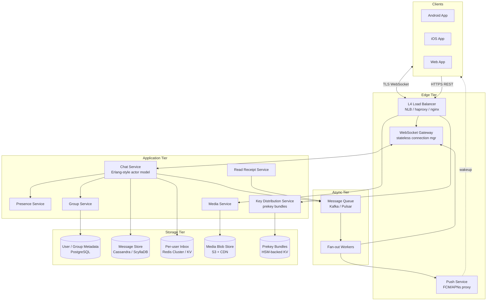
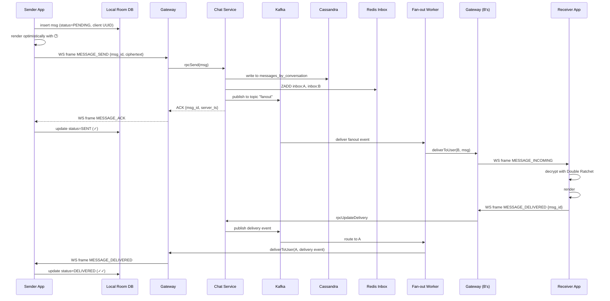
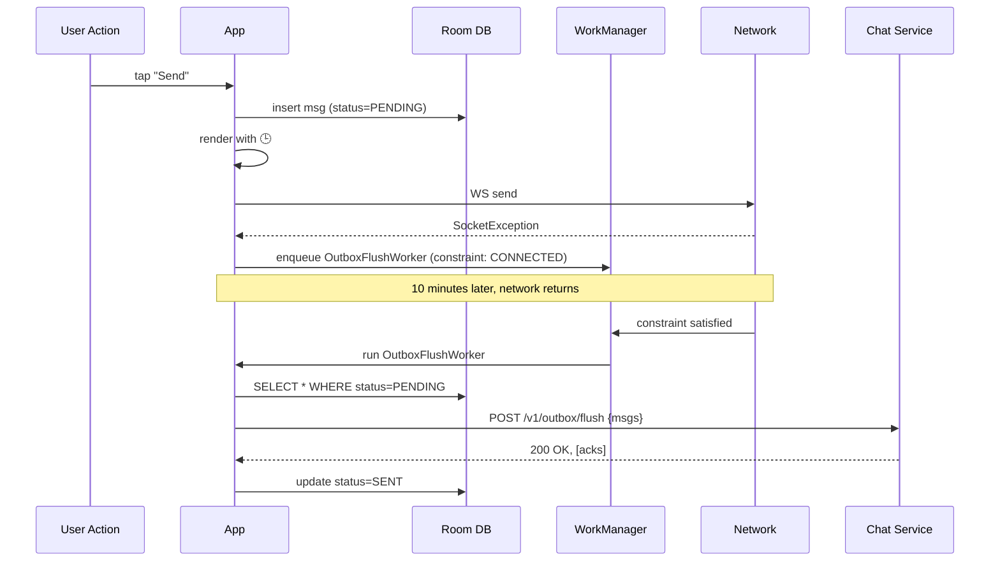
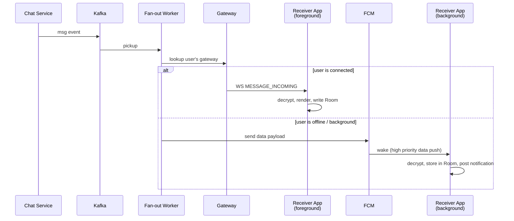
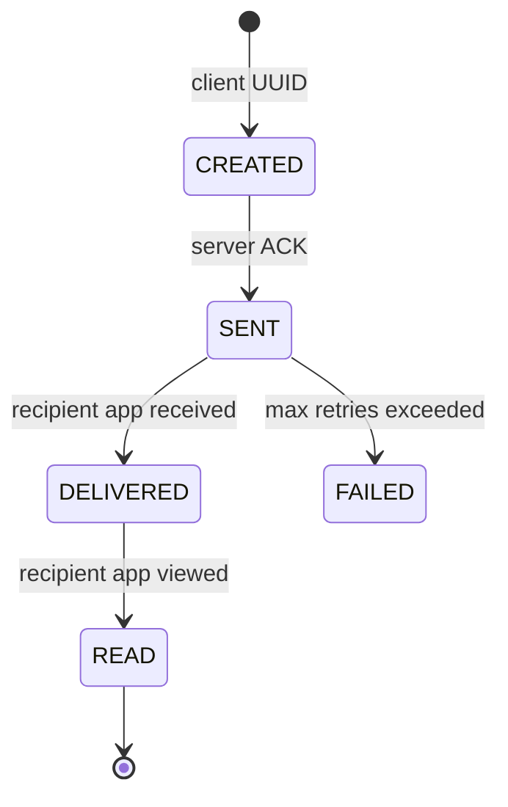
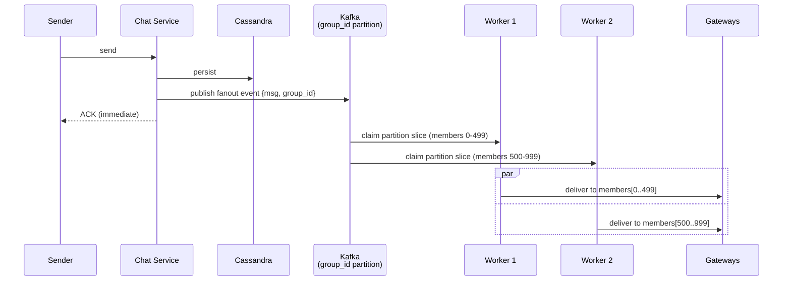
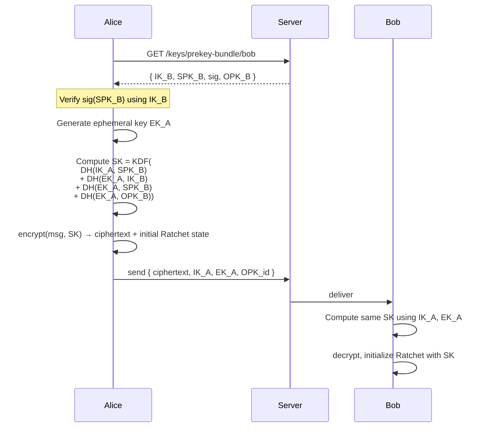
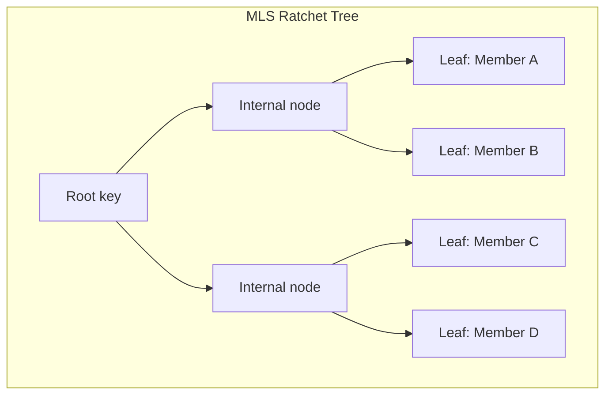
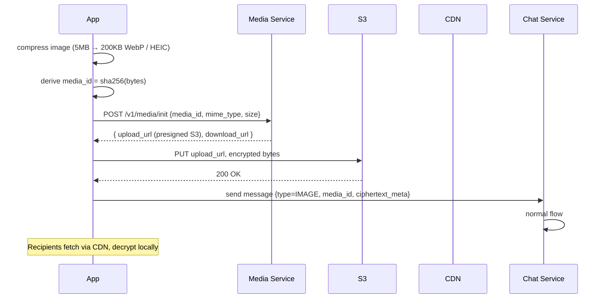

# Chat / Messaging System Design

> Interview-style deep dive on designing a chat platform (WhatsApp / Signal / Telegram / Messenger). Covers high-level architecture, low-level data flows, end-to-end encryption, group fan-out at scale, read receipts, multi-device sync, and the mobile-specific concerns that distinguish a real production chat system from a textbook example.

---

## 1. Problem Statement

Design a real-time chat application supporting:

- **1-on-1 messaging** (text, images, video, voice notes, files, location).
- **Group chats** ranging from 2 to ~1,000 members (WhatsApp's current limit; some platforms go to 100K+ with channels).
- **Delivery and read receipts** (single check, double check, blue check).
- **Presence** (online, typing, last seen).
- **Offline support** — queue messages without connectivity, deliver when network returns.
- **Multi-device** — a user has phone + tablet + web simultaneously.
- **End-to-end encryption (E2EE)** — even the server cannot read message content.
- **Notifications** when the app is in the background.
- **Reliability** — no lost messages; exactly-once delivery to user.

### Non-Functional Requirements

| Concern | Target | Why |
|---|---|---|
| Message delivery latency (online) | p99 < 200ms | UX threshold for "instant" |
| Message delivery (E2EE overhead) | +20ms p99 | Crypto budget |
| Availability | 99.95% | Industry baseline; 4hr/year downtime |
| Durability | 11 nines (eventually deleted) | No message lost during in-transit storage |
| Battery | < 2% per hour foreground active chat | Mobile-critical |
| Cold start to ready | < 1.5s | Conversation list usable |
| Group size | Up to 1,024 (configurable) | Architecture must scale |

### Scale Assumptions (Back-of-Envelope)

For a 1B user, 500M DAU service:

| Quantity | Estimate | Derivation |
|---|---|---|
| Messages per day | 100B | 200 msg/user/day avg |
| Messages per second (peak) | 2M | 100B / 86,400 × 1.7 peak factor |
| New media uploads per second | 200K | 10% of messages contain media |
| Concurrent WebSocket connections | 200M | ~40% of DAU connected at any moment |
| Storage growth | 50 TB/day (text) + 5 PB/day (media) | 500B compressed text + 5MB avg media |
| Bandwidth (egress, text channel) | 200 Gbps peak | 2M msg/s × 100KB envelope (rare) |

These numbers shape every architectural decision: you can't keep 200M sockets on one server, can't dump 100B rows/day in one DB, and can't fan out 1,000-member groups synchronously.

---

## 2. High-Level Architecture



### Why these tiers exist

**Edge tier (stateless):** the load balancer terminates TLS and routes raw connections. The Gateway holds the WebSocket on behalf of one user — it owns no business logic. Why split LB and Gateway? Because L4 balancers (NLB) can shed millions of connections cheaply but can't run application logic. The Gateway is the application-aware proxy that translates WebSocket frames to internal RPCs.

**Application tier (stateless wherever possible):** Chat Service handles message routing, ordering, persistence. Presence Service tracks online/typing. Group Service owns membership and broadcasts. Media Service handles uploads. Key Service distributes encryption keys.

**Async tier:** for any fan-out larger than ~50 recipients, synchronous loops in the request path don't scale. Push events into Kafka, let fan-out workers handle delivery asynchronously. This is where you absorb bursty load.

**Storage tier:** the message log is the heart. Cassandra/ScyllaDB chosen for write-throughput (LSM tree) and horizontal scaling. A small relational DB (Postgres) holds metadata that needs joins (users, groups). Redis/KV holds the per-user "inbox" for fast retrieval of recent messages. S3 + CDN for blobs.

---

## 3. Low-Level Component Design

### 3.1 WebSocket Gateway

```
Responsibilities
- Accept TLS WebSocket connections from clients
- Authenticate (via JWT in upgrade headers, or post-handshake auth message)
- Map user_id → connection (and maintain a connection registry)
- Forward inbound frames to Chat Service via internal RPC
- Forward outbound events (from message queue) to the right user's socket
- Heartbeat (PING/PONG every 30s) to detect dead connections
- Graceful drain on deploy (drain mode → reject new connections, finish in-flight)
```

A single Gateway instance handles ~50K-200K concurrent connections on modern hardware. Each connection is a tiny coroutine/fiber (Erlang process, Go goroutine, Java virtual thread). Memory per connection: ~16-32 KB.

To find which Gateway holds a given user's connection, two patterns:

1. **Consistent hashing on user_id** → all Gateways agree on routing. Used by Slack, Discord.
2. **Sticky session via routing table** (Redis cluster `user_id → gateway_instance_id`). Used by WhatsApp's Mnesia-backed approach.

Pattern 1 is simpler; pattern 2 supports better multi-device routing (user on phone + tablet → two entries).

### 3.2 Chat Service (the message router)

```
Responsibilities
- Validate sender (is the user authorized to send to this conversation?)
- Generate server message_id (or accept client UUID for idempotency)
- Persist to message store
- Determine recipients (1:1 = the other party; group = lookup membership)
- Enqueue fan-out work
- Update per-conversation last-message metadata
- Update read receipt state machine
```

WhatsApp's choice: Erlang. One Erlang process per connection, lightweight (microseconds to spawn, ~2KB memory). A single physical server holds 2-3 million connections. The actor model makes message-routing trivially safe: each conversation is itself an actor, mailbox-serialized, no locks.

A modern alternative: Go or Java virtual threads (Project Loom). Similar coroutine economics, broader hiring pool.

### 3.3 Message Store (Cassandra / ScyllaDB)

Schema (Cassandra):

```cql
CREATE TABLE messages_by_conversation (
    conversation_id UUID,
    bucket INT,                  -- time-based bucket: floor(timestamp / 1day)
    message_id TIMEUUID,         -- v1 UUID = sortable by time
    sender_id UUID,
    payload BLOB,                -- encrypted ciphertext
    msg_type TINYINT,            -- 0=text, 1=image, 2=video, 3=system
    server_timestamp BIGINT,
    PRIMARY KEY ((conversation_id, bucket), message_id)
) WITH CLUSTERING ORDER BY (message_id DESC);
```

The composite partition key `(conversation_id, bucket)` distributes load: hot conversations don't all land on one node, and time bucketing prevents partitions from growing unbounded.

Reading the last 50 messages in a conversation:

```cql
SELECT * FROM messages_by_conversation
WHERE conversation_id = ? AND bucket = ?
ORDER BY message_id DESC LIMIT 50;
```

Scrolling back fetches earlier buckets. With buckets sized at ~1 day, even very active conversations stay well under Cassandra's recommended 100MB per partition.

### 3.4 Per-user Inbox (Redis Cluster)

Reading from `messages_by_conversation` for every conversation a user has open is too many queries. The inbox is a per-user secondary index of "recent activity":

```
Redis key: inbox:{user_id}
Type: Sorted Set
Score: server_timestamp
Member: {conversation_id}:{message_id}

ZADD inbox:user-99 1719500000 "conv-7:msg-abc"

# Fetch 50 most recent conversation events
ZREVRANGE inbox:user-99 0 49
```

On reconnect, the client sends `since={last_seen_message_id}`, the inbox returns conversation_id + message_id pairs newer than that, and the client backfills from `messages_by_conversation`.

### 3.5 Group Service

```
group_metadata: { group_id, name, avatar_url, created_at, settings }
group_members:  { group_id, user_id, role (admin/member), joined_at }
```

For groups under ~200 members, membership fits in a single row/cache lookup. For larger groups, members are sharded by `(group_id, user_id_hash % 16)` so lookups parallelize across shards.

### 3.6 Presence Service

```
presence:{user_id} → { status: ONLINE|TYPING|OFFLINE, since: timestamp, last_seen: timestamp }
TTL: 60s (re-asserted by heartbeat)
```

Redis-backed. Reads are cheap. Updates are throttled (typing pings every 5s while typing, not per keystroke). For groups, "is anyone typing?" is a `MGET` of all member presence keys.

---

## 4. Wire Format & APIs

### 4.1 WebSocket envelope

The WebSocket frame carries a typed JSON envelope (Protobuf in production for size):

```json
{
  "v": 1,
  "type": "MESSAGE_SEND",
  "msg_id": "client-generated-uuid",
  "ts": 1719500000000,
  "body": { /* type-specific */ }
}
```

Common types:

| Type | Direction | Body |
|---|---|---|
| `AUTH` | C→S | `{ jwt }` |
| `MESSAGE_SEND` | C→S | `{ conversation_id, ciphertext, content_type, ratchet_index }` |
| `MESSAGE_ACK` | S→C | `{ msg_id, server_ts, status }` |
| `MESSAGE_DELIVERED` | S→C | `{ conversation_id, msg_id, recipient_id, ts }` |
| `MESSAGE_READ` | S→C | `{ conversation_id, msg_id, reader_id, ts }` |
| `MESSAGE_INCOMING` | S→C | `{ conversation_id, msg_id, sender_id, ciphertext, ts }` |
| `TYPING` | C→S, S→C | `{ conversation_id, user_id, is_typing }` |
| `PRESENCE` | S→C | `{ user_id, status, last_seen }` |
| `SYNC_REQUEST` | C→S | `{ since_msg_id }` |
| `SYNC_RESPONSE` | S→C | `{ messages: [...] }` |
| `PING` / `PONG` | both | `{}` |

Protobuf shrinks the typical envelope from ~250 bytes (JSON) to ~80 bytes (Protobuf), and parsing is 5-10x faster. For 2M msg/s, the bandwidth saving is significant.

### 4.2 REST endpoints

| Endpoint | Purpose |
|---|---|
| `POST /v1/media/upload` | Multipart upload, returns blob_id + temporary CDN URL |
| `GET /v1/keys/prekey-bundle/{user_id}` | Fetch identity key + signed prekey + one-time prekey for X3DH |
| `POST /v1/keys/upload-prekeys` | Client uploads new one-time prekey bundles |
| `GET /v1/conversations/{id}/history?before={msg_id}&limit=50` | Backfill old messages |
| `POST /v1/groups` / `PATCH /v1/groups/{id}/members` | Group management |
| `POST /v1/devices/register` | Register a new device under existing identity |
| `POST /v1/auth/login` | Phone/email + 2FA → JWT |

---

## 5. Core Flows

### 5.1 Sending a 1:1 message (happy path)



Key properties:

- **Client-generated msg_id (UUID)** — the message has an identity before the server sees it. Enables optimistic UI and idempotent retry.
- **Cassandra write before fan-out** — durability before delivery. If we fan out first and the server crashes before persisting, the message is lost.
- **Inbox update is async** — included in the same transactional path (or eventually-consistent via outbox). The inbox is a denormalized read-index.
- **Fan-out via MQ** — even for 1:1, going through the queue means a Chat Service crash doesn't lose the in-flight delivery; another worker picks it up.

### 5.2 Offline send (subway tunnel)



The outbox table:

```kotlin
@Entity(tableName = "outbox")
data class OutboxMessage(
    @PrimaryKey val msgId: String,         // client UUID
    val conversationId: String,
    val ciphertext: ByteArray,
    val createdAt: Long,
    val attemptCount: Int = 0,
    val nextAttemptAt: Long = 0
)
```

Backoff is exponential with jitter: `nextAttempt = now + 2^attempt * 1000ms + random(±500ms)`. After 100 attempts (~1 day), the message is marked permanently failed and the UI shows a retry button.

REST flush vs WebSocket reconnect:

- **WebSocket-only**: requires the socket to reconnect before flushing. Reconnect takes 2-10s depending on network. Many small sends each wait for the socket.
- **REST flush** (recommended): a single `POST /v1/outbox/flush` batches all pending messages into one HTTP request. Fast, simple, retryable.

### 5.3 Receiving a message (online & background)



**FCM data push details:**
- `priority: high` ensures wake under Doze (up to N pushes per day per app).
- Payload is the ciphertext + sender + msg_id (≤ 4KB FCM limit; larger messages send only a "you have a message" notice and the app fetches the body on wake).
- The push handler is a `BroadcastReceiver` → enqueues a `WorkManager` job for actual decryption + DB write to avoid blocking the FCM thread.

### 5.4 Read receipts state machine



State transitions are events on the message, persisted in Cassandra:

```cql
CREATE TABLE message_receipts (
    conversation_id UUID,
    message_id TIMEUUID,
    recipient_id UUID,
    delivered_at BIGINT,
    read_at BIGINT,
    PRIMARY KEY ((conversation_id, message_id), recipient_id)
);
```

For 1:1, "delivered" and "read" are atomic events.

For groups, the same row exists per recipient. "Delivered to 47 of 50" / "Read by 12 of 50" — UI sums the receipt rows. This is why group read receipts are sometimes hidden or aggregated: showing per-member status in a 200-member group spams the UI.

Privacy-aware read receipts: a per-user setting can suppress sending the `READ` event. The receiver still tracks locally; the sender just doesn't see the blue check.

### 5.5 Multi-device sync

A user has phone + tablet + web simultaneously. All must show the same conversation state.

Approach 1: **Server as source of truth** (Slack, Telegram).
- Every device opens its own WebSocket, identified by `device_id`.
- Server fans out every message to every device of the user.
- Each device confirms delivery.
- Read receipt: when the user reads on phone, phone sends `READ`, server fans out a `MESSAGE_READ` event to tablet and web so they too mark the message read.

Approach 2: **Primary device + companion** (WhatsApp's old model).
- Phone is the "owner" of the user's chat history.
- Other devices (web, desktop) pair with phone, sync via phone.
- Phone must be online for companions to work.

Modern WhatsApp uses a hybrid where each device has its own key but the server still distributes ciphertext. The Signal Protocol's per-device sessions handle this — each device has its own Double Ratchet state.

E2EE complication: the sender must encrypt the message N times, once per recipient device. A 4-device group of 5 members = 20 encryptions per send. This is why E2EE scales worse than plaintext for large groups (more on this in §7).

---

## 6. Group Messaging at Scale

### 6.1 Fan-out strategies by group size

| Group size | Strategy | Why |
|---|---|---|
| 2 | Direct routing | Trivially the recipient's gateway |
| 3-200 | Synchronous fan-out on send | Chat Service writes once, loops recipients, returns ACK |
| 200-1,000 | Async fan-out via MQ | Send returns immediately; workers fan out |
| 1,000-100K | Sharded fan-out workers | Partition members; multiple workers parallel-deliver |
| 100K+ | "Channels" — pull-based | Receiver pulls from a topic on demand |

### 6.2 Small-group fan-out (≤200 members)

```kotlin
// Pseudocode in Chat Service
fun handleGroupMessage(msg: Message) {
    persistToCassandra(msg)
    val members = groupService.members(msg.conversationId)  // cached
    for (m in members) {
        if (m.userId == msg.senderId) continue
        outbound.enqueue(deliverEvent(m.userId, msg))
        receiptDb.markPending(msg, m)
    }
    ack(msg.senderId, msg.id)
}
```

Direct loop. For 200 members and ~1ms per enqueue, ACK to sender within 200ms — within budget.

### 6.3 Large-group fan-out (≥1,000)



Worker partitioning: members are sharded into batches of ~500. Each worker handles one batch independently. With 10 workers, a 5,000-member group fans out in ~100ms instead of seconds.

### 6.4 Membership changes

Adding/removing a member is a privileged event:

```kotlin
data class GroupEvent(
    val eventType: GroupEventType,   // ADD_MEMBER, REMOVE_MEMBER, CHANGE_ADMIN, CHANGE_NAME
    val actor: UserId,
    val target: UserId?,
    val timestamp: Long
)
```

Events flow through the same message channel as text. Each member's app processes the event, updates local Room, re-renders. Encryption keys rotate on membership change (see §7.4) to prevent removed members from reading future messages.

---

## 7. End-to-End Encryption (Signal Protocol Deep Dive)

E2EE means **the server cannot read message contents**, even with full DB access. Signal Protocol (used by Signal, WhatsApp, Messenger, Google Messages RCS) achieves this with two components:

1. **X3DH (Extended Triple Diffie-Hellman)** — initial key agreement when two parties first message.
2. **Double Ratchet** — forward-secret encryption for ongoing conversation.

### 7.1 X3DH: starting a conversation

Each user uploads a **prekey bundle** to the server when registering:

```
Identity Key (IK):              long-lived; ed25519 signing key, x25519 derive key
Signed Prekey (SPK):            rotated every few weeks; signed by IK
Signed Prekey Signature:        proof SPK comes from IK's owner
One-Time Prekeys (OPK):         batches of ~100; consumed once each
```

When Alice wants to start a chat with Bob:



The four Diffie-Hellman computations bind: Alice's identity, Bob's identity, Alice's ephemeral, Bob's signed prekey, and Bob's one-time prekey. The result is a 256-bit shared secret known only to Alice and Bob. The OPK (one-time) provides **forward secrecy for the first message** — even if Bob's IK is later compromised, that one message is safe.

### 7.2 Double Ratchet: ongoing messages

After X3DH, both parties share a 256-bit root key. The Double Ratchet derives per-message keys with two combined mechanisms:

**Symmetric ratchet (per message):** each message advances a chain key via HKDF. The message key is derived from the chain key. Used → discarded.

```
chain_key_n = HKDF(chain_key_{n-1}, "Constant")
message_key_n = HKDF(chain_key_n, "MessageKey")
```

This gives **forward secrecy**: stealing the current state can't decrypt past messages.

**DH ratchet (per session round-trip):** each time the conversation direction changes, a new DH key pair is generated and exchanged. The root key advances by `KDF(old_root, DH(new_pair))`.

```
root_key_new = HKDF(root_key_old, DH(my_new_dh_priv, their_new_dh_pub))
```

This gives **post-compromise security** ("future secrecy"): if the state leaks at time T, a single round-trip exchange re-secures the conversation by T+1.

```mermaid
sequenceDiagram
    participant A as Alice
    participant B as Bob

    Note over A,B: After X3DH; root_key = SK
    A->>A: gen DH_A1
    A->>B: msg1 {ciphertext, DH_A1_pub}
    B->>B: root_key = KDF(root_key, DH(DH_B_init, DH_A1_pub))
    B->>B: decrypt with first chain_key from new root
    B->>B: gen DH_B1
    B->>A: msg2 {ciphertext, DH_B1_pub}
    A->>A: root_key = KDF(root_key, DH(DH_A1_priv, DH_B1_pub))
    Note over A,B: Each direction-change rotates root key
```

The actual implementation has more — handling out-of-order messages, retaining a small window of past keys, etc. — but this is the core.

### 7.3 Android implementation outline

```kotlin
// Using libsignal (org.signal:libsignal-client)

class SignalSession(
    private val store: SignalProtocolStore,    // wraps Room + Keystore
    private val recipientAddress: SignalProtocolAddress
) {
    suspend fun encrypt(plaintext: ByteArray): CiphertextMessage = withContext(Dispatchers.Default) {
        val cipher = SessionCipher(store, recipientAddress)
        cipher.encrypt(plaintext)
    }

    suspend fun decrypt(ciphertext: CiphertextMessage): ByteArray = withContext(Dispatchers.Default) {
        val cipher = SessionCipher(store, recipientAddress)
        when (ciphertext.type) {
            CiphertextMessage.PREKEY_TYPE -> cipher.decrypt(ciphertext as PreKeySignalMessage)
            CiphertextMessage.WHISPER_TYPE -> cipher.decrypt(ciphertext as SignalMessage)
            else -> error("Unknown ciphertext type")
        }
    }
}
```

The `SignalProtocolStore` persists:
- Identity key pair (in Android Keystore, hardware-backed where available)
- Signed prekey rotations
- One-time prekeys (consumed on use)
- Per-session state (Double Ratchet root key, sending/receiving chain keys, DH pairs)
- Identity verification fingerprints for known peers

Storage layout:

```kotlin
@Entity(tableName = "signal_sessions")
data class SignalSessionRow(
    @PrimaryKey val addressAndDevice: String,  // "+15551234567:1"
    val sessionStructure: ByteArray             // Protobuf-encoded Double Ratchet state
)
```

The Double Ratchet state is opaque to the app; libsignal manages it.

### 7.4 Group encryption: Sender Keys vs MLS

**The naïve approach**: encrypt the message N times (once per recipient using their pairwise Double Ratchet). This is what's used for small groups. For 1,000 members, this is 1,000 encryptions per send — expensive.

**Sender Keys (WhatsApp's old approach):**
- Each sender generates a per-group sender key.
- Distributes it via the pairwise Double Ratchet to each member (still N pairwise messages, but only on first message).
- Subsequent group messages: encrypt once with the sender key, broadcast to all.
- Membership changes: rotate sender key.

**MLS (Messaging Layer Security, IETF RFC 9420, 2023):**
- Tree-based key agreement, similar to TreeKEM.
- Adding/removing a member updates O(log N) nodes in the tree instead of O(N).
- One ciphertext per message regardless of group size.
- Forward secrecy and post-compromise security maintained across the group.
- Now standardized; Signal, Wire, and others have adopted or are adopting it.



A member can derive the root key from its leaf + the public path to root. Updating one leaf changes only the path's keys — log(N) operations.

For a Staff-level chat design, MLS is the future-facing default for new builds. WhatsApp's existing Sender Keys are entrenched and remain correct.

### 7.5 Identity verification (safety numbers)

After X3DH, both Alice and Bob can compute a deterministic 60-digit "safety number" from `IK_A || IK_B`. Comparing it (in-person or via screenshot over another channel) confirms there was no MITM at session start. The UI prompts users to verify; once verified, the contact gets a checkmark.

If either user's identity key changes (reinstall, new device without backup), the session resets — and the UI surfaces a security warning ("Bob's safety number changed").

---

## 8. Connection Management & Mobile Constraints

### 8.1 Foreground WebSocket lifecycle

```kotlin
class ChatSocket(
    private val tokenProvider: TokenProvider,
    private val scope: CoroutineScope
) {
    private var socket: WebSocket? = null
    private val reconnectBackoff = ExponentialBackoff(initial = 1.seconds, max = 30.seconds, jitter = 0.5)

    fun connect() {
        val request = Request.Builder()
            .url("wss://chat.example.com/v1/socket")
            .header("Authorization", "Bearer ${tokenProvider.current()}")
            .build()
        socket = client.newWebSocket(request, object : WebSocketListener() {
            override fun onOpen(ws: WebSocket, resp: Response) {
                reconnectBackoff.reset()
                send(buildAuthMessage())
                startHeartbeat()
                drainOutbox()
                sendSyncRequest()
            }
            override fun onMessage(ws: WebSocket, text: String) {
                handleFrame(text)
            }
            override fun onClosed(ws: WebSocket, code: Int, reason: String) {
                scheduleReconnect()
            }
            override fun onFailure(ws: WebSocket, t: Throwable, resp: Response?) {
                scheduleReconnect()
            }
        })
    }

    private fun scheduleReconnect() {
        scope.launch {
            delay(reconnectBackoff.next())
            connect()
        }
    }

    private fun startHeartbeat() {
        scope.launch {
            while (isActive) {
                delay(30.seconds)
                socket?.send("""{"type":"PING"}""")
            }
        }
    }
}
```

Reconnect with exponential backoff + jitter is critical: when a load balancer fails and 1M clients disconnect, naïve "reconnect immediately" creates a thundering herd that prevents the LB from recovering. Jitter spreads attempts across a window.

### 8.2 Background — FCM data pushes

When the user backgrounds the app:

1. `onStop()` → after a brief grace period (~30s in case they come back), disconnect the WebSocket.
2. Server marks the user offline; future messages route via FCM.
3. New message → server builds FCM data payload `{ msg_id, sender, ciphertext, msg_type }` → FCM delivers to device.
4. App's `FirebaseMessagingService` receives the payload, hands it to a `WorkManager` job.
5. Job decrypts (Double Ratchet state available in Keystore-protected Room), writes to local DB, posts a notification.

FCM data pushes with `priority: high` bypass Doze mode. There are quotas (Android 9+: ~20-50 high-priority pushes per app per day, more if user engages with notifications). Strategy: every message is a data push, but the *content* is the ciphertext; if the message is too large for FCM's 4KB limit, push a "you have a message" notice and the app fetches the body on wake.

### 8.3 Connection multiplexing for multi-device

A user with phone + tablet + web means three sockets per user. The server's connection registry:

```
sockets:{user_id} → set { device_id → gateway_instance }

User_99:
  device_iphone_a1b2c3 → gw-7
  device_ipad_d4e5f6  → gw-12
  device_web_browser  → gw-3
```

Outgoing fan-out iterates this set. A message to user_99 fans out to all three. Each device has its own E2EE session, so each receives its own ciphertext.

### 8.4 Network classification & adaptive behavior

On the client:

```kotlin
when (networkType) {
    WIFI -> {
        wsHeartbeat = 30.seconds
        mediaQuality = ORIGINAL
        preconnect = true
    }
    CELLULAR_4G_OR_BETTER -> {
        wsHeartbeat = 45.seconds       // longer to save battery
        mediaQuality = HIGH
    }
    CELLULAR_3G_OR_WORSE -> {
        wsHeartbeat = 60.seconds
        mediaQuality = LOW
        useRestFallback = true          // WebSocket may be unstable
    }
    NONE -> {
        disconnect = true
        outboxOnly = true
    }
}
```

---

## 9. Media (Images, Video, Voice Notes)

### 9.1 Upload flow



### 9.2 E2EE for media

Plain media URLs would leak. Instead:

1. Client generates a random 256-bit key `K`.
2. Encrypts media bytes with `AES-GCM(K)`.
3. Uploads encrypted bytes to S3 — server only sees ciphertext.
4. Sends `K` (along with `media_id`, mime, dimensions) inside the chat message ciphertext — so only recipients see it.
5. Recipient downloads from CDN, decrypts with `K`.

Server-side: never sees plaintext media. CDN caches encrypted bytes; cache hits across users without leakage.

### 9.3 Adaptive media

- **Thumbnail** (small, blurhash placeholder) embedded directly in message — visible immediately.
- **Full media** downloaded on tap (or auto on Wi-Fi).
- **Voice notes**: encoded as Opus at ~32 kbps; a 10s note is ~40 KB.
- **Video**: HLS-style chunked streaming via signed CDN URLs; entire file rarely downloaded.

---

## 10. Failure Modes & Bottlenecks

### 10.1 Thundering herd reconnect

**Scenario:** A Gateway crashes; 100K sockets simultaneously try to reconnect.

**Defense:**
- Client backoff with jitter (described above).
- Server: rate-limit per source IP at LB.
- Server: queue overflow → return 503 Retry-After.
- Capacity: provision Gateway pool with N+2 redundancy so any single crash absorbed by neighbors.

### 10.2 Hot conversation (celebrity / public chat)

**Scenario:** A 1,000-member group where one person posts and thousands read.

**Defense:**
- Cassandra partition key includes time bucket so hot conversation distributes across days.
- Use of `(conversation_id, bucket)` partition key avoids hotspot.
- Read amplification: cache recent N messages in Redis with TTL.
- Group fan-out: parallel workers as in §6.3.

### 10.3 Message ordering across multiple senders in a group

**Problem:** Alice and Bob both send to the same group simultaneously. Different fan-out workers handle them. Members receive in different orders.

**Defense:**
- Server assigns monotonically increasing message IDs per conversation (Snowflake-style or Cassandra TIMEUUID).
- Clients display sorted by server message ID, not client timestamp.
- A late-arriving message is inserted in its correct position, not appended.

### 10.4 Out-of-order in Double Ratchet

**Problem:** Alice sends msg 5, 6, 7. Bob receives 7, 5, 6 due to network reorder. Double Ratchet's chain key advances per message — msg 7 expects to be msg 5's successor.

**Defense:** libsignal retains a skipped-message-keys cache (~1,000 entries). Each message header includes its chain index; out-of-order arrivals look up the right key.

### 10.5 Lost message — exactly-once delivery

**Truth:** TCP, Kafka, and the app layer are not exactly-once. They're at-least-once or at-most-once. We achieve exactly-once *to user* via:

- Client UUID idempotency at send side.
- Server-side `INSERT IF NOT EXISTS` keyed on `(conversation_id, message_id)`.
- Client-side dedup on receive (Room's PK is `message_id`; second insert is a no-op).

### 10.6 Battery drain

**Defense:**
- Disconnect WebSocket on background.
- Batch FCM-triggered DB writes.
- Throttle typing indicators (max 1 update per 5s while typing).
- Coalesce read receipts (send "read up to msg_id X" instead of N individual events).

### 10.7 Encryption key rotation lag

**Problem:** Bob hasn't connected in 30 days. His signed prekey expired. New messages from Alice can't initialize a session.

**Defense:**
- Server returns SPK + cached OPK; Alice uses old SPK as long as the bundle exists.
- Bob's reconnect uploads new SPK and OPKs immediately.
- Acceptable security: SPK rotation is *added* security; using an older SPK temporarily is OK as long as identity key hasn't changed.

---

## 11. Storage & Retention

### 11.1 Server-side retention policy

- **Undelivered messages**: stored until delivered or TTL (~30 days) expires.
- **Delivered messages**: optional retention. Pure E2EE platforms (Signal) often delete server-side immediately after delivery. WhatsApp keeps server backup until all devices ACK delivery.
- **Read messages**: client-side only (server has done its job).
- **Media blobs**: TTL ~30 days unencrypted access; encrypted blobs may persist longer for backup.

### 11.2 Client-side storage

```kotlin
@Entity(tableName = "messages",
    indices = [Index("conversationId"), Index("timestamp")])
data class Message(
    @PrimaryKey val id: String,
    val conversationId: String,
    val senderId: String,
    val plaintext: String?,        // decrypted, in-memory or in Keystore-encrypted Room
    val mediaRef: String?,
    val timestamp: Long,
    val sendStatus: SendStatus,
    val deliveryStatus: DeliveryStatus,
    val readStatus: ReadStatus,
    val replyToId: String? = null,
    val edited: Boolean = false
)
```

For privacy: Room database is encrypted via SQLCipher (key in Android Keystore). Even with root, the DB file is opaque.

Storage budget: 1KB per message × 100K messages = 100MB. Acceptable.

Pruning: optional, user-driven ("Clear conversation history older than 6 months").

---

## 12. Mobile-Specific Concerns

| Concern | Strategy |
|---|---|
| Cold start time | Open WebSocket lazily after UI renders; show cached conversations immediately from Room. |
| Notification reliability | High-priority FCM; fallback to silent sync on app open. |
| Doze mode | Use FCM not WorkManager for time-sensitive arrival. |
| Multi-device key sync | Out-of-band QR code for pairing; device-specific Signal session. |
| Backup & restore | Encrypted backup to Google Drive / iCloud with user-provided passphrase; never the server. |
| Offline-first UX | Optimistic UI (status=PENDING); read from Room not from network. |
| Audio call interop | WebRTC for media; signaling over chat WebSocket. |
| Network changes (WiFi → cellular) | Detect via ConnectivityManager; reconnect WebSocket on new network. |
| Battery analytics | Track WebSocket uptime, FCM delivery vs WebSocket delivery, msg/min/W. |

---

## 13. Tradeoffs

**WebSocket vs HTTP polling vs SSE**

| Transport | Pros | Cons |
|---|---|---|
| WebSocket | Bidirectional, low latency, persistent | Battery cost, NAT timeouts, complex reconnect |
| SSE | Simpler, HTTP-native, auto-reconnect | One-way, no send channel |
| HTTP polling | Trivial, survives any network | 30s+ latency, battery via radio wake |
| FCM/APNs | Background works, OS-managed | Vendor lock, payload size limits, not for high frequency |

Production answer: WebSocket foreground + FCM background.

**Fan-out on write vs read**

| Strategy | Best for | Trade |
|---|---|---|
| Write fan-out | Small groups, latency-critical | Write amplification |
| Read fan-out (pull) | Large channels (10K+) | Higher read load, possibly stale |
| Hybrid | Most production systems | Operational complexity |

**E2EE vs server-readable**

| Model | Pros | Cons |
|---|---|---|
| E2EE (Signal/WhatsApp) | Privacy, regulatory, brand | No server-side search, harder spam filtering, complex multi-device, no message-content analytics |
| Server-readable (Slack, Teams) | Search, retention, compliance, spam ML | Less private; subject to lawful access |

**Per-message vs sender-key E2EE for groups**

| Scheme | Pros | Cons |
|---|---|---|
| Per-recipient | Simple, no group state | O(N) encryption per send |
| Sender Keys | O(1) per send | Pairwise distribution still O(N) on first send / membership change |
| MLS | O(log N) for everything | New standard, fewer libraries |

---

## 14. Probing Questions

1. Walk through the X3DH handshake. What does each Diffie-Hellman computation prove, and what would break if you omitted the one-time prekey?
2. Explain forward secrecy vs post-compromise security in Double Ratchet. Which mechanism provides each?
3. A user sends a message from their phone and reads it on tablet. Trace the events showing how the tablet learns the message was read.
4. Cassandra partition keys for chat messages. Why `(conversation_id, bucket)` instead of just `conversation_id`?
5. WebSocket disconnects in background. Why does the server keep the user "online" in presence for ~30s after the disconnect?
6. A 5,000-member group fan-out. Walk through how you partition the work and the expected latency.
7. Idempotency keys prevent dup messages. Walk through the bug if the server-side dedup uses only client-side timestamp instead of UUID.
8. WhatsApp's old Sender Keys vs MLS. What's the asymptotic improvement and how does it work?
9. Read receipts have a privacy toggle. Walk through how the system enforces it both client-side and server-side without leaking timing info.
10. A typing indicator at 100 keystrokes per minute. How do you throttle without making it feel laggy?
11. Cold start time budget is 1.5s. What loads from disk, what loads from network, what loads after first paint?
12. Server learns Alice's identity key from her client. What attack does the safety-number verification prevent that an unverified user is vulnerable to?
13. Media is uploaded encrypted. How does the recipient know which key to use to decrypt?
14. Out-of-order Double Ratchet messages: Bob receives msg 7 before msg 5. How does libsignal recover, and what's the limit?
15. Group membership changes — adding a new user. Walk through what happens in plaintext vs E2EE.
16. Battery cost of holding a WebSocket alive in foreground. Compute approximate radio-on time per hour for heartbeat-only.
17. Multi-device backup. The user reinstalls. How do they recover history without breaking E2EE?
18. Spam at scale. Without server-side message reading, how do you fight spam?
19. Compliance & lawful intercept. What can a court compel from an E2EE provider?
20. Voice / video calling adds signaling. Where does the signaling go, and how is media encrypted differently?

---

## 15. Further Reading

In this repository:

- [`offline-sync.md`](offline-sync.md) — the offline-first storage pattern.
- [`push-notifications.md`](push-notifications.md) — FCM/APNs deep dive.
- [`../backend-for-mobile/push-vs-poll-vs-sse-vs-websockets.md`](../backend-for-mobile/push-vs-poll-vs-sse-vs-websockets.md) — transport comparison.
- [`../distributed-systems/idempotency.md`](../distributed-systems/idempotency.md) — exactly-once via client UUIDs.
- [`../distributed-systems/delivery-semantics.md`](../distributed-systems/delivery-semantics.md) — at-least-once and exactly-once.
- [`../distributed-systems/consensus-basics.md`](../distributed-systems/consensus-basics.md) — quorum for ordered delivery.
- [`../adr/008-lww-vs-crdt.md`](../adr/008-lww-vs-crdt.md) — conflict resolution choices.
- [`../android/concurrency/workmanager.md`](../android/concurrency/workmanager.md) — outbox queue mechanics.
- [`../android/networking-and-security/security-and-keystore.md`](../android/networking-and-security/security-and-keystore.md) — Keystore-backed identity storage.

External:

- *The Signal Protocol*, [signal.org/docs](https://signal.org/docs/) — canonical X3DH and Double Ratchet specifications.
- Trevor Perrin & Moxie Marlinspike, *"The X3DH Key Agreement Protocol"* — original spec.
- Trevor Perrin & Moxie Marlinspike, *"The Double Ratchet Algorithm"* — original spec.
- IETF RFC 9420, *"The Messaging Layer Security (MLS) Protocol"* (2023).
- [WhatsApp Engineering blog](https://engineering.fb.com/category/whatsapp/) — public deep dives on scale.
- Rick Reed (WhatsApp), *"That's Not My Bug"* (Erlang Factory 2013) — original scaling story.
- *Designing Data-Intensive Applications* by Martin Kleppmann — distributed messaging fundamentals.
- *High Performance Browser Networking* by Ilya Grigorik, Chapter 17 — WebSocket performance.
- [libsignal-client GitHub](https://github.com/signalapp/libsignal) — production Signal Protocol implementation used by Signal, WhatsApp, etc.

---

Sources I drew on for current best practices:

- [Inside the Signal Protocol's Security Architecture](https://profincognito.me/blog/security/signal-security-architecture/) — Double Ratchet, X3DH, and the 2024-2025 evolution including SPQR (post-quantum).
- [How WhatsApp Works — Architecture Deep Dive on 100 Billion Messages](https://getstream.io/blog/whatsapp-works/) — Erlang, Ejabberd, Mnesia scaling story.
- [WhatsApp's Architecture: A Deep Dive Into Its Distributed Messaging System](https://undercodetesting.com/whatsapps-architecture-a-deep-dive-into-its-distributed-messaging-system/) — group fan-out and parallel delivery.
- [Group Chat Architecture: Fan-out & Message Routing](https://wittycoder.in/courses/chat-system/group-chat) — size-based fan-out strategies and tradeoffs.
- [Design a Chat System — Complete Walkthrough](https://www.codelit.io/blog/design-a-chat-system) — production patterns for delivery, presence, and consistency.
- [IETF RFC 9420 — Messaging Layer Security](https://datatracker.ietf.org/doc/html/rfc9420) — modern group E2EE standard replacing Sender Keys.
