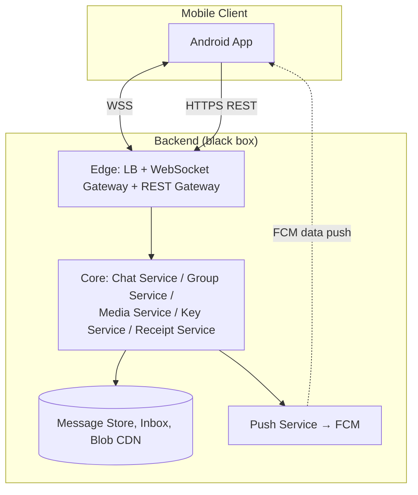
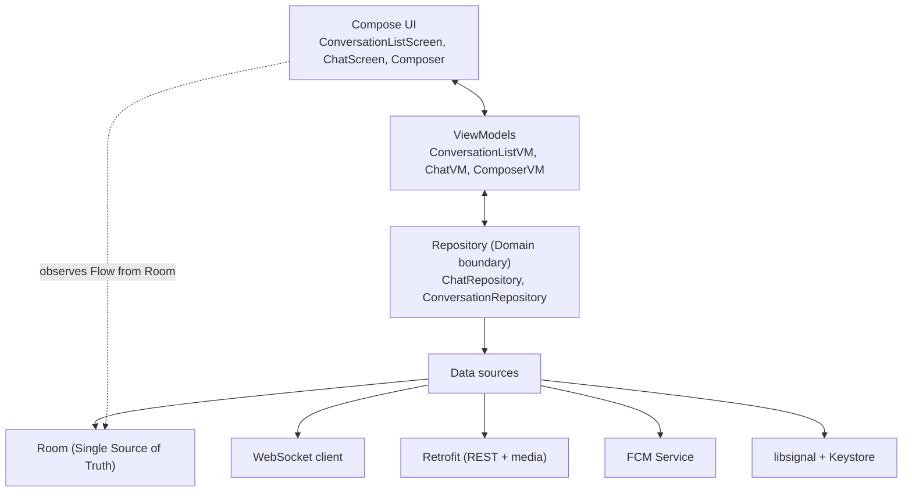
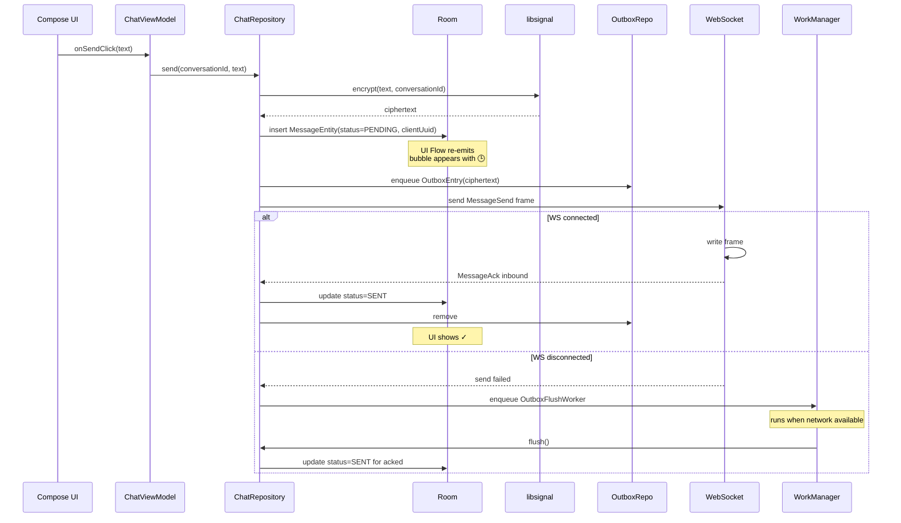

# Chat / Messaging System Design

> Interview-style deep dive on designing a chat client for an Android engineer (WhatsApp / Signal / Telegram / Messenger from the device side). The backend is treated as a black-box contract — one HLD diagram, one paragraph, the wire format, and the idempotency mechanism are enough. The rest of the file is **how you build the Android app**: layered architecture, Room as single source of truth, Compose UI, ViewModels with SavedStateHandle, WebSocket lifecycle, FCM data pushes, WorkManager for the outbox, MessagingStyle notifications, E2EE integration via libsignal, media handling, battery, process death, and the failure modes you actually debug as a mobile developer.

---

## 1. Problem Statement

Design the **Android client** for a chat platform supporting:

- 1-on-1 and group conversations (up to ~1,024 members per group).
- Text, images, video, voice notes, file attachments, location.
- Delivery and read receipts; presence (online, typing, last seen).
- Offline send + receive — queue while disconnected; deliver and sync when network returns.
- Multi-device per user (phone + tablet + web run independently).
- End-to-end encryption — the server cannot read message bodies.
- Notifications when the app is backgrounded or killed.
- Process death recovery — kill the app and the user finds everything intact.

### Non-Functional Requirements (mobile-facing)

| Concern | Target | Why it shapes client design |
|---|---|---|
| Cold start to chat list visible | < 1.5s | Read from Room first; backend fetch in parallel |
| Time to first message in a conversation | < 200ms | Conversation history lives in Room; sync is incremental |
| Send-to-ack p95 (online) | < 500ms | WebSocket open in foreground; HTTP fallback for outbox |
| Message delivery latency (online) | < 200ms | WebSocket inbound; FCM only when killed |
| Battery foreground (active chat) | < 2%/hr | Heartbeat every 30-45s; conflate UI updates |
| Battery background | negligible | Disconnect WebSocket; rely on FCM data pushes |
| Storage budget | < 250MB for typical user | Prune old media; keep text indefinitely |
| Offline correctness | No data loss; no duplicates | Client UUID per message; Room is SSOT |

### Scale Assumptions (as inputs to client decisions)

For a 500M-DAU app, the client-side implications:

| Backend scale | Client implication |
|---|---|
| 100B messages/day fan out to recipients | Server pushes; client never polls. WebSocket + FCM. |
| Avg user reads ~50 messages/day | Local DB queries dominate; ~95% of UI reads never touch network. |
| Avg media uploaded ~3/day | Pre-signed S3 uploads; client compresses before send. |
| ~5% messages cause delivery/read receipts | Bulk-coalesce read receipts before sending (1 ack per 10-20 messages). |
| Avg group size 12, P99 ~150 | Receipt-row count is bounded; UI shows aggregate "12 read" not per-member. |

The backend handles scale. The client's job is to behave correctly under varying network and lifecycle conditions.

---

## 2. High-Level Architecture (One Diagram, One Paragraph)



**What the backend does (this is all an Android engineer needs to know):** the **Edge tier** terminates TLS WebSockets and REST requests. The **Core services** route messages, manage groups, mediate media uploads via pre-signed URLs, distribute prekey bundles for E2EE, and track delivery/read receipts. The **Push Service** delivers FCM data pushes when the app isn't connected. The **storage tier** persists messages, per-user inboxes, and media blobs. For the rest of this file, treat the backend as a contract: it accepts our requests, it pushes us events, it tells us idempotency conflicts. How it's sharded internally doesn't matter to the client.

---

## 3. API Contract / Wire Format

The client integrates against a small contract — one persistent WebSocket and a handful of REST endpoints.

### 3.1 WebSocket envelope

All real-time traffic is a typed envelope, JSON for readability but ideally Protobuf in production:

```kotlin
@Serializable
sealed class WsFrame {
    abstract val v: Int
    abstract val ts: Long

    @Serializable @SerialName("AUTH")
    data class Auth(val jwt: String, override val v: Int = 1, override val ts: Long) : WsFrame()

    @Serializable @SerialName("MESSAGE_SEND")
    data class MessageSend(
        val msgId: String,                // client UUID — idempotency key
        val conversationId: String,
        val ciphertext: String,           // base64
        val mediaRef: String? = null,
        override val v: Int = 1,
        override val ts: Long
    ) : WsFrame()

    @Serializable @SerialName("MESSAGE_ACK")
    data class MessageAck(val msgId: String, val serverTs: Long, val status: String,
                          override val v: Int = 1, override val ts: Long) : WsFrame()

    @Serializable @SerialName("MESSAGE_INCOMING")
    data class MessageIncoming(val msgId: String, val conversationId: String, val senderId: String,
                               val ciphertext: String, val serverTs: Long,
                               override val v: Int = 1, override val ts: Long) : WsFrame()

    @Serializable @SerialName("MESSAGE_DELIVERED")
    data class MessageDelivered(val msgId: String, val conversationId: String, val recipientId: String,
                                override val v: Int = 1, override val ts: Long) : WsFrame()

    @Serializable @SerialName("MESSAGE_READ")
    data class MessageRead(val msgIds: List<String>, val conversationId: String, val readerId: String,
                           override val v: Int = 1, override val ts: Long) : WsFrame()

    @Serializable @SerialName("TYPING")
    data class Typing(val conversationId: String, val userId: String, val isTyping: Boolean,
                      override val v: Int = 1, override val ts: Long) : WsFrame()

    @Serializable @SerialName("PRESENCE")
    data class Presence(val userId: String, val status: String, val lastSeen: Long,
                        override val v: Int = 1, override val ts: Long) : WsFrame()

    @Serializable @SerialName("SYNC_REQUEST")
    data class SyncRequest(val sinceServerTs: Long, override val v: Int = 1, override val ts: Long) : WsFrame()

    @Serializable @SerialName("SYNC_RESPONSE")
    data class SyncResponse(val messages: List<MessageIncoming>, val newCursor: Long,
                            override val v: Int = 1, override val ts: Long) : WsFrame()

    @Serializable @SerialName("PING") data class Ping(override val v: Int = 1, override val ts: Long) : WsFrame()
    @Serializable @SerialName("PONG") data class Pong(override val v: Int = 1, override val ts: Long) : WsFrame()
}
```

### 3.2 REST endpoints

| Endpoint | Purpose |
|---|---|
| `POST /v1/auth/login` | Phone/email + 2FA → JWT (refresh token mechanism in [`authentication.md`](authentication.md)) |
| `POST /v1/media/init` | Get pre-signed S3 upload URL + media_id |
| `GET /v1/conversations` | Initial conversation list (used on first install) |
| `GET /v1/conversations/{id}/history?before={msgId}&limit=50` | Backfill older messages (Paging 3 calls this) |
| `POST /v1/outbox/flush` | Batch upload pending messages (WebSocket alternative on reconnect) |
| `GET /v1/keys/prekey-bundle/{userId}` | Fetch peer's prekey for libsignal X3DH |
| `POST /v1/keys/upload-prekeys` | Replenish our one-time prekeys |
| `POST /v1/devices/register` | New device pairing |

### 3.3 Idempotency

Every message carries a **client-generated UUID** (`msgId`). The server treats it as the idempotency key:

- First time seen → process and ACK.
- Subsequent times → return cached ACK; do not re-process.

This is the foundation that makes retries safe — duplicated network attempts cannot deliver the message twice to recipients.

---

## 4. Mobile App Architecture

### 4.1 Module structure (multi-module Gradle)

```text
:app                              // Application class, navigation, DI graph
:feature:chat                     // ConversationList, ChatScreen, Composer; Compose UI + ViewModels
:feature:settings                 // unrelated, here for context
:core:designsystem                // theme, typography, atoms
:core:ui                          // shared Composables
:core:data                        // ChatRepository, OutboxRepository, KeyRepository
:core:database                    // Room: entities, DAOs, AppDatabase, migrations
:core:network                     // Retrofit interfaces, WebSocket client, JSON config
:core:notification                // FCM service, MessagingStyle builders
:core:media                       // Image/video/voice helpers
:core:crypto                      // libsignal wrappers, Keystore identity
```

Feature modules depend only on `:core:*`. Reverse direction is forbidden — enforced via Konsist or ArchUnit (see [`../principles/locality-of-reference.md`](../principles/locality-of-reference.md)).

### 4.2 Layered architecture inside :feature:chat



**Key rule**: the UI reads from Room via Flow. It never reads directly from the network. Networking writes into Room; Room re-emits; UI recomposes. This makes offline-first work automatically — when the network is absent, the UI keeps showing cached data; when it returns, Room updates and the UI smoothly refreshes.

---

## 5. Local Storage — Room (Single Source of Truth)

### 5.1 Schema

```kotlin
@Entity(tableName = "conversations",
    indices = [Index("lastMessageAt")])
data class ConversationEntity(
    @PrimaryKey val id: String,
    val title: String?,                          // null for 1:1; group name otherwise
    val type: String,                            // "DIRECT" | "GROUP"
    val avatarRef: String?,
    val lastMessagePreview: String?,
    val lastMessageAt: Long,
    val unreadCount: Int,
    val isMuted: Boolean,
    val draftText: String?,                      // composer draft survives kill
    val syncCursor: Long                          // last serverTs we've synced
)

@Entity(tableName = "messages",
    indices = [Index("conversationId", "serverTs"), Index("status")],
    foreignKeys = [ForeignKey(entity = ConversationEntity::class,
        parentColumns = ["id"], childColumns = ["conversationId"],
        onDelete = ForeignKey.CASCADE)])
data class MessageEntity(
    @PrimaryKey val id: String,                  // client UUID (also idempotency key)
    val conversationId: String,
    val senderId: String,
    val plaintext: String?,                      // decrypted body; null if not yet decrypted
    val mediaRef: String?,
    val type: String,                            // "TEXT" | "IMAGE" | "VIDEO" | "VOICE" | "FILE" | "SYSTEM"
    val replyToId: String? = null,
    val status: String,                          // "PENDING" | "SENDING" | "SENT" | "DELIVERED" | "READ" | "FAILED"
    val createdAt: Long,                         // client-side wall clock at compose
    val serverTs: Long? = null,                  // server-assigned monotonic order
    val edited: Boolean = false
)

@Entity(tableName = "outbox",
    indices = [Index("state"), Index("nextAttemptAt")])
data class OutboxEntry(
    @PrimaryKey val msgId: String,               // == MessageEntity.id
    val conversationId: String,
    val ciphertext: ByteArray,                   // already encrypted, ready to send
    val mediaRef: String? = null,
    val attemptCount: Int = 0,
    val nextAttemptAt: Long = 0,
    val state: String                            // "PENDING" | "IN_FLIGHT" | "FAILED_PERMANENT"
)

@Entity(tableName = "signal_sessions")
data class SignalSessionEntity(
    @PrimaryKey val addressAndDevice: String,    // "user_id:device_id"
    val sessionBytes: ByteArray                  // opaque libsignal session
)

@Entity(tableName = "media_cache",
    indices = [Index("lastAccessedAt")])
data class MediaCacheEntry(
    @PrimaryKey val mediaRef: String,
    val localPath: String,
    val mimeType: String,
    val sizeBytes: Long,
    val lastAccessedAt: Long
)
```

### 5.2 DAOs and Flow exposure

```kotlin
@Dao
interface MessageDao {
    @Query("""
        SELECT * FROM messages
        WHERE conversationId = :conversationId
        ORDER BY COALESCE(serverTs, createdAt) DESC
    """)
    fun pagingSource(conversationId: String): PagingSource<Int, MessageEntity>

    @Query("SELECT * FROM messages WHERE conversationId = :id ORDER BY COALESCE(serverTs, createdAt) DESC LIMIT 1")
    fun lastMessage(id: String): Flow<MessageEntity?>

    @Insert(onConflict = OnConflictStrategy.IGNORE)   // PK is client UUID → idempotent insert
    suspend fun insert(msg: MessageEntity): Long

    @Update suspend fun update(msg: MessageEntity)

    @Query("UPDATE messages SET status = :status WHERE id = :id")
    suspend fun setStatus(id: String, status: String)

    @Transaction
    suspend fun upsertFromServer(msg: MessageEntity) {
        val existing = getById(msg.id)
        if (existing == null) insert(msg)
        else if (existing.serverTs == null) update(msg)   // we sent it, now we have serverTs
        // else: keep existing (already authoritative)
    }

    @Query("SELECT * FROM messages WHERE id = :id")
    suspend fun getById(id: String): MessageEntity?
}

@Dao
interface ConversationDao {
    @Query("SELECT * FROM conversations ORDER BY lastMessageAt DESC")
    fun pagingSource(): PagingSource<Int, ConversationEntity>

    @Query("SELECT * FROM conversations WHERE id = :id")
    fun observe(id: String): Flow<ConversationEntity?>

    @Query("UPDATE conversations SET draftText = :draft WHERE id = :id")
    suspend fun saveDraft(id: String, draft: String?)
}
```

`Flow` return types let the UI subscribe. Any insert/update triggers re-emission; Compose recomposes.

### 5.3 Encryption at rest

```kotlin
@Database(
    entities = [
        ConversationEntity::class, MessageEntity::class,
        OutboxEntry::class, SignalSessionEntity::class, MediaCacheEntry::class
    ],
    version = 7,
    autoMigrations = [AutoMigration(from = 6, to = 7)]
)
abstract class AppDatabase : RoomDatabase() {
    abstract fun messageDao(): MessageDao
    abstract fun conversationDao(): ConversationDao
    abstract fun outboxDao(): OutboxDao
    abstract fun signalDao(): SignalSessionDao
}

@Module @InstallIn(SingletonComponent::class)
object DatabaseModule {
    @Provides @Singleton
    fun provideDatabase(@ApplicationContext ctx: Context, keyProvider: SqlCipherKeyProvider): AppDatabase {
        val passphrase: ByteArray = keyProvider.passphrase()    // sourced from Android Keystore
        val factory = SupportFactory(passphrase)
        return Room.databaseBuilder(ctx, AppDatabase::class.java, "chat.db")
            .openHelperFactory(factory)
            .addMigrations(...)
            .build()
    }
}
```

The DB passphrase is wrapped by a hardware-backed key in the Android Keystore. Even with root, the DB file is opaque AES-encrypted ciphertext.

---

## 6. UI Layer — Compose

### 6.1 Conversation list

```kotlin
@Composable
fun ConversationListScreen(
    viewModel: ConversationListViewModel = hiltViewModel(),
    onConversationClick: (String) -> Unit
) {
    val items = viewModel.conversations.collectAsLazyPagingItems()
    val connectionStatus by viewModel.connectionStatus.collectAsStateWithLifecycle()

    Column(Modifier.fillMaxSize()) {
        ConnectionBanner(connectionStatus)
        LazyColumn(Modifier.fillMaxSize()) {
            items(items.itemCount, key = items.itemKey { it.id }) { i ->
                val convo = items[i] ?: return@items
                ConversationRow(
                    title = convo.title ?: convo.id,
                    preview = convo.lastMessagePreview ?: "",
                    timestamp = convo.lastMessageAt.toDisplayTime(),
                    unreadCount = convo.unreadCount,
                    onClick = { onConversationClick(convo.id) }
                )
            }
        }
    }
}
```

`collectAsLazyPagingItems()` ties Paging 3 to Compose. Each new conversation update flows through Room → ViewModel → UI without manual list management.

### 6.2 Chat screen with reverse-layout LazyColumn

```kotlin
@Composable
fun ChatScreen(
    viewModel: ChatViewModel = hiltViewModel(),
    onBack: () -> Unit
) {
    val messages = viewModel.messages.collectAsLazyPagingItems()
    val composerState by viewModel.composerState.collectAsStateWithLifecycle()
    val listState = rememberLazyListState()

    LaunchedEffect(messages.itemCount) {
        // Smooth scroll to bottom when a new message arrives if user is at bottom
        if (listState.firstVisibleItemIndex == 0) {
            listState.animateScrollToItem(0)
        }
    }

    Scaffold(
        topBar = { ChatTopBar(viewModel.title, viewModel.presence, onBack) },
        bottomBar = {
            Composer(
                state = composerState,
                onTextChange = viewModel::onComposerTextChange,
                onSend = viewModel::send,
                onAttachMedia = viewModel::onAttachMedia
            )
        }
    ) { padding ->
        LazyColumn(
            modifier = Modifier.padding(padding).fillMaxSize(),
            state = listState,
            reverseLayout = true        // newest at bottom
        ) {
            items(messages.itemCount, key = messages.itemKey { it.id }) { i ->
                val msg = messages[i] ?: return@items
                MessageBubble(
                    text = msg.plaintext ?: "[encrypted]",
                    status = msg.status,
                    isFromMe = msg.senderId == viewModel.myUserId,
                    serverTs = msg.serverTs,
                    media = msg.mediaRef?.let { MediaRef(it) }
                )
            }
        }
    }
}
```

**Why `reverseLayout = true`**: it inverts the layout direction so item index 0 is at the *bottom*. New incoming messages can be prepended (index 0) and Compose automatically holds the user's scroll position rather than shifting content. The mental model is "scroll up to see history."

### 6.3 Composer with media + typing

```kotlin
@Composable
fun Composer(
    state: ComposerState,
    onTextChange: (String) -> Unit,
    onSend: () -> Unit,
    onAttachMedia: (Uri) -> Unit
) {
    val pickMedia = rememberLauncherForActivityResult(
        ActivityResultContracts.PickVisualMedia()
    ) { uri -> uri?.let(onAttachMedia) }

    Row(verticalAlignment = Alignment.CenterVertically) {
        IconButton(onClick = {
            pickMedia.launch(PickVisualMediaRequest(ActivityResultContracts.PickVisualMedia.ImageAndVideo))
        }) { Icon(Icons.Default.AttachFile, null) }

        TextField(
            value = state.text,
            onValueChange = onTextChange,
            modifier = Modifier.weight(1f),
            placeholder = { Text("Type a message") }
        )

        IconButton(onClick = onSend, enabled = state.canSend) {
            Icon(Icons.Default.Send, null)
        }
    }
}
```

### 6.4 Lifecycle-aware collectors

Always use `collectAsStateWithLifecycle()`, not `collectAsState()`. The lifecycle-aware variant stops collecting when the screen goes to STOPPED and resumes when it returns. This saves CPU and avoids race conditions where backgrounded screens consume updates they don't need.

---

## 7. ViewModels

### 7.1 ConversationListViewModel

```kotlin
@HiltViewModel
class ConversationListViewModel @Inject constructor(
    private val conversationRepository: ConversationRepository,
    private val connectionStatusObserver: ConnectionStatusObserver,
    private val syncManager: SyncManager
) : ViewModel() {
    val conversations: Flow<PagingData<ConversationEntity>> =
        conversationRepository.pagingConversations()
            .cachedIn(viewModelScope)

    val connectionStatus: StateFlow<ConnectionStatus> = connectionStatusObserver.status
        .stateIn(viewModelScope, SharingStarted.WhileSubscribed(5000), ConnectionStatus.Unknown)

    init { viewModelScope.launch { syncManager.requestSync() } }
}
```

### 7.2 ChatViewModel with SavedStateHandle

```kotlin
@HiltViewModel
class ChatViewModel @Inject constructor(
    private val savedStateHandle: SavedStateHandle,
    private val chatRepository: ChatRepository,
    private val conversationRepository: ConversationRepository,
    private val mediaUploader: MediaUploader,
    @Authenticated val myUserId: String
) : ViewModel() {
    private val conversationId: String = checkNotNull(savedStateHandle["conversationId"])

    val title = conversationRepository.observe(conversationId).map { it?.title ?: "" }
    val presence = chatRepository.observePresence(conversationId)

    val messages: Flow<PagingData<MessageEntity>> =
        chatRepository.pagingMessages(conversationId).cachedIn(viewModelScope)

    // Composer text survives configuration change AND process death via SavedStateHandle
    private val composerText: StateFlow<String> =
        savedStateHandle.getStateFlow("composerText", "")

    val composerState: StateFlow<ComposerState> = composerText
        .map { text -> ComposerState(text = text, canSend = text.isNotBlank()) }
        .stateIn(viewModelScope, SharingStarted.Eagerly, ComposerState.empty())

    fun onComposerTextChange(text: String) {
        savedStateHandle["composerText"] = text
        viewModelScope.launch { conversationRepository.saveDraft(conversationId, text.takeIf { it.isNotBlank() }) }
    }

    fun send() {
        val text = composerText.value
        if (text.isBlank()) return
        viewModelScope.launch {
            chatRepository.send(conversationId, text)
            savedStateHandle["composerText"] = ""
        }
    }

    fun onAttachMedia(uri: Uri) {
        viewModelScope.launch {
            val mediaRef = mediaUploader.upload(uri)
            chatRepository.sendMedia(conversationId, mediaRef)
        }
    }
}
```

**Why `SavedStateHandle` for composer text**: a `var draft by remember { mutableStateOf("") }` survives only configuration changes. `SavedStateHandle` survives **process death** — if Android kills the app while the user has half-typed a message, they find their draft intact on restart. The same draft is also persisted to Room (longer-term) so it survives across app launches.

### 7.3 State & events

```kotlin
data class ComposerState(val text: String, val canSend: Boolean) {
    companion object { fun empty() = ComposerState("", false) }
}

sealed interface ChatEvent {
    data class ShowError(val message: String) : ChatEvent
    data class NavigateToMedia(val mediaRef: String) : ChatEvent
    data object MessageSent : ChatEvent
}

// Inside ChatViewModel:
private val _events = MutableSharedFlow<ChatEvent>(extraBufferCapacity = 8)
val events: SharedFlow<ChatEvent> = _events.asSharedFlow()
```

`StateFlow` for UI state (current values). `SharedFlow` for one-shot events (snackbar, navigation). The screen collects events with `repeatOnLifecycle(Lifecycle.State.STARTED)`.

---

## 8. Networking Layer

### 8.1 WebSocket client

```kotlin
@Singleton
class ChatWebSocket @Inject constructor(
    @ApplicationContext private val context: Context,
    private val tokenProvider: TokenProvider,
    private val json: Json,
    private val scope: ApplicationScope                 // backed by ProcessLifecycleOwner
) {
    private val client = OkHttpClient.Builder()
        .pingInterval(30, TimeUnit.SECONDS)             // OkHttp sends WS PING frames
        .readTimeout(0, TimeUnit.SECONDS)               // long-lived
        .build()

    private var socket: WebSocket? = null
    private val backoff = ExponentialBackoff(initialMs = 1000, maxMs = 30_000, jitter = 0.5)

    private val _frames = MutableSharedFlow<WsFrame>(extraBufferCapacity = 64)
    val frames: SharedFlow<WsFrame> = _frames.asSharedFlow()

    private val _state = MutableStateFlow<ConnectionState>(ConnectionState.Disconnected)
    val state: StateFlow<ConnectionState> = _state.asStateFlow()

    fun connect() {
        scope.launch {
            while (currentCoroutineContext().isActive) {
                val token = tokenProvider.fetchValidToken()
                val req = Request.Builder()
                    .url("wss://chat.example.com/v1/socket")
                    .header("Authorization", "Bearer $token")
                    .build()
                _state.value = ConnectionState.Connecting
                socket = client.newWebSocket(req, listener)
                val outcome = awaitClosed()                     // suspends until socket dies
                _state.value = ConnectionState.Disconnected
                val delayMs = backoff.next()
                delay(delayMs)
            }
        }
    }

    fun send(frame: WsFrame): Boolean = socket?.send(json.encodeToString(WsFrame.serializer(), frame)) ?: false

    fun disconnect() {
        socket?.close(1000, "client requested")
        socket = null
        _state.value = ConnectionState.Disconnected
    }

    private val listener = object : WebSocketListener() {
        override fun onOpen(ws: WebSocket, response: Response) {
            backoff.reset()
            _state.value = ConnectionState.Connected
        }
        override fun onMessage(ws: WebSocket, text: String) {
            scope.launch { _frames.emit(json.decodeFromString(WsFrame.serializer(), text)) }
        }
        override fun onClosing(ws: WebSocket, code: Int, reason: String) { ws.close(code, reason) }
        override fun onFailure(ws: WebSocket, t: Throwable, response: Response?) {
            _state.value = ConnectionState.Disconnected
        }
    }
}
```

`ExponentialBackoff` with jitter is essential — a thundering herd of 1M reconnects after a backend blip melts the load balancer. Add `± 50%` jitter per attempt.

### 8.2 Lifecycle-aware connection policy

```kotlin
class ChatSocketLifecycleObserver @Inject constructor(
    private val socket: ChatWebSocket,
    private val backgroundDisconnectDelay: Duration = 30.seconds
) : DefaultLifecycleObserver {
    private var disconnectJob: Job? = null

    override fun onStart(owner: LifecycleOwner) {
        disconnectJob?.cancel()
        socket.connect()
    }

    override fun onStop(owner: LifecycleOwner) {
        // Brief grace so quick app-switch doesn't churn the socket
        disconnectJob = ProcessLifecycleOwner.get().lifecycleScope.launch {
            delay(backgroundDisconnectDelay)
            socket.disconnect()
        }
    }
}

// In Application class:
class ChatApp : Application() {
    @Inject lateinit var socketLifecycleObserver: ChatSocketLifecycleObserver
    override fun onCreate() {
        super.onCreate()
        ProcessLifecycleOwner.get().lifecycle.addObserver(socketLifecycleObserver)
    }
}
```

Foreground → socket open. Background for >30s → socket closes; we rely on FCM until next foregrounding.

### 8.3 FCM data push handler

```kotlin
@AndroidEntryPoint
class ChatFcmService : FirebaseMessagingService() {
    @Inject lateinit var chatRepository: ChatRepository
    @Inject lateinit var workManager: WorkManager
    @Inject lateinit var notificationFactory: ChatNotificationFactory

    override fun onMessageReceived(message: RemoteMessage) {
        val type = message.data["type"] ?: return
        when (type) {
            "MSG" -> handleIncomingMessage(message.data)
            "SYNC_HINT" -> requestImmediateSync()
            else -> {}
        }
    }

    private fun handleIncomingMessage(data: Map<String, String>) {
        // Light work here; offload to WorkManager because FCM thread is brief
        val input = workDataOf(
            "msgId" to data["msgId"],
            "conversationId" to data["conversationId"],
            "ciphertext" to data["ciphertext"]
        )
        workManager.enqueueUniqueWork(
            "decrypt-${data["msgId"]}",
            ExistingWorkPolicy.KEEP,
            OneTimeWorkRequestBuilder<DecryptAndNotifyWorker>()
                .setInputData(input)
                .setExpedited(OutOfQuotaPolicy.RUN_AS_NON_EXPEDITED_WORK_REQUEST)
                .build()
        )
    }

    override fun onNewToken(token: String) {
        // Push new token to backend; user's device registration
        scope.launch { tokenSyncRepository.upload(token) }
    }
}
```

`FirebaseMessagingService` runs on a brief background thread; never block. Hand off to WorkManager for the decrypt + DB write + notification post.

### 8.4 Connection state observable

```kotlin
@Singleton
class ConnectionStatusObserver @Inject constructor(
    private val socket: ChatWebSocket,
    @ApplicationContext private val context: Context
) {
    val status: Flow<ConnectionStatus> = combine(
        socket.state,
        context.networkConnectivityFlow()
    ) { sock, net ->
        when {
            net == NetworkAvailability.None -> ConnectionStatus.Offline
            sock is ConnectionState.Connected -> ConnectionStatus.Online
            sock is ConnectionState.Connecting -> ConnectionStatus.Reconnecting
            else -> ConnectionStatus.Offline
        }
    }
}
```

The UI shows a banner ("Waiting for network", "Reconnecting…") driven by this combined Flow. Single source of truth for the user's perception of connectivity.

---

## 9. Background Work — WorkManager

### 9.1 Outbox flush worker

```kotlin
@HiltWorker
class OutboxFlushWorker @AssistedInject constructor(
    @Assisted appContext: Context,
    @Assisted workerParams: WorkerParameters,
    private val outboxRepository: OutboxRepository,
    private val chatApi: ChatApi
) : CoroutineWorker(appContext, workerParams) {

    override suspend fun doWork(): Result {
        val pending = outboxRepository.getPending(limit = 50)
        if (pending.isEmpty()) return Result.success()

        return try {
            val response = chatApi.flushOutbox(pending.toRequest())
            outboxRepository.markSent(response.ackedIds)
            outboxRepository.markFailed(response.failedIds)
            if (outboxRepository.hasPending()) Result.retry() else Result.success()
        } catch (e: IOException) {
            Result.retry()
        }
    }
}

@Module @InstallIn(SingletonComponent::class)
object WorkModule {
    fun scheduleOutboxFlush(workManager: WorkManager) {
        val request = OneTimeWorkRequestBuilder<OutboxFlushWorker>()
            .setConstraints(Constraints.Builder()
                .setRequiredNetworkType(NetworkType.CONNECTED)
                .build())
            .setBackoffCriteria(BackoffPolicy.EXPONENTIAL, 10.seconds.inWholeMilliseconds, TimeUnit.MILLISECONDS)
            .build()
        workManager.enqueueUniqueWork("outbox-flush", ExistingWorkPolicy.KEEP, request)
    }
}
```

Called when:
- A new message is sent and WebSocket is down.
- The app starts and `outbox` has pending rows.
- The user reconnects to network.

`ExistingWorkPolicy.KEEP` prevents duplicate workers stacking up.

### 9.2 Periodic sync worker

```kotlin
@HiltWorker
class PeriodicSyncWorker @AssistedInject constructor(
    @Assisted ctx: Context,
    @Assisted params: WorkerParameters,
    private val syncManager: SyncManager
) : CoroutineWorker(ctx, params) {
    override suspend fun doWork(): Result {
        return try {
            syncManager.syncAll()
            Result.success()
        } catch (e: Exception) {
            Result.retry()
        }
    }
}

// Schedule at app start:
val periodic = PeriodicWorkRequestBuilder<PeriodicSyncWorker>(15.minutes.toJavaDuration())
    .setConstraints(Constraints.Builder().setRequiredNetworkType(NetworkType.CONNECTED).build())
    .build()
WorkManager.getInstance(ctx).enqueueUniquePeriodicWork(
    "periodic-sync", ExistingPeriodicWorkPolicy.KEEP, periodic
)
```

Periodic 15-minute sync catches the rare case of missed FCM pushes (FCM has quotas; deep Doze on some OEM ROMs).

---

## 10. Send Message Flow (Client-Side End-to-End)



Key correctness properties:

- **Idempotent insert**: `MessageEntity` PK is the client UUID. Reinserting after a server echo is a no-op via `OnConflictStrategy.IGNORE`.
- **Optimistic UI**: the bubble appears the instant Room is written (microseconds), not after the server ACKs.
- **No data loss**: the outbox entry is persisted to disk *before* attempting send. App killed mid-send → resumed on next launch.
- **Conflated send attempts**: if the user retries by tapping, the UUID dedups on the server.

### 10.1 ChatRepository.send()

```kotlin
@Singleton
class ChatRepository @Inject constructor(
    private val database: AppDatabase,
    private val crypto: SignalEncrypter,
    private val socket: ChatWebSocket,
    private val outboxRepository: OutboxRepository,
    private val clock: Clock,
    @Authenticated private val myUserId: String,
    private val workManager: WorkManager
) {
    suspend fun send(conversationId: String, text: String) {
        val msgId = UUID.randomUUID().toString()
        val ciphertext = crypto.encryptForConversation(conversationId, text.toByteArray())

        database.withTransaction {
            database.messageDao().insert(MessageEntity(
                id = msgId,
                conversationId = conversationId,
                senderId = myUserId,
                plaintext = text,
                mediaRef = null,
                type = "TEXT",
                status = "PENDING",
                createdAt = clock.millis(),
                serverTs = null
            ))
            outboxRepository.enqueue(OutboxEntry(
                msgId = msgId,
                conversationId = conversationId,
                ciphertext = ciphertext,
                attemptCount = 0,
                nextAttemptAt = clock.millis(),
                state = "PENDING"
            ))
        }

        // Try immediate send via WS; failure falls through to WorkManager
        val sent = socket.send(WsFrame.MessageSend(
            msgId = msgId, conversationId = conversationId,
            ciphertext = Base64.encodeToString(ciphertext, Base64.NO_WRAP),
            ts = clock.millis()
        ))
        if (!sent) scheduleOutboxFlush(workManager)
    }
}
```

---

## 11. Receive Message Flow

### 11.1 Foreground (WebSocket inbound)

```kotlin
@Singleton
class IncomingFrameRouter @Inject constructor(
    private val socket: ChatWebSocket,
    private val chatRepository: ChatRepository,
    private val scope: ApplicationScope
) {
    init {
        scope.launch {
            socket.frames.collect { frame ->
                when (frame) {
                    is WsFrame.MessageIncoming -> chatRepository.onIncomingMessage(frame)
                    is WsFrame.MessageAck -> chatRepository.onAck(frame)
                    is WsFrame.MessageDelivered -> chatRepository.onDelivered(frame)
                    is WsFrame.MessageRead -> chatRepository.onRead(frame)
                    is WsFrame.Typing -> chatRepository.onTyping(frame)
                    is WsFrame.Presence -> chatRepository.onPresence(frame)
                    is WsFrame.SyncResponse -> chatRepository.onSyncResponse(frame)
                    else -> {}
                }
            }
        }
    }
}

suspend fun ChatRepository.onIncomingMessage(frame: WsFrame.MessageIncoming) {
    val ciphertext = Base64.decode(frame.ciphertext, Base64.NO_WRAP)
    val plaintext = try {
        crypto.decrypt(frame.senderId, ciphertext).toString(Charsets.UTF_8)
    } catch (e: Exception) {
        null    // store ciphertext; let user retry decrypt later
    }
    database.messageDao().upsertFromServer(MessageEntity(
        id = frame.msgId,
        conversationId = frame.conversationId,
        senderId = frame.senderId,
        plaintext = plaintext,
        mediaRef = null,
        type = "TEXT",
        status = "DELIVERED",
        createdAt = frame.serverTs,
        serverTs = frame.serverTs
    ))
    // Send DELIVERED ack back to server
    socket.send(WsFrame.MessageDelivered(frame.msgId, frame.conversationId, myUserId, ts = clock.millis()))
}
```

### 11.2 Background (FCM data push → decrypt + notify)

```kotlin
@HiltWorker
class DecryptAndNotifyWorker @AssistedInject constructor(
    @Assisted ctx: Context,
    @Assisted params: WorkerParameters,
    private val chatRepository: ChatRepository,
    private val notificationFactory: ChatNotificationFactory
) : CoroutineWorker(ctx, params) {

    override suspend fun doWork(): Result {
        val msgId = inputData.getString("msgId") ?: return Result.failure()
        val convId = inputData.getString("conversationId") ?: return Result.failure()
        val ctxt = inputData.getString("ciphertext") ?: return Result.failure()

        val incomingFrame = WsFrame.MessageIncoming(
            msgId = msgId, conversationId = convId, senderId = inputData.getString("senderId") ?: "",
            ciphertext = ctxt, serverTs = System.currentTimeMillis(), ts = System.currentTimeMillis()
        )
        chatRepository.onIncomingMessage(incomingFrame)

        notificationFactory.postIncoming(msgId, convId)
        return Result.success()
    }
}
```

The notification factory uses `MessagingStyle` for grouping:

```kotlin
class ChatNotificationFactory @Inject constructor(
    @ApplicationContext private val ctx: Context,
    private val conversationDao: ConversationDao,
    private val messageDao: MessageDao
) {
    suspend fun postIncoming(msgId: String, convId: String) {
        val convo = conversationDao.observe(convId).first() ?: return
        val recent = messageDao.recentForConversation(convId, limit = 7)
        val personMe = Person.Builder().setName("You").setKey("me").build()
        val style = NotificationCompat.MessagingStyle(personMe)
            .setConversationTitle(convo.title)
            .also { mss ->
                recent.reversed().forEach { msg ->
                    val sender = Person.Builder().setName(msg.senderId).setKey(msg.senderId).build()
                    mss.addMessage(NotificationCompat.MessagingStyle.Message(
                        msg.plaintext ?: "[encrypted]",
                        msg.serverTs ?: msg.createdAt,
                        if (msg.senderId == /* myUserId */ "me") null else sender
                    ))
                }
            }

        val replyIntent = PendingIntent.getBroadcast(
            ctx, convId.hashCode(),
            Intent(ctx, ReplyReceiver::class.java).apply {
                putExtra("conversationId", convId)
            },
            PendingIntent.FLAG_UPDATE_CURRENT or PendingIntent.FLAG_MUTABLE
        )
        val remoteInput = RemoteInput.Builder("reply_text").setLabel("Reply").build()
        val replyAction = NotificationCompat.Action.Builder(
            R.drawable.ic_reply, "Reply", replyIntent
        ).addRemoteInput(remoteInput).build()

        val n = NotificationCompat.Builder(ctx, "chat-messages")
            .setSmallIcon(R.drawable.ic_chat)
            .setStyle(style)
            .setContentIntent(deepLinkToChat(convId))
            .addAction(replyAction)
            .setAutoCancel(true)
            .build()
        NotificationManagerCompat.from(ctx).notify(convId.hashCode(), n)
    }
}
```

`MessagingStyle` is the canonical Android pattern for chat — it groups messages, shows sender avatars, supports inline reply, and integrates with Wear OS / cars.

---

## 12. Offline Behavior & Optimistic UI

The pattern is straightforward once Room is the single source of truth:

| User action | Without network | With network |
|---|---|---|
| Open conversation list | Renders from Room | Same; sync in background |
| Open a conversation | Renders cached messages | Same; sync new messages in background |
| Send a message | Inserted as PENDING; queued in outbox; bubble shows 🕒 | Same plus immediate WS send → ACK → ✓ |
| Receive a message | Will arrive on next sync (push or pull) | Arrives via WS or FCM |
| Edit a draft | Saved to SavedStateHandle + Room | Same |

The UI logic is identical online and offline. The only difference users see is the message status icon (clock vs single check vs double check) and a "Reconnecting…" banner if the connection drops.

---

## 13. Process Death & State Restoration

```mermaid
sequenceDiagram
    participant OS as Android OS
    participant App as Chat App
    participant SSH as SavedStateHandle
    participant Room as Room
    participant Sync as SyncManager

    OS->>App: process killed (low memory)
    App->>App: dies; SavedStateHandle persisted to disk

    Note over App: ...time passes...
    OS->>App: restart from saved state (deep link or warm launch)
    App->>SSH: restore composer text, scroll position, selected conversation
    App->>Room: render messages from Room (already on disk)
    App->>Sync: requestSync()
    Sync->>Sync: read syncCursor from Room
    Sync->>Sync: GET /sync since=cursor
    Sync->>Room: insert missed messages
    Room->>App: Flow re-emits; UI shows new messages
```

Three things survive process death:

1. **Room** — every cached message, the outbox, the draft saved to `conversations.draftText`.
2. **`SavedStateHandle`** — the ViewModel's transient state (current scroll position, current composer text, selected media).
3. **WorkManager** — outbox flush jobs and periodic sync.

What does **not** survive:

- The WebSocket — it must be re-established on restart.
- In-memory caches outside Room — they rebuild from Room.

The recovery routine is fully deterministic: open the DB, restore state handle, reconnect socket, request sync since the saved cursor.

---

## 14. E2EE Integration on Mobile

The backend can't read messages — the cryptographic guarantee comes from libsignal. As an Android engineer, your job is to integrate the library correctly, not to implement the protocol.

### 14.1 Library: `libsignal-client`

```kotlin
// build.gradle.kts
implementation("org.signal:libsignal-client:0.62.0")
```

### 14.2 Identity key in Android Keystore

```kotlin
class SignalIdentityProvider @Inject constructor(
    @ApplicationContext private val ctx: Context,
    private val signalDao: SignalSessionDao
) {
    private val keystoreAlias = "signal-identity-key"

    fun getOrCreateIdentityKeyPair(): IdentityKeyPair {
        val cached = signalDao.getIdentity()
        if (cached != null) return IdentityKeyPair(cached.bytes)

        val pair = IdentityKeyPair.generate()
        val wrapped = wrapWithKeystore(pair.serialize())
        signalDao.setIdentity(IdentityRow(bytes = wrapped))
        return pair
    }

    private fun wrapWithKeystore(plaintext: ByteArray): ByteArray {
        val keystore = KeyStore.getInstance("AndroidKeyStore").apply { load(null) }
        if (!keystore.containsAlias(keystoreAlias)) generateKeystoreKey()
        val key = keystore.getKey(keystoreAlias, null) as SecretKey
        val cipher = Cipher.getInstance("AES/GCM/NoPadding").apply { init(Cipher.ENCRYPT_MODE, key) }
        val ciphertext = cipher.doFinal(plaintext)
        return cipher.iv + ciphertext
    }

    private fun generateKeystoreKey() {
        val kg = KeyGenerator.getInstance(KeyProperties.KEY_ALGORITHM_AES, "AndroidKeyStore")
        kg.init(KeyGenParameterSpec.Builder(keystoreAlias, KeyProperties.PURPOSE_ENCRYPT or KeyProperties.PURPOSE_DECRYPT)
            .setBlockModes(KeyProperties.BLOCK_MODE_GCM)
            .setEncryptionPaddings(KeyProperties.ENCRYPTION_PADDING_NONE)
            .setUserAuthenticationRequired(false)        // background decryption must work
            .build())
        kg.generateKey()
    }
}
```

The library's protocol implementation (X3DH key agreement, Double Ratchet message keys, optional MLS for groups) is intentionally **not** your problem. Trust the library; integrate the storage; verify safety numbers in the UI.

### 14.3 Encrypt / decrypt boundary

```kotlin
@Singleton
class SignalEncrypter @Inject constructor(
    private val sessionStore: SignalSessionStore,    // wraps Room
    private val identityKeyStore: SignalIdentityKeyStore,
    private val preKeyStore: PreKeyStore,
    private val signedPreKeyStore: SignedPreKeyStore
) {
    suspend fun encryptForConversation(conversationId: String, plaintext: ByteArray): ByteArray =
        withContext(Dispatchers.Default) {
            val address = SignalProtocolAddress(conversationId, 1)
            val cipher = SessionCipher(sessionStore, preKeyStore, signedPreKeyStore, identityKeyStore, address)
            cipher.encrypt(plaintext).serialize()
        }

    suspend fun decrypt(senderId: String, ciphertext: ByteArray): ByteArray =
        withContext(Dispatchers.Default) {
            val address = SignalProtocolAddress(senderId, 1)
            val cipher = SessionCipher(sessionStore, preKeyStore, signedPreKeyStore, identityKeyStore, address)
            cipher.decrypt(SignalMessage(ciphertext))
        }
}
```

`Dispatchers.Default` because crypto is CPU-bound. Never on `Dispatchers.Main`.

### 14.4 Safety number verification UI

```kotlin
@Composable
fun SafetyNumberScreen(viewModel: SafetyNumberViewModel = hiltViewModel()) {
    val safetyNumber by viewModel.safetyNumber.collectAsStateWithLifecycle()
    Column {
        Text("Verify Bob's safety number")
        SafetyNumberDigits(digits = safetyNumber.digits)
        QrCodeImage(payload = safetyNumber.qrPayload)
        Button(onClick = viewModel::markVerified) { Text("Mark as verified") }
    }
}
```

The screen displays a 60-digit number that both users compare in-person or via a separate channel. Marking verified writes a flag in Room; the UI later shows a checkmark next to the contact.

---

## 15. Media Handling

### 15.1 Image: pick, compress, encrypt, upload

```kotlin
class MediaUploader @Inject constructor(
    @ApplicationContext private val ctx: Context,
    private val mediaApi: MediaApi,
    private val crypto: BlobEncrypter,
    private val mediaCacheDao: MediaCacheDao
) {
    suspend fun upload(uri: Uri): String = withContext(Dispatchers.IO) {
        val original = ctx.contentResolver.openInputStream(uri)!!.use { it.readBytes() }
        val compressed = compressImage(original, targetMaxKb = 250)
        val (encryptedBytes, key) = crypto.encrypt(compressed)
        val initResp = mediaApi.init(MediaInitRequest(
            sha256 = sha256(encryptedBytes).hex(),
            sizeBytes = encryptedBytes.size.toLong(),
            mimeType = "image/jpeg"
        ))
        if (!initResp.exists) {
            val client = OkHttpClient()
            val req = Request.Builder().url(initResp.uploadUrl)
                .put(encryptedBytes.toRequestBody("application/octet-stream".toMediaType()))
                .build()
            client.newCall(req).execute().use { check(it.isSuccessful) }
        }
        // Cache locally to avoid re-downloading on render
        val localPath = saveToCache(initResp.mediaRef, compressed)
        mediaCacheDao.insert(MediaCacheEntry(
            mediaRef = initResp.mediaRef,
            localPath = localPath,
            mimeType = "image/jpeg",
            sizeBytes = compressed.size.toLong(),
            lastAccessedAt = System.currentTimeMillis()
        ))
        // Return mediaRef + key (key goes in the encrypted message body to recipient)
        "${initResp.mediaRef}#${Base64.encodeToString(key, Base64.URL_SAFE or Base64.NO_WRAP)}"
    }

    private fun compressImage(bytes: ByteArray, targetMaxKb: Int): ByteArray {
        val bitmap = BitmapFactory.decodeByteArray(bytes, 0, bytes.size)
        val scaled = bitmap.scaledTo(maxDimen = 1280)
        var quality = 85
        var out: ByteArray
        do {
            out = ByteArrayOutputStream().apply {
                scaled.compress(Bitmap.CompressFormat.JPEG, quality, this)
            }.toByteArray()
            quality -= 10
        } while (out.size > targetMaxKb * 1024 && quality > 30)
        return out
    }
}
```

### 15.2 Voice notes with MediaRecorder + Opus

```kotlin
class VoiceRecorder @Inject constructor(@ApplicationContext private val ctx: Context) {
    private var recorder: MediaRecorder? = null
    private var outputFile: File? = null

    fun start(): File {
        outputFile = File(ctx.cacheDir, "voice-${UUID.randomUUID()}.ogg").also { file ->
            recorder = MediaRecorder(ctx).apply {
                setAudioSource(MediaRecorder.AudioSource.MIC)
                setOutputFormat(MediaRecorder.OutputFormat.OGG)
                setAudioEncoder(MediaRecorder.AudioEncoder.OPUS)
                setAudioEncodingBitRate(32_000)
                setOutputFile(file.absolutePath)
                prepare()
                start()
            }
        }
        return outputFile!!
    }

    fun stop(): File {
        recorder?.apply { stop(); release() }
        recorder = null
        return outputFile!!
    }
}
```

A 30-second voice note at 32 kbps is ~120 KB. Cheap on cellular.

### 15.3 Video playback with ExoPlayer

```kotlin
@Composable
fun MediaPlayer(mediaRef: String) {
    val context = LocalContext.current
    val exoPlayer = remember(mediaRef) {
        ExoPlayer.Builder(context).build().apply {
            setMediaItem(MediaItem.fromUri(mediaRef.toCdnUri()))
            prepare()
            playWhenReady = false
        }
    }
    AndroidView(
        factory = { ctx -> PlayerView(ctx).apply { player = exoPlayer } },
        modifier = Modifier.fillMaxWidth().aspectRatio(16f / 9f)
    )
    DisposableEffect(exoPlayer) { onDispose { exoPlayer.release() } }
}
```

For lists of videos (Reels-style), use an `ExoPlayerPool` that recycles a small set of players across viewport items. See [`youtube-video-streaming.md`](youtube-video-streaming.md) for the pool implementation.

---

## 16. Battery & Performance

| Lever | Setting | Why |
|---|---|---|
| WebSocket heartbeat | 30s foreground, off in background | Cellular keep-alive without burning radio |
| FCM priority | `priority: high` for messages | Wakes app from Doze; low-priority for typing |
| Typing indicator throttle | 1 update / 3s while typing, 1 stop on idle 1s | Avoid spamming presence |
| Read receipts | Coalesce: send "read up to msg N" not per-message | One frame instead of dozens |
| Image rendering | Coil with disk + memory cache | Decoded once per session |
| Decoder strategy | Hardware acceleration for video; sw fallback only on old devices | Battery + thermal |
| List rendering | Stable keys + `@Immutable` data classes | Compose recomposition skipping |

```kotlin
data class TypingThrottle(val scope: CoroutineScope, val send: (Boolean) -> Unit) {
    private val state = MutableStateFlow(false)
    private val job = scope.launch {
        state.debounce(3.seconds).distinctUntilChanged().collect(send)
    }
    fun onUserTyping() { state.value = true }
    fun onStopTyping() { state.value = false }
}
```

---

## 17. Failure Modes (Mobile Perspective)

**Process killed mid-send.** The outbox row was written before the WS attempt; on next launch, `OutboxFlushWorker` retries with the same UUID. Server dedups. No loss, no duplicate.

**Decrypt fails (wrong session key).** The message is stored with `plaintext = null`; UI shows a placeholder "Decryption failed; tap to retry." On retry, attempt re-sync of session state (Signal sessions can drift if a peer reinstalls).

**Migration on app update.** A new `messages` column. Use Room `AutoMigration` for additive changes; manual `Migration` for renames. Always test migrations with `MigrationTestHelper`.

**FCM not delivered (OEM kills, Doze).** Periodic 15-min `WorkManager` sync catches missed messages. UI shows correct state once the app reopens.

**WebSocket can't connect because clock is wrong.** TLS rejects certs. Mitigation: fall back to REST polling for sync; show "Check your device time" toast.

**Notification not posted (channel disabled by user).** Honor the user's choice; surface a Settings prompt only after several missed messages.

**SQLCipher passphrase corruption.** Recovery: prompt re-auth; rebuild DB; sync history from server (text only — media is restored via CDN). Painful but recoverable.

**WorkManager job stuck in queue (constraints never met).** Use `setExpedited()` with `OutOfQuotaPolicy.RUN_AS_NON_EXPEDITED_WORK_REQUEST` for time-sensitive sends.

**ANR during message render.** Heavy synchronous work on main thread (parsing large emoji list, regex over body). Move to `Dispatchers.Default`; render with `derivedStateOf` to avoid re-running.

**Out-of-order message arrival.** Server `serverTs` is monotonic per conversation; sort by `serverTs ?: createdAt DESC` in Room queries. Re-render reorders correctly.

**Self-message echo loop.** Server echoes our sent messages so other devices receive them. Local dedup: PK on client UUID; `OnConflictStrategy.IGNORE`.

---

## 18. Tradeoffs

**WebSocket vs polling vs FCM**

| | WebSocket | Polling | FCM data push |
|---|---|---|---|
| Latency | low | high | low (when delivered) |
| Battery foreground | ok | bad | n/a (not used) |
| Battery background | bad | bad | great |
| Reliability under Doze | bad | bad | great |
| Use | foreground active chat | last-resort fallback | background delivery |

The production answer is "WebSocket foreground + FCM background." Polling shows up only when both fail (OEM-killed FCM on some Chinese ROMs).

**Room SSOT vs network-first**

| Room SSOT | Network-first |
|---|---|
| Offline works | Always shows latest |
| Instant UI from cache | Loading spinner on every open |
| Sync logic explicit | "Just retry" simpler |
| Used by | every successful chat app |

**MessagingStyle vs custom notification**

`MessagingStyle` is more work upfront but gives you grouping, direct reply, Wear OS integration, and Android Auto. Custom notifications miss all of those.

**Bundled libsignal vs roll-your-own**

Don't roll your own. The library is audited, performance-optimized, and updated as the protocol evolves. Implementation bugs in crypto are catastrophic.

---

## 19. Probing Questions (Mobile-Engineer Focused)

1. The user types a message and taps Send while in airplane mode. Walk through the path from `onSendClick` to the bubble appearing with a clock icon. Which layer writes to disk, and at what point?
2. Explain why we use `OnConflictStrategy.IGNORE` for the messages table primary key. What bug would `REPLACE` cause?
3. The app is killed by Android. The user reopens it 10 minutes later. List, in order, what runs to restore them to "instant chat, with intervening messages visible."
4. Why is `SavedStateHandle` the right place for composer text, but Room is the right place for the *draft* of a conversation? Are they redundant?
5. `reverseLayout = true` in the messages LazyColumn. What does it solve, and what would break if you flipped it off?
6. Walk through the lifecycle observer logic. Why do we wait 30 seconds before disconnecting the WebSocket on background?
7. Compose your own `MessagingStyle` notification for a 1-on-1 message. What does `Person` contain, and what fails if you skip it?
8. The `OutboxFlushWorker` is in the queue. The user opens the app and triggers a manual send. Race condition? Walk through what prevents double-send.
9. We use FCM `priority: high` for incoming messages. What's the quota concern, and what behavior change does the OS impose if we exceed it?
10. A user reports "my drafts disappear when I switch apps." Walk through the debugging path — which layers persist drafts, and how do they interact?
11. WebSocket reconnect backoff. Explain why pure exponential backoff isn't enough, and what jitter accomplishes.
12. The libsignal session for a peer becomes corrupted (their device wiped). What's the user-visible failure, and how does the app recover?
13. Room migration: you add an `editedAt` column to `messages`. Walk through the `AutoMigration` annotation and what would happen without it.
14. Why must the encryption / decryption happen on `Dispatchers.Default` and never on `Dispatchers.Main`?
15. Compose recomposition: the chat list is laggy when scrolling. The profiler shows the row recomposing on every state change. What stabilization patterns apply?
16. Voice note recording: explain why `MediaRecorder.OutputFormat.OGG` + `OPUS` is chosen over `AAC + MP4`.
17. The user takes a photo, attaches it, and immediately sends another text message before the photo upload completes. How does the outbox keep them in the correct order?
18. Read receipts: explain why we coalesce ("read up to msg N") instead of per-message acks. What's the cost of doing per-message in a busy group?
19. Process death wipes in-memory caches. What rebuilds them on the next launch, and from what source?
20. A multi-module Konsist test fails: `:feature:chat` is depending on `:feature:settings`. Why is this banned, and what fix do you propose?

---

## 20. Further Reading

In this repository:

- [`offline-sync.md`](offline-sync.md) — sync cursor and conflict resolution patterns.
- [`push-notifications.md`](push-notifications.md) — FCM data pushes and quotas.
- [`pagination.md`](pagination.md) — Paging 3 with Room as the source.
- [`image-loading.md`](image-loading.md) — Coil/Glide pipeline.
- [`youtube-video-streaming.md`](youtube-video-streaming.md) — ExoPlayer pool for chat video previews.
- [`authentication.md`](authentication.md) — JWT acquisition + refresh.
- [`../backend-for-mobile/push-vs-poll-vs-sse-vs-websockets.md`](../backend-for-mobile/push-vs-poll-vs-sse-vs-websockets.md) — transport tradeoffs.
- [`../android/architecture/viewmodel.md`](../android/architecture/viewmodel.md) — ViewModel + SavedStateHandle mechanics.
- [`../android/architecture/process-death-and-state-restoration.md`](../android/architecture/process-death-and-state-restoration.md) — survival patterns.
- [`../android/architecture/flow.md`](../android/architecture/flow.md) — StateFlow/SharedFlow patterns.
- [`../android/concurrency/workmanager.md`](../android/concurrency/workmanager.md) — WorkManager constraints and expedited jobs.
- [`../android/concurrency/coroutines-under-the-hood.md`](../android/concurrency/coroutines-under-the-hood.md) — what dispatcher choice actually does.
- [`../android/data-and-di/room.md`](../android/data-and-di/room.md) — Room internals and migration.
- [`../android/networking-and-security/security-and-keystore.md`](../android/networking-and-security/security-and-keystore.md) — Keystore-wrapped identity keys.
- [`../android/compose/recomposition-and-state.md`](../android/compose/recomposition-and-state.md) — stability and skip optimization.

External:

- Android Developers, [WorkManager guide](https://developer.android.com/guide/background/persistent) — official background-work bible.
- Android Developers, [`NotificationCompat.MessagingStyle`](https://developer.android.com/reference/androidx/core/app/NotificationCompat.MessagingStyle) — chat notification canonical reference.
- Android Developers, [FCM advanced options](https://firebase.google.com/docs/cloud-messaging/concept-options) — priority, delivery, Doze interaction.
- [libsignal-client Android](https://github.com/signalapp/libsignal) — the library you actually integrate.
- Yigit Boyar, [Paging 3 architecture](https://developer.android.com/topic/libraries/architecture/paging/v3-overview) — the paging story.
- [SQLCipher for Android](https://www.zetetic.net/sqlcipher/sqlcipher-for-android/) — encrypting Room at rest.
- Chris Banes, [Compose performance](https://chrisbanes.me/posts/compose-performance/) — recomposition skipping in practice.
- Romain Guy, [Practical Tradeoffs in Android Performance](https://www.youtube.com/c/RomainGuy) — depth on rendering and memory.
