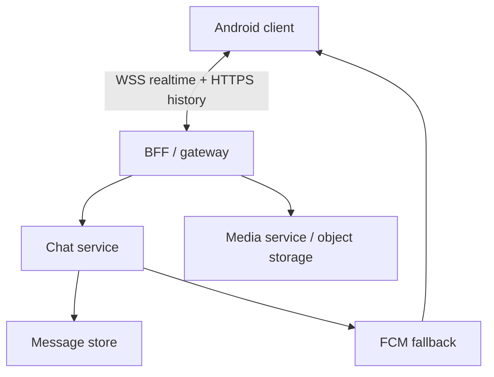
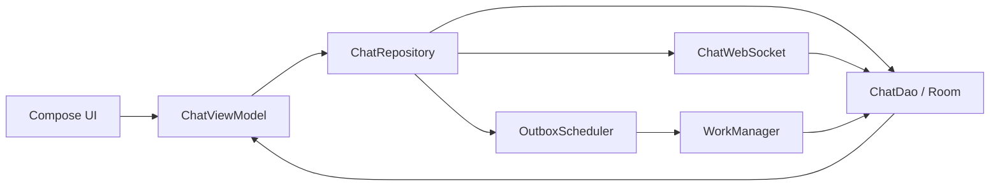
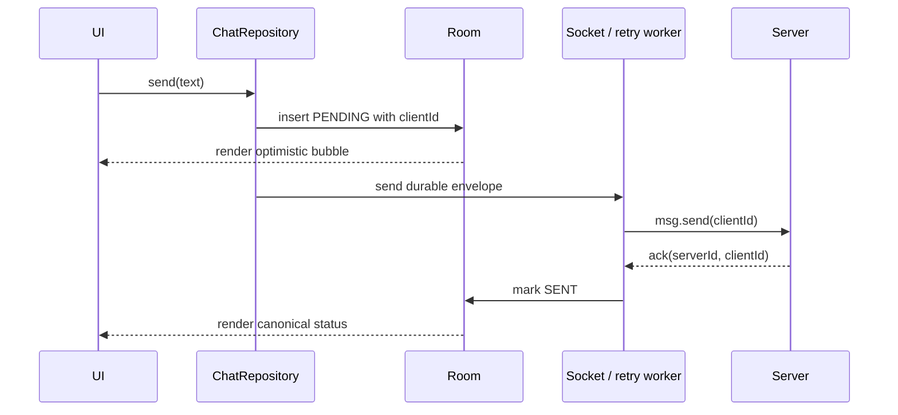

# Chat / Messaging App

> A 45-60 minute mobile system-design walkthrough for a 1:1 chat client (Android-first). The bulk of the file is mobile-client thinking; the backend appears only as an API contract.

---

## 1. Gathering Requirements (~5 min)

> **Interviewer:** "Design a chat app like WhatsApp."
> **Candidate:** "Before I start, let me agree on scope so I don't drift into a 3-hour answer."

### Functional Requirements (pick 3-5, defend the rest as out of scope)
- **1:1 text messaging** with delivery + read receipts.
- **Send/receive when offline** — queued locally, sent on reconnect, no user lock-up.
- **Push notifications** for new messages when the app is backgrounded or killed.
- **Message history** that survives reinstall (server-side restore on login).
- **Image attachments** (single image, up to ~10 MB).

### Non-Functional Requirements
- **Low latency** end-to-end (< 500 ms p95 on a healthy network).
- **Offline-first** — UI never blocks on network; outgoing messages are durable.
- **Battery & data conscious** — no chatty polling, no decoded video in feed scroll.
- **Secure at rest** — local DB encrypted; transport TLS; E2EE optional (deferred to "use platform SDK").

### Out of Scope (call out explicitly so the interviewer can pull anything back in)
- Group chats, channels, broadcast lists
- Voice / video calls
- Voice messages
- Message edit / delete / unsend
- Reactions, threads, replies, forwarding
- Sign-up / login flow (assume an `accessToken` is in `DataStore`)
- E2EE protocol math (use `libsignal-client` as a black box)

---

## 2. Clarifying Questions (~3 min)

Things I'd ask the interviewer before drawing anything:

| Question | Why it matters |
|---|---|
| DAU / peak concurrent? | Pick WebSocket vs polling; cache sizing |
| Geography (emerging markets?) | Data-saver mode, image quality, FCM fallback strategy |
| Target Android API levels? | `WorkManager` features, FGS rules, `setExpedited` availability |
| Avg messages/user/day? | Local DB growth, retention policy, pagination size |
| Median attachment size? | Compression strategy, pre-signed URL pattern |
| Are conversations long-lived? | Pagination strategy, archival, scroll restoration |
| Multi-device (web + mobile)? | Read-receipt fan-out, ack ownership |
| Compliance (GDPR, COPPA)? | "Delete my data" flow, retention windows |

> **Candidate:** "I'll assume 10M DAU, mostly mobile, mixed network quality, Android 9+, ~50 msgs/user/day, single device per user."

---

## 3. High-Level Diagram (~10 min)



The socket carries active-session events, REST recovers history, and FCM wakes offline recipients; durable message identity remains in the chat service rather than any transport.

**Server-side components (named for context, not designed in this round):**
- **BFF / Gateway** — terminates WebSocket, authenticates JWT, routes to chat / media / push.
- **Chat Service** — persists messages, fans out to other devices.
- **Message Storage** — durable store (Cassandra-like). *We treat it as a black box.*
- **Push Service** — issues FCM payloads when the recipient socket is offline.
- **Media Service** — issues pre-signed S3 URLs; the client uploads directly.

> The whole rest of the file is what the **Android client** does with this contract.

---

## 4. API Contract

### WebSocket envelope (single duplex stream, JSON over WSS)

```json
// Client → Server: send
{ "type": "msg.send", "clientId": "8f7…uuid", "convId": "c_42",
  "text": "hey", "attachmentId": null, "sentAt": 1750000000000 }

// Server → Client: ack
{ "type": "msg.ack", "clientId": "8f7…uuid", "serverId": "m_991", "ts": 1750000000200 }

// Server → Client: incoming
{ "type": "msg.recv", "serverId": "m_992", "convId": "c_42",
  "senderId": "u_7", "text": "yo", "sentAt": 1750000000400 }

// Either side: receipt
{ "type": "msg.read", "convId": "c_42", "uptoServerId": "m_992" }
```

### REST endpoints (history, media, presence)

| Method | Path | Use |
|---|---|---|
| `GET` | `/v1/conversations?cursor=…&limit=30` | Conversation list, cursor-paginated |
| `GET` | `/v1/conversations/{id}/messages?before=…&limit=50` | History page |
| `POST` | `/v1/media/uploads` | Returns pre-signed PUT URL + `attachmentId` |
| `POST` | `/v1/conversations/{id}/read` | Idempotent receipt |

### Idempotency
- Every outgoing message carries a **client-generated UUID** (`clientId`).
- Server returns `serverId` in the `msg.ack`. If the client retries the same `clientId` after a flaky network, the server returns the same `serverId` — no duplicates.

### Push payload (FCM data message)
```json
{ "convId": "c_42", "serverId": "m_992", "preview": "yo",
  "senderName": "Sam", "priority": "high" }
```
> Data messages, not notification messages — the client decides whether to show a notification (depends on app foreground state, mute setting, etc.).

---

## 5. Mobile App Architecture (~10 min)

### Module structure (multi-module Gradle, Kotlin 2.x + K2)

```
:app                       ← Application class, Hilt entry, nav graph
:feature:conversations     ← list of chats
:feature:chat              ← single conversation screen
:feature:media-preview     ← image viewer
:core:network              ← Ktor 3 (or OkHttp+Retrofit) + WebSocket
:core:database             ← Room 2.7+, SQLCipher
:core:notifications        ← FCM + MessagingStyle
:core:work                 ← WorkManager workers
:core:design-system        ← Compose theme, primitives
:domain:chat               ← pure-Kotlin models, repository contracts
:data:chat                 ← repository impls, mappers
```

### Layered diagram



Room is the single render source; both socket delivery and retry workers converge messages into the same database observed by the ViewModel.

**Rule:** UI never talks to network directly. Room is the single source of truth — the socket and REST both write to Room, the UI only reads from Room via `Flow`.

### Key class signatures (not implementations)

```kotlin
interface ChatRepository {
    fun observeMessages(convId: String): Flow<PagingData<Message>>
    suspend fun send(convId: String, text: String, attachmentId: String? = null)
    suspend fun markRead(convId: String, uptoServerId: String)
    fun connectionState(): StateFlow<ConnectionState>
}

@HiltViewModel
class ChatViewModel @Inject constructor(
    private val repo: ChatRepository,
    savedState: SavedStateHandle,
) : ViewModel() {
    val composer: StateFlow<String> = savedState.getStateFlow("composer", "")
    val messages: Flow<PagingData<Message>>      // from repo
    val connection: StateFlow<ConnectionState>   // from repo
    fun onSend() { … }
}
```

### Dependency injection (Hilt)

`ChatWebSocket` is `@Singleton`. `ChatRepository` is `@Singleton`. `ChatViewModel` is `@HiltViewModel` (per-screen). Workers are `@HiltWorker`.

---

## 6. Local Storage (Room as Single Source of Truth)

```kotlin
@Entity(tableName = "messages",
    indices = [Index("convId", "sentAt")])
data class MessageEntity(
    @PrimaryKey val clientId: String,   // UUID; survives ack
    val serverId: String?,              // null until ACKed
    val convId: String,
    val senderId: String,
    val text: String?,
    val attachmentId: String?,
    val sentAt: Long,
    val status: Status,                 // PENDING, SENT, DELIVERED, READ, FAILED
)
```

Three tables total: `conversations`, `messages`, `outbox` (mirrors PENDING rows for the worker). One DAO each. Migrations are exhaustive — never `fallbackToDestructiveMigration` in production.

**Encryption.** When the threat model requires database encryption, Room is opened through a reviewed SQLCipher integration; a random passphrase is wrapped by a direct Android Keystore key and the versioned ciphertext is stored in app-private storage. StrongBox is requested only under an explicit fallback policy.

> **Probing question you should expect:** "What's the single source of truth?" Answer: Room. Network writes go to Room first; UI observes Room.

---

## 7. Deep Dive: Send Flow (~15 min)

> *I'd pick send-flow as the deep dive because it covers optimistic UI, idempotency, the WebSocket lifecycle, the offline outbox, and FCM fallback — most of the interesting client decisions in one feature.*

### Sequence



The client-generated ID survives process death and retries, allowing the server to deduplicate while the UI immediately renders a durable pending message.

### Repository contract

```kotlin
suspend fun send(convId: String, text: String, attachmentId: String?) {
    val msg = MessageEntity(
        clientId = UUID.randomUUID().toString(),
        serverId = null, convId = convId, senderId = me,
        text = text, attachmentId = attachmentId,
        sentAt = clock.now(), status = Status.PENDING,
    )
    dao.insert(msg)                           // optimistic
    when (socket.state.value) {
        Connected -> socket.send(msg.toEnvelope())
        else       -> outbox.schedule(msg.clientId)
    }
}
```

### WebSocket lifecycle (the part interviewers probe)

| Event | Action |
|---|---|
| App enters foreground | Connect socket; re-subscribe to active convId |
| App backgrounded > 30s | Disconnect (battery); rely on FCM |
| Socket error / 4xx close | Drop; exponential backoff with jitter (1s, 2s, 4s, capped at 60s) |
| Token expired (401-style frame) | Refresh, then reconnect — do **not** retry the failed token |
| User opens chat screen | Send `subscribe` frame so server prioritises this convId |

> Lifecycle is observed at the **Application** level (`ProcessLifecycleOwner`), not per Activity — Activities rotate; the socket should not.

### When does FCM matter?
Socket is closed in background. FCM data-message wakes the app; a `@HiltWorker` (not the `FirebaseMessagingService` directly — too short a lifecycle) decrypts, writes to Room, posts a `MessagingStyle` notification with `RemoteInput` for direct reply.

### Failure modes for send

| What breaks | Client behaviour |
|---|---|
| Process killed mid-send | `Outbox` row remains; next launch's worker re-sends |
| Server returns 5xx | Worker retries with exponential backoff |
| Server returns 4xx (validation) | Mark `FAILED`; surface error UI; do not retry |
| User has no network for hours | Outbox grows; worker fires when `NETWORK_CONNECTED` constraint flips |
| User uninstalls and reinstalls | Outbox lost (acceptable); history restored from server |

---

## 8. Trade-offs

### Realtime transport

| Option | Pros | Cons | Verdict |
|---|---|---|---|
| **WebSocket** | Bi-directional, low overhead | Battery in background, NAT timeouts | Foreground |
| **FCM data push** | Wakes app from killed state | High-priority quota; rate-limited | Background |
| **Long-poll** | Works behind hostile proxies | Latency + battery | Fallback only |
| **Short-poll** | Trivial | Awful battery + latency | Avoid |

### Local store

| Option | Pros | Cons | Verdict |
|---|---|---|---|
| **Room + SQLCipher** | SQL, Flow, migrations, encrypted | Compile-time setup | Pick this |
| **DataStore** | Great for small/preferences | No query, no joins | Not for messages |
| **Realm** | Object DB, reactive | Vendor lock-in, sync product is paid | Skip |
| **Plain SQLite** | Lightweight | Boilerplate; no Flow | Skip |

### Pagination

| Option | Pros | Cons | Verdict |
|---|---|---|---|
| **Cursor (Paging 3 + RemoteMediator)** | Stable across inserts, infinite scroll | More wiring | Pick this |
| **Offset** | Easy | Breaks when new messages arrive | Skip |
| **Load-all** | Trivial | OOM on long chats | Skip |

### Image handling

| Choice | Pick | Reason |
|---|---|---|
| Image loader | **Coil 3** | KMP-ready, Compose-native, Kotlin coroutines |
| Compression | Client-side WebP at 1280px max edge | Smaller upload, faster on slow networks |
| Upload | Pre-signed S3 PUT | Offloads bandwidth from BFF |
| Display | Coil with `crossfade` + `MemoryCache.builder().maxSizePercent(0.25)` | Bounded memory |

---

## 9. Major Concerns

- **Battery.** Foreground socket only; ping every 30 s; in background rely on FCM. Don't keep `WakeLock`s. Use `setExpedited` only for user-initiated sends.
- **OEM kill (Xiaomi, OPPO, Vivo).** FCM data messages can be dropped on aggressive OEMs; document the limitation and add an in-app "trust this app" guide. Use `WorkManager` (not a service) for the wake-up because it survives reschedule.
- **Process death.** `ChatViewModel` saves composer text in `SavedStateHandle`. Scroll position is restored via `LazyListState` keyed on the last visible `serverId`. Outbox is durable in Room, not in-memory.
- **Doze / App Standby.** Outbox flush uses `WorkManager` with `setRequiresCharging(false)` and `NetworkType.CONNECTED` — system schedules within maintenance windows. Don't fight Doze; design for it.
- **Configuration changes.** Compose `rememberSaveable` + `ViewModel` cover rotation. Don't keep `Activity` references in the socket.
- **Memory.** Room `Flow` + Paging 3 bound page size to 50; bitmaps go through Coil with size-bucketed cache.
- **Security.** TLS 1.3, certificate pinning on prod builds, no logs of message bodies, `FLAG_SECURE` on screens with media previews, biometric gate optional.
- **Schema migrations.** Every `Room` version bumps ships a migration; `MigrationTestHelper` covers each.

---

## 10. Follow-up Questions

> **Q: How do read receipts work without writing your own protocol?**
> Receipts ride the same socket: client emits `msg.read { uptoServerId }` on visibility. Server fans out. On the recipient side, Room updates `status=READ` for all rows `<= uptoServerId` in that conv. Idempotent — re-sending is fine.

> **Q: What if the socket reconnects after being offline for an hour?**
> On reconnect, client sends `sync { sinceServerId }` per active conv. Server streams the delta. Worst case (very long gap) falls back to a paginated REST history fetch. Room dedup is by `serverId` PK on the messages-by-server-id index.

> **Q: How do you avoid stuck "Sending…" bubbles?**
> Outbox rows have a `firstAttemptedAt`. If a row stays `PENDING` > 60 s and the socket is healthy, the repository force-re-sends. If the worker hits max attempts (5), flip to `FAILED` and show a retry CTA.

> **Q: Single device today — what changes for multi-device?**
> Acks become per-device. Read receipts get a `deviceId` dimension. Server picks a "primary" device for echo suppression. Client-side, you'd add a `deviceId` to each `clientId`.

> **Q: How would you add E2EE?**
> Integrate `libsignal-client` at the boundary: encrypt before `socket.send`, decrypt before Room write. Identity keys live in Android Keystore. The rest of the architecture (Outbox, FCM, MessagingStyle) is unchanged — the payload is just bytes.

> **Q: How do you test this on real networks?**
> `OkHttp` Interceptor that injects latency / loss in debug builds; `ConnectivityManager.setNetworkCallback` to simulate flaps. Integration tests run with a real WebSocket against a local server image (Testcontainers).

---

## 11. Out of Scope (defended)

- **Group chats** — fan-out, per-member receipts, member list reconciliation. ~1 hour on its own.
- **Voice / video calls** — entirely different stack (WebRTC, TURN). Separate interview.
- **E2EE math** — the *integration* is in scope; the X3DH / Double Ratchet math is not. Use the SDK.
- **Sign-up / login** — assume `accessToken` exists in `DataStore`.
- **Web/desktop sync** — single-device assumption; multi-device is a 15-min follow-up if there's time.

---

## 12. Further Reading

- [weeeBox/mobile-system-design — chat-app](https://github.com/weeeBox/mobile-system-design/blob/master/exercises/chat-app.md) — the reference format for this folder.
- [Android Developers — App Architecture Guide](https://developer.android.com/topic/architecture) — official UI/Domain/Data layering.
- [Now in Android sample](https://github.com/android/nowinandroid) — production-grade multi-module Compose + Room + Hilt + WorkManager.
- [WhatsApp Encryption Overview (whitepaper)](https://www.whatsapp.com/security/) — for E2EE intuition (deferred topic).
- [Signal libsignal-client docs](https://github.com/signalapp/libsignal) — the SDK you'd integrate, not re-implement.

---

> **Closing in the interview:** "I picked send-flow for the deep dive because it touches the most decisions; I'd happily do read-receipt fan-out, media upload, or E2EE integration next if you want." That signals you have more depth available and lets the interviewer steer.
