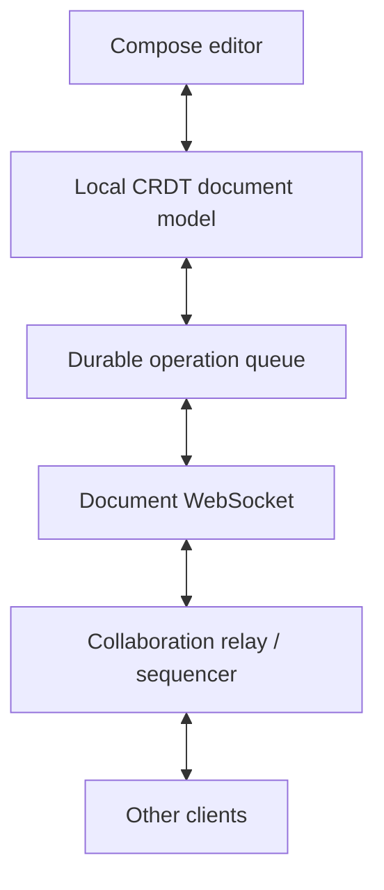
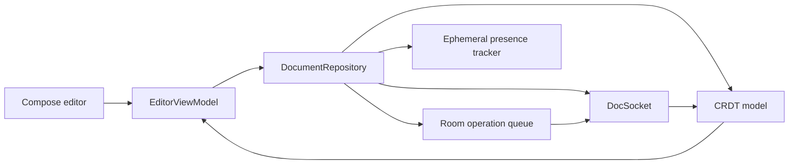

# Collaborative Editing (Google Docs / Figma-style)

> A 45-60 minute mobile system-design walkthrough for a real-time collaborative editor on Android. CRDT / OT internals live on a shared library — bulk is on-device: client model, presence, optimistic local apply, sync, offline.

---

## 1. Gathering Requirements (~5 min)

> **Interviewer:** "Design Google Docs / Figma-style collaboration for a mobile app."
> **Candidate:** "Two hard parts on the client: model that supports concurrent ops (CRDT or OT via SDK), and presence + cursor sync at low latency. Backend is a sequencer/relay. I'll deep-dive the local apply + sync path."

### Functional Requirements
- **Multiple users edit the same document concurrently**.
- **Real-time updates** of others' edits.
- **Presence + remote cursors** visible.
- **Offline edits** that sync on reconnect.
- **Conflict-free merge** of concurrent edits.

### Non-Functional Requirements
- **< 100 ms perceived latency** for local edits.
- **Eventual consistency** across all clients.
- **No data loss** during disconnect.
- **Battery** — efficient delta stream, not full state replication.
- **Privacy** — document content stays in app-private storage and the authenticated document session.

### Out of Scope
- Operational Transform / CRDT algorithm internals (use Yjs, Automerge, or in-house SDK as a black box)
- Server-side relay sharding / scaling
- Document permission management UI
- Comments / suggestions / version history
- Inline media / embedded content

---

## 2. Clarifying Questions (~3 min)

| Question | Why it matters |
|---|---|
| CRDT or OT? | Library choice |
| Document type (rich text, tabular, graph)? | Model shape |
| Max concurrent users per doc? | Buffering, presence bandwidth |
| Offline duration to support? | Outbox sizing, conflict resolution stress |
| Cursor presence ephemeral or persisted? | Stream channel |
| Server-side authority on order? | Sequencer model |
| Authentication per document? | Permission check on join |

> **Candidate:** "CRDT via Yjs-style SDK, rich text document, up to 10 concurrent editors, support week-long offline, ephemeral cursors, server is sequencer, doc-scoped permissions."

---

## 3. High-Level Diagram (~10 min)



Local operations update the CRDT before network acknowledgement and enter a durable queue; the relay distributes operations, while convergence comes from operation identity and merge rules rather than arrival order alone.

**Components:**
- **`DocumentModel`** — CRDT instance for this document.
- **`OpQueue`** — the durable op log: unacked local ops, plus ops not yet in a snapshot.
- **`DocSocket`** — WebSocket lifeline; sends/receives op + presence frames.
- **`PresenceTracker`** — cursors + selections of other users.
- **`DocSyncService`** — long-running while doc is open.

---

## 4. API Contract

### Join document (WSS handshake)

```json
{ "type": "join", "docId": "d_42", "token": "ey..." }
```

Server replies with current state vector + initial CRDT snapshot if needed.

### Op frame (bidirectional)

```json
{
  "type": "op",
  "docId": "d_42",
  "ops": [
    { "type": "insert", "clientId": "c_8f7a", "clock": 999,
      "after": { "clientId": "c_2b1e", "clock": 412 }, "text": "hello" }
  ]
}
```

Readable JSON for the interview; on the wire this is the SDK's binary update. An op anchors to the identity of its neighbour, not an integer position, which would go stale as soon as a concurrent edit lands: that's what lets ops merge in any order.

### Presence frame

```json
{
  "type": "presence",
  "docId": "d_42",
  "userId": "u_7", "name": "Sam", "color": "#FF6B6B",
  "selection": {
    "anchor": { "clientId": "c_2b1e", "clock": 412 },
    "focus": { "clientId": "c_8f7a", "clock": 1003 }
  }
}
```

Selections use the same anchors, like Yjs relative positions, so a remote cursor stays on its character when text is inserted before it.

### Ack

```json
{ "type": "ack", "ops": [{ "clientId": "c_8f7a", "clock": 999 }] }
```

---

## 5. Mobile App Architecture

### Module structure

```
:app
:feature:editor          ← Compose editor screen, presence UI
:core:network
:core:database           ← op log + snapshot
:core:crdt               ← Yjs-style SDK wrapper
:data:document
```

### Layered diagram



Durable document operations and ephemeral presence have different reliability contracts, even though one repository coordinates both for the editor.

### Key class signatures

```kotlin
interface DocumentRepository {
    suspend fun open(docId: String): Document
    fun observeContent(docId: String): Flow<DocumentContent>
    fun observePresence(docId: String): Flow<List<RemoteCursor>>
    suspend fun applyLocalEdit(edit: LocalEdit)
    suspend fun close(docId: String)
}

class DocumentModel internal constructor(private val crdt: CrdtInstance) {
    fun snapshot(): DocumentContent
    fun applyLocal(op: Op): Op             // returns the op as serialized
    fun applyRemote(op: Op)
    fun stateVector(): ByteArray
    fun serialize(): ByteArray
}
```

---

## 6. Local Storage

```kotlin
@Entity(tableName = "documents", primaryKeys = ["accountId", "docId"])
data class DocumentEntity(
    val accountId: String,
    val docId: String,
    val crdtSnapshotBytes: ByteArray,   // serialized CRDT state, including its state vector
    val snapshotSavedAt: Long,
    val openedAt: Long
)

@Entity(tableName = "op_log", primaryKeys = ["accountId", "docId", "clientId", "clock"])
data class OpLogRow(
    val accountId: String, val docId: String,
    val clientId: String, val clock: Long,   // the op's identity, as on the wire
    val opBytes: ByteArray,
    val needsSend: Boolean,                  // true for a local op until its ack
    val createdAt: Long
)
```

CRDT snapshot plus op log is the durable state, and the snapshot can lag by the debounce window, so a row stays until a committed snapshot contains it. That applies to acked and remote ops too: an offline restart has no server to get them back from, and a local edit typed after a remote op depends on that op. Yjs's own `y-indexeddb` persistence works the same way, logging every update and compacting later. The outbox is the rows with `needsSend = true`.

Documents and op rows belong to one account: a cached snapshot must not open for someone whose access was never checked, and queued edits must not go out under another user's token. Reads filter by `accountId`. Sign-out warns if any row still needs sending, then deletes that account's rows. `clientId` identifies a replica session, not a user: Yjs creates a new one per session and warns that two live documents sharing one can corrupt the document, so a relaunch gets a new id and old rows keep theirs.

---

## 7. Deep Dive: Local Apply + Sync (~15 min)

> *I'd pick this as the deep dive because the local-first apply + outbox + reconcile is the heart of the collaborative client. Get this wrong and edits get lost or duplicated; get it right and the UI feels instant.*

### Local edit path

```kotlin
suspend fun applyLocalEdit(edit: LocalEdit) = modelLock.withLock {   // one writer at a time
    // 1. Apply to the in-memory model — not shown yet
    val op = documentModel.applyLocal(edit.toCrdtOp())
    // 2. Persist op log entry — durable
    opLogDao.insert(OpLogRow(
        accountId = accountId,
        docId = currentDocId,
        clientId = op.clientId,
        clock = op.clock,
        opBytes = op.serialize(),
        needsSend = true,
        createdAt = clock.now(),
    ))
    // 3. Show it — UI updates via Flow
    content.value = documentModel.snapshot()
    // 4. Send via socket — if connected
    if (socket.isConnected) {
        socket.send(op.toWire(currentDocId))
    }
    // 5. Update persistent snapshot (debounced)
    snapshotScheduler.touch()
}
```

The order matters: apply → persist → show → send. A crash before (2) loses an edit the user never saw; a crash after it replays from the op log. A Room transaction wouldn't help here, because it can't roll back the in-memory model, an emission or a socket send. If the insert throws, the model holds an op that isn't durable, so close the editor with an error and reopen from snapshot plus outbox.

### Snapshot debouncing

```kotlin
class SnapshotScheduler @Inject constructor(
    private val dao: DocumentDao,
    private val db: AppDatabase,
    private val model: DocumentModel,
    private val modelLock: Mutex,
    private val scope: CoroutineScope,
) {
    private val touches = MutableSharedFlow<Unit>(
        extraBufferCapacity = 1,
        onBufferOverflow = BufferOverflow.DROP_OLDEST,
    )
    private val writeLock = Mutex()

    init {
        scope.launch {
            touches.debounce(2.seconds).collect { writeSnapshot() }
        }
    }

    fun touch() { touches.tryEmit(Unit) }

    suspend fun flush() = writeSnapshot()   // from ON_STOP and close()

    private suspend fun writeSnapshot() = writeLock.withLock {   // one save at a time, in order
        val (bytes, covered) = modelLock.withLock {
            // Every op log row is already in the model, so these rows are in `bytes`
            model.serialize() to opLogDao.settledRows(accountId, currentDocId)   // needsSend = false
        }
        db.withTransaction {
            dao.upsert(accountId, currentDocId, bytes, clock.now())
            opLogDao.delete(covered)
        }
    }
}
```

Writing the whole CRDT snapshot on every keystroke is wasteful. Debounce 2s. Sustained typing keeps pushing the write back, which is safe because the op log provides durability between snapshot saves. `writeLock` covers the whole save, so a slow scheduled write can't overwrite a newer `flush()`. A row is deleted in the same transaction that commits a snapshot containing it, so a crash leaves either the old snapshot and the row, or the new snapshot without it. An ack that lands during a save just leaves its row for the next one; `flush()` writes when the user leaves. A `SharedFlow` is used because a `StateFlow` of `true` can't re-emit `true`, and clearing it after a write would discard a `touch()` that arrived during that write.

### Remote op handling

```kotlin
socket.incomingFrames.collect { frame ->
    when (frame) {
        is Frame.Op -> modelLock.withLock {
            // needsSend = false; ignored if the row exists, so an echo can't clear a local op's flag
            opLogDao.insertIgnore(frame.op.toLogRow(accountId, needsSend = false))
            documentModel.applyRemote(frame.op)
            content.value = documentModel.snapshot()
            snapshotScheduler.touch()
        }
        is Frame.Presence -> presenceTracker.update(frame)
        is Frame.Ack -> {
            frame.ops.forEach { opLogDao.markAcked(accountId, currentDocId, it.clientId, it.clock) }
            snapshotScheduler.touch()   // the next save can now remove these rows
        }
    }
}
```

The CRDT library handles concurrent ops correctly — local and remote ops can be applied in any order and converge to the same state. Ops from the state vector sync below arrive the same way, so they're logged too. A repeated ack updates no row and is harmless.

### Open after a restart

```kotlin
suspend fun loadModel(docId: String) {
    documentModel = DocumentModel.from(documentDao.snapshot(accountId, docId))
    // Ops newer than the snapshot, acked or not, exist only in the op log
    opLogDao.all(accountId, docId).forEach { documentModel.applyRemote(it.toOp()) }
    content.value = documentModel.snapshot()
}
```

Load first, so the document is complete offline and the state vector sent on connect includes everything on this device. This relies on the model, not the log, for the merge: order doesn't matter, and replaying a row the snapshot already contains is a no-op.

### Reconnect + state vector sync

```kotlin
suspend fun onReconnect() {
    val sv = documentModel.stateVector()
    socket.send(Frame.SyncRequest(docId = currentDocId, stateVector = sv))
    // Server responds with deltas the client doesn't have yet
}
```

The state vector compactly represents "what ops I've seen." Server computes the diff and sends only missing ops.

### Outbox flush on reconnect

```kotlin
suspend fun onSocketConnected() {
    val pending = opLogDao.needsSend(accountId, currentDocId)   // every unacked op, by clock
    pending.forEach { socket.send(it.toWire()) }
}
```

Flush every unacked op, not only those never sent: a frame sent just before a disconnect may never have arrived. Yjs updates are idempotent — re-applying one that was already received is a no-op. So we can flush optimistically without worrying about duplicates.

### Presence

```kotlin
class PresenceTracker {
    private val _cursors = MutableStateFlow<Map<String, RemoteCursor>>(emptyMap())
    val cursors = _cursors.asStateFlow()

    fun update(presence: Frame.Presence) {
        _cursors.update { it + (presence.userId to presence.toRemoteCursor()) }
    }

    fun localCursorChanged(selection: TextRange) {
        socket.send(Frame.Presence(localUserId, ..., selection.toRange()))
    }
}
```

Presence is ephemeral; not persisted. Cursors fade after 15s of no update from a user, three missed keepalives, so one late frame doesn't make a cursor flicker. Yjs Awareness uses the same pattern with longer times: it renews every 15s and marks a client offline after 30s.

### Foreground service while doc is open

```kotlin
class DocCollabService : LifecycleService() {

    override fun onStartCommand(intent: Intent?, flags: Int, startId: Int): Int {
        super.onStartCommand(intent, flags, startId)
        ServiceCompat.startForeground(
            this, NOTIF_ID, buildDocOpenNotification(currentDoc),
            FOREGROUND_SERVICE_TYPE_DATA_SYNC
        )
        return START_NOT_STICKY     // the next open recovers from snapshot + op log
    }

    override fun onTimeout(startId: Int, fgsType: Int) {
        stopSelf(startId)           // dataSync: 6 hours in 24 on Android 15+
    }
}
```

Foreground service while a document is actively open (with the user). Keeps the socket alive during brief backgrounding. Closed when user exits the doc. Three limits apply:

- **Start.** Start it while the editor is visible: apps targeting Android 12+ can't generally start one from the background.
- **Manifest.** Declare the `dataSync` type and the `FOREGROUND_SERVICE_DATA_SYNC` permission.
- **Timeout.** After `onTimeout`, the socket closes and the outbox waits for the next connection.

This buys continuity, not durability, because the op log already holds every edit. If a persistent notification isn't worth that, close the socket after a short grace period and flush with `WorkManager`.

### Failure modes

| What breaks | Behavior |
|---|---|
| Network drops mid-edit | Outbox persists; flush on reconnect; UI keeps working |
| App killed by OEM | On relaunch, snapshot loads, the op log re-applies locally, then unacked rows go to the server; CRDT idempotency saves us |
| Crash after an ack, before a snapshot | The acked row is still in the op log, so the edit is there even offline |
| Crash during a snapshot save | The transaction rolls back: old snapshot, rows kept |
| Slow save overlaps `flush()` | `writeLock` runs them in order; the newer one writes last |
| Account signs out | Warn if edits are unsent, then delete that account's rows; the next account can't read or send them |
| Document grew very large | Split it into separately loaded parts, such as Yjs subdocuments; a single CRDT document has to load before it can merge |
| Two clients edit same range concurrently | CRDT merges per its algebra; both edits preserved |
| Server out of sync | Client requests full sync; server sends complete state |
| Stale snapshot on disk | State vector reconciliation pulls deltas to catch up |

---

## 8. Trade-offs

### Algorithm

| Option | Pros | Cons | Verdict |
|---|---|---|---|
| **CRDT (Yjs, Automerge)** | Decentralized; offline-friendly; commutative ops | Metadata overhead; on Android, check SDK maturity: Yjs is JavaScript, its Yrs port has Kotlin bindings (`ykt`, last pushed 2023), and `automerge-java` supports Android | Pick for modern apps |
| **OT (Operational Transform)** | Tighter document state | Usually needs a central server; complex to implement | Google Docs' published design (2010) |
| Last-write-wins | Trivial | Loses concurrent edits | Skip for collab |
| Locking | Avoids conflicts | Blocks users; bad UX | Skip |

### Server topology

| Option | Verdict |
|---|---|
| **Sequencer / relay (server orders ops)** | Pick — easier for client; supports offline |
| **Peer-to-peer (no server)** | Niche; firewall pain |
| **Authoritative server (decides the final state)** | Figma: the server is the central authority, with last-writer-wins per property; Figma notes it isn't a text editor, so this doesn't carry over to rich text |

### Storage

| Option | Verdict |
|---|---|
| **CRDT snapshot in Room (BLOB) + op log** | Pick — durable + idempotent |
| Per-op file | Many small files |
| In-memory only | Loses on crash |

### Sync protocol

| Option | Verdict |
|---|---|
| **WebSocket (binary frames)** | Pick — bidirectional, low overhead |
| HTTP long-poll | Higher latency |
| WebRTC data channel | Peer-to-peer; not our model |

### Presence channel

| Option | Verdict |
|---|---|
| **Same WebSocket, separate frame type** | Pick — one connection |
| Separate channel | More connections, more overhead |

---

## 9. Major Concerns

- **Durability.** Op log in Room before UI commits. Snapshot debounced; a row leaves the log only with the snapshot that contains it.
- **Latency.** Local apply is synchronous; remote ops apply async; UI updates from Flow.
- **Battery.** Foreground service only while doc is open. Socket disconnects on close.
- **Backpressure.** Don't flood the server with op frames; batch within 10ms windows.
- **Privacy.** End-to-end encryption is possible with some CRDT libraries; out of scope here, but the SDK boundary supports it.
- **Document size.** CRDT state grows over time (deletion markers, item identities). Any compaction must keep a client that's been offline for a week able to merge.
- **Permission revocation.** Server can boot a client; client must gracefully exit (`socket.disconnect()`) and delete that document's local rows, since the server will reject its queued edits.
- **Conflict UX.** Concurrent edits to the same range — CRDT merges deterministically; user may see unexpected text. Highlight remote edits briefly to reduce surprise.

---

## 10. Follow-up Questions

> **Q: User edits offline for a week, then reconnects — what happens?**
> Outbox has ~thousands of ops. On reconnect: the outbox flush sends them. Server orders and broadcasts. Other clients receive and CRDT-merge. The user's view doesn't change until other clients' ops arrive.

> **Q: How is initial document load fast for large docs?**
> Server sends a CRDT snapshot (compact) + state vector. Client applies it off the main thread, then lays out only the visible portion. Subsequent edits stream. For very large documents, split into parts loaded on demand, such as Yjs subdocuments.

> **Q: Two users select the same text and edit at the same time — what does user A see?**
> User A sees their edit instantly. Then User B's op arrives a few hundred ms later; CRDT merges (e.g., both inserts coexist at the same logical position). UI highlights B's contribution briefly for awareness.

> **Q: How is presence kept fresh without flooding the server?**
> Presence frames sent at most every 100 ms while cursor is moving. Idle cursors send a keepalive every 5s, and others fade them after 15s of silence. Server fans out.

> **Q: How would you support comments / suggestions?**
> Separate CRDT layer (or a separate op type). Comments are anchored to op identifiers, which CRDTs make stable across edits. Sketched here, fully covered in a different design.

> **Q: How do you test this?**
> Fake socket + scripted ops. Property test: any interleaving of (local edit, remote op, ack, snapshot save, crash, restart, network drop, reconnect) converges to the same final state, and after an offline restart every op the user saw is still there. Compare against the reference CRDT lib's own conformance tests.

---

## 11. Out of Scope (defended)

- **CRDT / OT algorithm internals** — use SDK.
- **Server relay / scaling** — backend.
- **Version history UI** — separate feature.
- **Comments / suggestions** — additive layer.
- **Inline media** — separate sub-system.

---

## 12. Further Reading

- [Yjs documentation](https://docs.yjs.dev/) — production CRDT for collaborative editing.
- [Automerge](https://automerge.org/) — alternative CRDT library.
- [Figma — How our multiplayer works](https://www.figma.com/blog/how-figmas-multiplayer-technology-works/) — practitioner perspective.
- [Ink & Switch — Local-first software](https://www.inkandswitch.com/local-first/) — design philosophy.
- [Operational transformation (Wikipedia)](https://en.wikipedia.org/wiki/Operational_transformation) — pioneered by Ellis and Gibbs in 1989, later used by Google Wave and Docs.
- [Google Docs on operational transformation](https://drive.googleblog.com/2010/09/whats-different-about-new-google-docs_22.html) — the 2010 engineering post.

---

> **Closing in the interview:** "I anchored on local apply + sync because that's the heart of the user experience. Happy to dig into the state vector reconciliation, presence backpressure, or offline week-long edit scenarios next."
