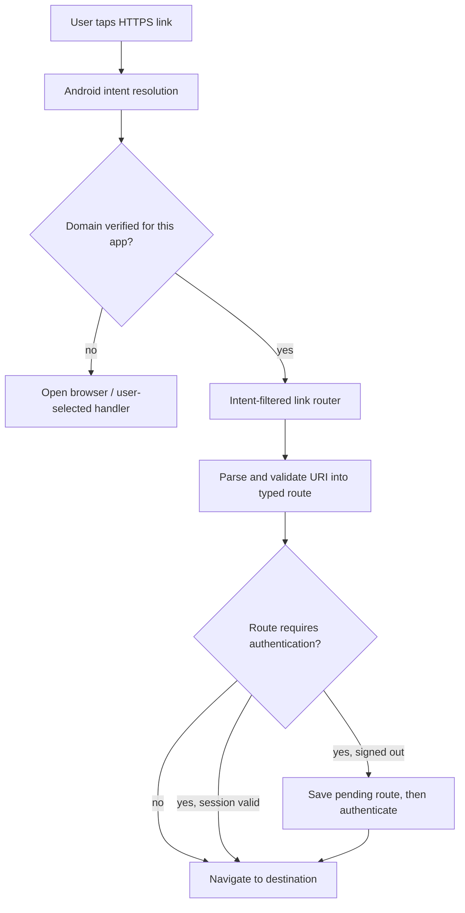
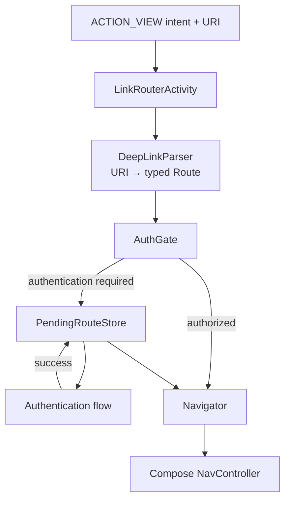

# Deep Links & App Links (Android Universal Links)

> A 45-60 minute mobile system-design walkthrough for the deep-linking subsystem of an Android app: URI schemes vs App Links, intent filters, the verification handshake, deferred deep links, and routing inside the app.

---

## 1. Gathering Requirements (~5 min)

> **Interviewer:** "Design deep linking for an app."
> **Candidate:** "Three layers: domain → app handoff (App Links), deferred deep links (install-attribution), and in-app routing (the nav graph). I'll deep-dive routing + App Links verification, since that's where most bugs live."

### Functional Requirements
- **Open any in-app screen from a URL** (`https://example.com/users/42` → user profile).
- **Universal**: same URL works on web, iOS, Android.
- **Deferred deep linking** — install the app then route to the original destination.
- **Authenticated routes** — gate on session, save destination, re-route after login.
- **Back-stack hygiene** — opening from a notification doesn't lose the home screen.

### Non-Functional Requirements
- **No "Open with..." chooser** for our domain — App Links + verified domain.
- **Survive process death** — route resumes correctly even if cold-started.
- **Safe** — no exfiltration via spoofed `intent://` URLs.
- **Composable** with the navigation graph (one source of truth for routes).
- **Observable** — track every deep-link hit by source.

### Out of Scope
- Web bridge (JS ↔ native) — separate concern
- Notification routing logic (see `push-notifications.md`)
- Authentication flow (see `authentication.md`)
- Cross-app sharing (`Intent.ACTION_SEND` etc.)

---

## 2. Clarifying Questions (~3 min)

| Question | Why it matters |
|---|---|
| Domain ownership (one or many)? | One assetlinks file per domain |
| Need install-attribution (Branch, AppsFlyer)? | Deferred deep link SDK choice |
| Use Compose Navigation or Jetpack Navigation? | Routing surface |
| Multi-module nav graph? | Centralized route registry |
| Wear / Auto / Chromebook surfaces? | Additional intent filters |
| Authenticated deep links? | Save-and-resume pattern |
| Cross-platform parity (iOS Universal Links)? | URL scheme symmetry |

> **Candidate:** "Single primary domain, Compose Navigation, multi-module routes, Branch for deferred attribution, authenticated routes save-and-resume, parity with iOS Universal Links."

---

## 3. High-Level Diagram (~10 min)



Verified App Links decide whether Android can route the HTTPS URL directly to the app; application code must still validate the URI, enforce authentication, and preserve the intended route safely.

**Components:**
- **`assetlinks.json`** — served at `/.well-known/assetlinks.json` on our domain; lists package + SHA-256 fingerprint.
- **Intent filter** — `<intent-filter android:autoVerify="true">` for the domain.
- **`LinkRouterActivity`** — single entry; parses URI and dispatches.
- **`DeepLinkParser`** — `Uri` → `Route` mapping.
- **`Navigator`** — applies the route via `NavController`.
- **Branch / AppsFlyer SDK** — optional, for deferred attribution.

---

## 4. API Contract

### `assetlinks.json` (served at `https://example.com/.well-known/assetlinks.json`)

```json
[{
  "relation": ["delegate_permission/common.handle_all_urls"],
  "target": {
    "namespace": "android_app",
    "package_name": "com.example.app",
    "sha256_cert_fingerprints": [
      "14:6D:E9:83:C5:73:06:50:D8:..."
    ]
  }
}]
```

### Intent filter (`AndroidManifest.xml`)

```xml
<activity android:name=".routing.LinkRouterActivity"
          android:exported="true">
    <intent-filter android:autoVerify="true">
        <action android:name="android.intent.action.VIEW" />
        <category android:name="android.intent.category.DEFAULT" />
        <category android:name="android.intent.category.BROWSABLE" />
        <data android:scheme="https" android:host="example.com" />
    </intent-filter>
    <intent-filter>
        <action android:name="android.intent.action.VIEW" />
        <category android:name="android.intent.category.DEFAULT" />
        <category android:name="android.intent.category.BROWSABLE" />
        <data android:scheme="myapp" />   <!-- legacy URI scheme fallback -->
    </intent-filter>
</activity>
```

### URL → route mapping

| URL pattern | Route |
|---|---|
| `https://example.com/users/{id}` | `user/{id}` |
| `https://example.com/orders/{id}` | `order/{id}` (auth required) |
| `https://example.com/p/{shareCode}` | `post/{shareCode}` |
| `https://example.com/login` | `login` |
| `myapp://chat/{convId}?message={msgId}` | `chat/{convId}` + scrollTo |

---

## 5. Mobile App Architecture

### Module structure

```
:app
:core:navigation         ← Navigator interface, Route definitions
:core:deeplinks          ← LinkRouterActivity, DeepLinkParser
:feature:user            ← contributes user routes
:feature:order
:feature:chat
:data:auth               ← knows if user is signed in
```

### Layered diagram



Parsing, authorization, pending-route persistence, and navigation are separate responsibilities so a malicious or unauthenticated link cannot bypass policy by calling the navigation layer directly.

Validated against: [Add Android App Links](https://developer.android.com/training/app-links) and [Verify App Links](https://developer.android.com/training/app-links/verify-android-applinks).

### Key class signatures

```kotlin
sealed class Route {
    data class User(val id: String) : Route()
    data class Order(val id: String) : Route()
    data class Chat(val convId: String, val scrollToMessage: String? = null) : Route()
    data class Post(val shareCode: String) : Route()
    object Login : Route()
}

interface DeepLinkParser {
    fun parse(uri: Uri): Route?
}

interface Navigator {
    fun go(route: Route)
    fun goAndSaveDestination(route: Route)
    fun resumePendingDestination(): Route?
}
```

---

## 6. Local Storage (Pending destination)

Pending deep-link destination survives auth flow:

```kotlin
@Entity(tableName = "pending_route")
data class PendingRouteRow(
    @PrimaryKey val id: Int = 1,
    val routeJson: String, val savedAt: Long
)
```

Only the destination; transient query params are encoded into the route itself.

---

## 7. Deep Dive: Routing + Verification (~15 min)

> *I'd pick this as the deep dive because it covers App Links verification (the "no chooser" magic), the parser, the auth gate, and back-stack policy — the parts that decide whether the deep link feels native.*

### App Links verification handshake

1. Sign your release APK.
2. Compute SHA-256 fingerprint: `keytool -list -v -keystore release.keystore` → SHA-256 line.
3. Host `assetlinks.json` at `https://example.com/.well-known/assetlinks.json` over HTTPS with `Content-Type: application/json`.
4. On install, Android downloads the file and verifies. Status visible via `adb shell pm get-app-links com.example.app`.

If verification succeeds: tapping `https://example.com/...` opens our app silently. If it fails: user gets a "Open with..." chooser (bad UX).

### Manifest intent filter (recap)

`autoVerify="true"` on the App Links intent filter. The legacy `myapp://` scheme is a separate, non-verified filter — useful for QR codes that don't need an HTTPS handshake.

### Single router activity

```kotlin
class LinkRouterActivity : ComponentActivity() {

    @Inject lateinit var parser: DeepLinkParser
    @Inject lateinit var navigator: Navigator
    @Inject lateinit var authGate: AuthGate
    @Inject lateinit var analytics: AnalyticsClient

    override fun onCreate(savedInstanceState: Bundle?) {
        super.onCreate(savedInstanceState)
        val uri = intent.data
        if (uri == null) { finish(); return }

        val route = parser.parse(uri)
        analytics.log("deeplink_received", mapOf("uri" to uri.scrubbedString(), "route" to (route?.name ?: "unknown")))

        if (route == null) {
            navigator.go(Route.Home)   // fallback
        } else if (authGate.requires(route) && !authGate.isAuthenticated) {
            navigator.goAndSaveDestination(route)
            navigator.go(Route.Login)
        } else {
            navigator.go(route)
        }
        finish()       // Router is invisible; never stays on the back stack
    }
}
```

### Parser

```kotlin
class DefaultDeepLinkParser @Inject constructor(
    private val patterns: List<RoutePattern>
) : DeepLinkParser {
    override fun parse(uri: Uri): Route? =
        patterns.firstNotNullOfOrNull { it.match(uri) }
}

class UserPattern : RoutePattern {
    override fun match(uri: Uri): Route? =
        if (uri.host == "example.com" && uri.pathSegments.firstOrNull() == "users") {
            uri.pathSegments.getOrNull(1)?.let { Route.User(it) }
        } else null
}
```

Patterns contributed per-feature module via Hilt multi-binding.

### Auth gate + pending destination

```kotlin
class AuthGate @Inject constructor(
    private val session: SessionRepository,
    private val pendingDao: PendingRouteDao,
) {
    val isAuthenticated: Boolean get() = session.isSignedIn

    fun requires(route: Route): Boolean = route in AUTH_REQUIRED_ROUTES

    suspend fun savePending(route: Route) {
        pendingDao.save(PendingRouteRow(routeJson = json.encodeToString(route), savedAt = clock.now()))
    }

    suspend fun consumePending(): Route? {
        val row = pendingDao.get() ?: return null
        pendingDao.clear()
        return json.decodeFromString<Route>(row.routeJson)
    }
}
```

After login completes, the post-login screen calls `consumePending()` and navigates.

### Navigator (Compose Navigation under the hood)

```kotlin
class ComposeNavigator @Inject constructor(
    private val controller: NavController
) : Navigator {

    override fun go(route: Route) {
        when (route) {
            is Route.User -> controller.navigate("user/${route.id}")
            is Route.Order -> controller.navigate("order/${route.id}") {
                popUpTo("home")                 // collapse back stack
                launchSingleTop = true
            }
            is Route.Chat -> controller.navigate("chat/${route.convId}?msg=${route.scrollToMessage.orEmpty()}")
            is Route.Post -> controller.navigate("post/${route.shareCode}")
            Route.Login -> controller.navigate("login")
            Route.Home -> controller.popBackStack("home", false)
        }
    }
}
```

### Back-stack policy

For deep links from notifications:

```kotlin
val intent = Intent(Intent.ACTION_VIEW, Uri.parse(deepLink)).apply {
    flags = Intent.FLAG_ACTIVITY_NEW_TASK or Intent.FLAG_ACTIVITY_CLEAR_TOP
}
val pi = PendingIntent.getActivity(ctx, requestCode, intent,
    PendingIntent.FLAG_IMMUTABLE or PendingIntent.FLAG_UPDATE_CURRENT)
```

Inside the nav graph, the deep-link destination uses `popUpTo("home")` so the user can press Back and land on home, not on the router activity.

### Deferred deep linking

For "install the app and resume the link":

1. User taps `https://example.com/p/abc` without app installed.
2. Web page shows Play Store link with a `referrer` query (`?referrer=p%2Fabc`).
3. Install Referrer API delivers `referrer` to the app on first launch.
4. Splash screen reads referrer, hands to parser, resumes deep link.

```kotlin
class InstallReferrerClient @Inject constructor(@ApplicationContext ctx: Context) {
    suspend fun getReferrer(): String? = withContext(Dispatchers.IO) {
        val client = com.android.installreferrer.api.InstallReferrerClient.newBuilder(ctx).build()
        suspendCancellableCoroutine { cont ->
            client.startConnection(object : InstallReferrerStateListener {
                override fun onInstallReferrerSetupFinished(responseCode: Int) {
                    val ref = if (responseCode == OK) client.installReferrer.installReferrer else null
                    client.endConnection()
                    cont.resume(ref)
                }
                override fun onInstallReferrerServiceDisconnected() { cont.resume(null) }
            })
        }
    }
}
```

For more complex attribution (which channel? which campaign?), use Branch / AppsFlyer / Firebase Dynamic Links (sunsetting).

### Failure modes

| What breaks | Behavior |
|---|---|
| `assetlinks.json` not reachable | Verification fails; chooser appears |
| Fingerprint mismatch (e.g., new keystore) | Verification fails on next OS check |
| Parser doesn't know a route | Fallback to home; log unknown URI |
| Auth-required route + offline | Show splash, retry session on reconnect |
| Spoofed `intent://` URI | Validate scheme; only `https`/`myapp` accepted |
| Notification deep link with stale id | Land on screen, screen handles "not found" |
| Cold start with deep link | Splash + nav graph; pending route consumed after auth |

---

## 8. Trade-offs

### Linking transport

| Option | Pros | Cons | Verdict |
|---|---|---|---|
| **App Links (`https`)** | No chooser, verified, web parity | DevOps to host `assetlinks.json` | Pick this |
| URI scheme (`myapp://`) | Trivial setup | Spoofable, no web parity | Fallback only |
| Firebase Dynamic Links | Easy deferred | Sunsetting (Aug 2025) | Migrate away |
| Branch.io / AppsFlyer | Full attribution | Vendor dependency, cost | Pick if attribution matters |

### Routing

| Option | Verdict |
|---|---|
| **Compose Navigation + `NavController`** | Pick — Compose-native |
| Jetpack Navigation XML | OK for View-based apps |
| Single Activity custom router | Reinvents the wheel |
| Per-feature Activity | Bad UX (multiple tasks) |

### Router activity

| Option | Verdict |
|---|---|
| **Single invisible Activity** | Pick — clean separation |
| Route in `MainActivity.onNewIntent` | Acceptable for small apps; harder to test |
| Per-feature router | Don't — duplication |

### Auth-gating

| Option | Verdict |
|---|---|
| **Save destination, redirect to login, consume after** | Pick — best UX |
| Hard-block + show "please log in" | Worse UX, user loses context |
| Allow deep link, then 401 in API | Confusing |

---

## 9. Major Concerns

- **Verification fragility.** New keystore (e.g., Play App Signing) means new SHA-256 — update `assetlinks.json`. Check `adb shell pm get-app-links` after every cert change.
- **Security.** Never `eval` URI fragments. Validate scheme + host. Strip user-controllable content from logs.
- **Privacy.** Don't log full URIs with sensitive query params (`?token=…`). Use `scrubbedString()` that drops known-sensitive keys.
- **Localization.** Routes are language-agnostic; URLs use codes, not localized words.
- **Back stack.** Plan it per route. Notification → screen should have Home in the back stack so pressing Back doesn't exit the app.
- **Process death.** Pending destination in Room survives. Otherwise the user gets stuck on the login screen after auth.
- **Multi-domain.** Each domain needs its own `assetlinks.json` and intent filter `<data>`.
- **Web parity.** A URL that works on web must work on app. If app doesn't handle the route, fall back to web (don't 404).
- **Testing.** `adb shell am start -a android.intent.action.VIEW -d "https://example.com/users/42"` to test from terminal.

---

## 10. Follow-up Questions

> **Q: User taps a deep link, app cold-starts — how is the back stack constructed?**
> The intent flags + nav graph define it. Best practice: deep link to `target`, but push `home` underneath. Compose Navigation does this with `popUpTo("home") { saveState = true }` or via the `TaskStackBuilder` for legacy nav.

> **Q: Two apps want to handle the same URL — how does Android decide?**
> Verified App Links win without chooser. If multiple are verified for the same domain (unusual), Android shows the chooser. If only one is verified, it wins silently.

> **Q: How do you preview deep links during development?**
> `adb shell am start -W -a android.intent.action.VIEW -d "<url>" com.example.app`. Or use the IDE's "Run Deeplink" tool. Test against the real-device flow before release.

> **Q: What if `https` linking fails because the user's browser intercepts?**
> Most modern browsers respect App Links on Android. Chrome, Edge, Firefox do. Some in-app browsers (Instagram, Facebook) don't and open in their WebView — those are out of our control; we recommend the user open in Chrome.

> **Q: Deferred deep linking — privacy concerns?**
> Install Referrer is a Play Store-provided string with limited PII. Branch / AppsFlyer collect more; require user consent (GDPR). If you don't strictly need attribution, install referrer alone is enough.

> **Q: How do you test the parser?**
> Unit tests with URIs of every known pattern + known-bad URIs. Should be deterministic, no Android dependencies. Parser is a pure function.

---

## 11. Out of Scope (defended)

- **Web bridge** (JS ↔ native) — different mechanism (JavaScript interfaces).
- **Notification routing** — `push-notifications.md`.
- **Auth flow internals** — `authentication.md`.
- **Attribution analytics dashboards** — vendor-specific.
- **Cross-app intents** (`ACTION_SEND` from other apps) — different problem.

---

## 12. Further Reading

- [Android Developers — App Links](https://developer.android.com/training/app-links) — official, including verification steps.
- [Android Developers — Compose Navigation deep links](https://developer.android.com/jetpack/compose/navigation#deeplinks) — official Compose Nav guidance.
- [Digital Asset Links spec](https://developers.google.com/digital-asset-links/v1/getting-started) — the assetlinks.json format.
- [Install Referrer API](https://developer.android.com/google/play/installreferrer) — deferred deep link basics.
- [Branch.io — deferred deep linking](https://help.branch.io/) — vendor for full attribution.

---

> **Closing in the interview:** "App Links verification + the router is the heart of the design — that's where the user experience lives or dies. Happy to dig into the auth-gate save-and-resume pattern, Branch integration, or multi-domain setup next."
