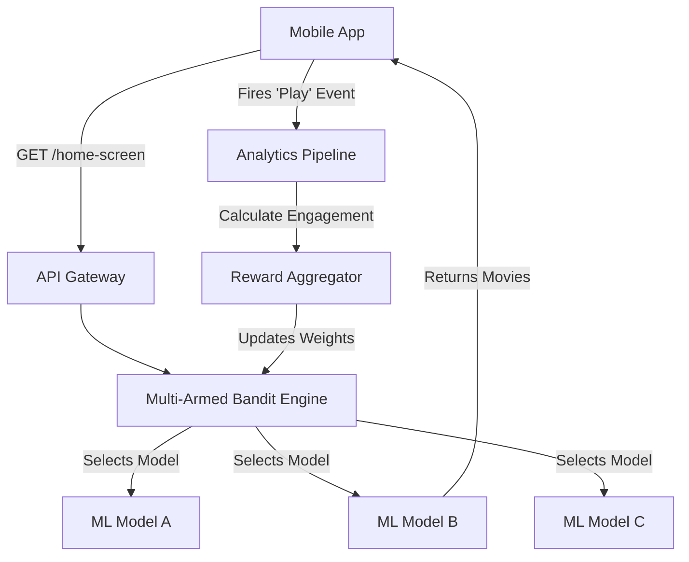

# Platform Design: Experimentation Platform (MABs & Interleaving)

## The Prompt

*"Design an Experimentation Platform for Netflix's home screen. The system must test 5 different recommendation algorithms simultaneously. Unlike a simple A/B test (Red vs Green button), we need to test complex, dynamic lists of movies. If one algorithm is performing terribly, the system should automatically route traffic away from it without requiring an app update or a PM's manual intervention."*

## 1. Requirements & Clarification (RADIO Framework)

### Functional Requirements
- Evaluate multiple dynamic variants (Machine Learning models).
- Dynamically adjust traffic allocation based on real-time performance.
- Support complex UI testing (e.g., mixing results from Model A and Model B in the same list).

### Non-Functional Requirements (NFRs)
- **Automation (Priority 0):** The system must self-heal. If a model drops engagement by 20%, traffic must be cut instantly.
- **Latency:** Requesting the personalized list of movies must return in < 200ms.
- **Statistical Power:** Must reach statistical significance faster than a standard A/B test.

## 2. High-Level Architecture (The Multi-Armed Bandit)

A standard A/B test uses a static 50/50 split for 4 weeks.
A Staff-level Experimentation Platform uses a **Multi-Armed Bandit (MAB)** algorithm.



## 3. The Core Flows (Deep Dive)

### Flow 1: Multi-Armed Bandits (Explore vs Exploit)
*Interviewer:* "You are testing 5 recommendation algorithms. Model C is broken and recommends kids movies to everyone. In a standard A/B test, 20% of your users will have a terrible experience for 4 weeks until the test ends. How do you prevent this?"

**Staff Answer:**
"We replace the static A/B test with a **Multi-Armed Bandit (MAB)** using Thompson Sampling or UCB (Upper Confidence Bound).
1. On Day 1, the MAB routes traffic equally (20% to each of the 5 models). This is the **Explore** phase.
2. The Android app sends engagement telemetry ('Play' events) back to the server.
3. The server calculates the 'Reward' for each model. Model C has near-zero engagement. Model B is performing exceptionally well.
4. On Day 2, the MAB automatically updates its routing weights. It routes 0% to Model C, 10% to Models A, D, E, and 70% to Model B. This is the **Exploit** phase.
5. The system continuously self-optimizes in real-time, protecting the user experience without human intervention."

### Flow 2: Interleaving (The Netflix Method)
*Interviewer:* "Testing Model A (Control) against Model B (Variant) usually requires 100,000 users over 4 weeks to prove statistical significance because users have wildly different tastes. How can you prove Model B is better in just 1 week?"

**Staff Answer:**
"We use **Interleaving**. Instead of showing User 1 only Model A and User 2 only Model B, we show a single user a blended list.
1. Model A recommends: `[Batman, Superman, Spiderman]`.
2. Model B recommends: `[Inception, Interstellar, Matrix]`.
3. The Backend interleaves them like a zipper: `[Batman, Inception, Superman, Interstellar...]`.
4. The Android app renders the list. The user doesn't know they are mixed.
5. The user taps 'Inception'. The Android app fires a click event.
6. The backend attributes the 'win' to Model B.
Because the same user is evaluating *both* models simultaneously under identical conditions (time of day, mood, device), the statistical variance is practically eliminated. Netflix proved that Interleaving requires 10x to 100x fewer users to reach statistical significance compared to traditional A/B testing."

### Flow 3: Server-Driven UI (SDUI)
*Interviewer:* "You want to run an experiment to completely redesign the layout of a movie card (changing the image aspect ratio, moving the title to the top). Do you build this as an A/B test inside the Android codebase?"

**Staff Answer:**
"No. Complex UI experiments hardcoded into the Android app require an App Store release, wait 2 weeks for adoption, and if the experiment fails, the dead code sits in the app forever (Technical Debt).
We must use **Server-Driven UI (SDUI)**.
1. The Android app does not hardcode the UI layout. It contains a rendering engine capable of drawing generic primitives (Rows, Columns, Text, Images).
2. The Backend Experimentation Platform decides which layout the user gets.
3. The Backend sends a JSON payload dictating the exact UI structure:
```json
{
  "type": "column",
  "children": [
    { "type": "image", "url": "batman.jpg", "aspectRatio": "16:9" },
    { "type": "text", "value": "Batman", "style": "bold_title" }
  ]
}
```
4. The Android app simply parses the JSON and renders it. The experiment lives 100% on the server, allowing us to test infinite UI variations without ever updating the mobile app."

## 4. Failure Modes & Bottlenecks

### Bottleneck: The Blind MAB
*Interviewer:* "Your Multi-Armed Bandit routes 99% of traffic to Model B. But Model B is actually optimizing for 'Clickbait' rather than 'Watch Time'. Users click, watch 5 seconds, and leave. Your platform thinks Model B is winning."

**Staff Answer:**
"The MAB is only as intelligent as its **Reward Function**.
If the Reward is a simple click, the MAB will inevitably devolve into clickbait.
**The Fix:** The Android Telemetry SDK must send deep, duration-based metrics. The Reward Function must be a composite metric: `(Click * 0.1) + (WatchTimeInMinutes * 0.9)`. The MAB must only reward the model when the user actually engages with the content, aligning the algorithm with the actual business goals."

### Bottleneck: Cache Defeat
*Interviewer:* "Your API Gateway caches the `/home-screen` JSON payload for 5 minutes. The MAB decides to give User A the Variant. The API Gateway returns the cached Control response. The MAB is broken."

**Staff Answer:**
"Experimentation completely destroys simple URL-based caching.
1. The CDN/API Gateway can no longer cache based solely on `URL`.
2. The cache key must include the `Experiment ID` and `Bucket ID`.
3. Alternatively (and more commonly), personalized feeds heavily driven by ML models and MABs are **Uncacheable** at the Edge. They must be computed dynamically on the core backend for every request. We mitigate this by aggressively caching the *underlying data* (the movie metadata) in Redis, while keeping the *sorting/aggregation layer* (the MAB) dynamic."

## 5. Staff Engineer Thinking: The Cost of Experimentation

A Staff Engineer understands that not everything should be an experiment.
Running a Multi-Armed Bandit or an Interleaved ML test is incredibly expensive in terms of CPU, latency, and engineering overhead.

*Staff Rule of Thumb:*
- **Change Button Color?** Use Client-Side Deterministic Hashing (0ms latency, zero backend cost).
- **Change Checkout Flow?** Use Server-Side A/B Testing.
- **Change ML Recommendation Algorithm?** Use Multi-Armed Bandits and Interleaving.
- **Change entire UI Layouts rapidly?** Use Server-Driven UI (SDUI).

Matching the architectural complexity to the specific business need is the hallmark of a Staff Engineer.

## 6. Probing Questions (For Practice)

1.  Explain the fundamental difference between a standard 50/50 A/B Test and a Multi-Armed Bandit (MAB).
2.  Describe the "Explore vs Exploit" trade-off. How does a MAB protect the user experience if one variant is catastrophically broken?
3.  Walk through the concept of "Interleaving" in ML recommendation systems. Why does this reach statistical significance faster than standard A/B testing?
4.  Why is hardcoding complex UI layout experiments into the Android client considered massive technical debt, and how does Server-Driven UI (SDUI) solve this?
5.  Describe the JSON payload structure necessary for an Android app to render a Server-Driven UI screen.
6.  Explain the "Clickbait Problem" in Multi-Armed Bandits. How must the Android Telemetry SDK be designed to provide a better Reward Function?
7.  Why does personalized experimentation (MABs/ML) defeat traditional Edge CDN caching (like Cloudflare), and how do you mitigate the backend load?
8.  If the Backend interleaves results from Model A and Model B, how does the Android app correctly attribute the user's click to the winning model?
9.  When should a team use Client-Side Hashing versus a Server-Side Multi-Armed Bandit? (Provide examples of both).
10. Describe the architectural challenges of implementing a "Pull-to-Refresh" action on a feed driven by a Multi-Armed Bandit that is constantly shifting its weights.

## Further Reading

- [`a-b-testing-infrastructure.md`](a-b-testing-infrastructure.md) — The foundation of Client-Side A/B testing.
- [`caching.md`](../engineering-fundamentals/caching.md) — Why ML pipelines defeat Edge CDNs.
- [`telemetry-sdk.md`](telemetry-sdk.md) — How the Reward Function telemetry is reliably transmitted from the device.
