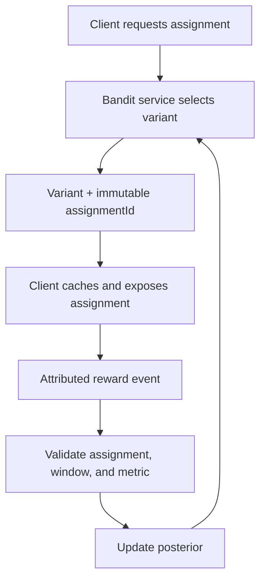
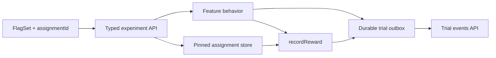

# Experimentation Platform (Beyond A/B)

> A 45-60 minute mobile system-design walkthrough for an experimentation platform that goes beyond fixed A/B, centered on multi-armed bandits, from the mobile client's perspective. Interleaving and sequential testing are named for context only. Built on top of `feature-flags-and-remote-config.md` and `a-b-testing-infrastructure.md`.

---

## 1. Gathering Requirements (~5 min)

> **Interviewer:** "Design an experimentation platform — go beyond fixed A/B."
> **Candidate:** "Multi-armed bandits (MAB) shift traffic to better-performing variants in real time. Interleaving is for ranking experiments. Sequential testing changes how we decide to stop. From the mobile client side, MAB is the interesting integration. I'll deep-dive the MAB client."

### Functional Requirements
- **Fixed A/B** support (the previous file).
- **Multi-armed bandits**: server adapts traffic by performance.
- **Reward reporting**: client signals success per arm.
- **Sticky assignment within a chosen unit** (session or user) even as bandits shift.
- **Eligibility filters** (only ship a variant to users who qualify).

### Non-Functional Requirements
- **Fast assignment** — no extra network hop.
- **Reward must be attributable** to the exposed arm.
- **Privacy-aware** — reward signals scrub PII.
- **Auditable** — every assignment + reward traceable.
- **Resilient** — falls back to control, outside the experiment, if bandit service is down.

### Out of Scope
- Bandit algorithm internals (Thompson sampling, UCB, ε-greedy) — server's domain
- Interleaving experiments (for search/feed ranking, specialist)
- Sequential analysis statistics (server)
- Causal inference / observational studies
- Marketing campaign optimization

---

## 2. Clarifying Questions (~3 min)

| Question | Why it matters |
|---|---|
| Bandit algorithm policies (single per experiment)? | API shape |
| Reward latency (immediate vs delayed)? | Buffer + late-attribution |
| Sample budget per arm? | Convergence rate |
| Cross-platform parity? | Server-side assignment |
| Default if bandit service down? | Fall back to control or last-known winner |
| Reward signals (click, conversion, retention)? | Capture latency |
| Bandit rebalance cadence? | Sticky session enforcement |

> **Candidate:** "Per-experiment Thompson sampling, conversion rewards within 24 hours of exposure, server-side assignment, fall back to control on bandit failure, one active assignment per user and pin unit so platforms agree."

---

## 3. High-Level Diagram (~10 min)



Every reward references the assignment that caused it; without that immutable join key, delayed or repeated outcomes corrupt the adaptive policy.

**Components:**
- **`BanditClient`** — talks to flag service + reward endpoint.
- **`AssignmentDao`** — stores each pinned assignment, with its arm, for reward attribution.
- **`TrialOutbox`** — one durable, ordered queue of exposure and reward events.
- **Server-side Bandit Service** — black box; runs the algorithm.

---

## 4. API Contract

### Flag response (bandit-aware)

The request names the current session, so the server can issue an assignment for that pin.

```json
{
  "killedExperiments": [],              // read live; overrides any pinned assignment
  "flags": {
    "onboarding_variant": {
      "type": "variant",
      "value": "C",
      "experimentId": "exp_onboarding_v7",
      "assignmentId": "asg_8f7a",       // unique to one trial for one pin
      "ownerUserId": "u_1",
      "pinKey": "u_1",                  // the session ID or user ID this was issued for
      "policy": "bandit_thompson",
      "policyVersion": 12,
      "isHoldout": false
    }
  }
}
```

### Trial events

```http
POST /v1/experiments/trial-events
{
  "events": [
    { "eventId": "4b7d…", "seq": 41, "type": "EXPOSURE",   // IDs created once on the client, resent unchanged
      "assignmentId": "asg_8f7a", "experimentId": "exp_onboarding_v7", "ts": ... },
    { "eventId": "9c1e…", "seq": 42, "type": "REWARD",
      "assignmentId": "asg_8f7a", "experimentId": "exp_onboarding_v7",
      "rewardType": "onboarding_completed", "rewardValue": 1.0, "ts": ... }
  ]
}
```

### Fallback flag (if bandit service down)

```json
{
  "flags": {
    "onboarding_variant": { "type": "variant", "value": "control",
                            "experimentId": "exp_onboarding_v7",
                            "policy": "fallback_control" }
  }
}
```

---

## 5. Mobile App Architecture

### Module structure

```
:lib:experiments               ← (from a-b-testing-infrastructure)
:lib:bandits
    bandits-api                ← reward typed accessors
    bandits-core               ← AssignmentDao, TrialOutbox
```

### Layered diagram



The client persists enough assignment context to attribute a later reward, while the durable outbox keeps exposure before reward and prevents transient connectivity from silently biasing observed outcomes.

### Key class signatures

```kotlin
abstract class BanditExperiment<T : Variant>(
    id: String,
    flagKey: String,
    default: T,
    variants: List<T>,
    val unit: PinUnit,                      // SESSION or USER
) : Experiment<T>(id, flagKey, default, variants) {
    abstract suspend fun assignment(): BanditAssignment<T>
    abstract suspend fun recordReward(handle: AssignmentHandle, type: String, value: Double = 1.0)
}

data class BanditAssignment<T>(val variant: T, val handle: AssignmentHandle?)   // null: not in the experiment

@JvmInline value class AssignmentHandle(val assignmentId: String)
```

---

## 6. Local Storage

```kotlin
@Entity(
    tableName = "bandit_assignments",
    primaryKeys = ["ownerUserId", "experimentId", "pinKey"],
    indices = [Index(value = ["assignmentId"], unique = true)],   // one trial, one pin
)
data class AssignmentEntity(
    val ownerUserId: String, val experimentId: String,
    val pinKey: String,                    // session ID or user ID, by the experiment's PinUnit
    val assignmentId: String?,             // null: pinned as not in the experiment
    val variant: String,                   // the arm itself, so it survives flag changes
    val policyVersion: Int?,
    val assignedAt: Long,
    val firstExposedAt: Long?              // null until shown; starts the reward window
)

@Entity(tableName = "bandit_trial_events", indices = [Index(value = ["eventId"], unique = true)])
data class TrialEventEntity(
    @PrimaryKey(autoGenerate = true) val seq: Long = 0,   // upload order
    val eventId: String,                                  // saved once, resent unchanged
    val ownerUserId: String,
    val type: TrialEventType,                             // EXPOSURE or REWARD
    val assignmentId: String, val experimentId: String,
    val rewardType: String?, val rewardValue: Double?, val ts: Long
)
```

A session pin is kept until its reward window closes (24h after first exposure, or sooner if never shown). A user pin is kept as long as the experiment runs, because deleting it would let a lasting assignment such as onboarding change. Trial events are flushed by their own worker. Sign-out tries a final flush for that user, then purges their rows.

---

## 7. Deep Dive: Bandit Client (~15 min)

> *I'd pick this as the deep dive because the MAB client looks like A/B but the reward attribution is where everything gets subtle: which arm gets credit, when, and how to avoid leaking signal from delayed conversions.*

### Assignment

Server returns the variant + `assignmentId` per fetch. The `assignmentId` is unique per assignment instance. A bandit can change a user's arm between pins as the algorithm explores, or keep each user on one arm and shift traffic only for new users.

> **Trade-off:** choose the pin unit per surface. A surface where each session stands alone, such as a promo card, can pin per session. Onboarding or anything with a lasting effect pins per user, because switching a returning user's arm carries over: an outcome credited to one arm may have been caused by the earlier one. Pinning per user doesn't stop the bandit adapting, since it still shifts allocation for new users. Either way, the bandit assumes arm quality is fairly stable; a surface with strong carry-over or a long delay is a better fit for fixed A/B.

### Pinned assignment policy

```kotlin
class BanditExperimentImpl<T : Variant>(...) : BanditExperiment<T>(...) {
    private val mutex = Mutex()        // first-assignment check and write are one step

    // Pinned per session or per user. Holdout, eligibility and fallback are decided before anything is exposed.
    suspend fun assignment(): BanditAssignment<T> = mutex.withLock {
        val owner = session.userId()
        // A kill overrides a pin but doesn't erase it; the stored row stays for analysis.
        if (id in flags.value.killedExperiments) return@withLock BanditAssignment(default, handle = null)

        val pinKey = if (unit == PinUnit.USER) owner else currentSessionId()
        dao.pinned(owner, id, pinKey)?.let { return@withLock it.toAssignment() }

        // A cached assignment belongs to the pin it was issued for. Reusing it would merge two trials.
        val raw = flags.value.variantFor(flagKey)?.takeIf { it.ownerUserId == owner && it.pinKey == pinKey }
        val candidate = raw?.takeIf { it.policy != FALLBACK_CONTROL && !it.isHoldout }?.let(::pickVariant)
        val row = if (raw != null && candidate != null && eligibility.check(candidate)) {
            AssignmentEntity(owner, id, pinKey, raw.assignmentId, candidate.name, raw.policyVersion, clock.now())
        } else {
            AssignmentEntity(owner, id, pinKey, assignmentId = null, default.name, policyVersion = null, clock.now())
        }
        // A not-enrolled user pin isn't stored, so a later assignment for this user can still apply.
        if (row.assignmentId != null || unit == PinUnit.SESSION) dao.insert(row)
        row.toAssignment()
    }

    // Call where the arms first differ. A row with no assignmentId is never exposed or rewarded.
    suspend fun recordExposure(a: BanditAssignment<T>) {
        if (a.handle == null) return
        val snap = dao.byAssignmentId(a.handle.assignmentId) ?: return
        trialOutbox.recordFirstExposure(snap, clock.now())   // starts the reward window and opens the trial
        exposureSink.log(id, a.variant.name, a.handle.assignmentId)   // analysis; separate and best-effort
    }
}
```

> The first read locks the assignment for the pin unit, durably, so a process restart reads the same arm. Later reads return the same variant, even if the server rebalances mid-session. The stored variant means no flag change can alter it. A row with no `assignmentId` records "not in this experiment", so a late flag refresh can't flip the user mid-session either. That includes a read before this session's flags arrive, so the session-start fetch should finish first where it can, and the rate of such misses is worth watching. The UI also observes `flags.killedExperiments` and asks again when it changes, so a kill reaches a screen that's already showing a treatment.

### Reward reporting

```kotlin
// The flow that started under an assignment keeps its handle, and stores it in its own durable record.
suspend fun recordReward(handle: AssignmentHandle, type: String, value: Double = 1.0) {
    val snap = dao.byAssignmentId(handle.assignmentId) ?: return
    if (snap.ownerUserId != session.userId()) return              // never credit another account
    val exposedAt = snap.firstExposedAt ?: return                 // never shown, so no trial to credit
    if (clock.now() - exposedAt > REWARD_WINDOW_MS) {
        diagnostics.lateConversion(id, type)                      // late_conversion, no reward
        return
    }
    trialOutbox.enqueue(TrialEventEntity(
        eventId = UUID.randomUUID().toString(),                   // saved once, resent unchanged
        ownerUserId = snap.ownerUserId,
        type = TrialEventType.REWARD,
        assignmentId = snap.assignmentId!!,
        experimentId = id,
        rewardType = type, rewardValue = value,
        ts = clock.now()
    ))
}
```

### Reward attribution window

A user is exposed to variant `C` at 10:00. They start checkout, then a new session assigns `B`, and they convert at 10:32. The reward should attribute to the 10:00 assignment, not whatever variant they'd be in at 10:32.

A lookup by experiment can't recover that, because "the latest assignment" is `B` by then. So the caller passes the handle captured when the flow began, which can outlive the session. `REWARD_WINDOW_MS` = 24h here, counted from first exposure, the same event that opens the server's trial. An assignment saved at 09:00 and first shown at 10:00 can still earn a reward at 09:30 the next day. Older than that and we conservatively drop the reward signal. The client's check only saves an upload; the server decides from its own trial record, because device clocks can be wrong.

### What counts as a trial

The client reports only successes, so the server has to know about failures. Exposed users who never convert are the failures for Thompson sampling. If they don't count, every arm looks perfect and the arm with more traffic collects more credit: 5% of 1,000 users gives 50 successes, while 10% of 100 gives 10, so the worse arm wins.

So the contract is:
- A valid `EXPOSURE` event opens a trial on the server. An assignment that was fetched but never exposed isn't a trial.
- A reward closes that trial as a success.
- When the window ends without a reward, the server closes it as reward 0.
- A binary reward counts once per `(assignmentId, rewardType)`. A repeatable reward counts once per `eventId`.

The outbox below is what makes this contract hold.

### Trial outbox (durable, ordered, batched)

Exposures and rewards share one ordered queue, because their order decides the result. If they travelled separately, a reward could arrive first, be rejected as an unknown trial and be deleted, and the late exposure would then open a trial that closes as a false zero.

```kotlin
class TrialOutbox @Inject constructor(
    private val db: AppDatabase,
    private val eventDao: TrialEventDao,
    private val workManager: WorkManager,
) {
    // Atomic: a crash leaves both the marker and its event, or neither.
    suspend fun recordFirstExposure(snap: AssignmentEntity, now: Long) {
        db.withTransaction {
            if (dao.markExposedIfUnset(snap.assignmentId!!, now)) {
                eventDao.insert(TrialEventEntity.exposure(snap, eventId = UUID.randomUUID().toString(), now))
            }
        }
        enqueueFlush(snap.ownerUserId)
    }

    suspend fun enqueue(reward: TrialEventEntity) {
        eventDao.insert(reward)
        enqueueFlush(reward.ownerUserId)
    }

    // APPEND_OR_REPLACE: KEEP would ignore this while a worker is finishing its last read.
    private fun enqueueFlush(owner: String) =
        workManager.enqueueUniqueWork("trial-flush-$owner", APPEND_OR_REPLACE, trialFlushWork(owner))
}

@HiltWorker
class TrialFlushWorker @AssistedInject constructor(...) : CoroutineWorker(ctx, params) {
    override suspend fun doWork(): Result {
        val owner = inputData.getString(KEY_OWNER_USER_ID) ?: return Result.failure()   // fixed at enqueue
        repeat(MAX_BATCHES) {
            val batch = eventDao.takeOldest(owner, limit = 100)     // ordered by seq
            if (batch.isEmpty()) return Result.success()
            val response = try {
                api.reportTrialEvents(owner, batch.toWire())        // CancellationException propagates
            } catch (e: IOException) {
                return Result.retry()
            }
            // Accepted, duplicate or permanently rejected. An event the server can't place yet stays queued.
            eventDao.delete(response.settledEventIds)
            if (response.settledEventIds.isEmpty()) return Result.retry()
        }
        workManager.enqueueUniqueWork("trial-flush-$owner", APPEND_OR_REPLACE, trialFlushWork(owner))   // more may remain
        return Result.success()
    }
}
```

App start also enqueues a flush for the signed-in owner if rows exist, covering a process death before enqueue, or a chained job that failed. The analytics `experiment_exposure` event still goes out for analysis, but only this outbox event opens a trial.

The server handles a batch in `seq` order and dedupes by `eventId`. It closes a trial at the end of the window **plus a delivery grace period**, so an offline user's exposure and reward can still arrive together before a zero is recorded. After a kill, it refuses new exposures but still accepts a reward for an exposure made before the kill, because rejecting those delayed conversions would bias the result.

**Owner binding.** Reading the current session when the worker starts wouldn't protect uploads, since a batch can be loaded for A and sent after B signs in. So the worker takes its owner as immutable input, and `reportTrialEvents` gets credentials for that owner, with the network layer refusing any other token. Sign-out cancels that owner's unique work as cleanup. The server also checks that each assignment belongs to the authenticated principal.

### Eligibility filtering

Some variants are only valid for some users (e.g., a premium-only feature variant). The flag service applies the filter server-side and either omits the variant or returns control.

Late-known eligibility is checked on the client inside `assignment()`, **before** the row is committed or an exposure logged. Filtering afterwards would leave a logged exposure and a stored assignment for an arm the user never saw, and could bias the arms. The client logs what was actually delivered, and an ineligible user holds no handle, so no reward can be credited.

### Failure modes

| What breaks | Behavior |
|---|---|
| Bandit service down | Server returns control with `policy: fallback_control` |
| Reward sent for unknown `assignmentId` | Can't happen by ordering alone, since exposure goes first. If it does, the server keeps it unsettled and retried; rejects it only for a bad owner or after the window plus grace; and counts it |
| Crash during first exposure | Marker and exposure event commit together, so a reward can't exist without its trial's event |
| User exposed, never converts | Server closes the trial as reward 0 when the window ends |
| Late conversion (> window) | Drop client-side; report a `late_conversion` diagnostic |
| User in holdout | Server says so; skip bandit entirely; default arm; no handle, so no reward attribution |
| Session boundary mid-flow | The flow keeps its handle, so the reward credits the arm that started it |
| Treatment is harmful | Live kill list overrides the pin; default arm, no new exposures; the row stays for analysis |
| Cached assignment from an earlier pin | Not reused; this pin stays not enrolled until the server issues one |
| More than one batch queued | Worker drains in a bounded loop, then chains one follow-up |
| Event enqueued as the worker finishes | `APPEND_OR_REPLACE` runs another pass; app start covers a process death or a failed chain |

---

## 8. Trade-offs

### Bandit assignment

| Option | Pros | Cons | Verdict |
|---|---|---|---|
| **Server-side per request** | Algorithm-driven, central | Network round-trip on each fetch | Pick this |
| Server pre-computed cohort | No real-time adaptation | Stale | Skip for MAB |
| Client-side bandit | Latency-friendly | Diverges from server, hard to debug | Skip |

### Sticky-within-session

| Option | Pros | Cons | Verdict |
|---|---|---|---|
| **Session-locked assignment** | Coherent UX; more trials per user | Carry-over between sessions; a user's arm can change | Pick for surfaces where each session stands alone |
| **User-locked assignment** | Consistent experience; no carry-over | Fewer trials; adapts only through new users | Pick for onboarding and lasting effects |
| Per-screen assignment | Faster convergence | Confusing UX, often invalid | Skip |

### Reward latency

| Option | Verdict |
|---|---|
| **Immediate reward** (within session) | Easiest; preferred when possible |
| **Delayed reward** (within 24h) | Pick — keep pinned assignments for the window |
| Multi-day rewards | Server-side join; not client's problem |

### Reward signal

| Option | Verdict |
|---|---|
| **Boolean conversion** | Pick when simple (clicked / didn't) |
| Scalar value (revenue) | Pick when value matters |
| Latency-based | Possible; tricky to interpret |
| Implicit (dwell time) | Useful but noisy |

### Fallback

| Option | Verdict |
|---|---|
| **Control variant on bandit failure** | Pick — safest |
| Last-known winner | OK if known and acceptable to ship |
| Crash | Don't |

---

## 9. Major Concerns

- **Stickiness.** A user must not see arm A on screen 1 and arm B on screen 2. Lock on first read, atomically and durably.
- **Reward leakage.** A reward fired after user switched arms (e.g., due to logout/login) must not attribute incorrectly. The flow passes its handle, and the owner is checked.
- **Privacy.** Reward types shouldn't reveal PII. Use category labels (e.g., `purchase_completed`, not `purchased_xyz_product`).
- **Late conversions.** Set one window for each experiment, past which rewards are dropped, and use it on both client and server. Otherwise opportunistic conversions reward whichever arm is current.
- **Bandit convergence.** Need a minimum sample per arm before traffic shifts heavily. Server enforces; client just consumes.
- **Cross-platform consistency.** Same user on iOS and Android should not be in different arms of the same bandit at the same time. Server keys by user id, not device, and returns the active assignment for that pin rather than a new draw per fetch.
- **Holdout interaction.** Bandits live within the layered experimentation system. Holdout users always get control, and the server's `isHoldout` is checked before anything else.
- **Debugging.** Without pinned assignment, debugging is nearly impossible. Engineers can't reproduce.
- **Policy names.** The client needs `policy` only to spot the fallback. Keep it out of user-facing UI.

---

## 10. Follow-up Questions

> **Q: User opens the app, app fetches flags (variant C), user converts in 5 minutes — what happens?**
> Room holds `(experimentId, assignmentId=asg_8f7a, variant=C)`, and the exposure opened a trial on the server. The reward event sends `assignmentId=asg_8f7a`. Server records a success on that trial, and C's posterior improves. The next user might be more likely to see C if Thompson sampling boosts it.

> **Q: User opens the app while offline — what variant do they get?**
> A user pin already in Room keeps its arm. A new session pin can't reuse the cached assignment, because that assignment is a trial for an earlier pin, so the session gets control, not enrolled. Rewards and exposures already queued wait for reconnect.

> **Q: Why not let the client run the bandit algorithm?**
> Cross-platform consistency (the same user across iOS and Android), centralized algorithm changes, and server-side has the global posterior view that no single client can have.

> **Q: What if a reward needs a 7-day window?**
> The experiment's window becomes 7 days on both sides, counted from first exposure, Room keeps session pins that long, and flows still pass their handle. The bandit then learns slowly, because a trial stays open for a week. Past that, a server-side join is a better design than holding assignments on the client.

> **Q: A reward fires twice (network retry) — how is dedup handled?**
> Each event has a UUID `eventId`, created before upload and resent unchanged. The server dedups on `eventId`. Binary rewards also count once per `(assignmentId, rewardType)`, so two separate taps can't double-credit. A timestamp makes a poor key, because it can merge separate rewards.

> **Q: How is this tested?**
> Fake `FlagsRepository` that returns scripted assignments. Fake server for `TrialOutbox`. Property tests: same pin always returns same variant, including after a simulated restart and under concurrent first reads. A delayed reward credits the original arm after a new session. A reward just inside the window counts from first exposure, not assignment. A cached assignment isn't reused for a new pin. A kill overrides a pin. An ineligible user produces no exposure. 101 queued events all upload, in order. A crash during first exposure leaves both the marker and its event, or neither. A reward can't reach the server before its exposure.

---

## 11. Out of Scope (defended)

- **Algorithm internals** (Thompson, UCB, ε-greedy) — server-side; vendor or in-house data science.
- **Interleaving** — ranking-specific; specialist.
- **Sequential testing** — analysis methodology.
- **Causal inference** — observational studies, separate problem.
- **Server admin** — non-mobile.

---

## 12. Further Reading

- [A Tutorial on Thompson Sampling](https://arxiv.org/abs/1707.02038) — Russo et al.; the algorithm and Bernoulli bandits.
- [Microsoft — Diagnosing sample ratio mismatch](https://www.microsoft.com/en-us/research/articles/diagnosing-sample-ratio-mismatch-in-a-b-testing/) — why uneven logging breaks analysis.
- [Statsig documentation](https://docs.statsig.com/) — vendor docs.
- [Vowpal Wabbit](https://vowpalwabbit.org/) — open-source contextual bandit project.

---

> **Closing in the interview:** "Bandit client was my deep dive because sticky-within-session + reward attribution is where most bugs live. Happy to dig into eligibility filtering, layered bandits, or the late-conversion handling next."
