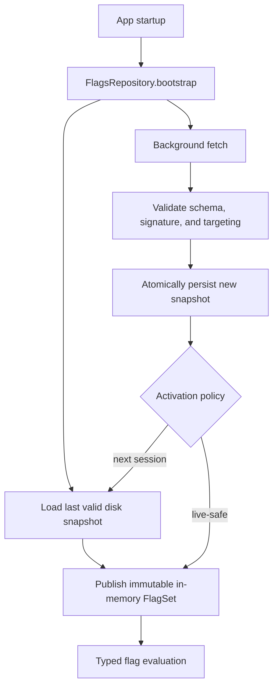
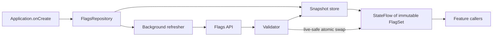
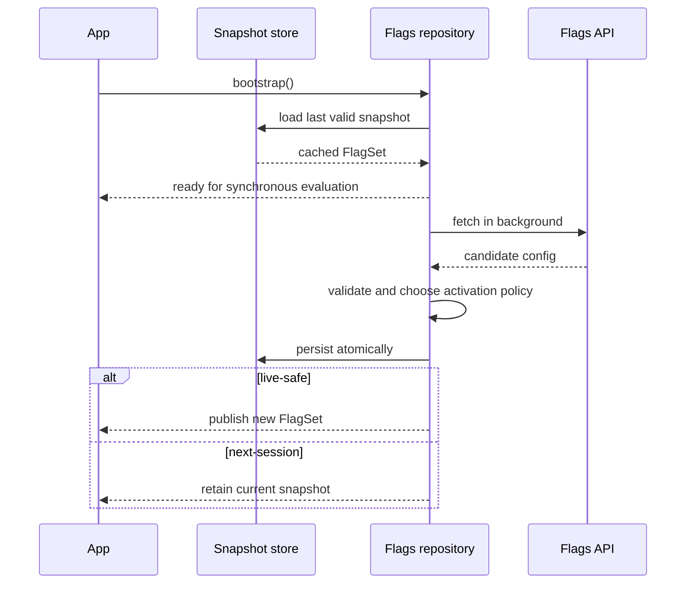

# Feature Flags & Remote Config

> A 45-60 minute mobile system-design walkthrough for the feature-flag + remote-config subsystem of an Android app: kill switches, server-driven config, evaluation rules, fetch lifecycle, fallback for offline. A/B experimentation builds on top (next file).

---

## 1. Gathering Requirements (~5 min)

> **Interviewer:** "Design a feature-flag and remote-config system for a mobile app."
> **Candidate:** "Three core problems: (1) evaluate consistently when the same user opens the app twice, (2) fetch reliably without blocking startup, (3) survive offline. I'll deep-dive the evaluation + fetch cycle."

### Functional Requirements
- **Boolean flags** (kill switch).
- **String / number config values** (e.g., button text, retry count).
- **Variant flags** (control / B / C) — same primitive used by experimentation.
- **Targeting rules** (by app version, country, locale, device tier).
- **Type-safe access** at call sites.

### Non-Functional Requirements
- **Synchronous reads** — `flag("feature_x").bool` returns from memory.
- **Fetch never blocks UI**.
- **Stable** for the session — flag doesn't flip mid-session unless explicitly opted in.
- **Offline safe** — last good values served from disk.
- **Auditable** — every evaluation can be logged.

### Out of Scope
- Statistical analysis of variants (see `a-b-testing-infrastructure.md`)
- Multi-armed bandit assignment (see `experimentation-platform.md`)
- Server-side flag UI / changeflow (out of mobile scope)
- Encryption at rest of flag values (handled by EncryptedSharedPrefs if sensitive)

---

## 2. Clarifying Questions (~3 min)

| Question | Why it matters |
|---|---|
| Who owns flags (eng, PM, both)? | UX of config editing |
| How many flags total? | Payload size, evaluation cost |
| Targeting granularity (country, version)? | Rule engine complexity |
| Need server-side evaluation? | Some flags must not be guessable client-side |
| Refresh cadence? | Periodic vs on-launch |
| Default for unknown flag? | Safe-default policy |
| Need sticky bucketing per user? | User-id hash routing |

> **Candidate:** "Mixed ownership, ~200 flags, targeting by version/country/locale/tier, sticky bucketing by user id, refresh on launch + every 4 hours, default-on or default-off per flag, single-tenant."

---

## 3. High-Level Diagram (~10 min)



Startup never waits for the network: callers receive a last-known-good immutable snapshot, while a validated background fetch is activated live only when the flag's policy permits it.

**Components:**
- **`FlagsRepository`** — bootstraps, fetches, persists.
- **`Evaluator`** — applies targeting rules; produces a `FlagSet`.
- **`FlagSet`** — immutable snapshot read by the rest of the app.
- **`FlagFetcher`** — REST client for `/v1/flags`.
- **`FlagsStore`** — DataStore-backed persistence (JSON).

---

## 4. API Contract

### Server payload

```json
GET /v1/flags?appVer=4.12.1&os=14&country=IN&locale=en-IN&deviceTier=mid
200 OK
{
  "flags": {
    "new_checkout": { "type": "bool", "value": true },
    "max_retry": { "type": "int", "value": 5 },
    "feed_layout": { "type": "string", "value": "grid", "variant": "B" }
  },
  "evaluatedAt": 1750000000,
  "stickyBucketSeed": "u_42"     // for client-side sticky bucketing of new flags
}
```

### Caller API (typed)

```kotlin
object Flags {
    val newCheckout: BooleanFlag = bool("new_checkout", default = false)
    val maxRetry: IntFlag = int("max_retry", default = 3, range = 1..10)
    val feedLayout: VariantFlag = variant("feed_layout", default = "control", values = listOf("control", "A", "B"))
}

// Usage:
if (Flags.newCheckout()) { ... }
val retries = Flags.maxRetry()
```

### Exposure event (analytics piggyback)

```json
{
  "event": "flag_exposed",
  "flag": "new_checkout",
  "value": true,
  "variant": null,
  "evaluatedAt": ...
}
```

> Exposure events are only fired when a flag is actually read (lazy), not on fetch.

---

## 5. Mobile App Architecture

### Module structure

```
:lib:flags
    flags-api          ← public typed Flags object
    flags-core         ← FlagsRepository, evaluator, store
    flags-codegen      ← optional KSP for typed accessors
```

### Layered diagram



One repository owns persistence, refresh, validation, and publication, preventing features from fetching remote configuration or observing partially updated values independently.

### Key class signatures

```kotlin
class FlagsRepository @Inject constructor(
    private val fetcher: FlagsFetcher,
    private val store: FlagsStore,
    private val evaluator: Evaluator,
    private val exposureSink: ExposureSink,
) {
    val flags: StateFlow<FlagSet>                       // immutable snapshot
    suspend fun bootstrap()                              // load disk + start refresh
    suspend fun refresh()                                // explicit refresh
}

class FlagSet internal constructor(private val raw: Map<String, RawFlag>) {
    fun bool(key: String, default: Boolean): Boolean
    fun int(key: String, default: Int): Int
    fun string(key: String, default: String): String
    fun variant(key: String, default: String): String
}
```

---

## 6. Local Storage

Use DataStore (Proto for typed, Preferences for simple):

```kotlin
// Snapshot serialized via kotlinx.serialization
@Serializable
data class FlagsSnapshot(val flags: Map<String, RawFlag>, val fetchedAt: Long)

@Serializable
data class RawFlag(val type: String, val value: JsonElement, val variant: String?)
```

Saved atomically via DataStore's `updateData { it.copy(...) }`. No partial writes.

---

## 7. Deep Dive: Evaluation + Fetch Cycle (~15 min)

> *I'd pick this as the deep dive because it covers: synchronous read API, async refresh, atomic apply policy, offline fallback, exposure tracking, and the type-safety story — the parts that decide whether the system is usable.*

### Bootstrap (on app start)

```kotlin
class DefaultFlagsRepository @Inject constructor(
    private val store: FlagsStore,
    private val fetcher: FlagsFetcher,
    private val evaluator: Evaluator,
    private val context: ContextProvider,
    private val scope: CoroutineScope,
) : FlagsRepository {

    private val _flags = MutableStateFlow(FlagSet.EMPTY)
    override val flags = _flags.asStateFlow()

    override suspend fun bootstrap() {
        // Phase 1: synchronous-from-disk
        val disk = store.read()
        _flags.value = evaluator.evaluate(disk, context.snapshot())

        // Phase 2: async refresh (does not block bootstrap)
        scope.launch { refresh() }
    }

    override suspend fun refresh() {
        runCatching { fetcher.fetch(context.snapshot()) }
            .onSuccess { resp ->
                store.write(FlagsSnapshot(resp.flags, resp.evaluatedAt))
                // POLICY: don't swap mid-session
                pendingSnapshot.value = FlagsSnapshot(resp.flags, resp.evaluatedAt)
            }
            .onFailure { /* log, keep current */ }
    }

    fun onAppForegrounded() {
        // Apply pending snapshot at session boundary
        pendingSnapshot.value?.let {
            _flags.value = evaluator.evaluate(it, context.snapshot())
            pendingSnapshot.value = null
        }
    }
}
```

### Apply policy

| Policy | When to apply |
|---|---|
| **Next session** (default) | Most flags — stable user experience, no surprise toggling mid-flow |
| **Next launch (cold)** | Big changes — wait for cold start to fully take effect |
| **Live update** | Kill switches only — must propagate immediately |

Encoded in the flag definition itself:

```kotlin
val killUploadDirty = bool("kill_upload_dirty", default = false, applyPolicy = ApplyPolicy.LIVE)
```

When a live flag's value changes mid-session, `_flags` updates immediately; otherwise we hold the snapshot until the next session boundary.

### Evaluator

```kotlin
class Evaluator @Inject constructor() {
    fun evaluate(snapshot: FlagsSnapshot, ctx: EvaluationContext): FlagSet {
        // Server is the primary evaluator; the client mostly enforces targeting that came pre-filtered.
        // For client-side sticky bucketing of variants without server round-trip:
        val resolved = snapshot.flags.mapValues { (key, raw) ->
            if (raw.type == "variant" && raw.variant == null) {
                val bucket = stickyBucket(key, ctx.userId)
                raw.copy(variant = pickVariant(key, bucket))
            } else raw
        }
        return FlagSet(resolved)
    }

    private fun stickyBucket(flagKey: String, userId: String): Int {
        val hash = Hashing.sha256().hashString("$flagKey|$userId", Charsets.UTF_8).asLong()
        return ((hash % 10_000) + 10_000) % 10_000
    }
}
```

> **Sticky bucketing** ensures the same user lands in the same bucket across sessions, even if the server didn't include `variant` (e.g., for backward-compat).

### FlagSet (the read surface)

```kotlin
class FlagSet internal constructor(private val raw: Map<String, RawFlag>) {
    fun bool(key: String, default: Boolean): Boolean {
        val r = raw[key] ?: return default
        if (r.type != "bool") return default
        ExposureSink.lazyLog(key, r.value)
        return r.value.jsonPrimitive.boolean
    }
    // ... int, string, variant
}
```

`ExposureSink.lazyLog` debounces: only logs each `(flagKey, sessionId)` pair once per session.

### Typed accessors (codegen)

A KSP processor reads a YAML or JSON schema and generates the `Flags` object:

```yaml
# flags.yaml
new_checkout:
  type: bool
  default: false
  applyPolicy: NEXT_SESSION
max_retry:
  type: int
  default: 3
  range: [1, 10]
```

Generates:

```kotlin
object Flags {
    val newCheckout: BooleanFlag = BooleanFlag("new_checkout", default = false)
    val maxRetry: IntFlag = IntFlag("max_retry", default = 3, range = 1..10)
}
```

### Default-safety

```kotlin
fun safeFlag(name: String, default: Boolean, callerContext: String = ""): Boolean {
    return runCatching { flags.value.bool(name, default) }
        .getOrElse {
            Telemetry.captureException(it)
            default
        }
}
```

Defaults are not "what we want" but "what's safest if the network/disk fails." Default-on if the feature is critical; default-off if it's risky.

### Fetch lifecycle



The lifecycle separates availability from freshness: cached flags make startup deterministic, and remote data becomes active only after validation and an explicit live-versus-next-session decision.

### Failure modes

| What breaks | Behavior |
|---|---|
| First-ever launch (no disk) | All defaults; fetch races to load before user interacts |
| Network down on launch | Last-good disk values used; refresh deferred |
| Server returns malformed JSON | Drop response, keep current; log |
| Disk file corrupted | Drop, use defaults; let fetch repair |
| Schema mismatch (new field) | Ignore unknown fields, use defaults |
| Two `refresh()` calls race | Single-flight in repository |

---

## 8. Trade-offs

### Storage

| Option | Pros | Cons | Verdict |
|---|---|---|---|
| **DataStore (Proto/Preferences)** | Coroutine-native, atomic | Slight ceremony | Pick this |
| EncryptedSharedPrefs | Use only if values are sensitive | Slower writes | Niche |
| Room | Overkill for ~200 keys | Slower reads | Skip |
| Plain SharedPrefs | Old | Synchronous main-thread danger | Skip |

### Fetch transport

| Option | Verdict |
|---|---|
| **REST GET** | Pick — cacheable, simple |
| WebSocket subscription | Real-time but heavy | Use only for kill switches |
| FCM hint to re-fetch | Pick — sends a best-effort silent tickle to re-fetch without constant polling; because Doze, OEM restrictions, and missed messages can delay or drop it, reconcile on foreground and with periodic work for correctness |

### Variant assignment

| Where? | Verdict |
|---|---|
| **Server** | Pick — central control, multi-platform parity |
| **Client (sticky bucketing)** | Use as fallback / offline path |
| Hybrid (server primary, client fallback) | Default |

### Apply policy

| Default | Verdict |
|---|---|
| **Next session** | Pick — stable user experience |
| Immediate | Confusing mid-flow; use only for kill switches |
| Next cold start | Safest; conservative |

### Codegen

| Option | Verdict |
|---|---|
| **KSP-generated typed accessors** | Pick — compile-time guarantees |
| Reflective `getFlag(name)` | Stringly-typed, error-prone |
| Hand-written wrappers | Toil; gets stale |

---

## 9. Major Concerns

- **Performance.** Reads are O(1) map lookups from in-memory snapshot. Never block on disk or network at call site.
- **Defaults matter.** Pick a safe default per flag. Imagine the flag service is down forever — does the app still work correctly?
- **Apply policy.** Don't flip flags mid-flow. Use "next session" by default. Live updates only for true kill switches.
- **Privacy.** No PII in the targeting context. Country/locale/version only. User id is hashed for bucketing.
- **Auditability.** Exposure events log which flag the user saw, exactly once per session. Drives A/B analysis later.
- **Sticky bucketing.** Hash by `(flagKey, userId)` so the same user is always in the same bucket, even if the server doesn't pre-assign.
- **Backward compatibility.** Old app versions must safely ignore new flag schemas. Forward compat: server only sends what the app version supports.
- **Killswitch coverage.** Every risky launch should have a corresponding kill switch. Treat them as table stakes for ship-readiness.

---

## 10. Follow-up Questions

> **Q: User opens the app, fetches new flags, presses Back, opens again — what flag values do they see?**
> Old values (the session is still active). Pending snapshot is queued and applied on a true session boundary (e.g., > 30s background). This prevents flickering UX mid-flow.

> **Q: How do you handle a kill switch needing to propagate in seconds?**
> Live-apply policy + an FCM data push that triggers a foreground refresh. Latency from "flip in dashboard" to "live on device" can be < 30s.

> **Q: How is the flag schema versioned?**
> The flag definition lives in a single YAML in the repo, generated into typed accessors. New flags can be added without server change (server returns unknown safely). Removed flags need a deprecation period (the YAML keeps them as "deprecated: true" for one release).

> **Q: How does multi-platform stay in sync?**
> Server is the source of truth for evaluation. iOS, Android, web all hit the same `/v1/flags` with their own context. Variant assignment is server-side so all platforms see the same bucket for the same user.

> **Q: How do you debug a "the flag isn't working" report?**
> Debug overlay (debug build only) showing every flag's current value and source (disk / server / default). Optionally a developer menu to override a flag locally.

> **Q: How is this tested?**
> Inject a fake `FlagsStore` and `FlagsFetcher`. Tests assert read values, apply-policy behavior, exposure logging. UI tests use a `TestFlagsRepository` that returns pre-set values.

---

## 11. Out of Scope (defended)

- **Statistical analysis** — `a-b-testing-infrastructure.md`.
- **Multi-armed bandits** — `experimentation-platform.md`.
- **Server-side flag UI** — admin tool, not mobile.
- **Encryption** — flags aren't sensitive in our model; if they were, EncryptedSharedPrefs path.
- **Cross-app flag sharing** — separate problem.

---

## 12. Further Reading

- [GrowthBook](https://www.growthbook.io/) — open-source flag/experimentation platform with mobile SDK.
- [Firebase Remote Config](https://firebase.google.com/docs/remote-config) — vendor reference.
- [Statsig SDK design](https://docs.statsig.com/) — modern vendor.
- [LaunchDarkly mobile patterns](https://launchdarkly.com/blog/) — apply-policy and offline considerations.
- [Martin Fowler — Feature Toggles](https://martinfowler.com/articles/feature-toggles.html) — taxonomy: release, ops, experiment, permission toggles.

---

> **Closing in the interview:** "I anchored on the evaluation + fetch cycle because the apply-policy decision determines whether the system feels stable or chaotic. Happy to dig into typed-accessor codegen, kill-switch propagation, or the debug overlay next."
