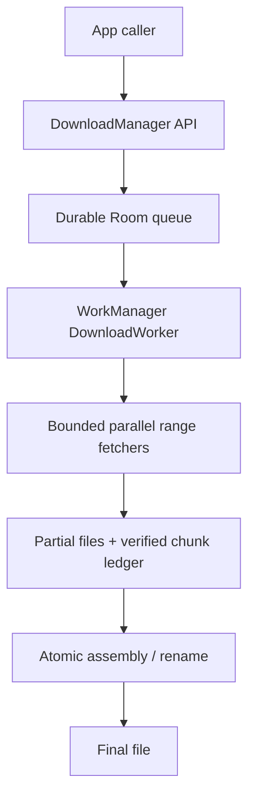
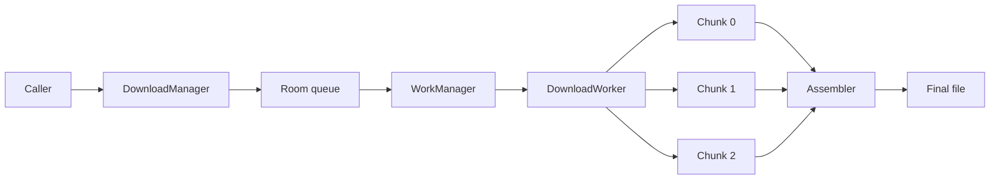

# File Downloader Library

> A 45-60 minute mobile system-design walkthrough for a robust file-downloader library. Think podcasts, offline video, attachments: chunked, resumable, parallel, lifecycle-aware.

---

## 1. Gathering Requirements (~5 min)

> **Interviewer:** "Design a file-downloader library."
> **Candidate:** "The classic problems are resumability across flaky networks, parallel chunks for speed, and surviving process death. I'll deep-dive the chunked download + resume path."

### Functional Requirements
- **Queue arbitrary downloads** identified by URL + destination.
- **Resumable** after pause / network loss / process death, when the server offers `Range` and a strong `ETag`.
- **Progress updates** to the UI.
- **Concurrency control** — N parallel downloads, M parallel chunks per download.
- **Priority levels** (foreground user-initiated vs background prefetch).

### Non-Functional Requirements
- **Survives process death** (durable queue, partial files preserved).
- **Battery-conscious** (no Wi-Fi-blocking unless requested).
- **Resilient to network drops** (auto-retry with backoff).
- **Composable observation** (Flow-based progress).
- **Storage-aware** (low-storage handling).

### Out of Scope
- DRM / encrypted streams (delegate to ExoPlayer's DRM session)
- Peer-to-peer downloads
- Cross-process queue sharing
- Background upload (separate concern — see media upload patterns)
- HTTPS pinning details (caller wires OkHttp)

---

## 2. Clarifying Questions (~3 min)

| Question | Why it matters |
|---|---|
| Largest file size? | Chunking strategy, disk pre-allocation |
| Server supports HTTP `Range` requests and strong ETags? | Resumable + parallel chunks |
| Wi-Fi-only requirement? | WorkManager constraint vs user-initiated data transfer job or foreground service |
| Foreground-only downloads or also background? | Notification + service decision |
| Android API floor? | User-initiated data transfer jobs (14+), `setExpedited`, FGS rules |
| Need cellular data warnings? | `ConnectivityManager.isActiveNetworkMetered` |
| Acceptable resume granularity? | Block size for the partial file ledger |

> **Candidate:** "Files 1 MB-500 MB, server supports `Range`, mostly Wi-Fi but cellular allowed with consent, foreground + background, Android 9+, resume at chunk boundaries."

---

## 3. High-Level Diagram (~10 min)



Queue and chunk progress are durable, so process death resumes verified work instead of restarting blindly or exposing a partial file as complete.

**Components:**
- **`DownloadManager`** — public API; enqueue, observe, pause, cancel.
- **`Queue (Room)`** — durable queue + chunk ledger.
- **`DownloadWorker`** — `@HiltWorker` per download; orchestrates chunks.
- **`ChunkFetcher`** — single chunk request via OkHttp `Range`.
- **`Assembler`** — concatenates chunks into the final file on completion.

---

## 4. API Contract

```kotlin
interface DownloadManager {
    suspend fun enqueue(req: DownloadRequest): DownloadId
    suspend fun pause(id: DownloadId)
    suspend fun resume(id: DownloadId)
    suspend fun cancel(id: DownloadId)
    fun observe(id: DownloadId): Flow<DownloadState>
    fun observeAll(): Flow<List<DownloadState>>
}

data class DownloadRequest(
    val url: String,
    val destFile: File,
    val constraints: Constraints = Constraints(),
    val priority: Priority = Priority.NORMAL,
    val headers: Map<String, String> = emptyMap(),
    val expectedSize: Long? = null,
    val checksum: Checksum? = null,
)

sealed class DownloadState {
    object Queued : DownloadState()
    data class Running(val downloadedBytes: Long, val totalBytes: Long?, val bytesPerSecond: Long) : DownloadState()
    object Paused : DownloadState()
    data class Failed(val reason: Throwable, val canResume: Boolean) : DownloadState()
    data class Completed(val file: File) : DownloadState()
}
```

---

## 5. Mobile App Architecture

### Module structure

```
:lib:download
    download-api          ← public interface, models
    download-core         ← queue, worker, scheduler
    download-okhttp       ← OkHttp adapter
    download-ktor         ← optional Ktor adapter
```

### Layered diagram



One worker owns download state while fetch concurrency remains bounded; assembly begins only after every required chunk passes validation.

---

## 6. Local Storage (Room as ledger)

```kotlin
@Entity(tableName = "downloads")
data class DownloadEntity(
    @PrimaryKey val id: String,
    val url: String, val destPath: String,
    val state: DownloadStateCode,
    val totalBytes: Long?, val downloadedBytes: Long,
    val priority: Int, val constraintsJson: String,
    val createdAt: Long, val updatedAt: Long,
    val checksumExpected: String?, val checksumAlgo: String?,
    val etag: String?,                          // strong validator pinned when chunks are planned
    val forceSingleChunk: Boolean               // the server broke its range contract; stop splitting
)

@Entity(tableName = "chunks",
    primaryKeys = ["downloadId", "index"],
    foreignKeys = [ForeignKey(DownloadEntity::class, ["id"], ["downloadId"], onDelete = CASCADE)])
data class ChunkEntity(
    val downloadId: String, val index: Int,
    val startByte: Long, val endByte: Long,    // inclusive
    val state: ChunkState                       // PENDING, IN_PROGRESS, DONE
)
```

> **Probing Q:** "Why a chunk ledger separate from the file?" Because the partial file might be truncated by the OS or contain incomplete chunks. The ledger is the truth — on resume we re-issue any chunk not marked `DONE`.

---

## 7. Deep Dive: Chunked Resumable Download (~15 min)

> *I'd pick this as the deep dive because it covers HTTP `Range`, parallelism, partial-file management, and resume-after-crash — the whole reason this library exists.*

### Enqueue

```kotlin
suspend fun enqueue(req: DownloadRequest): DownloadId {
    val id = UUID.randomUUID().toString()
    db.withTransaction {
        downloadDao.insert(DownloadEntity(id, req.url, req.destFile.path, ...))
        // chunk planning happens after HEAD request inside the worker
    }
    workManager.enqueueUniqueWork(
        "download-$id",
        ExistingWorkPolicy.KEEP,
        OneTimeWorkRequestBuilder<DownloadWorker>()
            .setConstraints(req.constraints.toAndroidx())
            .setInputData(workDataOf("id" to id))
            .build()
    )
    return DownloadId(id)
}
```

### Worker

```kotlin
@HiltWorker
class DownloadWorker @AssistedInject constructor(
    @Assisted ctx: Context, @Assisted params: WorkerParameters,
    private val client: OkHttpClient,
    private val db: AppDatabase,
    private val dao: DownloadDao,
    private val chunkDao: ChunkDao,
) : CoroutineWorker(ctx, params) {

    override suspend fun doWork(): Result {
        val id = inputData.getString("id") ?: return Result.failure()
        val entity = dao.get(id) ?: return Result.failure()

        // 1) HEAD with Accept-Encoding: identity. OkHttp otherwise asks for gzip on a request
        //    without Range, and the length and ETag could then describe the compressed form.
        val head = client.headOrNull(entity.url) ?: return Result.retry()
        val totalBytes = head.contentLengthOrNull()
        val validator = head.strongEtagOrNull()      // null when missing or weak (W/"...")

        // 2) Chunks from an earlier run belong to one version of the file
        if (chunkDao.countFor(id) > 0 && (validator != entity.etag || totalBytes != entity.totalBytes)) {
            discardPartsAndReplan(id)
        }

        // 3) Plan chunks and pin the validator together (one-time, idempotent).
        //    Bytes from separate requests can only be combined under a strong validator.
        if (chunkDao.countFor(id) == 0) {
            val splittable = validator != null && totalBytes != null &&
                head.acceptsRanges() && !entity.forceSingleChunk
            db.withTransaction {
                dao.updateMeta(id, totalBytes, validator)
                planChunks(id, totalBytes, splittable)
            }
        }

        // 4) Run parallel chunks with the row that holds the pinned validator
        return runChunks(id, dao.get(id) ?: return Result.failure())
    }
}
```

### Chunk planning

```kotlin
private suspend fun planChunks(id: String, total: Long?, splittable: Boolean) {
    if (total == null || !splittable) {
        chunkDao.insert(ChunkEntity(id, 0, 0, Long.MAX_VALUE, ChunkState.PENDING))   // one-shot: no resume
        return
    }
    val chunkSize = pickChunkSize(total)        // 1-8 MB based on file size
    val chunks = (0 until ceil(total / chunkSize.toDouble()).toInt()).map { i ->
        val start = i * chunkSize.toLong()
        val end = minOf(start + chunkSize - 1, total - 1)
        ChunkEntity(id, i, start, end, ChunkState.PENDING)
    }
    chunkDao.insertAll(chunks)
}
```

### Chunk runner (parallel)

```kotlin
private suspend fun runChunks(id: String, entity: DownloadEntity): Result = coroutineScope {
    val maxParallel = 3
    val sem = Semaphore(maxParallel)
    val pending = chunkDao.notDoneFor(id)
    val jobs = pending.map { chunk ->
        async {
            sem.withPermit { fetchChunk(id, chunk, entity) }
        }
    }
    val results = jobs.awaitAll()
    when {
        results.any { it is FetchResult.DiskFull } -> {
            dao.markFailed(id, "disk full")
            Result.failure()
        }
        results.all { it is FetchResult.Ok } -> {
            if (!partsMatchLedger(id)) {        // a part was truncated after its chunk was marked DONE
                discardPartsAndReplan(id)
                return@coroutineScope Result.retry()
            }
            assemble(id, entity.destPath)
            verifyChecksum(entity)?.let { return@coroutineScope Result.failure() }
            dao.markCompleted(id)
            Result.success()
        }
        results.any { it is FetchResult.RangeIgnored } -> {
            discardPartsAndReplan(id, forceSingleChunk = true)   // HEAD would keep offering ranges
            Result.retry()
        }
        results.any { it is FetchResult.FileChanged || it is FetchResult.RangeInvalid } -> {
            discardPartsAndReplan(id)   // the next run plans against the new validator and size
            Result.retry()
        }
        results.any { it is FetchResult.NetworkError || it is FetchResult.Incomplete } -> Result.retry()
        else -> Result.failure()
    }
}
```

### Single chunk fetch

```kotlin
private suspend fun fetchChunk(id: String, chunk: ChunkEntity, entity: DownloadEntity): FetchResult {
    val partFile = File("${entity.destPath}.part.${chunk.index}")
    val isWholeFileChunk = chunk.endByte == Long.MAX_VALUE
    val alreadyWritten = if (!isWholeFileChunk && partFile.exists()) partFile.length() else 0L
    val effectiveStart = chunk.startByte + alreadyWritten
    if (!isWholeFileChunk) {
        if (effectiveStart > chunk.endByte + 1) return FetchResult.RangeInvalid   // longer than the chunk
        if (effectiveStart == chunk.endByte + 1) {
            chunkDao.update(chunk.copy(state = ChunkState.DONE))
            return FetchResult.Ok
        }
    }
    val request = Request.Builder()
        .url(entity.url)
        .apply {
            if (!isWholeFileChunk) {                       // ranged chunks always have a strong validator
                header("Range", "bytes=$effectiveStart-${chunk.endByte}")
                header("If-Range", entity.etag!!)          // file changed? server sends a full 200
            }
        }
        .build()
    return try {
        client.newCall(request).execute().use { resp ->
            val responseEtag = resp.strongEtagOrNull()
            val target = when {
                isWholeFileChunk && resp.code == 200 -> partFile.sink()    // truncates: restart from zero
                isWholeFileChunk -> return FetchResult.HttpError(resp.code)
                resp.code == 206 -> {
                    // The status alone doesn't say which bytes these are. contentRangeOrNull() is
                    // null for a missing, invalid, multipart or non-bytes Content-Range.
                    val range = resp.contentRangeOrNull() ?: return FetchResult.RangeIgnored
                    if (range.first != effectiveStart || range.last > chunk.endByte) {
                        return FetchResult.RangeIgnored
                    }
                    if (range.completeLength.let { it != null && it != entity.totalBytes } ||
                        responseEtag.let { it != null && it != entity.etag }) {
                        return FetchResult.FileChanged
                    }
                    if (resp.body.contentLength().let { it != -1L && it != range.last - range.first + 1 }) {
                        return FetchResult.RangeIgnored
                    }
                    partFile.appendingSink()
                }
                resp.code == 200 ->                                        // full body from byte 0
                    return if (responseEtag != null && responseEtag != entity.etag) FetchResult.FileChanged
                    else FetchResult.RangeIgnored
                resp.code == 416 -> return FetchResult.RangeInvalid
                else -> return FetchResult.HttpError(resp.code)
            }
            target.buffer().use { sink ->
                resp.body.source().use { src ->
                    while (true) {
                        val read = src.read(sink.buffer, BUFFER)
                        if (read == -1L) break
                        sink.emitCompleteSegments()
                        progressBus.publish(id, read)
                    }
                }
            }
            // A server may send less than requested; DONE needs every byte of the chunk.
            if (!isWholeFileChunk && chunk.startByte + partFile.length() - 1 != chunk.endByte) {
                return FetchResult.Incomplete           // the next run requests the remainder
            }
            chunkDao.update(chunk.copy(state = ChunkState.DONE))
            FetchResult.Ok
        }
    } catch (e: IOException) {                 // CancellationException must keep propagating
        if (diskIsFull(partFile)) FetchResult.DiskFull else FetchResult.NetworkError(e)
    }
}
```

### Assemble

```kotlin
private fun assemble(id: String, destPath: String) {
    val dest = File("$destPath.tmp")
    val chunks = chunkDao.allFor(id).sortedBy { it.index }
    dest.outputStream().use { out ->
        chunks.forEach { ck ->
            File("$destPath.part.${ck.index}").inputStream().use { it.copyTo(out) }
        }
    }
    if (!dest.renameTo(File(destPath))) error("rename failed")
    chunks.forEach { File("$destPath.part.${it.index}").delete() }   // tidy up partial files
    chunkDao.deleteAllFor(id)
}
```

### Progress aggregation

```kotlin
object progressBus {
    private val flow = MutableSharedFlow<Pair<String, Long>>(extraBufferCapacity = 256)
    fun publish(id: String, bytes: Long) { flow.tryEmit(id to bytes) }
    fun observe(id: String, startAt: Long): Flow<Long> = flow
        .filter { it.first == id }
        .map { it.second }
        .scan(startAt) { acc, v -> acc + v }
        .sample(250.milliseconds)        // UI updates 4x/sec, not 60x
}
```

`startAt` is the sum of the part-file lengths, so a resumed run doesn't restart at zero. A re-plan starts a new observation, so discarded bytes aren't counted twice.

### Failure modes

| What breaks | Behavior |
|---|---|
| Network drop mid-chunk | Worker returns `Result.retry()`; partial file kept; resume from byte offset (a one-shot chunk restarts from zero) |
| Server returns 200 not 206 | The body starts at byte 0, so never append it. Same or no ETag: the server ignored Range, so discard partial data and restart as one chunk |
| Server returns 416 | Range invalid; re-plan (file size may have changed) |
| Server returns 206 for other bytes | `Content-Range` missing, invalid or not starting at the requested byte: write nothing; discard partial data and restart as one chunk |
| Server returns 206 with less than requested | Keep what arrived; the chunk stays not `DONE`, and the next run requests the remainder |
| File changed on the server | `If-Range` fails, so the server sends a full 200 with a new ETag (or HEAD reports a new ETag or length); discard partial data and re-plan, rather than splicing two versions. Cap repeated re-plans, then fail and surface it |
| No strong validator (ETag missing or weak) | Bytes from separate requests can't be safely combined, so use one chunk with a plain `GET`. An interruption restarts from zero |
| Part file shorter than a `DONE` chunk | Found before assembly; discard partial data and re-plan |
| Process killed | Ledger persists; new worker invocation re-runs `notDoneFor(id)` |
| Disk full | Worker fails permanently; surface to user |
| Checksum mismatch | Delete file; mark failed; do not retry automatically |

---

## 8. Trade-offs

### Background scheduler

| Option | Use |
|---|---|
| **WorkManager** | Pick — survives reboot, constraints, retry, backoff |
| User-initiated data transfer job (Android 14+) | Prefer for a long user-started download; requires a notification and must be scheduled while the app is visible |
| Foreground service | On older versions, when the user expects continuous progress with a notification; `dataSync` is limited to 6 hours in 24 on Android 15+ |
| AlarmManager | Lower-level; no constraints |
| `JobScheduler` (raw) | `WorkManager` wraps this; no benefit to use directly |

### Concurrency

| Choice | Pick |
|---|---|
| Parallel chunks per download | **3 (network dispatcher capped)** |
| Parallel downloads | **2 default, tunable** |
| Total HTTP connections | OkHttp `connectionPool` defaults are fine |

### Resume granularity

| Option | Verdict |
|---|---|
| **Chunk-level (file-per-chunk)** | Pick — easy ledger, easy resume |
| Byte-level append to one file | Possible but fragile if assembly truncates |
| Restart from zero | Awful UX for big files; the only safe option without a strong validator |

### HTTP client

| Option | Verdict |
|---|---|
| **OkHttp** | Pick — `Range`, connection pool, interceptors |
| Ktor 3 | Acceptable, KMP-friendly |
| Cronet | Faster on bad networks (Google's QUIC); heavier integration |
| `HttpURLConnection` | Don't |

### Storage

| Option | Use |
|---|---|
| App-private (`context.filesDir`) | Cache / non-user-visible |
| Scoped storage (Downloads collection) | User-visible files (`MediaStore`) |
| `StorageManager.allocateBytes()` | Reserve space for a large file before starting; `setLength()` only changes the file's length |

---

## 9. Major Concerns

- **Process death.** Ledger in Room is the truth. Worker invocation replays remaining chunks. No state in memory.
- **Disk space.** Check `StorageManager.getAllocatableBytes()` before starting, and reserve with `allocateBytes()`; fail fast if not enough.
- **Battery.** Use WorkManager constraints (`NetworkType.UNMETERED` for Wi-Fi-only). Use a user-initiated job or foreground service only when the user expects active progress.
- **Throttling.** Cellular: throttle to N MB/s if needed; surface a "downloading on cellular" banner.
- **OEM kill.** WorkManager reschedules after process death and reboot, though aggressive OEM policies can delay it. Expedited work suits short tasks that finish within a few minutes, so use `setExpedited` only for small user-initiated downloads. For a long one, use a user-initiated data transfer job on Android 14+, or a long-running worker with `setForeground` below that. For prefetch use defaults.
- **Network changes.** A connection lost to a network change fails the in-flight chunk with an `IOException`; the worker retries and resumes from the part file's length. (OkHttp's `ConnectionSpec` only configures TLS versions and cipher suites.)
- **Checksum.** SHA-256 verify on completion (optional). Mismatch = delete + fail.
- **Privacy.** Don't log URLs with auth tokens; redact in error reports.
- **Observability.** Total bytes, throughput, retry count surfaced via the same `EventListener` pattern.

---

## 10. Follow-up Questions

> **Q: How do you know the server supports Range?**
> HEAD request; check `Accept-Ranges: bytes` and a strong `ETag`. If either is absent, fall back to single-chunk download. (A server may support ranges without advertising them, so this is the cautious choice. Advertising isn't proof either, so every 206 is checked against its `Content-Range`.)

> **Q: What if the user starts a 1 GB download and switches to cellular mid-stream?**
> Honour constraints: if `NetworkType.UNMETERED` was set, WorkManager stops the worker when the constraint is lost and retries the work when it is met again; the ledger lets that run resume. Without constraint, continue but emit a warning event.

> **Q: How would you support a "pause" button?**
> `pause(id)` writes a flag in `DownloadEntity` + cancels the work. The worker checks the flag on each chunk boundary. Resume = new `WorkManager` enqueue with the same id; chunks not marked `DONE` re-fetch with their byte offsets.

> **Q: What about HTTPS without pinning?**
> Caller configures the OkHttp client. The library accepts a `Client` adapter; pinning, interceptors, timeouts are caller's concern.

> **Q: Memory footprint during download?**
> Streaming via Okio's `BufferedSource` / `BufferedSink`. No full-file in memory. Each chunk is a sequential write to its part file.

> **Q: How do you test this without a server?**
> `MockWebServer` from OkHttp; scripted responses (200, 206, 416, 5xx), plus a 206 with the wrong or a missing `Content-Range`, a short 206, a weak or missing ETag, and a file that changes between chunks. Property-based test: any sequence of (network drop, resume, file change) eventually produces a file matching one version's source bytes, never a mix.

---

## 11. Out of Scope (defended)

- **DRM** — Widevine integration is its own world; ExoPlayer handles for streaming.
- **P2P** — different protocol stack entirely.
- **Cross-process queue** — single-app assumption.
- **Background upload** — symmetric but different concerns (chunked PUT, multipart).
- **Real-time mirroring** (a-la `rsync`) — out of mobile scope.

---

## 12. Further Reading

- [weeeBox/mobile-system-design — file-downloader-library](https://github.com/weeeBox/mobile-system-design/blob/master/exercises/file-downloader-library.md) — reference format.
- [Android Developers — WorkManager](https://developer.android.com/topic/libraries/architecture/workmanager) — official guide, expedited + constraints.
- [OkHttp recipes](https://github.com/square/okhttp/tree/master/samples/guide/src/main/java/okhttp3/recipes) — request examples, including headers and streaming.
- [Cronet / QUIC for Android](https://developer.android.com/develop/connectivity/cronet) — for next-gen transport.
- [Android Developers — Foreground services](https://developer.android.com/develop/background-work/services/foreground-services) — when to escalate from worker.

---

> **Closing in the interview:** "I anchored on the chunked resumable path because it's where every bug lives. Happy to dig into the pause/resume race, the checksum verification flow, or how priority preemption would work next."
