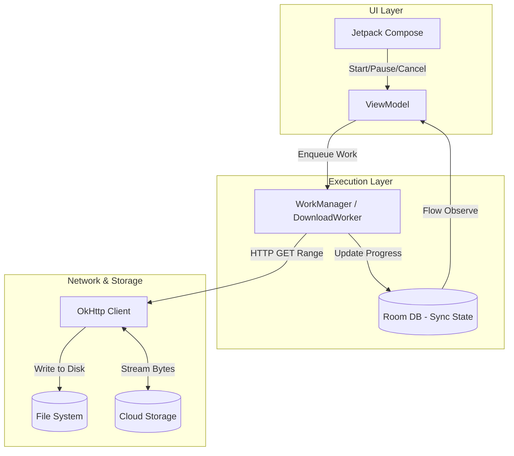

# System Design: File Downloader

## The Prompt

*"Design a robust File Downloader library for Android. It must be capable of downloading massive files (e.g., 2GB movies or 500MB map datasets). It must survive process death, handle network drops gracefully without restarting the download from 0%, and provide real-time progress to the UI without blocking the Main Thread."*

## 1. Requirements & Clarification (RADIO Framework)

### Functional Requirements
- Download files via HTTP/HTTPS given a URL.
- Pause, Resume, and Cancel functionality.
- Provide UI progress updates (0% to 100%).

### Non-Functional Requirements (NFRs)
- **Resilience (Priority 0):** Must survive Android OS Process Death. If the user swipes the app away, the 2GB download must continue or pause gracefully.
- **Network Efficiency:** Must support **Resumable Downloads**. If the network drops at 99%, the app must only download the remaining 1%, not restart the 2GB file.
- **Memory (RAM) Footprint:** Must not load the file into RAM. A 2GB file will instantly crash a phone with an `OutOfMemoryError`. Must stream directly to Disk.

## 2. High-Level Architecture

The architecture separates the UI (which can die at any moment) from the actual download engine (which must be managed by the OS).



## 3. Data Model & API

### The Local Database (Room)

To survive process death and communicate progress to the UI safely, the `DownloadWorker` writes state to a local Room database. The UI observes a `Flow` from this database.

```kotlin
@Entity(tableName = "downloads")
data class DownloadEntity(
    @PrimaryKey val id: String, // UUID
    val url: String,
    val destinationPath: String,
    val status: DownloadStatus, // QUEUED, DOWNLOADING, PAUSED, COMPLETED, FAILED
    val totalBytes: Long,
    val downloadedBytes: Long,
    val errorMessage: String?
)
```

### The API Contract (HTTP Range Requests)

To support Resumable Downloads, the server *must* support the HTTP `Range` header.

```http
// Client asks for the file, starting at byte 1,000,000 (because it already has the first MB)
GET /movie.mp4 HTTP/1.1
Host: cdn.example.com
Range: bytes=1000000-

// Server replies with Partial Content (206)
HTTP/1.1 206 Partial Content
Content-Range: bytes 1000000-2000000/2000000
Content-Length: 1000000
```

*Staff Note:* In a system design interview, you must explicitly state: *"I am assuming the backend CDN supports `Accept-Ranges: bytes`. If it does not, resumable downloads are mathematically impossible, and the architecture must fallback to downloading the entire file from 0% upon failure."*

## 4. The Core Flows (Deep Dive)

### Flow 1: Streaming to Disk (Preventing OOM)

A Junior engineer downloads a file like this:
```kotlin
// FATAL: Loads 2GB into RAM. App instantly crashes.
val responseBytes = okHttpClient.newCall(request).execute().body?.bytes()
file.writeBytes(responseBytes)
```

A Staff engineer uses **Input/Output Streams** to route the bytes directly from the network antenna to the physical flash storage, using a tiny 8KB buffer in RAM.

```kotlin
// Safe: Streams directly to disk using an 8KB RAM buffer
val response = okHttpClient.newCall(request).execute()
val inputStream = response.body?.byteStream()
val outputStream = FileOutputStream(destinationFile, true) // 'true' for appending

val buffer = ByteArray(8 * 1024) // 8KB Buffer
var bytesRead: Int

while (inputStream.read(buffer).also { bytesRead = it } != -1) {
    outputStream.write(buffer, 0, bytesRead)
    downloadedBytes += bytesRead
    
    // Throttle DB updates to avoid thrashing (e.g., update every 1 second)
    if (shouldUpdateDb()) {
        db.updateProgress(downloadedBytes)
    }
}
```

### Flow 2: Surviving Process Death

1. User taps "Download 2GB Game".
2. `ViewModel` enqueues a `OneTimeWorkRequest` to Android `WorkManager`.
3. `WorkManager` spins up the `DownloadWorker`.
4. User swipes the app away (Process Death).
5. The Android OS sees the `WorkManager` job. It re-spawns the app process in the background.
6. The `DownloadWorker` resumes execution.
7. To prevent the OS from killing the background work to save battery (Doze Mode), the `Worker` must call `setForegroundAsync()`. This binds the Worker to a visible System Notification, proving to the OS that the user is aware of the background battery usage.

## 5. Failure Modes & Bottlenecks

### Bottleneck: Database Thrashing
*Interviewer:* "Your 8KB buffer fills up and writes to disk 10,000 times a second on a fast 5G network. You are updating the Room database 10,000 times a second. Your app completely freezes."

**Staff Answer:**
"We cannot update the database (and therefore the UI) on every buffer read. I will implement a **Throttler**. I will only write the `downloadedBytes` to the Room database if 1 second has elapsed since the last update, or if the download jumps by a significant chunk (e.g., 1%). This drops database writes from 10,000/sec down to 1/sec, completely solving the UI freeze, while still looking perfectly smooth to the user."

### Bottleneck: Corrupted Partial Downloads
*Interviewer:* "The network drops at 50%. You have 1GB on disk. The user resumes. But the file on the CDN was updated 5 minutes ago. You append the new file's bytes to the old file's bytes. The MP4 is permanently corrupted."

**Staff Answer:**
"When performing an HTTP Range request, I must validate the `ETag` (Entity Tag) or `Last-Modified` header. 
When the download first starts, I save the server's `ETag` into the Room database.
When I attempt to resume the download, I send the `If-Match: <Old ETag>` header. 
If the server returns `412 Precondition Failed`, it means the file on the server has changed. I must delete my 1GB local partial file, reset `downloadedBytes` to 0 in the database, and restart the download from scratch to prevent corruption."

### Bottleneck: File System Verification
*Interviewer:* "The download reaches 100%. How do you prove the file is actually correct and not maliciously intercepted or corrupted by packet loss?"

**Staff Answer:**
"I require the backend API to provide a cryptographic hash (e.g., SHA-256 or MD5) of the complete file before the download starts. 
When the `DownloadWorker` hits 100%, I will stream the local file through a `MessageDigest` hasher. If my local hash matches the server's hash, I mark the database `status = COMPLETED`. If it fails, I delete the file and mark it `FAILED`. I never trust the `Content-Length` header alone."

## 6. Staff Engineer Thinking: Why not `DownloadManager`?

Android provides a built-in system service called `DownloadManager`. 
A Junior engineer says: "I'll just use `DownloadManager`, it handles everything."

A Staff engineer refuses to use `DownloadManager` for critical business flows.
*Why?*
1.  **Black Box:** `DownloadManager` behaves differently across Samsung, Xiaomi, and Pixel devices. OEMs aggressively kill it to save battery.
2.  **Auth Headers:** Passing complex, rotating OAuth tokens into `DownloadManager` is incredibly brittle.
3.  **UI Sync:** Querying `DownloadManager` for progress is slow (Cursor-based IPC) and difficult to bind to a modern Compose `Flow`.

*Decision:* A Staff Engineer builds a bespoke downloader using `WorkManager` + `OkHttp` to maintain 100% control over the lifecycle, authentication, and error handling.

## 7. Probing Questions (For Practice)

1.  Explain why reading an HTTP response body directly into a `ByteArray` is a fatal architecture flaw for a File Downloader.
2.  Describe the HTTP `Range` header and how it mechanically enables resumable downloads.
3.  How does `WorkManager.setForegroundAsync()` protect a long-running download from being killed by the Android OS's Doze Mode?
4.  Explain the "Database Thrashing" failure mode and how time-based or percentage-based throttling solves it.
5.  What is the purpose of the HTTP `ETag` header, and how does it prevent a resumable download from corrupting a file if the server updates the file mid-download?
6.  Describe why a Staff Engineer might choose to build a custom `WorkManager` download engine instead of relying on the built-in Android `DownloadManager` service.
7.  How does cryptographic hashing (e.g., SHA-256) protect the integrity of a downloaded file better than relying on the HTTP `Content-Length` header?
8.  Walk through the Single Source of Truth architecture for updating a Jetpack Compose progress bar based on a background download. Why does the `Worker` not communicate directly with the `ViewModel`?
9.  If a user's device runs out of physical storage space (Disk Full) at 99%, how should the architecture gracefully handle the `IOException`?
10. Describe the `File(path, append = true)` parameter in Java/Kotlin I/O. Why is it absolutely critical for resumable downloads?

## Further Reading

- [`workmanager.md`](../android/concurrency/workmanager.md) — The deep dive into how WorkManager survives process death.
- [`retrofit-and-okhttp.md`](../android/networking-and-security/retrofit-and-okhttp.md) — How OkHttp streams bytes.
- [`jank.md`](../android/performance/jank.md) — Why Database Thrashing causes the UI to drop frames.
