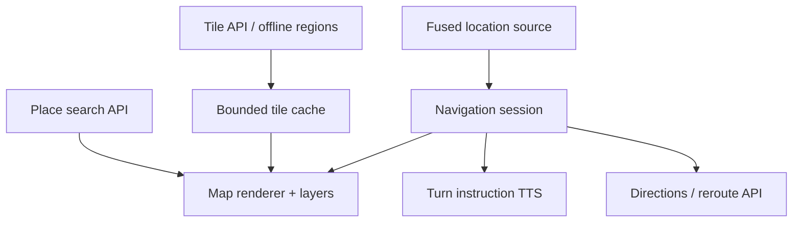
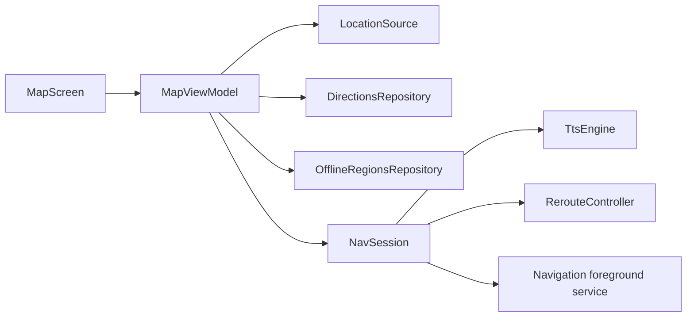

# Maps + Location System (Google Maps-style)

> A 45-60 minute mobile system-design walkthrough for a maps + location app (Google Maps, Apple Maps): map rendering, location streaming, search, turn-by-turn nav. The tile server and routing engine are server problems — bulk is on-device.

---

## 1. Gathering Requirements (~5 min)

> **Interviewer:** "Design a Maps + Location app."
> **Candidate:** "The interesting mobile problems are: continuous location with battery discipline, map tile cache, offline maps, and turn-by-turn navigation lifecycle. I'll deep-dive turn-by-turn nav."

### Functional Requirements
- **Show user's location** on a map with accuracy halo.
- **Search for places** (POIs).
- **Routes** (driving, walking, transit).
- **Turn-by-turn nav** with voice + visual cues.
- **Offline maps** for a downloaded region.

### Non-Functional Requirements
- **Battery**: nav can run for hours; don't drain phone.
- **Accuracy** under 50 m city, 100 m highway.
- **Offline tolerance** — downloaded region works without signal.
- **Smooth pan/zoom** — 60 Hz interaction.
- **Privacy** — location only when needed; surface why.

### Out of Scope
- Tile server / map data ingestion
- Routing algorithm internals (server)
- POI data freshness pipeline
- Reviews / ratings UX
- Local guide / contributor flows
- AR walking nav (Live View)

---

## 2. Clarifying Questions (~3 min)

| Question | Why it matters |
|---|---|
| Map SDK (Google, Mapbox, HERE, MapLibre)? | Offline rights, navigation terms, cost |
| Offline map size budget? | Disk strategy, format |
| Voice nav languages? | TTS engine selection |
| Background nav (driving over screen-off)? | Foreground service required |
| Battery target during nav (% per hour)? | Sampling cadence |
| Lane guidance / AR? | UI complexity |
| Wear / Auto / CarPlay? | Multi-surface architecture |

> **Candidate:** "Downloadable regions and our own guidance decide the provider. Google's terms restrict both, so I'll assume MapLibre Native over tiles and routes we license and serve ourselves. 1-2 GB offline regions, multilingual TTS, screen-off nav for a route the user started, < 8% battery/hour, no AR, Auto considered."

---

## 3. High-Level Diagram (~10 min)



Rendering, location sampling, routing, offline tiles, and spoken guidance have separate lifecycles; the navigation session coordinates them only while an active route needs them.

**Components:**
- **`MapView`** — SDK-provided; we control layers, markers, polylines.
- **`LocationSource`** — Fused; same as `ride-hailing.md`.
- **`OfflineTileCache`** — pre-downloaded regions; disk-backed.
- **`NavSession`** — state machine for an active route.
- **`TTS`** — `TextToSpeech` for spoken cues.

---

## 4. API Contract

### Search

```http
GET /v1/search?q=coffee&lat=37.77&lng=-122.42&radius=2000
{ "places": [ { "id": "p_1", "name": "Blue Bottle", "lat": ..., "lng": ..., "rating": 4.5 } ] }
```

### Directions

```http
POST /v1/directions
{ "from": {"lat": 37.77, "lng": -122.42}, "to": {"lat": 37.79, "lng": -122.40}, "mode": "driving" }

{
  "routes": [{
    "polyline": "encoded:abc123...",
    "distanceMeters": 3420, "durationSec": 540,
    "steps": [
      { "instruction": "Head north on Main St", "polyline": "...", "distanceM": 120, "maneuver": "STRAIGHT" },
      ...
    ],
    "warnings": [], "trafficSummary": "Light"
  }]
}
```

### Tile download (offline region)

```http
GET /v1/tiles/download?bbox=...&zoomRange=10-17
{ "bundleUrl": "https://cdn/.../tiles_8f7a.pmtiles", "sizeBytes": 248_000_000 }
```

---

## 5. Mobile App Architecture

### Module structure

```
:app
:feature:map
:feature:nav
:feature:offline-maps
:core:network
:core:database
:core:location           ← from ride-hailing.md
:core:tts
:data:directions
:data:tiles
```

### Layered diagram



The foreground service exists only for user-visible active navigation; ordinary map browsing does not keep location access once the app leaves the foreground.

### Key class signatures

```kotlin
class NavSession(private val location: LocationSource, ...) {
    val state: StateFlow<NavState>
    suspend fun run(route: Route, startStep: Int = 0)   // one owner collects it and cancels it to stop
    suspend fun restore(): Pair<Route, Int>?            // active route and step saved for this account
}

sealed class NavState {
    object Idle : NavState()
    data class Navigating(val currentStepIndex: Int, val distanceToTurnM: Float, val etaSec: Int) : NavState()
    data class Rerouting(val reason: RerouteReason) : NavState()
    data class Arrived(val arrivedAt: Long) : NavState()
}
```

---

## 6. Local Storage

```kotlin
@Entity(tableName = "offline_regions")
data class OfflineRegion(
    @PrimaryKey val id: String, val name: String,
    val bboxJson: String, val zoomMin: Int, val zoomMax: Int,
    val status: RegionStatus,                  // QUEUED, DOWNLOADING, READY, FAILED
    val sizeBytes: Long?, val downloadedAt: Long?,  // null until READY, so TTL starts at completion
    val ttlDays: Int = 90
)

// Personal location history: every row belongs to one account.
@Entity(tableName = "recent_places", primaryKeys = ["ownerId", "id"])
data class RecentPlace(val ownerId: String, val id: String, val name: String, val lat: Double, val lng: Double, val lastUsedAt: Long)

@Entity(tableName = "saved_places", primaryKeys = ["ownerId", "id"])
data class SavedPlace(val ownerId: String, val id: String, val label: String, val name: String, val lat: Double, val lng: Double)

@Entity(tableName = "active_nav")
data class ActiveNav(@PrimaryKey val ownerId: String, val routeJson: String, val stepIndex: Int, val updatedAt: Long)

@Entity(tableName = "cached_routes", primaryKeys = ["ownerId", "destinationKey", "cachedAt"])
data class CachedRoute(val ownerId: String, val destinationKey: String, val routeJson: String, val cachedAt: Long)
```

Queries filter by the signed-in `ownerId`. Sign-out deletes that account's places, routes and active session. Offline regions hold public map data rather than history, so they can stay on the device.

Tiles themselves live in a PMTiles file outside Room, in `filesDir/offline/<regionId>.pmtiles`.

---

## 7. Deep Dive: Turn-by-Turn Navigation (~15 min)

> *I'd pick this as the deep dive because nav combines location streaming, route progress, TTS announcements, reroute logic, and foreground-service discipline — almost every mobile concern in one feature.*

### NavSession state machine

```kotlin
class NavSession @Inject constructor(
    private val ttsEngine: TtsEngine,
    private val location: LocationSource,
    private val routing: DirectionsRepository,
    private val activeNavDao: ActiveNavDao,
    private val owner: CurrentAccount,
    private val clock: Clock,
) {
    private val _state = MutableStateFlow<NavState>(NavState.Idle)
    val state = _state.asStateFlow()

    private val sampling = MutableStateFlow(Sampling.STRAIGHT_ROAD)
    private var activeRoute: Route? = null
    private var currentStep = 0
    private val spokenThresholds = mutableSetOf<Int>()   // reset for each step
    private var offRouteSince: Long? = null

    // One owner (the foreground service) collects this and cancels it to stop.
    suspend fun run(route: Route, startStep: Int = 0) {
        activate(route, startStep)
        sampling.flatMapLatest { location.stream(it.intervalMs, it.priority) }
            .conflate()                                  // a reroute suspends; skip samples it made stale
            .takeWhile { _state.value !is NavState.Arrived }
            .collect { loc -> onLocation(loc) }
    }

    private suspend fun onLocation(loc: Location) {
        val route = activeRoute ?: return
        if (loc.accuracy > MAX_USABLE_ACCURACY_M) return     // too poor to judge progress or deviation
        val step = route.steps[currentStep]
        val distanceToTurn = step.distanceFromCurrentPosition(loc)
        val isLastStep = currentStep == route.steps.lastIndex

        if (isLastStep && distanceToTurn < ARRIVAL_THRESHOLD_M) {
            activeNavDao.clear(owner.id)
            _state.value = NavState.Arrived(clock.now())     // takeWhile ends sampling
            return
        }

        if (!isLastStep && distanceToTurn < ADVANCE_TO_NEXT_STEP_M) {
            currentStep++
            spokenThresholds.clear()
            activeNavDao.updateStep(owner.id, currentStep, clock.now())
            announce(route.steps[currentStep].instruction)
        } else {
            UPCOMING_ANNOUNCE_M.firstOrNull { distanceToTurn < it && it !in spokenThresholds }?.let {
                announce("In $it meters, ${step.instruction}")   // 500 m, then 200 m
                spokenThresholds += UPCOMING_ANNOUNCE_M.filter { t -> t >= it }
            }
        }

        sampling.value = Sampling.forProgress(distanceToTurn, loc.speed)
        if (isSustainedOffRoute(route, loc)) {
            reroute(loc, route)
            return
        }

        _state.value = NavState.Navigating(currentStep, distanceToTurn, recomputeEta(route, currentStep, loc))
    }

    // Project onto the polyline, and require the deviation to last: one bad sample must not reroute.
    private fun isSustainedOffRoute(route: Route, loc: Location): Boolean {
        if (route.distanceFromPolyline(loc) <= OFF_ROUTE_THRESHOLD_M) {
            offRouteSince = null
            return false
        }
        val since = offRouteSince ?: clock.now().also { offRouteSince = it }
        return clock.now() - since >= OFF_ROUTE_SUSTAIN_MS
    }

    // Collection is sequential, so only one reroute runs at a time.
    private suspend fun reroute(loc: Location, route: Route) {
        _state.value = NavState.Rerouting(RerouteReason.OFF_ROUTE)
        offRouteSince = null
        try {
            activate(routing.directions(from = loc.toLatLng(), to = route.destination), startStep = 0)
        } catch (e: IOException) {                           // routing down: keep guiding on the old route
            _state.value = NavState.Navigating(currentStep, route.steps[currentStep].distanceFromCurrentPosition(loc), recomputeEta(route, currentStep, loc))
        }
    }

    private suspend fun activate(route: Route, startStep: Int) {
        activeRoute = route
        currentStep = startStep
        spokenThresholds.clear()
        activeNavDao.save(ActiveNav(owner.id, route.toJson(), startStep, clock.now()))
        val step = route.steps[startStep]
        _state.value = NavState.Navigating(startStep, distanceToTurnM = step.distanceM.toFloat(), etaSec = route.durationSec)
    }

    suspend fun restore(): Pair<Route, Int>? =
        activeNavDao.get(owner.id)?.let { Route.fromJson(it.routeJson) to it.stepIndex }
}
```

`Sampling` holds the interval and priority from the sampling table in section 8. `UPCOMING_ANNOUNCE_M` is `listOf(200, 500)`, so the nearest threshold not yet spoken is chosen. `ADVANCE_TO_NEXT_STEP_M` applies only before the last step, so the index can never pass the end of the route.

### Foreground service (driving over screen-off)

```kotlin
class NavForegroundService : LifecycleService() {

    @Inject lateinit var session: NavSession
    private val requests = MutableStateFlow<NavRequest?>(null)   // keeps only the latest
    private var lastStartId = 0

    override fun onCreate() {
        super.onCreate()
        lifecycleScope.launch {      // one observer, for every route this service runs
            session.state.collect { state ->
                NotificationManagerCompat.from(this@NavForegroundService).notify(NOTIF_ID, buildNavNotification(state))
                if (state is NavState.Arrived) stopSelf(lastStartId)   // a newer start keeps the service alive
            }
        }
        lifecycleScope.launch {      // the one controller: never two location collectors
            // collectLatest cancels the running session and waits for it to finish before starting the next.
            requests.filterNotNull().collectLatest { request ->
                when (request) {
                    is NavRequest.Start -> session.run(request.command.route)
                    NavRequest.Resume -> {
                        val (route, step) = session.restore() ?: run {
                            stopSelf(lastStartId)   // redelivered after arrival: nothing left to resume
                            return@collectLatest
                        }
                        session.run(route, step)
                    }
                }
            }
        }
    }

    override fun onStartCommand(intent: Intent?, flags: Int, startId: Int): Int {
        super.onStartCommand(intent, flags, startId)
        lastStartId = startId
        try {
            ServiceCompat.startForeground(
                this, NOTIF_ID,
                buildNavNotification(session.state.value),
                FOREGROUND_SERVICE_TYPE_LOCATION
            )
        } catch (e: RuntimeException) {   // SecurityException or ForegroundServiceStartNotAllowedException
            showTapToResumeNotification()
            stopSelf(startId)
            return START_NOT_STICKY
        }

        // A redelivered intent still holds the original route, so it never counts as a new trip.
        val command = intent?.navCommandOrNull()   // commandId + route
        val redelivered = flags and START_FLAG_REDELIVERY != 0
        val current = requests.value
        when {
            command != null && !redelivered -> {
                if ((current as? NavRequest.Start)?.command?.id != command.id) requests.value = NavRequest.Start(command)
            }
            current == null -> requests.value = NavRequest.Resume
        }
        return START_REDELIVER_INTENT
    }
}
```

Commands go through one stable controller rather than a chain of replacement jobs. `cancelAndJoin` is itself cancellable, so a chain could cancel a coroutine that's still waiting for an older session, and start a new collector while the old one was cleaning up. With `collectLatest`, rapid A → B → C commands never overlap: each session starts only after the previous one has finished, and the state flow may skip a command that's already out of date, so the last one always wins.

Persistent notification with current instruction + distance. User can return to nav from any screen.

Start the service while an activity is visible, because the user tapped "Start". Android 14+ restricts creating a location foreground service from the background. It needs `ACCESS_BACKGROUND_LOCATION`, or a start on the separate [while-in-use exemption list](https://developer.android.com/develop/background-work/services/fgs/restrictions-bg-start#wiu-restrictions), such as a notification interaction or a system component. An exemption from the general background-start rule doesn't by itself lift this. `START_REDELIVER_INTENT` asks for a restart but doesn't guarantee one, and a restart may be refused or never come. It also redelivers the original intent, so a restart must never treat that intent's route as a new trip, or it would overwrite the saved step and any reroute. When no restart comes, the fallback is a "tap to resume" notification or the saved route on next launch. Test the restart path on real devices.

### TTS announcements

```kotlin
class TtsEngine @Inject constructor(@ApplicationContext ctx: Context) {
    private val tts = TextToSpeech(ctx, ::onInit)
    private val queue = MutableSharedFlow<String>(replay = 0, extraBufferCapacity = 32)

    private fun onInit(status: Int) {
        if (status == TextToSpeech.SUCCESS) {
            tts.language = Locale.getDefault()
            tts.setSpeechRate(1.0f)
        }
    }

    fun speak(text: String, priority: Priority = Priority.NORMAL) {
        tts.speak(text, if (priority == Priority.HIGH) QUEUE_FLUSH else QUEUE_ADD, null, text.hashCode().toString())
    }
}
```

Voice ducking: lower music volume during announcement via `AudioFocusRequest`.

### Map rendering

The SDK does most of the lifting. We overlay:
- Current location marker (animated rotation by `bearing`).
- Route polyline (decoded from server response).
- Step markers at each maneuver.
- ETA / instruction card pinned at top.

### Battery discipline

- Adaptive location interval: 1s while approaching turn, 4s straight road, 10s stationary.
- TTS only at announcement points, not continuous.
- Don't redraw polyline every location update; animate marker only.

### Offline regions

```kotlin
class OfflineRegionsRepository @Inject constructor(
    private val workManager: WorkManager,
    private val dao: OfflineRegionDao,
    private val downloader: DownloadManager,
) {
    suspend fun downloadRegion(bbox: BoundingBox, name: String, zoomRange: IntRange) {
        val descriptor = api.requestOfflineBundle(bbox, zoomRange)   // a failed call leaves no phantom row
        val regionId = UUID.randomUUID().toString()
        dao.insert(OfflineRegion(regionId, name, bbox.toJson(), zoomRange.first, zoomRange.last, RegionStatus.QUEUED, sizeBytes = null, downloadedAt = null))
        downloader.enqueue(DownloadRequest(
            url = descriptor.bundleUrl,
            destFile = File(filesDir, "offline/$regionId.pmtiles"),
            constraints = Constraints(networkType = NetworkType.UNMETERED, requiresStorageNotLow = true),
        ))
    }

    // Called from the download library's completion event.
    suspend fun onDownloadFinished(regionId: String, file: File, succeeded: Boolean) {
        if (succeeded) dao.markReady(regionId, file.length(), clock.now())
        else dao.markFailed(regionId)
    }
}
```

Reuses the `file-downloader.md` library. The renderer reads a finished region from device storage through a `pmtiles://file://…` source. MapLibre Android supports this from 11.7.0, and PMTiles needs byte-range reads, so the file can't sit in app assets. This works because we license and serve the tiles ourselves. Google Maps Platform content can't simply be prefetched into a region bundle, and the Google Maps app's offline download isn't an SDK feature.

### Failure modes

| What breaks | Behavior |
|---|---|
| Tunnel / no GPS | Last known location dimmed; "GPS lost" badge; nav pauses until signal back |
| Off route | Sustained deviation triggers a reroute; "Recalculating" announcement |
| TTS engine unavailable | Visual cues only; haptic at turns |
| Foreground service killed by OEM | Active route is saved in Room. If no restart happens, the next launch offers "Resume navigation"; user warned in onboarding |
| Service restart refused from the background | Catch the exception and post a "tap to resume" notification; tapping it starts the service through an exempt path |
| User starts a different route during navigation | New `commandId`: the controller cancels the old session, waits for it to finish, then runs the latest route, with one location collector throughout |
| Offline region expired (TTL) | Show "update available"; downgrade quality if missing tiles |
| Routing API down | Keep guiding on the current route, then a cached recent route to the destination if the user started a new trip; otherwise error |
| Battery critical | Reduce location frequency; warn user |

---

## 8. Trade-offs

### Map SDK

| Option | Pros | Cons | Verdict |
|---|---|---|---|
| Google Maps SDK | Comprehensive map data | Cost at scale; GMS dependency; content can't be prefetched into our own region bundles; its terms bar combining it with Directions and Geolocation into navigation substantially similar to Google Maps | Pick when the app shows a map without custom navigation or downloadable regions |
| Google Navigation SDK | Google's routing and guidance | Separate product; less control; check its offline limits and terms | Pick when Google routing matters more than owning guidance |
| Mapbox | Customizable styling; offline support | Cost; smaller ecosystem | Strong alternative |
| HERE Maps | Enterprise / fleet | License complexity | Niche |
| **MapLibre Native + licensed tiles** | Open-source renderer; local PMTiles files; we own guidance | We license data and run tile and routing servers | Pick for this design |
| OSMDroid | OSS; OSM data | Limited polish | When GMS unavailable |

Provider terms are part of the design, and whether a product counts as "substantially similar" is a legal question. Check the current [Google Maps Platform Terms](https://cloud.google.com/maps-platform/terms) before committing.

### Offline format

| Option | Verdict |
|---|---|
| **PMTiles** | Pick — single file, read by MapLibre Android 11.7.0+ from device storage |
| MBTiles (SQLite) | Single file, transactional; confirm renderer support first, since MapLibre's Android docs don't describe an MBTiles source |
| Individual PNG tiles | Many small files; FS pressure |
| Vector tiles (`.pbf`) | Better; packaged inside the single file above |

### Location stream

| Sampling | When |
|---|---|
| 1 s, HIGH_ACCURACY | Active nav, approaching turn |
| 4 s, HIGH_ACCURACY | Active nav, straight road |
| 10 s, BALANCED | Stationary detected |
| One-shot | Search results, "my location" button |

### Foreground service vs background nav

| Option | Verdict |
|---|---|
| **Foreground service while nav active** | Pick — keeps location access for a route the user started |
| Plain background | Android limits background apps to a few location updates an hour; unusable for guidance |
| Wake-locks | Not by default. A foreground service doesn't keep the CPU awake by itself, so test whether samples keep arriving with the screen off. Add a bounded lock only if they stop and no API already holds one |

### Routing transport

| Option | Verdict |
|---|---|
| **REST polling for reroute** | Pick — simple |
| WebSocket for live traffic | Use only if features warrant |
| Local routing | Possible offline; usually too large to ship |

---

## 9. Major Concerns

- **Battery during nav.** Adaptive intervals, no wake lock unless testing proves one is needed, FGS only when needed. Target < 8%/hour.
- **Permission UX.** Request `ACCESS_FINE_LOCATION` (or honour "approximate only" by degrading accuracy) before starting. Declare `FOREGROUND_SERVICE`, `FOREGROUND_SERVICE_LOCATION` and the `location` service type. A running location foreground service counts as foreground location, so a route the user started doesn't need `ACCESS_BACKGROUND_LOCATION`. Ask for that only if a feature needs location outside it, such as geofencing, or must start navigation from the background.
- **OEM kill.** FGS + persistent notification + `FOREGROUND_SERVICE_TYPE_LOCATION` reduce the risk but don't remove it. Educate user during onboarding.
- **TTS robustness.** Honour audio focus; duck music; handle missing voices gracefully.
- **Privacy.** Location only while nav active. Don't log raw lat/lng; aggregate to H3 cell. Recent places, saved places and cached routes belong to one account and are deleted at sign-out.
- **Process death.** `active_nav` in Room holds the route and step. A restart or the next launch restores from it, and the failure table covers the case where neither happens.
- **Offline expiration.** Auto-prompt to refresh expired regions when on Wi-Fi.
- **Accessibility.** Voice cues + haptics for vision-impaired drivers; large buttons; readable in glance.
- **Data usage.** Tile prefetch only on Wi-Fi by default; user-overridable.

---

## 10. Follow-up Questions

> **Q: User goes into a long tunnel mid-nav — what happens?**
> Location stream stalls; UI shows "GPS lost" but doesn't say "rerouting". Nav state stays at current step. On exit, location resumes, distance-to-turn recalculates, nav continues seamlessly. Announce nothing during the gap to avoid confusion.

> **Q: How is "you're off route" detected?**
> Project current location onto the route polyline; compute perpendicular distance. If > threshold (e.g., 50 m) for > 5 s, trigger reroute. Don't fire on a single bad GPS sample.

> **Q: How do you handle multi-screen (phone + Android Auto)?**
> Auto has its own `CarAppService` + `TemplateAPI`. NavSession is the model; both UIs subscribe. Phone-side notification mirrors what Auto shows.

> **Q: How are voice prompts kept reasonable?**
> Distance-based: "In 500 m, turn left" → "In 200 m, turn left" → "Turn left now." Don't repeat the current step. Pause music with audio ducking, not stopping.

> **Q: What about lane guidance and complex intersections?**
> Server returns per-step `lanes` (array of preferred lanes). UI renders chevrons. Out of detailed scope here.

> **Q: How are routes cached for offline reuse?**
> Last 3 routes per destination cached for 24h, per account. If the user starts the same route while offline, we use the cached polyline + steps. Reroute won't work without network.

---

## 11. Out of Scope (defended)

- **Tile server / data pipeline** — backend.
- **Routing algorithm internals** — server (graph search, traffic-weighted edges).
- **POI freshness** — data engineering side.
- **AR navigation (Live View)** — separate stack.
- **Reviews / ratings UX** — separate feature.

---

## 12. Further Reading

- [Google Maps SDK for Android](https://developers.google.com/maps/documentation/android-sdk/overview) — official.
- [Google Navigation SDK for Android](https://developers.google.com/maps/documentation/navigation/android-sdk) — Google's separate guidance product.
- [Mapbox Maps SDK Android](https://docs.mapbox.com/android/maps/guides/) — alternative SDK.
- [MapLibre Android: PMTiles](https://maplibre.org/maplibre-native/android/examples/data/PMTiles/) — reading local and remote tile archives.
- [FusedLocationProvider best practices](https://developer.android.com/develop/sensors-and-location/location) — battery-aware location.
- [Foreground service restrictions](https://developer.android.com/develop/background-work/services/fgs/restrictions-bg-start) — what can start a location service from the background.
- [Android Developers — Android Auto](https://developer.android.com/training/cars) — multi-surface nav.

---

> **Closing in the interview:** "Turn-by-turn was my deep dive because it stitches together location, route, TTS, and foreground service discipline. Happy to dig into offline-region downloads, Auto integration, or the reroute heuristic next."
