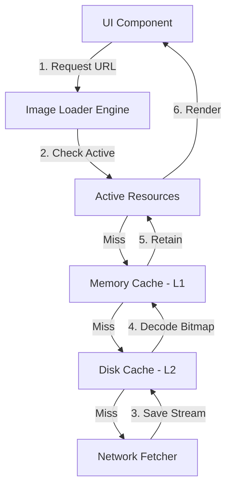

# System Design: Image Loading Library (Glide / Coil)

## The Prompt

*"Design an Image Loading Library for Android (similar to Glide, Picasso, or Coil). It must fetch images from the network, cache them efficiently, decode them without freezing the UI, and bind them to a `RecyclerView` or Compose `LazyColumn` without OOM (Out of Memory) errors during fast scrolling."*

## 1. Requirements & Clarification (RADIO Framework)

### Functional Requirements
- Fetch images via HTTP URL.
- Display the image in an `ImageView` or Compose `Image`.
- Support placeholders (while loading) and error images.

### Non-Functional Requirements (NFRs)
- **Memory (Priority 0):** Prevent `OutOfMemoryError` (OOM). Android has a strict Heap limit per app (e.g., 256MB). A 4K uncompressed image can consume 50MB of RAM.
- **Performance (Jank):** Scrolling a list of 100 images must maintain 60 FPS (16.6ms per frame). Decoding must happen in the background.
- **Network/Battery:** Minimize redundant network calls. Aggressive caching is mandatory.

## 2. High-Level Architecture (The 3-Tier Cache)

The core architecture of an Image Loader is the **Pipeline**. A request flows through three distinct layers before hitting the network.

## 3. Data Model & Components

### Component 1: The Memory Cache (L1)
Uses an **LRU (Least Recently Used)** Cache algorithm. 
- **Size:** Typically 1/8th or 1/7th of the available device RAM (e.g., `Runtime.getRuntime().maxMemory() / 8`).
- **Key:** The URL + the requested dimensions (e.g., `https://img.com/cat.jpg_200x200`).
- **Value:** The physical `Bitmap` object in RAM.

### Component 2: The Disk Cache (L2)
Uses a **DiskLruCache**.
- **Size:** Hardcoded limit (e.g., 250MB).
- **Key:** A cryptographic hash (SHA-256) of the URL (because URLs have illegal characters for filenames).
- **Value:** The raw compressed bytes (`.jpg` or `.webp`) exactly as they came from the network.

### Component 3: The Bitmap Decoder
The most dangerous component. It converts a `.jpg` on disk into a pixel-grid `Bitmap` in RAM.

## 4. The Core Flows (Deep Dive)

### Flow 1: Preventing OOM (Downsampling)
*Interviewer:* "The network returns a 4K image (3840x2160). The user's avatar view is only 100x100 pixels. If you load the 4K image into RAM, it takes 32MB. How do you prevent this?"

**Staff Answer:**
"I will use **Bitmap Downsampling** via `BitmapFactory.Options.inSampleSize`.
1. I first read the image bounds from the disk *without* allocating memory for the pixels (`inJustDecodeBounds = true`).
2. I calculate the target ratio. If the image is 4000px wide, and the UI view is 100px wide, the ratio is 40.
3. I set `inSampleSize = 32` (power of 2). 
4. I decode the image again (`inJustDecodeBounds = false`). The OS will only allocate a 125x125 pixel Bitmap in RAM, consuming a few Kilobytes instead of 32 Megabytes. This mathematically guarantees we will never OOM on large images."

### Flow 2: Preventing Garbage Collection Thrashing (Bitmap Pooling)
*Interviewer:* "The user is scrolling rapidly. You are creating 100x100 Bitmaps and discarding them as they scroll off-screen. The Garbage Collector (GC) panics and freezes the UI (Jank). How do you fix this?"

**Staff Answer:**
"I will implement a **Bitmap Pool**.
In older Android versions (pre-Android 8), allocating and destroying Bitmaps triggered massive GC pauses. 
Instead of letting the GC destroy old Bitmaps, when an image scrolls off-screen, I move its `Bitmap` object into a 'Reusable Pool'. 
When the *next* image comes from the network, I pass the old `Bitmap` object to `BitmapFactory.Options.inBitmap`. The OS will overwrite the existing memory address with the new pixels instead of allocating new memory. Zero allocation means zero Garbage Collection, resulting in butter-smooth 60fps scrolling."

### Flow 3: Cancelling Stale Requests (RecyclerView)
*Interviewer:* "The user scrolls down 50 items very fast. 50 network requests are fired. The user is now looking at Item 50, but Items 1-49 are still downloading, clogging the network. Item 50 won't load until they finish. How do you fix this?"

**Staff Answer:**
"I must implement **Request Cancellation** bound to the View Lifecycle.
If using `RecyclerView`, when `onViewRecycled` is called, I intercept the View, find its associated network request Job, and cancel it immediately. 
If using Jetpack Compose, the `AsyncImage` composable automatically cancels its underlying Coroutine when it leaves the Composition tree. This frees up the TCP connection pool for the images the user is actually looking at."

## 5. Failure Modes & Bottlenecks

### Bottleneck: The Disk I/O UI Freeze
A junior developer checks the Disk Cache on the Main Thread. Disk I/O on cheap Android phones can take 100ms. The UI drops 6 frames.
*(Fix: The pipeline must strictly enforce that L2 Disk Cache lookups happen on a background thread (`Dispatchers.IO`). Only the L1 Memory Cache can be checked synchronously on the Main Thread).*

### Bottleneck: Context Leaks
A junior developer passes an `Activity` context into the Image Loader singleton. The network request takes 10 seconds. The user rotates the phone, destroying the `Activity`. The Image Loader holds the reference, causing a massive memory leak.
*(Fix: The Image Loader must use the `ApplicationContext` for global singletons, and tie specific requests to a `LifecycleOwner` so they auto-cancel).*

## 6. Staff Engineer Thinking: Evolution of Image Loading

When asked to design this today, a Staff Engineer acknowledges the history of the platform.

1.  **Picasso (The Pioneer):** Relied heavily on the OS GC. Simple, but caused Jank on Dalvik.
2.  **Glide (The Workhorse):** Introduced aggressive Bitmap Pooling, fixing the GC problem. Incredibly complex, relies on Annotation Processors.
3.  **Coil (The Modern Standard):** "Coroutine Image Loader". Built completely in Kotlin. It delegates memory management back to the OS (since Android 8+ moved Bitmaps off the Dalvik heap and into native memory, Bitmap Pooling is no longer strictly necessary). Coil is vastly simpler because it leans on modern OS optimizations and Coroutines.

*My Recommendation:* "If designing this library for modern Android (API 26+), I would design it like Coil. I would discard the Bitmap Pool entirely to simplify the architecture, rely on Coroutines for request cancellation, and use `OkHttp` for the HTTP layer to automatically leverage HTTP/2 multiplexing."

## 7. Probing Questions (For Practice)

1.  Explain the mathematical formula used to calculate how many bytes a Bitmap consumes in RAM (e.g., ARGB_8888).
2.  Describe the three-tier cache architecture (Active, Memory, Disk) and why "Active Resources" are separated from the LRU Memory Cache.
3.  How does `inSampleSize` prevent an `OutOfMemoryError` when a user attempts to load a 10-Megapixel photo into a 50dp x 50dp thumbnail View?
4.  Explain the concept of Bitmap Pooling (`inBitmap`) and specifically how it prevents Garbage Collection (GC) pauses during fast scrolling.
5.  Why is the Disk Cache keyed by a cryptographic hash (like SHA-256) of the URL rather than the URL itself?
6.  Describe the exact lifecycle hook in a `RecyclerView.Adapter` where you must cancel an ongoing Image Network Request to prevent network clogging.
7.  If a user rotates their phone while a large image is downloading, how do you prevent the `Activity` from leaking in memory?
8.  Why is it safe to check an LRU Memory Cache on the Android Main Thread, but architectural malpractice to check a DiskLruCache on the Main Thread?
9.  Explain why modern Image Loading libraries (like Coil) no longer strictly require Bitmap Pooling on Android 8.0 (API 26) and above.
10. If an app needs to load 100 images simultaneously, why is relying on `OkHttp`'s connection pool and HTTP/2 multiplexing critical for the Image Loader's performance?

## Further Reading

- [`jank.md`](../android/performance/jank.md) — How GC pauses from Bitmap allocations destroy frame rates.
- [`memory-management-and-leaks.md`](../android/performance/memory-management-and-leaks.md) — Deep dive into the Dalvik vs Native heap allocation for Bitmaps.
- [`coroutines-under-the-hood.md`](../android/concurrency/coroutines-under-the-hood.md) — How Jetpack Compose automatically cancels Coroutine Image requests.
