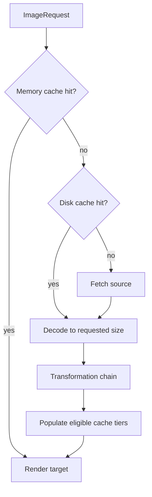
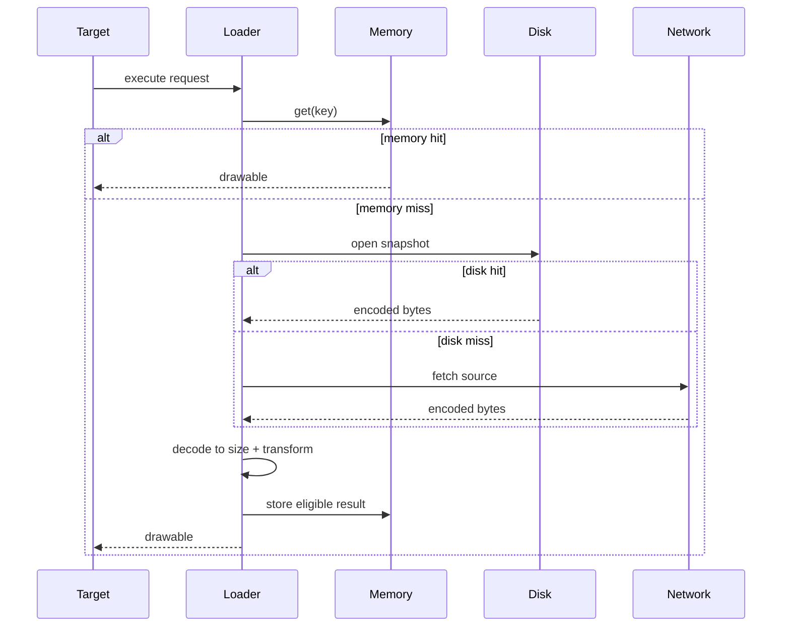

# Image Loading Library (Coil / Glide-style)

> A 45-60 minute mobile system-design walkthrough for an image-loading library. The interview classic: how does `Coil.load("https://…")` actually work? Three-tier cache, request pipeline, lifecycle awareness, bitmap pooling.

---

## 1. Gathering Requirements (~5 min)

> **Interviewer:** "Design an image-loading library like Glide or Coil."
> **Candidate:** "Three things make this interesting: the three-tier cache, the request pipeline, and lifecycle-aware cancellation. I'll deep-dive the request pipeline."

### Functional Requirements
- **Load from URL** into an `ImageView` or Compose `AsyncImage`.
- **In-memory + disk + (origin) cache**, with hit/miss propagation.
- **Cancellation** when the target detaches or the composable leaves.
- **Transformations** (resize, crop, blur).
- **Placeholders, errors, fallbacks**.

### Non-Functional Requirements
- **Smooth scroll** — don't decode on the main thread.
- **Bounded memory** — bitmaps dominate; cap at ~25% of heap.
- **Cellular-aware** — request smaller variant on metered networks.
- **No leaks** — cancel requests when `Activity`/`Composable` dies.
- **Kotlin/coroutine-native** for new APIs.

### Out of Scope
- GIF / video frame decoding (delegate to platform / Media3)
- DRM-protected content
- Server-side image transformations (assume CDN supports `?w=`)
- Vector / SVG (separate decoder)
- Augmented-reality overlays

---

## 2. Clarifying Questions (~3 min)

| Question | Why it matters |
|---|---|
| Compose-first or View-first? | API surface (`AsyncImage` vs target-based) |
| Median image size? | Disk budget, decoder choice |
| Source mix (network, file, content URI)? | Fetcher abstraction |
| Need to support custom decoders (HEIF, AVIF, animated WebP)? | Decoder registry |
| Cellular vs Wi-Fi behavior? | Variant selection, low-data mode |
| Memory class targets? | Cache budget heuristics |
| Android API floor? | Hardware bitmaps (8+), `ImageDecoder` (9+) |

> **Candidate:** "Compose-first, network + local URIs, default decoders only, Android 9+, target Pixel 6a baseline."

---

## 3. High-Level Diagram (~10 min)



The request key, requested size, and transformations determine cache identity; decoding is delayed until bytes are found or fetched and remains off the main thread.

**Components (named):**
- **`ImageLoader`** — root orchestrator, owns caches and dispatchers.
- **`Fetcher`** — produces a `Source` from a `Uri` (HTTP, file, content://).
- **`Decoder`** — turns a `Source` into a `Bitmap` or `Drawable`.
- **`MemoryCache`** — `LruCache<Key, Bitmap>` keyed by URL + transforms + size.
- **`DiskCache`** — bytes, on disk, atomic.
- **`Transformation`** — chain of bitmap-bitmap functions.
- **`Target`** — receives the result (`ImageView`, Compose painter).

---

## 4. API Contract

### Compose

```kotlin
AsyncImage(
    model = ImageRequest.Builder(LocalContext.current)
        .data("https://cdn/.../foo.jpg")
        .size(Size.Px(640))
        .crossfade(true)
        .placeholder(R.drawable.skel)
        .error(R.drawable.broken)
        .build(),
    contentDescription = "foo",
)
```

### View-based

```kotlin
imageView.load("https://cdn/.../foo.jpg") {
    crossfade(true)
    transformations(CircleCropTransformation())
    listener(onError = { _, _ -> /* log */ })
}
```

### Builder

```kotlin
val loader = ImageLoader.Builder(context)
    .memoryCache { MemoryCache.Builder().maxSizePercent(0.25).build() }
    .diskCache { DiskCache.Builder().directory(cacheDir).maxSizeBytes(200 * MB).build() }
    .crossfade(true)
    .build()
```

---

## 5. Mobile App Architecture

### Module structure

```
:lib:image-loader
    image-loader-core          ← ImageLoader, request pipeline
    image-loader-network       ← HTTP fetcher (OkHttp/Ktor adapter)
    image-loader-compose       ← AsyncImage, painter integration
    image-loader-decoders      ← jpeg/png/webp/heif via ImageDecoder
    image-loader-transformations
```

### Request pipeline (each request)



Cancellation belongs to the request owner throughout the pipeline; a recycled target must not receive a result from an older request.

---

## 6. Local Storage

**Memory cache** keyed by a derived key:
```kotlin
data class MemoryKey(
    val data: String,                // URL
    val transformations: List<String>,
    val targetSize: Size,
    val colorSpace: ColorSpace,
)
```

**Disk cache** is bytes, atomic write, byte-budget LRU. Same shape as the generic caching library; in fact, reuses `cache-disk` module.

---

## 7. Deep Dive: Request Pipeline (~15 min)

> *I'd pick this as the deep dive because everything else is policy. The pipeline is where lifecycle, cancellation, decoding, and cache writes all interact.*

### Engine

```kotlin
class ImageEngine(
    private val memory: MemoryCache,
    private val disk: DiskCache,
    private val fetcherRegistry: FetcherRegistry,
    private val decoderRegistry: DecoderRegistry,
    private val dispatchers: ImageDispatchers,
) {
    suspend fun execute(req: ImageRequest): ImageResult = withContext(dispatchers.main) {
        memory[req.memoryKey()]?.let { return@withContext SuccessResult(it, DataSource.MEMORY) }

        withContext(dispatchers.decode) {
            disk.openSnapshot(req.diskKey())?.use { snap ->
                val bitmap = decoderRegistry.decode(snap.source(), req.size)
                val final = req.transformations.fold(bitmap) { b, t -> t.transform(b) }
                memory.put(req.memoryKey(), final)
                return@withContext SuccessResult(final, DataSource.DISK)
            }

            val fetched = fetcherRegistry.fetch(req.data, req.options)
                .also { disk.write(req.diskKey(), it.source) }
            val bitmap = decoderRegistry.decode(fetched.source, req.size)
            val final = req.transformations.fold(bitmap) { b, t -> t.transform(b) }
            memory.put(req.memoryKey(), final)
            SuccessResult(final, DataSource.NETWORK)
        }
    }
}
```

### Lifecycle-aware cancellation

```kotlin
@Composable
fun rememberAsyncImagePainter(model: Any): AsyncImagePainter {
    val scope = rememberCoroutineScope()
    val painter = remember(model) { AsyncImagePainter(model) }
    DisposableEffect(painter) {
        val job = scope.launch { painter.execute() }
        onDispose { job.cancel() }
    }
    return painter
}
```

For Views, the loader keeps a `ViewTargetDisposable`; on `onViewDetachedFromWindow` it cancels the job.

### Size resolution

```kotlin
when (val s = req.size) {
    is Size.Px        -> s.value
    is Size.Original  -> null  // decode at original
    is Size.Resolve   -> awaitView { view.width to view.height }   // ViewTarget
}
```

`ImageDecoder.setTargetSize(width, height)` samples down at decode time — half the memory of decoding then resizing.

### Bitmap pooling

Modern Android (API 28+) supports `Bitmap.reconfigure` only for limited cases. Glide-style pooling is less critical post-API 28 because the platform allocator improved. Coil opts for an `LruCache` of `Bitmap`s with `inBitmap` hints when the decoder is `BitmapFactory` (legacy path). Default: rely on `ImageDecoder` + GC.

### Transformations chain

```kotlin
interface Transformation {
    val cacheKey: String
    suspend fun transform(input: Bitmap, size: Size): Bitmap
}
```

Each transformation contributes to the memory key — `crop(50)` and `crop(80)` cache as separate entries.

### Crossfade

`CrossfadeDrawable` is the result `Drawable` wrapping previous + current. Compose uses `Crossfade()` between the loading state and the loaded `Painter`.

### Failure modes

| What breaks | Behavior |
|---|---|
| Network 4xx | Surface `ErrorResult`; show `error` drawable |
| Decode fails | Surface `ErrorResult`; don't crash the app |
| OOM during decode | Catch + retry at smaller size; surface error if it still fails |
| Target dies mid-request | Cancel the job; drop the bitmap |
| Disk write fails | Continue (memory still has it); log |

---

## 8. Trade-offs

### Pipeline structure

| Option | Pros | Cons | Verdict |
|---|---|---|---|
| **Suspend functions on dispatchers** | Coroutine cancellation, KMP-ready | Caller must know dispatcher model | Pick this |
| Callbacks | Familiar | Manual cancellation, leaks | Skip |
| RxJava | Mature | Heavy, fading in Android | Skip for new code |

### Bitmap memory

| Option | Pros | Cons | Verdict |
|---|---|---|---|
| **`Bitmap.Config.ARGB_8888`** | Quality | 4 bytes/pixel | Default |
| `RGB_565` | Half memory | No alpha, banding | Opt-in for thumbnails |
| Hardware bitmap (API 26+) | Zero JVM heap | Can't sample/transform after creation | Use for terminal display only |

### Decoders

| Option | Verdict |
|---|---|
| **`ImageDecoder`** (API 28+) | Pick — animated WebP/HEIF, sampling at decode |
| `BitmapFactory` | Fallback for old APIs |
| Custom (libwebp, libjpeg-turbo) | Only if measured win on target devices |

### Disk format

Same as the caching library: file-per-entry with atomic rename + index. Reuses `cache-disk`.

### Network fetcher

| Option | Verdict |
|---|---|
| **OkHttp** | Pick — battle-tested cache, interceptors |
| Ktor 3 | Acceptable, KMP wins |
| Custom HTTP | Don't |

---

## 9. Major Concerns

- **OOM.** Memory cache cap at 25% of heap; size each entry by bitmap byte count, not entry count.
- **Main-thread.** All I/O and decode off-main. Only `Target.set` runs on main.
- **Leaks.** Targets hold weak refs to views; coroutines tied to lifecycle. Composables cancel on dispose.
- **Cellular cost.** Honour `ConnectivityManager.isActiveNetworkMetered`; default to lower-quality CDN variant.
- **Process death.** Memory cache is lost (acceptable). Disk survives.
- **Crash safety.** Atomic disk writes; bad-byte entries skipped on read.
- **Animated content.** Animated WebPs go to `ImageDecoder.decodeDrawable` → `AnimatedImageDrawable`. Caller's job to `start()`/`stop()` with lifecycle.
- **Privacy.** Don't cache images from credentialed URLs without an opt-in flag.
- **Observability.** `EventListener` hooks at every stage; caller wires hit/miss/error to analytics.

---

## 10. Follow-up Questions

> **Q: How is cache key derived for the same URL with different sizes?**
> The key includes URL + targetSize + transformations + colorSpace. So 240×240 and 480×480 of the same URL are two memory entries. Disk stores one source; memory stores variants.

> **Q: How does crossfade not flicker on a scrolled-back item?**
> If memory hits, skip crossfade (zero-latency). Crossfade triggers only on first paint of a new request.

> **Q: How do you avoid re-decoding the same image when scrolling fast?**
> Memory cache returns synchronously. Pipeline jobs are de-duplicated by `MemoryKey` — a second request for the same key joins the in-flight job rather than starting a second.

> **Q: How do you handle a URL that returns 304 Not Modified?**
> OkHttp's cache handles that. The fetcher uses OkHttp + `OkHttpClient.cache`. 304 is transparent; the conditional request saves bytes.

> **Q: Memory cache vs Glide's `BitmapPool`?**
> Pre-Android-O `BitmapPool` was critical (decoded bitmaps could reuse pooled memory via `inBitmap`). Post-O, the platform allocator handles this better. Coil dropped explicit pooling; we follow.

> **Q: How do you test this?**
> Inject a fake `Fetcher` returning a known byte stream. Run pipeline against an in-memory `MemoryCache` and `tempDir` disk cache. Assert decoded bitmap dimensions. Robolectric for the View target path; Compose preview / instrumented for `AsyncImage`.

---

## 11. Out of Scope (defended)

- **GIF / animated decoding** — pluggable via decoder registry; not the main architectural problem.
- **DRM** — different protocol stack.
- **SVG / vector** — separate decoder; the architecture absorbs it.
- **Server-side transforms** — caller can build query params; not the library's concern.
- **AI super-resolution** — separate concern; would slot in as a transformation.

---

## 12. Further Reading

- [weeeBox/mobile-system-design — image-library](https://github.com/weeeBox/mobile-system-design/blob/master/exercises/image-library.md) — reference format.
- [Coil 3 documentation](https://coil-kt.github.io/coil/) — production-grade Compose-native loader.
- [Glide architecture](https://bumptech.github.io/glide/doc/configuration.html) — for the legacy bitmap-pool perspective.
- [Android Developers — ImageDecoder](https://developer.android.com/reference/android/graphics/ImageDecoder) — modern decode API.
- [Coil 3 internals talk](https://coil-kt.github.io/coil/upgrading_to_coil3/) — Coil 3 architectural decisions.

---

> **Closing in the interview:** "I anchored on the pipeline because that's where lifecycle, decoding, and caching interact. Happy to dig into bitmap pooling, the OkHttp 304 path, or how Compose `AsyncImage` integrates with the painter."
