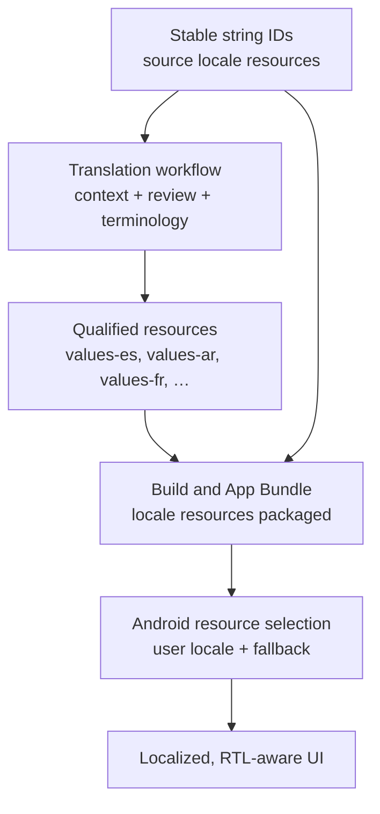

# Localization & Internationalization (L10n / i18n)

> A 45-60 minute mobile system-design walkthrough for the i18n + L10n posture of an Android app: string management, locale-aware formatting, RTL, pluralisation, on-device language switch, server-side localised content.

---

## 1. Gathering Requirements (~5 min)

> **Interviewer:** "Design i18n for an app shipping to 30 markets."
> **Candidate:** "i18n is about *architecture* — string IDs not hard-coded text, locale-aware formatting, RTL by default. L10n is the *content* — translations, region-specific business rules. I'll deep-dive translation workflow + RTL layout."

### Functional Requirements
- **30 locales** with translated strings.
- **Date / number / currency** formatted per locale.
- **Plural rules** correctly handled per language.
- **RTL** support for Arabic, Hebrew, Urdu, Farsi.
- **In-app language switch** without restart.

### Non-Functional Requirements
- **Translatable from day 1** — no hard-coded English in production code.
- **CI gate** — missing translations fail builds.
- **Performance**: locale switch < 1s, no app restart.
- **Storage**: translations bundle in APK or download per locale.
- **Compliance**: country-specific data (currency, units, addresses).

### Out of Scope
- Translation vendor selection (Lokalise, Crowdin, in-house)
- Live machine translation (separate vendor SDK)
- Per-region legal copy (legal team owns)
- Voice / TTS in multiple languages (separate, see `google-maps-location-system.md`)

---

## 2. Clarifying Questions (~3 min)

| Question | Why it matters |
|---|---|
| How many locales? | Strings bundle size |
| Per-locale APK or in-app downloads? | Storage strategy |
| RTL markets? | Layout audit |
| User-overridable language? | In-app picker |
| Locale-specific currency? | Number formatting |
| Server-side content (vs UI strings)? | Translation pipeline split |
| Asia: CJK character display? | Font fallback |

> **Candidate:** "30 locales, per-locale bundles via App Bundle splits, RTL in 4, user can override, currency by region, server returns localized content via Accept-Language, CJK fonts via system fallback."

---

## 3. The i18n Stack on Android



Stable resource IDs connect product copy to the translation workflow; Android then selects the best packaged locale resources at runtime, while the UI remains responsible for flexible layout and RTL behavior.

Validated against: [Localize your app](https://developer.android.com/guide/topics/resources/localization).

---

## 4. Strings.xml Discipline

```xml
<!-- values/strings.xml (en, source) -->
<resources>
    <string name="checkout_button">Place Order</string>

    <plurals name="cart_items">
        <item quantity="one">%d item</item>
        <item quantity="other">%d items</item>
    </plurals>

    <string name="price_with_currency">Price: %1$s</string>
    <string name="greet_user">Hi, %1$s!</string>
</resources>
```

### Rules

- **No hard-coded strings in Kotlin/Compose.** Lint rule + CI gate.
- **Use placeholders** (`%1$s`) — never concatenate localised strings.
- **Plurals via `<plurals>`** — never `if (count == 1) "item" else "items"` (other languages have many plural forms).
- **Comments for translators** in source XML:
  ```xml
  <!-- Button on the checkout screen. Action: confirms the order. -->
  <string name="checkout_button">Place Order</string>
  ```

---

## 5. Compose / Code Usage

```kotlin
@Composable
fun CartScreen(cart: Cart) {
    Text(text = pluralStringResource(R.plurals.cart_items, cart.itemCount, cart.itemCount))
    Text(text = stringResource(R.string.price_with_currency, format(cart.total, cart.currency)))
    Button(onClick = { ... }) { Text(stringResource(R.string.checkout_button)) }
}
```

For ViewModel state, expose the data and resolve the string in the UI:

```kotlin
@HiltViewModel
class CartViewModel @Inject constructor(
    ...
) : ViewModel() {
    val itemCount: StateFlow<Int> = ...
}

// In the composable:
val count by vm.itemCount.collectAsStateWithLifecycle()
Text(pluralStringResource(R.plurals.cart_items, count, count))
```

> **Anti-pattern:** formatting user-visible strings in the ViewModel with a `Context`. The ViewModel survives the Activity recreation that a language change triggers, so a string it built keeps the old language. On Android 12 and lower, the AppCompat per-app locale also applies to the `AppCompatActivity` context, not the application context.

---

## 6. Number / Date / Currency Formatting

```kotlin
import java.math.BigDecimal
import java.text.DateFormat
import java.text.NumberFormat
import java.util.Currency
import java.util.Date
import java.util.Locale

// Money as BigDecimal (or integer minor units), never Double.
fun formatCurrency(amount: BigDecimal, currency: String): String {
    val format = NumberFormat.getCurrencyInstance(Locale.getDefault())
    format.currency = Currency.getInstance(currency)
    return format.format(amount)
}

fun formatDateLegacy(ts: Long): String =
    DateFormat.getDateInstance(DateFormat.MEDIUM, Locale.getDefault()).format(Date(ts))
```

Better: `java.time` formatters (API 26+, or lower with core library desugaring):

```kotlin
import java.time.Instant
import java.time.ZoneId
import java.time.format.DateTimeFormatter
import java.time.format.FormatStyle

fun formatDate(ts: Long): String =
    Instant.ofEpochMilli(ts)
        .atZone(ZoneId.systemDefault())
        .format(DateTimeFormatter.ofLocalizedDate(FormatStyle.MEDIUM))
```

Don't hand-format. Always use `NumberFormat` / `DateTimeFormatter` with `Locale.getDefault()`.

---

## 7. RTL (Right-to-Left)

```xml
<!-- AndroidManifest.xml -->
<application android:supportsRtl="true">
```

```kotlin
// Use start/end, not left/right
Modifier.padding(start = 16.dp, end = 8.dp)
Modifier.align(Alignment.Start)

// Icons that have directional meaning auto-flip when locale is RTL
// Use vector drawables with `android:autoMirrored="true"`
```

**Audit checklist for RTL:**
- Text alignment: `textAlign = TextAlign.Start`, never `Left`.
- Padding/margin: `start`/`end`, never `left`/`right`.
- Vector drawables: `autoMirrored="true"` for arrows, chevrons.
- Numbers and dates: use the locale's formatter (some Arabic locales use Arabic-Indic digits); wrap mixed-direction values with `BidiFormatter`.
- Layout direction: `LocalLayoutDirection.current` for custom drawing.

---

## 8. Locale Switching at Runtime

Android 13+ provides per-app language preferences:

```kotlin
import androidx.appcompat.app.AppCompatDelegate
import androidx.core.os.LocaleListCompat

fun setAppLanguage(language: String) {
    val locales = LocaleListCompat.forLanguageTags(language)
    AppCompatDelegate.setApplicationLocales(locales)
}

// On Android 13+, this triggers a system-managed Activity recreation with new resources.
```

On Android 12 and lower, AppCompat 1.6+ backports the same API and recreates the Activity for you. The Activity must extend `AppCompatActivity` (Compose apps too), and the manifest must declare `androidx.appcompat.app.AppLocalesMetadataHolderService` with the `autoStoreLocales` meta-data set to `true` so the choice persists (or the app stores it itself). On Android 13+, enable `androidResources { generateLocaleConfig = true }` so the app's languages appear in the system settings.

In Compose, all `stringResource(...)` calls re-resolve on recreation. No additional work.

---

## 9. Server-Side Localised Content

```http
GET /v1/feed
Accept-Language: es-MX,es;q=0.9,en;q=0.5
{
  "items": [{ "title": "Bienvenido", ... }]
}
```

Server picks based on `Accept-Language`. Fallback chain: `es-MX → es → en (default)`.

For user-generated content (chat, posts), don't translate by default. Optionally offer "Translate" button that calls a translation API.

---

## 10. Translation Workflow

```
1. Engineer adds new string with name + English text + translator comment.
2. CI checks: every string must exist in en source.
3. Translation vendor (Lokalise, Crowdin) pulls strings.xml from main daily.
4. Translators provide values; vendor PRs them back.
5. CI checks: every (string, locale) translated before release.
6. Release ships per-locale splits via App Bundle.
```

CI lint:

```kotlin
// Custom Detekt or Lint rule
class HardcodedStringDetector : Detector(...) {
    override fun visitMethod(...) {
        // Flag any `Text("literal")` that's not a stringResource
    }
}
```

---

## 11. Storage: App Bundle Splits

```kotlin
// build.gradle.kts
android {
    bundle {
        language { enableSplit = true }    // language config splits per device
    }
}
```

Play installs only the language config splits for the device's languages; the saving depends on how many strings and locales you ship.

For markets where users switch languages frequently, opt out of language splits and ship all locales (`enableSplit = false`).

---

## 12. Common Misses

| Miss | Fix |
|---|---|
| Hard-coded English in Kotlin | Lint rule + CI |
| `if (count == 1) "item" else "items"` | `<plurals>` (handles Polish, Arabic plural forms) |
| `"Price: $" + amount` | `getString(R.string.price_with_currency, format(amount))` |
| `Modifier.padding(left = 16.dp)` | `start = 16.dp` |
| Locale-sensitive sort with `String.compareTo` | `Collator.getInstance(locale)` |
| Storing dates in local time | Always UTC server-side; format on display |
| English-only error messages from server | Server respects `Accept-Language` |
| Fonts that don't cover CJK | System fallback or per-locale font res |
| Right-to-left numeric tables | Test in `ar` locale; layout breaks reveal themselves |
| Translator comments missing | Every string has a comment for the translator |

---

## 13. Testing

### Manual

- `adb shell cmd locale set-app-locales com.example.app --locales ar` (Android 13+) to switch only this app to Arabic for an RTL test.
- Pseudolocales to detect non-localised strings: set `isPseudoLocalesEnabled = true` on the debug build type, enable developer options, then choose **English (XA)** (accented, expanded text such as `[Lōñgēr ëxāmplē tēxt]`) or **AR (XB)** (forced right-to-left) in the system language settings.

### Automated

- **Lint rule**: hardcoded string detector.
- **CI script**: parse all `R.string.*` references; ensure every `name=` in `values-*/strings.xml` exists.
- **Screenshot tests** per locale (Paparazzi / Compose Preview snapshots).

---

## 14. Further Reading

- [Android Developers — Localize your app](https://developer.android.com/guide/topics/resources/localization) — official.
- [Android Developers — RTL guidelines](https://developer.android.com/training/basics/supporting-devices/languages#rtl) — bidi support.
- [Android Developers — Per-app language preferences](https://developer.android.com/guide/topics/resources/app-languages) — Android 13+ runtime switch.
- [Unicode CLDR — plural rules](https://cldr.unicode.org/index/cldr-spec/plural-rules) — what plural forms exist per language.
- [App Bundle — language splits](https://developer.android.com/guide/app-bundle/configure-base) — per-locale delivery.

---

> **In short:** i18n is architectural discipline (no hard-coded strings, locale-aware formatting, start/end paddings, plural-aware quantities). L10n is content workflow (vendor pipeline, CI gates, comments for translators). Both must be in place from day 1.
