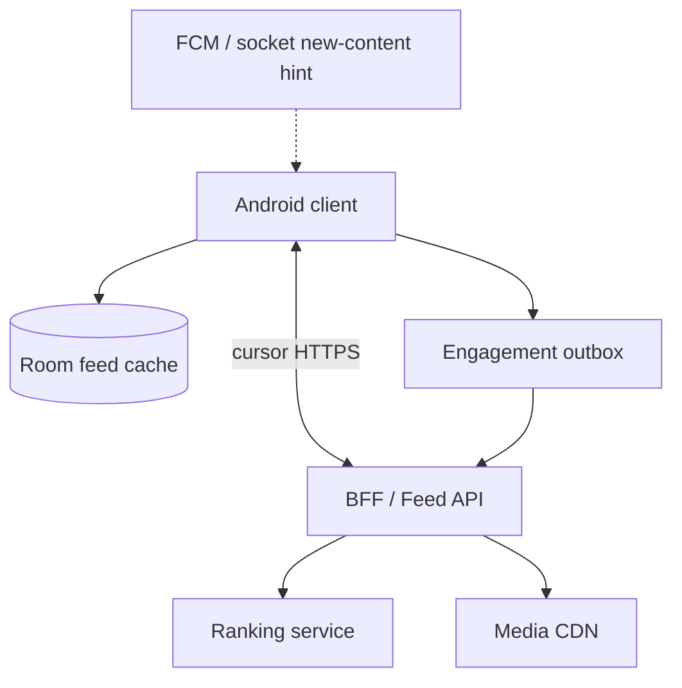
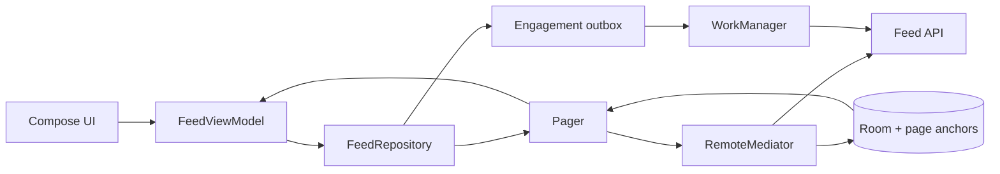

# News Feed (Instagram / Twitter-style)

> A 45-60 minute mobile system-design walkthrough for a social feed client (Android-first). Feed ranking, fan-out, and the ML pipeline are server concerns — the bulk of this file is how the *Android app* renders, paginates, and stays responsive over a slow network.

---

## 1. Gathering Requirements (~5 min)

> **Interviewer:** "Design a news feed like Instagram."
> **Candidate:** "I'll keep the backend at one diagram — the interesting work for a mobile engineer is paging, scroll, video, and offline behavior. Want me to start there?"

### Functional Requirements
- **Infinite scroll** of mixed posts (image, short video, text).
- **Pull-to-refresh** to show new posts.
- **Like / comment count** updates optimistically.
- **Open a post** in a detail screen and come back without losing scroll position.
- **Background prefetch** of the next page over Wi-Fi.

### Non-Functional Requirements
- **Smooth scroll** at 90/120 Hz — no jank, no frame drops on a mid-range device.
- **Offline tolerance** — last seen feed renders from cache; "Tap to retry" if the network is dead.
- **Data-saver mode** — disable autoplay, low-quality images on cellular.
- **Battery** — no decoded video off-screen; release players aggressively.

### Out of Scope
- Authoring / upload flow
- DMs, stories, reels recommendations carousel
- Ad-serving SDK integration
- Recommendation model training (the ranker is a black box that returns a sorted list of postIds)
- Content moderation / takedown UX

---

## 2. Clarifying Questions (~3 min)

| Question | Why it matters |
|---|---|
| DAU / median sessions per day? | Cache size, prefetch policy |
| Median post type (image-heavy vs text)? | ExoPlayer pool size, Coil disk budget |
| Geography (cellular cost)? | Data-saver default, image quality tier |
| Android API floor? | `getForegroundInfo` for expedited work before Android 12, predictive back |
| Avg images per post? | Carousel pagination, prefetch radius |
| Should likes work offline? | Outbox for engagement events |
| Real-time "new posts available" banner? | FCM data push vs polling |
| Personalised order or chronological? | Cache eviction strategy (personalised = short TTL) |

> **Candidate:** "Assuming 50M DAU, mostly image + 6-15s video, mixed networks, Android 9+, personalised ranking, ~30 min median session."

---

## 3. High-Level Diagram (~10 min)



The paged API returns a ranked snapshot, media loads from the CDN, and realtime delivery only hints that fresher content exists; it does not mutate ordering behind the user's scroll position.

**Server components (named, not designed):**
- **Feed API (BFF)** — accepts `cursor`, returns hydrated posts ready for render.
- **Ranking + ML** — picks postIds in order. Treated as a black box.
- **CDN** — serves images / HLS video segments with edge caching.
- **Push (FCM)** — fires a low-bandwidth "new posts available" hint when desired.

> The rest of the file is what the Android app does with `/v1/feed?cursor=…`.

---

## 4. API Contract

### Feed page (cursor-paginated)

```json
GET /v1/feed?cursor=eyJhZnRlciI6InBfOTkwIn0=&limit=15
200 OK
{
  "items": [
    { "id": "p_991", "author": { "id": "u_7", "name": "sam", "avatar": "https://cdn/…" },
      "media": [{ "type": "image", "url": "https://cdn/…", "blurhash": "L6P…", "w": 1080, "h": 1350 }],
      "text": "…", "likeCount": 41, "commentCount": 3,
      "likedByMe": false, "createdAt": 1750000000 }
  ],
  "nextCursor": "eyJhZnRlciI6InBfMTAwNSJ9"
}
```

### Engagement (optimistic, idempotent)

| Method | Path | Use |
|---|---|---|
| `POST` | `/v1/posts/{id}/like` | Idempotent (state, not increment) |
| `DELETE` | `/v1/posts/{id}/like` | Idempotent unlike |
| `POST` | `/v1/posts/{id}/comments` | `Idempotency-Key` header (UUID) |

### "New posts available" FCM payload

```json
{ "type": "feed.new", "accountId": "u_42", "count": "3" }   // hint only; client decides whether to show banner
```

Send this at normal priority: FCM's guidance puts keeping the UI in sync there, and says high priority messages should generally result in user interaction.

> **Wire-level rule:** the server returns *render-ready* objects. The client should not need to JOIN, re-rank, or hydrate. That's the BFF's job.

---

## 5. Mobile App Architecture (~10 min)

### Module structure

```
:app
:feature:feed              ← list screen
:feature:post-detail
:core:network              ← Ktor 3 / OkHttp + Retrofit
:core:database             ← Room 2.7+, Paging 3 LOCAL store
:core:media                ← Coil 3, Media3 (ExoPlayer)
:core:work                 ← engagement Outbox worker
:domain:feed
:data:feed                 ← FeedRepository + RemoteMediator
```

### Layered diagram



Paging reads through Room, while likes and other engagement events use a separate durable outbox so optimistic UI does not depend on immediate network success.

### Key class signatures

```kotlin
interface FeedRepository {
    fun feed(): Flow<PagingData<Post>>
    suspend fun toggleLike(id: String, liked: Boolean)
    fun newPostsAvailable(): Flow<Int>   // from FCM hint
}

@HiltViewModel
class FeedViewModel @Inject constructor(
    private val repo: FeedRepository,
    private val savedState: SavedStateHandle,
) : ViewModel() {
    val feed: Flow<PagingData<PostUi>> = repo.feed().map(::toUi).cachedIn(viewModelScope)
    val firstVisible = savedState.getStateFlow("firstVisible", 0)   // read-only view
    val newPostsBadge: StateFlow<Int>
    fun onScroll(index: Int) { savedState["firstVisible"] = index }
}
```

---

## 6. Local Storage (Room as cache, not source of truth for feed order)

```kotlin
@Entity(tableName = "feed_posts", primaryKeys = ["accountId", "id"])
data class PostEntity(
    val accountId: String,
    val id: String,
    val authorId: String, val text: String?,
    val mediaJson: String,      // serialized via kotlinx.serialization
    val likeCount: Int, val likedByMe: Boolean,
    val commentCount: Int, val createdAt: Long,
    val position: Int,          // server order across all fetched pages
    val deleted: Boolean = false,
)

@Entity(tableName = "feed_remote_keys", primaryKeys = ["accountId", "feed"])
data class FeedRemoteKey(
    val accountId: String,
    val feed: String,
    val nextCursor: String?,    // null = end of pagination
    val refreshedAt: Long,
)
```

> Feed order is **server-truth** (it's personalised), so `PagingSource` orders by `position`, not `createdAt`. The cursor is opaque and belongs to a page, not a post, so it gets its own table. On `REFRESH` the mediator fetches first, then clears and inserts in one transaction, so a failed refresh keeps the cache. Likes are cached locally; a queued like is re-applied over fetched rows until the outbox delivers it.

Every cached row, remote key and queued like belongs to one account, because a personalised feed and its cursor mean nothing for anyone else. Reads and writes filter by `accountId`, so `SKIP_INITIAL_REFRESH` can't show one account another account's feed. Sign-out deletes that account's rows, keys and queued likes, and clears Coil's memory and disk caches, since those aren't keyed by account. An account switch or sign-out also pops the account's navigation graph without saving state, which clears the ViewModel, its saved scroll index and its in-memory pages.

---

## 7. Deep Dive: Feed Scroll & Pagination (~15 min)

> *I'd pick this as the deep dive because it covers Paging 3 + RemoteMediator, scroll restoration across process death, optimistic likes, lifecycle-aware video, image prefetch, and the "new posts available" pattern — most of the interesting client decisions in one feature.*

### Paging 3 + RemoteMediator

```kotlin
@OptIn(ExperimentalPagingApi::class)
class FeedRemoteMediator(
    private val api: FeedApi,
    private val db: AppDatabase,
    private val clock: Clock,
    private val accountId: String,
) : RemoteMediator<Int, PostEntity>() {
    override suspend fun initialize(): InitializeAction {
        val key = db.feedKeyDao().get(accountId, FEED)
        val fresh = key != null && clock.now() - key.refreshedAt < CACHE_TTL
        return if (fresh) InitializeAction.SKIP_INITIAL_REFRESH
        else InitializeAction.LAUNCH_INITIAL_REFRESH
    }

    override suspend fun load(
        loadType: LoadType,
        state: PagingState<Int, PostEntity>,
    ): MediatorResult = try {
        val cursor = when (loadType) {
            LoadType.REFRESH -> null
            LoadType.PREPEND -> return MediatorResult.Success(endOfPaginationReached = true)
            LoadType.APPEND  -> db.feedKeyDao().get(accountId, FEED)?.nextCursor
                ?: return MediatorResult.Success(endOfPaginationReached = true)
        }
        val resp = api.feed(cursor, limit = PAGE_SIZE)
        db.withTransaction {
            if (loadType == LoadType.REFRESH) db.feedDao().clear(accountId)
            val start = (db.feedDao().maxPosition(accountId) ?: -1) + 1
            db.feedDao().upsert(resp.items.toEntities(accountId, startPosition = start))
            db.feedKeyDao().save(accountId, FEED, resp.nextCursor, isRefresh = loadType == LoadType.REFRESH)
            db.engagementOutboxDao().reapplyQueuedLikes(accountId)   // only where the fetched row differs
        }
        MediatorResult.Success(endOfPaginationReached = resp.nextCursor == null)
    } catch (e: IOException) {
        MediatorResult.Error(e)
    } catch (e: HttpException) {
        MediatorResult.Error(e)
    }
}
```

### Compose UI

```kotlin
@Composable
fun FeedScreen(vm: FeedViewModel = hiltViewModel()) {
    val items = vm.feed.collectAsLazyPagingItems()
    val state = rememberLazyListState(initialFirstVisibleItemIndex = vm.firstVisible.value)
    LazyColumn(state = state) {
        items(items.itemCount, key = items.itemKey { it.id }) { i ->
            items[i]?.let { PostCard(it, onLike = { vm.toggleLike(it.id, !it.likedByMe) }) }
        }
        item { if (items.loadState.append is LoadState.Loading) FeedSpinner() }
    }
    LaunchedEffect(state) {
        snapshotFlow { state.firstVisibleItemIndex }.collect { vm.onScroll(it) }
    }
}
```

### Lifecycle-aware video (Media3)

| Concern | Approach |
|---|---|
| Off-screen autoplay | `LifecycleEventEffect(Lifecycle.Event.ON_STOP) { player.pause() }` + visibility detector |
| Player pool | 2-3 `ExoPlayer`s reused, not one per card |
| Audio focus | Muted autoplay; unmute only on tap |
| Pre-buffer | Media3 `DefaultPreloadManager` loads the nearby videos; a small `bufferForPlaybackMs` in `DefaultLoadControl` starts the current one sooner |
| Release | The card's `DisposableEffect(player)` returns its player to the pool; the screen-level pool owner calls `release()` on all of them when it leaves composition |

### Scroll restoration across process death

`onScroll` writes the index into `SavedStateHandle`; `getStateFlow` only reads it. Paging 3's `cachedIn(viewModelScope)` keeps pages alive across config changes, but it dies with the process, and the `Pager` holds no cursor to re-fetch: it starts again from Room, with the next cursor in `feed_remote_keys`.

What happens next depends on `initialize()`:

- **`SKIP_INITIAL_REFRESH`.** The rows are unchanged, so the saved index still means the same post. Pass it as `Pager(initialKey = …)`, which Room's `PagingSource` treats as an item offset. Keep placeholders on (the default), so list indexes still mean feed positions, and don't compose the list until the first page arrives, or an empty list resets the state to index 0.
- **`LAUNCH_INITIAL_REFRESH`.** `REFRESH` replaces the rows, so the saved index points at a different post. Start at the top.

Saved state only returns after a system-initiated kill; a user who dismisses the app starts fresh.

### Optimistic likes

```kotlin
suspend fun toggleLike(id: String, liked: Boolean) {
    db.withTransaction {                                                      // both or neither
        db.feedDao().setLiked(accountId, id, liked, deltaCount = if (liked) +1 else -1)  // optimistic
        engagementOutbox.enqueue(EngagementOp.Like(accountId, id, liked))     // durable
    }
    outboxScheduler.schedule()   // app start reschedules too, in case the process dies here
}
```

`EngagementOutboxWorker` is a `@HiltWorker` scheduled by an expedited `OneTimeWorkRequest` (`setExpedited` belongs to the request, and the worker needs `getForegroundInfo` before Android 12). It sends each op with its own account's credentials, retries on network errors, 5xx, 408 and 429, and drops the op on any other 4xx. On reconcile, a feed fetch overwrites local counts with server truth, except that `reapplyQueuedLikes` keeps the user's latest choice for any post still queued. Otherwise a fetch that lands before the op drains would undo the like on screen.

### Image prefetch

Coil 3 with an `ImageLoader.execute(ImageRequest)` for `state.firstVisibleItemIndex + 2..+6` on a low-priority dispatcher. Cancelled when the user scrolls back.

### "New posts available" banner

FCM data message → `onMessageReceived` drops the hint if `accountId` isn't the signed-in account, then updates a `newPostsBadge` `StateFlow` directly. FCM's guidance reserves `WorkManager` for work that takes more than a couple of seconds, and this doesn't. The count lives in memory, which is fine: a new process refreshes or reads the cache anyway. The banner is a Compose composable; tap → `items.refresh()` + scroll to top.

---

## 8. Trade-offs

### Pagination strategy

| Option | Pros | Cons | Verdict |
|---|---|---|---|
| **Cursor + Paging 3 + RemoteMediator** | Stable, handles inserts, cached | More wiring | Pick this |
| Offset pagination | Trivial | Breaks when feed shifts (personalised) | Skip |
| Load-all | Trivial | OOM | Skip |
| Manual `LazyColumn` paging | No deps | Reinvents Paging 3 | Skip |

### Local cache

| Option | Use |
|---|---|
| **Room** | Page anchors, post bodies, like state |
| DataStore | User prefs (data-saver toggle, autoplay) |
| Disk (Coil/Media3) | Image / video segments |
| MemoryCache (Coil) | Up to 25% of the app's available memory for decoded images |

### Image loader

| Option | Verdict |
|---|---|
| **Coil 3** | Pick — KMP-ready, Compose-native, Kotlin-first |
| Glide | Battle-tested but Java-first; Compose through its `GlideImage` integration |
| Picasso | Deprecated; its README points to alternatives like Coil |
| Fresco | Heavy, native memory; only if you need bitmap streaming |

### Video player

| Option | Verdict |
|---|---|
| **Media3 (ExoPlayer)** | Pick — official, DASH/HLS, surface abstraction |
| `MediaPlayer` | Limited; no DASH, and HLS only in the older form Android documents (protocol v3, MPEG-2 TS) |
| HTML `<video>` in a `WebView` | Latency, no pre-buffer control |

### "New posts" hint transport

| Option | Verdict |
|---|---|
| **FCM data push** | Pick — battery-friendly, server-pushed |
| WebSocket | Overkill for a count |
| Polling | Wastes battery and quota |

---

## 9. Major Concerns

- **Jank.** Decoded bitmap memory dominates; cap Coil at 25% of the app's available memory with `maxSizePercent(context, 0.25)`. Item keys keep each post's state with the post when the list changes; they don't prevent recomposition. Add `contentType` so a mixed feed reuses compositions between items of the same type. Use `derivedStateOf` for "is at top" so the FAB doesn't recompose every frame.
- **Battery.** No auto-playing video off-screen. `Media3` player pool capped at 2-3. The "new posts" hint uses FCM, so no socket stays open for it.
- **Cellular data.** Data-saver default on metered networks (`ConnectivityManager.isActiveNetworkMetered`). Lower image quality variant requested from CDN.
- **Process death.** Scroll index in `SavedStateHandle`, next cursor in `feed_remote_keys`. Pager's in-memory cache is rebuilt from Room.
- **Account boundary.** Feed rows, cursors and queued likes are keyed by `accountId`; sign-out deletes them.
- **Memory leaks.** The pool owner calls `ExoPlayer.release()` in a screen-level `DisposableEffect`. No `Activity` held by ViewModels or repos.
- **Cold start.** Show a skeleton from Room while `RemoteMediator` refreshes. No spinner on first paint.
- **Errors.** `LoadState.Error` → inline retry chip, not a full-screen error. Empty state when `items.itemCount == 0` and not loading.
- **Accessibility.** `Modifier.semantics` per post; `LazyColumn` announces position. Honor "reduce motion" by disabling autoplay.

---

## 10. Follow-up Questions

> **Q: How do you avoid showing the same post twice across pagination?**
> The mediator dedupes by `id` (PK). Server should also stabilise cursor over a session — if the ranker reshuffles mid-session you'd see dupes. Mitigation: server returns a `sessionId` baked into the cursor.

> **Q: What if a post is deleted between page fetches?**
> Server returns a tombstone in the next page or omits it. The DAO query filters out rows where `deleted` is true. UI animates removal with `Modifier.animateItem()`, which needs item keys.

> **Q: How do likes reconcile if the worker is offline for hours?**
> The Outbox is durable in Room. On reconnect, the worker drains in order. If server state diverges (someone unliked from web), the next feed fetch after the queue drains wins.

> **Q: How do you measure scroll jank?**
> `JankStats` (Jetpack) reports `FrameData` on every frame, and the app aggregates it per session. Macrobenchmark + `BaselineProfile` for cold/warm start budgets. In-house dashboard tracks p95 frame time per device tier.

> **Q: How would you support a "for you" vs "following" toggle?**
> Two `Pager`s, one per tab. Tab state in `SavedStateHandle`. Each needs its own rows, so the primary key becomes `(accountId, feedType, id)`, and `feed_remote_keys` gets one row per tab: without `feedType`, a post in both tabs would overwrite its position. Switching tabs flips the `Flow<PagingData>` source — Compose handles it.

> **Q: Ads injection on the client?**
> Server returns ad slots inline (with a `type: "ad"` discriminator) so the client never has to interleave. Client just renders whatever the BFF gives it.

---

## 11. Out of Scope (defended)

- **Post upload** — separate flow with camera, media compression, resumable upload. ~30 min on its own.
- **Comments thread / replies** — UI is a separate screen with its own pagination.
- **Live video** — entirely different stack (RTMP ingest, low-latency HLS, chat overlay).
- **Stories** — short-form, separate cache eviction (24h TTL).
- **Recommendation model internals** — server's black box; we consume sorted IDs.

---

## 12. Further Reading

- [weeeBox/mobile-system-design](https://github.com/weeeBox/mobile-system-design) — reference format.
- [Android Developers — Paging 3 library](https://developer.android.com/topic/libraries/architecture/paging/v3-overview) — official guide + RemoteMediator.
- [Coil 3 documentation](https://coil-kt.github.io/coil/) — Compose-first, KMP-ready image loader.
- [Media3 (ExoPlayer) docs](https://developer.android.com/media/media3) — official player guide, including preloading.

---

> **Closing in the interview:** "Send-flow equivalent for a feed is the page-and-render loop — I picked that. Happy to deep-dive into video pooling, FCM ranking-update hints, or the data-saver tier logic next."
