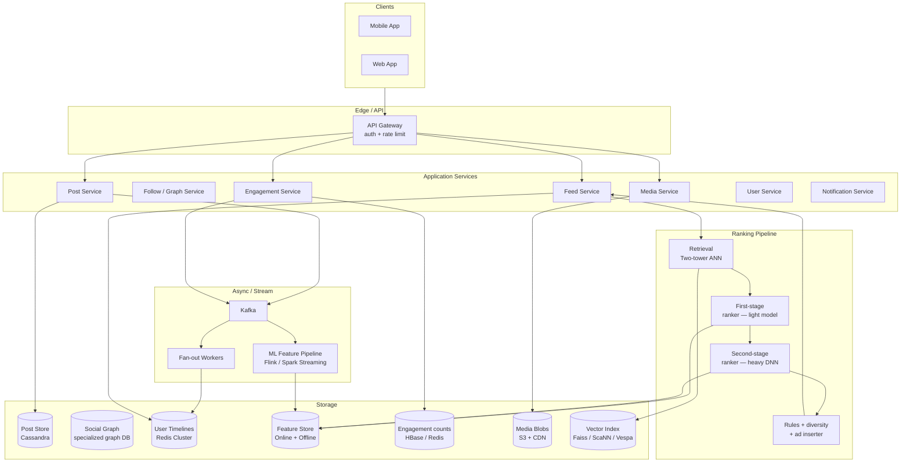
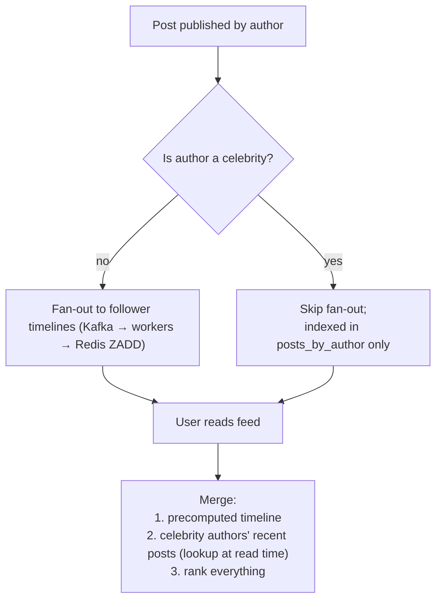
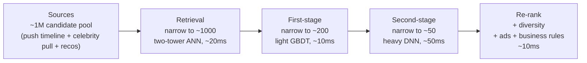
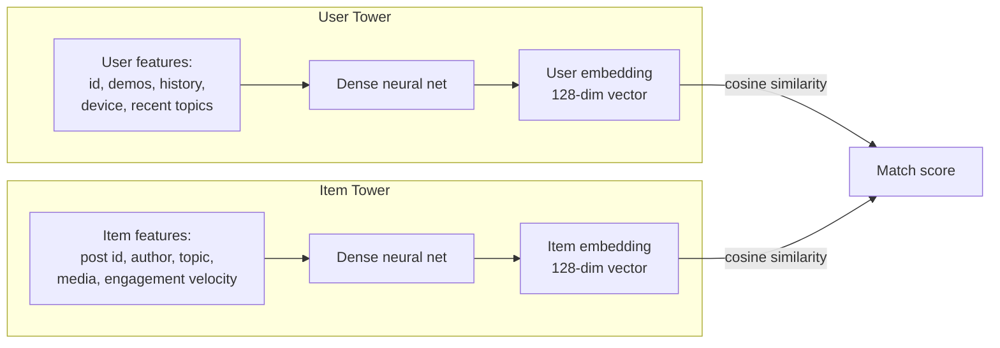
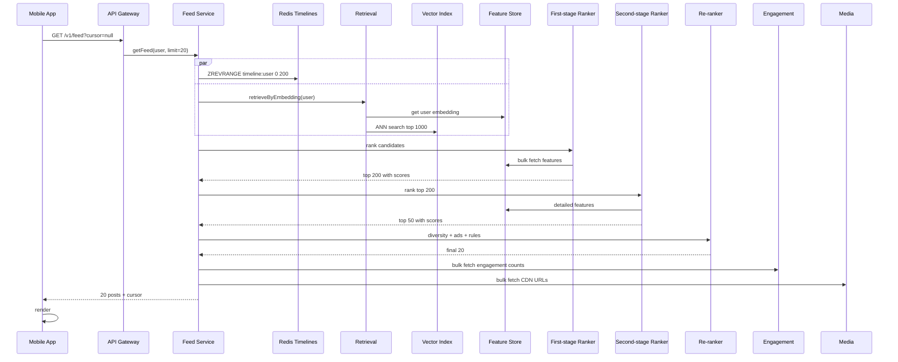
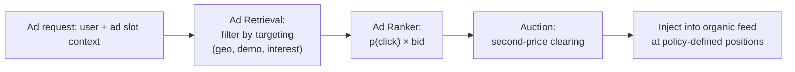

# News Feed System Design

> Interview-style deep dive on designing a social news feed (Facebook / Instagram / Twitter / TikTok). Covers fan-out at scale (push/pull/hybrid), the celebrity problem, the modern ML ranking pipeline (retrieval → coarse → fine ranking), the two-tower retrieval model, feed-generation strategies, mobile pagination, video autoplay, ads injection, and the architectural decisions that distinguish a 10K-user feed from a billion-user feed.

---

## 1. Problem Statement

Design a personalized social feed where:

- A user follows other users (or pages / topics).
- Followed users post text, images, videos, links.
- The user opens the app and sees a **personalized, ranked** stream of relevant posts.
- Likes, comments, and shares update visible counters; the user can interact.
- Stories / reels (short-lived content) appear in a separate section.
- Ads are injected throughout the feed.
- The feed updates as new posts arrive (pull-to-refresh, real-time markers).

### Functional Requirements

- Post creation (text, image, video, link).
- Follow / unfollow.
- Feed generation — personalized ranking, not strict reverse-chronological.
- Engagement — like, comment, share, save.
- Real-time updates ("new posts available" indicator).
- Notifications.
- Pagination (infinite scroll).
- Offline viewing of recently loaded feed.

### Non-Functional Requirements

| Concern | Target |
|---|---|
| Feed load latency (warm) | p95 < 300ms, p99 < 800ms |
| Time to first post (cold start) | < 1s |
| Post propagation (publish → visible in follower feed) | p95 < 5s |
| Feed freshness (new posts within last fetch) | < 30s lag |
| Availability | 99.95% |
| Storage durability | 11 nines |
| Personalization quality | CTR / time-spent / engagement vs baseline |

### Scale Assumptions

For a billion-user social platform with ~500M DAU:

| Quantity | Estimate | Derivation |
|---|---|---|
| Posts per day | 500M | Avg 1 post/user/day |
| Posts per second peak | 12K | 500M × 2 (peak factor) / 86,400 |
| Feed loads per day | 50B | 100 loads/DAU/day |
| Feed loads per second peak | 1M | 50B / 86,400 × 1.7 |
| Avg follower count | 150 | Long tail; median ~50 |
| Power users (50K+ followers) | 1M | 0.1% of users |
| Celebrities (1M+ followers) | 10K | Top 0.001% |
| Avg post size (incl. media metadata) | 10 KB | Text + thumbnails |
| Active media storage | 1 EB+ | Billions of items |

The math drives every decision: 12K posts/second × 150 followers = 1.8M write events/sec for naïve push fan-out. 10K celebrities × 1M followers each = 10B inflated events per celebrity post. Neither pure push nor pure pull works alone.

---

## 2. High-Level Architecture



### Service responsibilities

- **Post Service**: receives writes, persists, publishes to Kafka.
- **Follow Service / Graph**: who follows whom. Reads dominate writes. Specialized graph DB (Janus, Neo4j) or sharded relational table.
- **Feed Service**: assembles a feed for a user request. Orchestrates retrieval + ranking + post enrichment.
- **Engagement Service**: tracks likes, comments, shares, saves. Heavy writes; eventually-consistent counts.
- **Media Service**: pre-signed uploads, transcoding (video → HLS variants).
- **Ranking Pipeline**: the brain. Multi-stage to balance quality vs latency.
- **Fan-out Workers**: copy posts from the publish event into followers' timelines (push model) for non-celebrity authors.

---

## 3. Data Models

### 3.1 Posts (Cassandra)

```cql
CREATE TABLE posts (
    post_id TIMEUUID,                  -- v1 UUID; sortable by time
    author_id BIGINT,
    content TEXT,                       -- text body (small)
    media_ids LIST<UUID>,              -- references to Media Service
    post_type TINYINT,                 -- text, photo, video, link, repost
    created_at TIMESTAMP,
    visibility TINYINT,                -- public, friends, private
    PRIMARY KEY (post_id)
);

CREATE TABLE posts_by_author (
    author_id BIGINT,
    post_id TIMEUUID,
    created_at TIMESTAMP,
    PRIMARY KEY (author_id, post_id)
) WITH CLUSTERING ORDER BY (post_id DESC);
```

`posts` is the primary store, keyed by ID. `posts_by_author` is a secondary index for "show all posts by user X" (profile page).

### 3.2 Social graph

For most users, a simple sharded SQL table works:

```sql
CREATE TABLE follows (
    follower_id BIGINT,
    followee_id BIGINT,
    created_at TIMESTAMP,
    PRIMARY KEY (follower_id, followee_id)
) PARTITION BY follower_id;

CREATE INDEX idx_followees ON follows(followee_id);
```

For 1B users with avg 150 follows and ~75/sec writes, this is manageable. Critical operation: "who does user X follow?" — single partition read.

For graph algorithms (friend recommendations, mutual-follow scores), a specialized graph store (Facebook TAO, Twitter FlockDB) or in-memory graph processor (GraphX, Pregel) takes over.

### 3.3 User timeline (Redis sorted sets)

This is the per-user feed cache — the heart of the push model.

```
Key: timeline:{user_id}
Type: Sorted Set
Score: post_created_at (or score = -timestamp for descending)
Member: post_id

# Fan-out worker writes:
ZADD timeline:user-42 1719500000 "post_abc123"
# Trim to last 800 entries
ZREMRANGEBYRANK timeline:user-42 0 -801

# Feed Service reads:
ZREVRANGE timeline:user-42 0 99 WITHSCORES
```

Per-user timeline ~ 800 post IDs × 24 bytes ≈ 20KB per user. For 500M DAU: ~10TB of Redis. Sharded across hundreds of nodes.

### 3.4 Engagement (HBase + Redis)

```
Key: post:{post_id}:engagement
Fields: { likes: 1234, comments: 56, shares: 7, saves: 12 }
Storage: HBase column family with counters
Hot cache: Redis with TTL 5min
```

Engagement is read every feed render. Caching aggressively is essential.

### 3.5 Feature Store

```
Online (read-time): Redis Cluster, key = "user_features:{user_id}" → embedding + recent activity stats
Offline (training): S3 / Iceberg, partitioned by date
```

User features: embedding vector (128-dim), recent click history, demographics, language, region, device, time of day patterns.

Post features: embedding vector, author, topic, age, engagement velocity (likes per minute since post), media type.

### 3.6 Vector index

```
Approximate Nearest Neighbor index (Faiss, ScaNN, or Vespa)
Vectors: post embeddings (128-dim) for last ~7 days of posts (~3.5B posts)
Sharded by hash(post_id)
Query: given user embedding U, return top 1000 posts by cosine(U, post_embedding)
Latency: ~20ms
```

---

## 4. APIs

### Public REST (mobile / web)

| Endpoint | Notes |
|---|---|
| `POST /v1/posts` | Create a post. Body has text, media_refs, visibility. Returns post_id. |
| `GET /v1/feed?cursor=...&limit=20` | Paginated feed. Cursor encodes "last seen position". |
| `POST /v1/feed/refresh` | Tell server "pull new" — returns count + first batch. |
| `POST /v1/posts/{id}/like` | Idempotent. |
| `POST /v1/posts/{id}/comments` | Returns comment_id. |
| `POST /v1/follow/{user_id}` / `DELETE /v1/follow/{user_id}` | Graph mutation. |
| `GET /v1/users/{id}/profile` | Profile + recent posts. |
| `GET /v1/media/upload-url` | Pre-signed S3 URL for direct upload. |

### Internal (between services)

| RPC | Purpose |
|---|---|
| `RetrievalService.retrieve(user_id, k)` | Returns top-k candidate post_ids. |
| `RankingService.rank(user_id, candidates)` | Returns ordered list with scores. |
| `FollowService.followees(user_id)` | Returns full follow set (cached). |
| `EngagementService.fetchCounts(post_ids)` | Bulk counter lookup. |
| `MediaService.urls(media_ids)` | Returns CDN URLs + variants. |

---

## 5. Fan-out: Push vs Pull vs Hybrid

This is the single most important decision in feed design.

### 5.1 Push (fan-out on write)

When user posts, immediately copy the post_id into every follower's timeline cache.

```
On post:
    members = followService.followers(author_id)
    for each m in members:
        ZADD timeline:{m} now post_id
```

Pros: feed read is O(1) — just read the precomputed list. Latency p99 < 100ms easily.

Cons: write amplification = follower count. For a celebrity with 50M followers, one post = 50M Redis writes. Even at 100K writes/sec per shard, this takes 8 minutes per post — unacceptable.

### 5.2 Pull (fan-out on read)

When user requests feed, look up everyone they follow, fetch recent posts from each author, merge.

```
On feed request:
    followees = followService.followees(user_id)
    posts = []
    for each f in followees:
        posts += postService.recent(f, limit=100)
    return rank(merge(posts))
```

Pros: writes are O(1). Storage is just the original post.

Cons: heavy reads. A user following 500 people requires 500 author-feed lookups per feed open. With 1M feed loads/sec and 500 sub-queries each, that's 500M ops/sec — infeasible.

### 5.3 Hybrid (production answer)

**Push for normals + Pull for celebrities.**

Define a celebrity threshold (e.g., > 100K followers, or computed via percentile of follower count weighted by activity).



For a typical user:

```kotlin
suspend fun buildFeed(userId: UserId, limit: Int): List<Post> {
    val push = redis.zrevrange("timeline:$userId", 0, limit + 50)            // precomputed
    val celebrityAuthors = followService.celebrityFollowees(userId)           // small set
    val pull = celebrityAuthors.flatMap { author ->
        cassandra.recentPostsBy(author, limit = 20)                          // small per author
    }
    val merged = (push + pull).distinctBy { it.id }
    return ranker.rank(userId, merged).take(limit)
}
```

For a user following 1,000 normals + 5 celebrities: 1 ZREVRANGE + 5 small Cassandra reads + ranking. Total p95 ~250ms.

### 5.4 Celebrity tier breakdown

| Author follower count | Strategy | Reason |
|---|---|---|
| 0 – 10K | Pure push | Cheap to fan out |
| 10K – 100K | Push to active followers only | Active = logged in last 7d |
| 100K – 1M | Push to most-active (top X% by engagement) | Save fan-out cost |
| > 1M | No push; pull at read | Avoid amplification |

Twitter calls this "split fan-out." Instagram similar.

---

## 6. Ranking Pipeline

A modern feed is not chronological. The ranking pipeline turns "candidate posts" into "ordered feed" using ML.

### 6.1 Multi-stage architecture



Why multi-stage: a heavy DNN scored against 1M candidates would take seconds. A light model first narrows to a tractable set; the heavy model then evaluates only the best.

### 6.2 Retrieval: two-tower model



**Training:** pairs of (user, positive_item) where positive_item is a post the user engaged with. Negative samples randomly drawn. Loss: contrastive — push positives together, push negatives apart.

**Serving:**
1. Item embeddings precomputed offline; loaded into ANN index (Faiss / ScaNN / Vespa) keyed by post_id.
2. User embedding computed on-the-fly from streaming features (~5ms).
3. ANN query: "give me top 1000 nearest item embeddings to user embedding."
4. Result: ~1000 candidate post_ids. Done in ~20ms.

The decoupling — user tower and item tower don't share weights — is what makes this fast. The item side can be precomputed and indexed once; queries are just nearest-neighbor lookups.

### 6.3 First-stage ranker (coarse)

A lightweight gradient-boosted decision tree (XGBoost, LightGBM) trained on:
- Author affinity (past engagement between this user and this author)
- Post age
- Post type (video > photo > text by default engagement)
- User's past engagement with similar topics
- Engagement velocity (likes/min since post)

Predicts pCTR (probability of click) or pEng (probability of engagement). Score ≈ pEng × inverse_age_decay.

GBDT inference on 1000 items: ~10ms. Output: top 200 by score.

### 6.4 Second-stage ranker (fine)

A multi-task deep neural net predicting multiple objectives:
- p(like)
- p(comment)
- p(share)
- p(save)
- p(time_spent > 5s)
- p(skip / negative signal)

The model is large (~10-50M params for production systems) but only sees ~200 candidates, so latency ≤ 50ms.

The final score combines tasks with business-tunable weights:

```
score = w_like × p(like) + w_comment × p(comment) × 3 + w_share × p(share) × 5
        + w_time × p(time>5s) − w_skip × p(skip)
```

Weights are tuned for business goals (engagement vs time-spent vs growth). Different platforms emphasize different mixes (TikTok heavily weights time-spent; LinkedIn heavily weights professional engagement signals).

### 6.5 Re-ranking: diversity, freshness, ads

The top-50 ranked posts go through final re-ranking rules:

1. **Diversity**: prevent 5 photos from the same author in a row. Slot into different "lanes."
2. **Freshness**: boost recent posts slightly to compensate for any decay drift.
3. **Ad injection**: insert sponsored posts at positions 4, 12, 25 (or wherever ad-load policy says). Ads have their own ranker.
4. **Business rules**: e.g., elevate a friend's first post in days; demote already-seen.
5. **Story freshness**: never show a post the user already saw, unless they re-engaged.

---

## 7. Feed Generation Flow



Total latency budget for warm feed: ~300ms.

| Step | Budget |
|---|---|
| Network (RTT) | 50ms |
| Timeline read | 5ms |
| Retrieval | 20ms |
| First-stage ranking | 15ms |
| Second-stage ranking | 50ms |
| Re-rank + ads | 10ms |
| Engagement fetch | 15ms |
| Media URL hydration | 15ms |
| Server orchestration overhead | 30ms |
| Render on device | 90ms |
| **Total** | **~300ms** |

---

## 8. Mobile Client Architecture

### 8.1 Local cache & offline-first

```kotlin
@Entity(tableName = "feed_posts",
    indices = [Index("position"), Index("fetchedAt")])
data class CachedPost(
    @PrimaryKey val postId: String,
    val authorId: String,
    val text: String?,
    val mediaJson: String,            // serialized
    val createdAt: Long,
    val likes: Int,
    val comments: Int,
    val position: Int,                 // user's feed position
    val fetchedAt: Long
)
```

App opens → render cached feed immediately while a background coroutine fetches updates. UI never blocks on network.

### 8.2 Paging architecture

```kotlin
class FeedRemoteMediator(
    private val api: FeedApi,
    private val db: FeedDatabase
) : RemoteMediator<Int, CachedPost>() {

    override suspend fun load(
        loadType: LoadType,
        state: PagingState<Int, CachedPost>
    ): MediatorResult {
        val cursor = when (loadType) {
            LoadType.REFRESH -> null
            LoadType.APPEND -> state.lastItemOrNull()?.cursor
            LoadType.PREPEND -> return MediatorResult.Success(endOfPaginationReached = true)
        }
        return try {
            val response = api.fetchFeed(cursor, limit = 20)
            db.runInTransaction {
                if (loadType == LoadType.REFRESH) db.feedDao().clear()
                db.feedDao().insertAll(response.posts)
            }
            MediatorResult.Success(endOfPaginationReached = response.endOfFeed)
        } catch (e: IOException) {
            MediatorResult.Error(e)
        }
    }
}
```

Jetpack `Paging 3` library with `RemoteMediator` handles the network + DB sync transparently. `LazyColumn` renders.

### 8.3 Image and video handling

- **Images**: Coil with `crossfade(true)`. Pre-fetch next 5 visible items with low priority. Use BlurHash for instant placeholders.
- **Videos**: `ExoPlayer` pool. Pre-warm one player ahead of currently visible item. Pause + release when scrolled off-screen.
- **Video autoplay policy**: only on Wi-Fi by default; user setting controls; track `viewability` (post visible > 50% for > 2s).

### 8.4 Pull-to-refresh & "new posts" indicator

App polls a lightweight `/feed/new-count` endpoint every 60s while feed is visible. If count > 0, show a banner. On tap, refresh from top.

Alternative: WebSocket from feed channel for true real-time (used by Twitter). Latency ~1s vs ~30s for polling.

### 8.5 Engagement events

Likes are optimistic:

```kotlin
fun onLikeTap(post: Post) {
    val newCount = if (post.liked) post.likes - 1 else post.likes + 1
    feedDao.updateLikeState(post.id, liked = !post.liked, count = newCount)
    scope.launch {
        try {
            api.toggleLike(post.id)
        } catch (e: IOException) {
            workManager.enqueue(buildRetryWorkRequest(post.id))
        }
    }
}
```

Toggle locally, write to local DB, fire HTTP. Failure → WorkManager retry. UI never blocks.

---

## 9. Stories / Reels (Short-Lived Content)

Stories disappear after 24h. Different architecture from main feed:

- **Storage**: TTL-indexed Cassandra rows; auto-expire.
- **No personalization ranking at retrieval**: stories from people you follow, chronological in groups.
- **Heavy bandwidth**: video. Pre-fetch next 2 stories; tear down 2 back.
- **Engagement is lighter** (mostly views and "swipe ups" → links). Bulk-fetch viewer lists.

Reels (short videos like TikTok / Instagram Reels) flip: pure pull (no fan-out) + heavy ML personalization. The feed isn't of people you follow; it's of content the model predicts will engage you.

---

## 10. Engagement / Counter Architecture

Likes update in two paths:

```
Path 1 (immediate):
    Client → like API → engagement service → Redis INCR → push notification to author
Path 2 (background):
    Kafka event → durable HBase counter → reconciled with Redis daily
```

Why both? Redis is fast but volatile. HBase is durable but slow. Production system reads Redis for hot counts (used in feed), reconciles to HBase nightly. Counts in feed may briefly disagree with profile counts — acceptable.

For viral posts, single-key hotspots in Redis cause hot-key issues. Mitigation: shard a single post's count across N keys (`like_count:{post}:{shard}`); sum on read. Or use sharded counters with eventual consistency.

---

## 11. Failure Modes & Scaling Problems

### 11.1 Hot post (viral content)

A post gets 1M likes/min. Single Redis key for the counter melts.

**Defense:**
- Shard counter into 64 keys (`like_count:post123:{0..63}`).
- Random write to a shard; sum all on read.
- Cache aggregated count with 1s TTL.

### 11.2 Celebrity post fan-out

Skip fan-out for >1M-follower authors. Pull at read for active followers.

### 11.3 Ranker latency spike

Heavy DNN exceeds budget. Defense:

- **Fallback to first-stage only.** If second-stage > 100ms p99, page in just first-stage scores. Lower quality but feed loads.
- **Async pre-ranking.** Top candidates pre-scored when user becomes active (typing in search, etc.).
- **GPU-backed inference**, batched on the server.

### 11.4 Feature store overload

Feature lookup is the slowest part. Defense:

- Aggressive in-memory caching on ranker pod.
- Bulk fetch features for batch of candidates in one round-trip.
- Materialize stable features (user demographics) per user, push to client locally.

### 11.5 Feed staleness

User loads feed, sees a post from 4 hours ago. New posts didn't fan out fast.

**Defense:**
- SLO on fan-out: p95 < 5s. Alert if breached.
- Feed Service can fall back to small read-side merge of "since user's last load" to catch up.

### 11.6 Echo chambers / harmful content

ML-trained on engagement signals tends to amplify outrage and misinformation.

**Defense (organizational + technical):**
- Multi-objective ranking: weight time-spent + "meaningful interaction" (long comments, shares to close friends) more than likes.
- Suppress signals: classifiers detect borderline content; ranking score multiplied by 0.5-0.8.
- Diversity injection: occasionally surface content from outside echo chamber.
- Explicit user controls: "show me more / less of this."

---

## 12. Real-time Updates

Three patterns for surfacing new content:

| Pattern | UX | Cost |
|---|---|---|
| Polling /feed/new-count every 60s | "X new posts" banner | Cheap, simple, 60s lag |
| WebSocket feed channel | Posts appear live | Higher cost, real-time |
| Push notifications for prioritized content | Background alert | Limited by FCM/APNs quotas |

Most platforms combine: polling for in-app freshness indicator + push for select events (friend posted; tagged in photo).

---

## 13. Ads Architecture

Ads are a parallel ranking pipeline merged with organic.



Ad slots are reserved positions (e.g., 4, 12, 25 in scroll). The auction selects highest `p(click) × bid` ad. Ad CTR feeds back into the model.

Ad revenue is the platform's primary income; the ranking system balances "engagement" (retention) with "ad effectiveness" (revenue) — this is the central business tradeoff.

---

## 14. Tradeoffs

**Push vs Pull vs Hybrid**

| | Pure push | Pure pull | Hybrid |
|---|---|---|---|
| Read latency | very low | high | low |
| Write cost | high | low | medium |
| Storage | duplicated per follower | minimal | mostly duplicated |
| Celebrity problem | breaks | fine | solved |
| Best for | small-medium feeds | celebrity-heavy | production |

**Chronological vs ranked**

| | Chronological | Ranked |
|---|---|---|
| Predictability | high | low |
| Engagement | lower | higher |
| Complaints | "I missed X" | "echo chamber" |
| Complexity | trivial | massive |

Twitter offers both as a user choice. Most platforms enforce ranked.

**Single-stage vs multi-stage ranking**

| | Single | Multi-stage |
|---|---|---|
| Quality | high (if model is huge) | high |
| Latency | high | bounded |
| Operational complexity | simple | multiple models, complex pipeline |
| Failure isolation | one model fails → no ranking | fallback to first stage |

Production = multi-stage.

**Optimistic vs server-confirmed engagement**

Optimistic gives instant UX feedback at cost of occasional rollback. Production always uses optimistic.

---

## 15. Probing Questions

1. Walk through the celebrity problem. Why does pure fan-out-on-write fail for accounts with 50M followers, and how does the hybrid solution work?
2. A user has 1,000 push-timeline posts and 5 celebrity authors to pull. Walk through the merge step and explain how ranking handles posts coming from different sources.
3. Explain the two-tower retrieval model. Why decouple the user and item towers? What's pre-computed and what runs at query time?
4. Why is the second-stage ranker only fed 200 candidates instead of all 1000? What would break if you fed it everything?
5. Engagement velocity (likes/min since post). Why is this a powerful feature, and what's the risk of over-weighting it?
6. Multi-objective ranking has weights on like, comment, share, time-spent. How would you tune them differently for: (a) TikTok-style entertainment app, (b) LinkedIn-style professional network, (c) Reddit-style discussion forum?
7. A user complains "I keep seeing the same posts." Where in the pipeline does deduplication happen?
8. A post goes viral and hits 1M likes/minute. Walk through which components hotspot first and your defenses.
9. The ranker DNN goes down. What's your fallback strategy and what does the user experience?
10. Compare the trade-offs between: pulling all of last 24h posts from people you follow vs pre-computed timeline cache vs ML retrieval. When does each apply?
11. A celebrity's first post in a year. The follower is logged in. The fan-out skipped because the author is a celebrity. How does the user still see it?
12. Pagination: cursor-based vs offset-based for infinite-scroll feeds. Why is cursor better, and how do you encode it?
13. Stories (24h ephemeral) vs feed (permanent) — what changes in the architecture?
14. The model amplifies outrage content. From a technical standpoint, what levers can the ranking team pull?
15. Ad slots are reserved positions 4, 12, 25 in the feed. The user scrolls fast. What's the cost of rendering an ad they never see, and how do you handle viewability?
16. Cold start (new user with no follows). What does the feed show?
17. Pull-to-refresh: which components fire? What's the budget?
18. Real-time arrival of new posts during reading: how do you notify without disrupting the user's scroll position?
19. A user follows 5,000 people. Push-timeline cache caps at 800. How do you ensure their feed doesn't miss anything important?
20. Storage cost: 500M DAU × 800 post_ids × 24 bytes ≈ 10 TB Redis. How do you reduce, and what do you sacrifice?

---

## 16. Further Reading

In this repository:

- [`pagination.md`](pagination.md) — Paging 3 and cursor strategies.
- [`image-loading.md`](image-loading.md) — image-pipeline tradeoffs.
- [`youtube-video-streaming.md`](youtube-video-streaming.md) — video for feeds.
- [`offline-sync.md`](offline-sync.md) — local-first patterns for cached feed.
- [`a-b-testing-infrastructure.md`](a-b-testing-infrastructure.md) — ranking experiments.
- [`experimentation-platform.md`](experimentation-platform.md) — multi-armed bandits for ranking exploration.
- [`feature-flags-and-remote-config.md`](feature-flags-and-remote-config.md) — gating feed experiments.
- [`../distributed-systems/consistency-models.md`](../distributed-systems/consistency-models.md) — eventual-consistency for engagement counters.
- [`../engineering-fundamentals/caching.md`](../engineering-fundamentals/caching.md) — cache patterns for hot keys.
- [`../engineering-fundamentals/backpressure.md`](../engineering-fundamentals/backpressure.md) — fan-out worker backpressure.

External:

- [ByteByteGo, *Design a News Feed System*](https://bytebytego.com/courses/system-design-interview/design-a-news-feed-system) — canonical interview treatment.
- [Engineering behind Instagram's Recommendation Algorithm](https://blog.quastor.org/p/engineering-behind-instagrams-recommendation-algorithm-dc9c) — multi-stage retrieval and ranking architecture.
- [Two-Tower Model for Recommendation Systems](https://www.shaped.ai/blog/the-two-tower-model-for-recommendation-systems-a-deep-dive) — deep dive on retrieval architectures.
- [Designing a Scalable News Feed System](https://blog.algomaster.io/p/designing-a-scalable-news-feed-system) — push/pull/hybrid in production.
- [EdgeRank Is Dead — 100K weight factors](https://martech.org/edgerank-is-dead-facebooks-news-feed-algorithm-now-has-close-to-100k-weight-factors/) — the evolution from EdgeRank to modern ML.
- *Designing Data-Intensive Applications* by Martin Kleppmann, Chapter 2 — secondary indexes and fan-out.
- Eugene Yan, *"Real-time machine learning"* and *"System design for discovery"* (eugeneyan.com) — practical writeups.
- Twitter Engineering Blog, ["Earlybird"](https://blog.x.com/engineering/) — Twitter's search and ranking infrastructure.
- *Recommender Systems Handbook* (Springer) — foundational text on ranking algorithms.
- TikTok-style training pipelines: [Building training pipelines for TikTok-like recommenders](https://medium.com/data-science-collective/training-pipelines-for-tiktok-like-recommenders-f517786e3147).
