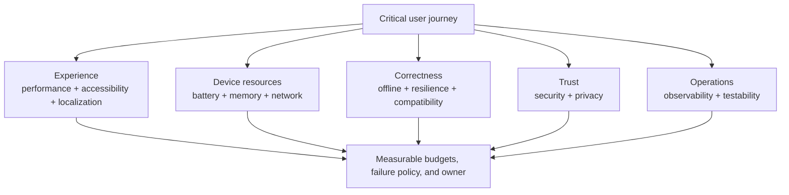

# Non-Functional Requirements (NFR Checklist for Mobile System Design)

> A reference card for the *non-functional requirements* part of any mobile system design interview. Not a problem to solve — a structured list of the dimensions you should mention and trade off when scoping any other file in this folder.

---

## 1. How to Use This File

In every interview, after listing functional requirements, you're expected to call out NFRs to show you think beyond the feature list. The interviewer wants signal that you understand the *cross-cutting concerns* that decide whether a feature ships safely or breaks production.

This file is the menu. Pick what's relevant per problem; don't recite the whole list.

---

## 2. The 13 NFR Dimensions for Mobile

NFRs are not a recital: start from the journey, select the dimensions that can change its design, and turn each selected concern into a measurable budget, failure policy, and accountable owner.

### 1. **Performance**
- TTID / TTFD budgets, frame rate, scroll smoothness.
- See `performance.md` for budgets per device tier.

### 2. **Battery**
- Foreground vs background discipline.
- WakeLocks, alarms, sockets, polling, location.
- Honour Doze + App Standby + battery saver.

### 3. **Memory**
- Heap bounded by tier; bitmap budgets; cache caps.
- No leaked `Context` / `Activity`.

### 4. **Network**
- Bandwidth-aware (cellular vs Wi-Fi); compression.
- Pagination; cache-first.
- Resilient to flaky networks (retry with backoff, idempotency).

### 5. **Offline Tolerance**
- Local SSOT (Room) so UI works offline.
- Outbox for writes; sync on reconnect.
- Optimistic UI for instant feedback.

### 6. **Security**
- TLS with cleartext disabled; use certificate pinning only when the threat model justifies its rotation and recovery cost.
- Tokens in Keystore-wrapped storage.
- `FLAG_SECURE` on sensitive screens.
- No PII in logs; biometric for high-stakes actions.

### 7. **Privacy & Compliance**
- GDPR, CCPA: consent gates, "delete my data" path.
- Minimise data collected; redact PII in telemetry.
- Per-channel notification visibility on lock screen.

### 8. **Accessibility**
- TalkBack semantics; large tap targets; color contrast.
- Honour system font size, reduce motion.

### 9. **Localization & Internationalization**
- All user-facing strings via resources; locale-aware formatting.
- RTL support; date/time/number per locale.

### 10. **Observability**
- Crash + ANR capture, perf telemetry.
- Product analytics with privacy-aware redaction.
- Exposure logging for experiments.

### 11. **Resilience**
- Survives process death (`SavedStateHandle`, durable queues).
- OEM-kill aware (Xiaomi/OPPO/Vivo); FCM as wake of last resort.
- Schema migrations exhaustive; no `fallbackToDestructiveMigration` in prod.

### 12. **Compatibility & Versioning**
- API floor explicit; gated behaviour above floor.
- Backwards-compatible wire format with the server.
- Configurable kill switches; feature flags for risky launches.

### 13. **Testability & Operability**
- Fakeable dependencies for unit and integration tests.
- Contract fixtures for API compatibility.
- Synthetic production checks for critical journeys.
- Clear ownership for flaky tests and release gates.

---

## 3. NFR Cheatsheet (per problem)

Use this 90-second checklist after stating functional requirements:

| Dimension | Ask yourself |
|---|---|
| Performance | What's the latency budget? Per-screen jank target? |
| Battery | Continuous work? Background sockets? |
| Memory | Bitmap heavy? Long lists? |
| Network | Cellular impact? Payload size? |
| Offline | Must writes survive offline? |
| Security | Sensitive data? Auth tokens? |
| Privacy | PII? Consent? Right to delete? |
| Accessibility | TalkBack? Color contrast? |
| Localization | RTL? Locale-formatted? |
| Observability | What to measure for this feature? |
| Resilience | Process death? OEM kill? |
| Compatibility | Schema evolution? API floor? |
| Testability | Can we prove this works before and after release? |

If 6+ dimensions matter, the interviewer is testing you on tradeoffs, not features.

---

## 4. NFR Patterns by Problem Type

### Streaming / real-time (chat, quotes, location)
- **Battery, Performance, Network, Resilience** dominate.
- WebSocket foreground policy. FCM background. Sample / throttle high-frequency.

### Lists / feeds (news feed, search results)
- **Performance, Memory, Network, Accessibility** dominate.
- Paging 3 + RemoteMediator. Coil with bounded cache.

### Forms / transactions (payment, order entry)
- **Security, Resilience, Privacy, Observability** dominate.
- Idempotency keys; biometric gate; durable status log.

### Background / sync (offline sync, downloads)
- **Resilience, Battery, Compatibility** dominate.
- WorkManager + outbox; constraints; schema migrations.

### Libraries (image, cache, file downloader)
- **Performance, Memory, Compatibility, Observability** dominate.
- Bounded caches; thread-safe; testable; observable.

### Platform (auth, deep links, notifications)
- **Security, Privacy, Resilience, Observability** dominate.
- Token vault; verified deep links; OEM-resilient.

### Critical production journeys (login, checkout, payment, sync)
- **Testability, Observability, Resilience, Security** dominate.
- Synthetic production tests with test accounts; contract tests; kill switches.

---

## 5. Common NFR Misses (and how to spot them)

| Miss | How to spot it in an interview |
|---|---|
| "We'll use WebSocket" — but no foreground policy | Ask: "What about battery in background?" |
| "We'll cache it" — no eviction or budget | Ask: "How big can it grow?" |
| "We'll retry" — no idempotency key | Ask: "How do you prevent double-charges?" |
| "We'll save locally" — no schema migration plan | Ask: "What happens when the schema changes?" |
| "We'll send analytics" — no consent gating | Ask: "GDPR opt-out?" |
| "Compose feed" — no `key` on items | Ask: "What happens when items are inserted?" |
| "FCM push" — no OEM-kill caveat | Ask: "Xiaomi / OPPO users?" |
| "Token in SharedPrefs" — no encryption | Ask: "What if the file is extracted, or the token is long-lived?" |
| "Worker fires on launch" — no `WorkManager` constraints | Ask: "What about Doze?" |
| "All strings in code" — no localization | Ask: "Does this app ship to RTL languages?" |
| "We'll manually verify prod" — no synthetic monitor | Ask: "How do we know checkout is broken before users do?" |

---

## 6. Synthetic Testing in Production

Synthetic tests are automated smoke journeys that run against production using controlled test accounts. They do not replace unit, UI, or contract tests; they prove the deployed system still works end to end.

Good synthetic tests:
- use clearly marked test users, products, payment methods, and backend fixtures;
- avoid polluting real analytics, recommendations, fraud models, and financial ledgers;
- assert user-visible outcomes, not internal implementation details;
- run from multiple regions or network profiles when geography matters;
- page only for critical journeys with an immediate mitigation path.

| Journey | Synthetic assertion | Guardrail |
|---|---|---|
| Login | test account reaches home screen | Exclude from growth analytics |
| Checkout | test order reaches success with fake payment | Auto-cancel or sandbox settlement |
| Offline sync | seeded edit syncs across two devices/accounts | Dedicated synthetic workspace |
| Push | notification arrives and opens correct destination | Mark as synthetic campaign |
| Deep link | production link opens intended screen | No real user state mutation |

Synthetic tests are Staff-level because they cross team boundaries. Mobile, backend, payments, analytics, fraud, and support must agree on the test data and cleanup rules.

---

## 7. How to Pace NFRs in an Interview

| Time spent | What you've shown |
|---|---|
| 0 min on NFRs | You only think about happy-path features (junior signal) |
| 30 seconds | You know the word "NFR" |
| 2 minutes structured | You can structure the design around real concerns (senior signal) |
| 5 minutes deep | You're padding; interviewer wants to see HLD too |

Right balance: **2 minutes**, picking 4-6 most relevant dimensions, stating budgets and trade-offs.

---

## 8. NFR Trade-off Table

Many NFRs trade off against each other. Recognise and call out:

| Trade-off | Tension | Resolution |
|---|---|---|
| Performance ↔ Battery | More CPU = faster + hotter | Throttle by tier; sample |
| Performance ↔ Network | More prefetch = faster + more data | Tier by connection |
| Memory ↔ Performance | Bigger cache = faster + OOM risk | Bound caches |
| Security ↔ UX | More auth = safer + more friction | Step-up auth on risk |
| Privacy ↔ Observability | More telemetry = better debug + privacy risk | Aggregate; redact |
| Reliability ↔ Speed | More retries = robust + slower | Backoff + idempotency |
| Offline ↔ Storage | Cache more = offline-friendly + bigger app | Tier by importance |
| Test realism ↔ CI speed | Real devices catch more but slow feedback | Split PR, nightly, and release gates |

Naming the trade-off out loud is half the signal.

---

## 9. Mobile-Specific NFRs Worth Calling Out

The OS imposes constraints that don't exist on backend:

- **App lifecycle**: Activities die on rotation; ViewModels survive; process dies on memory pressure.
- **Background limits**: Doze, App Standby Buckets, foreground service restrictions.
- **Permissions**: runtime grants, partial location, notification permission (Android 13+).
- **OEM behavior**: Xiaomi/OPPO/Vivo aggressively kill apps; document or mitigate.
- **Network class**: cellular (metered) vs Wi-Fi vs unmetered; quality varies wildly.
- **Storage class**: app-private vs scoped vs MediaStore; auto-backup interaction.
- **Process death**: once the app is in the background, its process can be reclaimed at any time; when the user returns, Android recreates it from saved state — design as if it will.
- **OS upgrades**: each Android version tightens permissions; respect API levels gracefully.

---

## 10. Sample NFR Section Wording (Use in interview)

> "Before diving into the architecture, let me name the non-functional concerns I'll keep in mind:
> 1. **Battery** — this is a streaming feature, so the foreground/background socket policy matters; we'll close the socket after 30s of background and rely on FCM.
> 2. **Resilience** — every write needs to survive process death; we'll use Room as the durable queue, not in-memory.
> 3. **Offline** — UI must work from cached data; Room is single source of truth.
> 4. **Performance** — list must scroll without missed frames at the device refresh rate (16.7 ms at 60 Hz, 11.1 ms at 90 Hz) on mid-tier; Paging 3 + Coil with bounded memory cache.
> 5. **Observability** — every state transition logged via the telemetry SDK.
> I'll skip security and accessibility this round unless you want to call them in."

This signals: you have a mental checklist, you've prioritised for *this* problem, and you're inviting the interviewer to expand.

---

## 11. Where to Read More

- [Android Developers — App quality guidelines](https://developer.android.com/quality) — official baseline.
- [Material Design — Accessibility](https://m3.material.io/foundations/accessible-design) — pattern library.
- [Android Vitals](https://developer.android.com/topic/performance/vitals) — Play Console RUM metrics.
- [WCAG 2.2 for mobile](https://www.w3.org/WAI/standards-guidelines/wcag/) — accessibility standard.
- [GDPR — Regulation (EU) 2016/679](https://eur-lex.europa.eu/eli/reg/2016/679/oj) — the legal text on consent and data minimisation.

---

> **In short:** NFRs are the difference between a feature that demoes well and a feature that survives production. Use this file as the menu; pick the dimensions that matter; trade them off explicitly.
