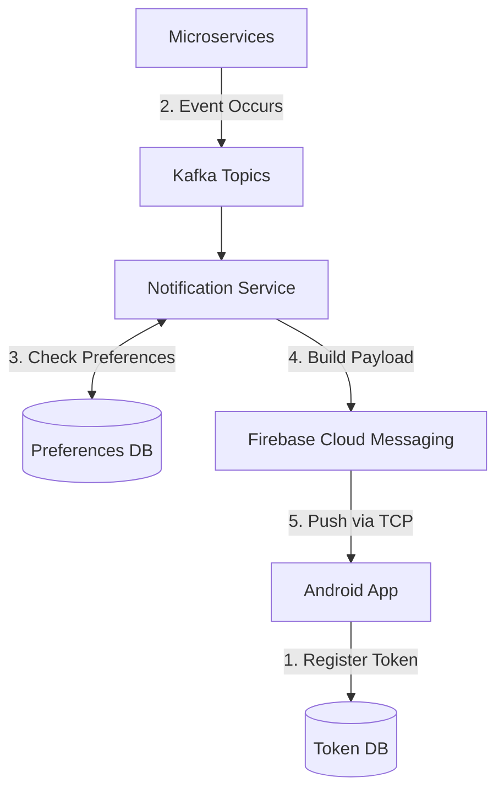

# System Design: Notification System

## The Prompt

*"Design a Push Notification system for a global social media application. It must handle 100 million users, deliver breaking news instantly, support user-specific personalized alerts (e.g., 'John liked your photo'), and allow users to mute specific threads without the phone buzzing unnecessarily."*

## 1. Requirements & Clarification (RADIO Framework)

### Functional Requirements
- **Targeted Pushes:** 1-to-1 messages (John liked your photo).
- **Broadcast Pushes:** 1-to-Many messages (Breaking News to 10M users).
- **User Preferences:** Users can mute specific topics or threads.
- **Deep Linking:** Tapping the notification opens a specific screen in the app.

### Non-Functional Requirements (NFRs)
- **Scale:** 100M active users.
- **Latency:** Instant delivery for 1-to-1. Broadcasts must complete within minutes.
- **Battery/Efficiency:** Do not wake up the Android app for muted threads.

## 2. High-Level Architecture

The core of a Notification System involves the **Device Token**, a massive Backend Message Broker, and Google's Firebase Cloud Messaging (FCM) infrastructure.



## 3. Data Model & Components

### 1. The Token Registry
FCM generates a unique String (Token) for every app installation. 
```json
{
  "user_id": "991",
  "device_token": "fcm_token_xyz_123",
  "device_type": "ANDROID",
  "app_version": "2.4.1",
  "last_active": 1672531200
}
```
*Staff Rule:* A user can have multiple devices (Phone, Tablet). The Token DB is a One-to-Many mapping. 

### 2. The Preferences Database
Stored on the backend (usually a fast NoSQL database like Redis or Cassandra).
```json
{
  "user_id": "991",
  "global_mute": false,
  "muted_threads": ["thread_456", "thread_789"],
  "quiet_hours": { "start": "22:00", "end": "07:00", "timezone": "PST" }
}
```

### 3. The FCM Payload (Data vs Notification)
This is the most critical Android-specific decision.
- **Notification Payload:** The OS intercepts it. The App code *never runs*. The OS draws a generic notification.
- **Data Payload:** The OS wakes up your `FirebaseMessagingService`. Your code executes. You can sync a database, check local settings, and manually draw a customized notification.

*Staff Decision:* We strictly use **Data Payloads**. We must maintain control over the notification grouping, rich imagery, and local SQLite syncing.

## 4. The Core Flows (Deep Dive)

### Flow 1: 1-to-1 Notification (John liked your photo)
1. User A likes User B's photo. The `LikeService` publishes an event to Kafka.
2. The `NotificationService` consumes the event.
3. It queries the `PreferencesDB` for User B. Are likes muted? No.
4. It queries the `TokenDB` for User B. User B has 2 Android devices.
5. It formats a JSON Data Payload and POSTs to the FCM API targeting those 2 Tokens.
6. FCM delivers the payload over the persistent Google TCP socket to the devices.
7. The Android OS wakes up the app's `FirebaseMessagingService`.
8. The App builds an `android.app.Notification` and posts it to the `NotificationManager`.

### Flow 2: 1-to-10M Broadcast (Breaking News)
*Interviewer:* "A celebrity dies. We need to send a push to 10 million users. If you query the Token DB 10 million times and make 10 million HTTP POST requests to FCM, your Notification Service will crash and it will take 4 hours to send."

**Staff Answer:**
"For broadcasts, we do not target Device Tokens. We use **FCM Topics**.
When the Android App installs, it subscribes to topics: `FirebaseMessaging.getInstance().subscribeToTopic("news_alerts")`.
When the backend wants to broadcast, it makes **ONE single HTTP POST** to FCM targeting the topic `/topics/news_alerts`.
FCM's massive internal infrastructure handles the fan-out to the 10 million individual devices simultaneously."

## 5. Failure Modes & Bottlenecks

### Bottleneck: The Token Rot Problem
*Interviewer:* "Users uninstall the app, but you keep sending pushes to their dead tokens. FCM starts rate-limiting your backend. How do you clean the database?"

**Staff Answer:**
"FCM will return an error code (`UNREGISTERED`) when we attempt to push to a token for an app that has been uninstalled. The `NotificationService` must intercept this specific HTTP response from FCM and immediately delete the token from our `TokenDB`. Furthermore, on the Android side, the `onNewToken` callback in `FirebaseMessagingService` must reliably sync any token rotations up to the backend."

### Bottleneck: Silent Muting (Battery Drain)
*Interviewer:* "User A mutes User B in the Android app. User B sends 500 messages. The phone battery dies because it keeps waking up."

**Staff Answer:**
"A junior engineer filters muted threads on the *Client*. They receive the push, check the local SQLite database, see it's muted, and choose not to display the notification. This is an architectural failure. Waking the cellular radio and the app process costs massive battery.
**The Fix:** Muting logic MUST execute on the Backend (`PreferencesDB`). The `NotificationService` checks the mute status *before* calling FCM. The push is never sent over the air, saving the user's battery."

### Bottleneck: The Deep Link Crash
*Interviewer:* "The user taps a notification to open a specific chat. The app crashes because the back-stack is broken."

**Staff Answer:**
"When drawing the notification, the `PendingIntent` cannot just launch a raw `Activity`. I will use Jetpack Navigation's `NavDeepLinkBuilder`. It constructs the exact back-stack defined in the NavGraph. When the user hits the back button in the chat, they go back to the Home screen, not the Android Home Launcher. This requires passing the deep link URI inside the FCM Data Payload."

## 6. Staff Engineer Thinking: Security and PII

When handling notifications, a Staff engineer focuses heavily on Privacy.

1.  **Lock Screen Privacy:** The OS can show notifications on a locked screen. If an FCM payload contains `"text": "Your HIV test result is positive"`, anyone looking at the phone sees it. I must configure the `NotificationCompat.Builder` with `setVisibility(NotificationCompat.VISIBILITY_PRIVATE)`. The OS will redact the text to "New Message" until the phone is unlocked via Biometrics.
2.  **Payload Interception:** FCM payloads travel through Google's servers. If we send end-to-end encrypted chat messages, we *cannot* put the plaintext message in the FCM payload. We send an empty "Wake Up" ping. The Android app wakes up, connects directly to our server via a secure socket, downloads the encrypted message, decrypts it locally, and *then* draws the notification.
3.  **Notification Channels:** Mandatory since Android O (API 26). I mandate strict Channel categorization ("Marketing", "Direct Messages", "Alerts"). If we put Marketing pushes in the "Direct Messages" channel, the user will block all notifications from our app in the OS settings.

## 7. Probing Questions (For Practice)

1.  Explain the fundamental difference between an FCM "Notification" payload and an FCM "Data" payload regarding Android background execution.
2.  Describe the "Fan-Out" problem when sending a breaking news alert to 10 million users, and how FCM Topics solve it.
3.  Why is it an architectural failure to evaluate "Mute Thread" preferences on the Android client instead of the Backend server?
4.  Explain the "Token Rot" problem. How does an app uninstallation signal the backend to delete the Device Token?
5.  What is a `PendingIntent`, and why must you use a tool like `NavDeepLinkBuilder` to construct the back-stack when a user taps a notification?
6.  How does an application prevent highly sensitive medical or financial information from being displayed on a locked smartphone screen?
7.  If an application requires End-to-End Encryption (E2EE), explain why the actual chat message text cannot be included in the FCM JSON payload.
8.  Describe the purpose of Android Notification Channels and the business risk of failing to categorize them properly (e.g., mixing Marketing and Direct Messages).
9.  Why does a single User ID in a backend database often map to multiple FCM Device Tokens in a One-to-Many relationship?
10. If an Android application updates its version, why might the `FirebaseMessagingService.onNewToken()` callback fire, and what must the app do immediately?

## Further Reading

- [`push-vs-poll-vs-sse-vs-websockets.md`](../backend-for-mobile/push-vs-poll-vs-sse-vs-websockets.md) — Why FCM uses a single persistent TCP socket managed by Google Play Services.
- [`security-and-privacy.md`](../mobile-system-design/security-and-privacy.md) — The compliance laws governing PII in push notifications.
- [`deep-links-and-universal-links.md`](deep-links-and-universal-links.md) — How the `PendingIntent` routes into the app architecture.
