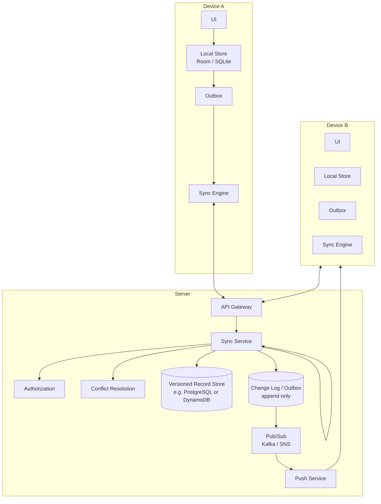
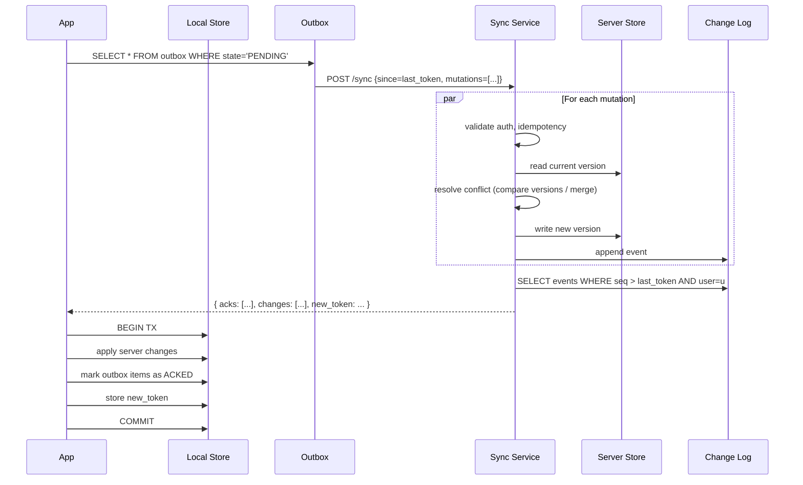

# Offline Sync System Design

> Interview-style deep dive on designing offline-first sync for mobile applications (Notes, Tasks, Email, CRM, Drive, anything where the client mutates state without connectivity). Covers the full sync protocol (local-first writes, outbox, delta pull, change tokens, tombstones), conflict resolution strategies (LWW, HLC-LWW, CRDTs, custom merges), the data model that makes sync correct (vector versions, soft deletes, append-only ops), HLD, sequence diagrams, schema, and the failure modes that ruin naïve implementations.

---

## 1. Problem Statement

Design an offline-first sync layer for a mobile app where:

- The user creates, edits, and deletes data on their device with **no network**.
- When the network returns, local changes propagate to the server.
- Other devices' changes propagate to the local device.
- All replicas (this device, server, other devices) **converge** to the same state.
- Conflicting concurrent edits are resolved deterministically without data loss when possible.
- The app works the same way online or offline — no degraded mode.

Canonical examples: Apple Notes, Google Keep, Notion, Todoist, Trello, Salesforce Field Service.

### Functional Requirements

- Read, create, update, delete (CRUD) records while offline.
- Auto-sync when network returns.
- Multi-device per user (phone + tablet + web).
- Optional collaboration (multiple users editing same record).
- Conflict resolution that surfaces meaningful conflicts to the user only when human judgment is required.
- Optional soft delete + restore.
- Search and filter on local data.
- Push notifications when remote changes arrive.

### Non-Functional Requirements

| Concern | Target |
|---|---|
| First open from cold (data already cached) | < 500ms |
| Sync round-trip (incremental, small) | < 1.5s |
| Storage on device | < 100MB for typical users; pruning for power users |
| Bandwidth on resume sync | proportional to changes, not total data |
| Data integrity | No silent data loss; convergence after every sync |
| Battery cost of background sync | < 1% per hour |
| Sync conflict rate | < 1% of edits surface as user-visible conflict |
| Server scale | 100M users × 10K records each = trillion-row scale |

### Scale Assumptions

- 50M DAU.
- 200M client-side mutations/day = ~2.5K/sec.
- Sync session every ~5 min when app open + on app launch + on push wake → ~50M sync sessions/day = ~600/sec.
- Per-user record count: median ~1K, P99 ~100K.
- Per-record avg size: 2KB (text-heavy notes; images go to blob store).

---

## 2. High-Level Architecture



### Tier responsibilities

- **Local store (Room/SQLite)** — single source of truth for the UI. UI never reads from network.
- **Outbox** — durable queue of pending local mutations, persisted until server acknowledges.
- **Sync engine** — manages the round-trip: push outbox, pull remote changes, apply, resolve conflicts.
- **Sync service** — server endpoint that accepts mutations, persists versioned records, returns updated state since the last sync token.
- **Change log** — append-only stream of every accepted mutation. Source of truth for delta sync.
- **Pub/sub** — propagates change events so other devices can be pushed to wake up.

---

## 3. The Sync Protocol

### 3.1 Three operations

Every sync session does three things:

1. **Push** — send the outbox (local pending mutations) to the server.
2. **Pull** — request changes since the last successful sync token.
3. **Apply** — write pulled changes into the local store; resolve conflicts.

### 3.2 The change token (cursor)

Each successful sync returns a `change_token` (sync cursor). Client stores it. Next sync sends:

```
POST /v1/sync
{
  "since": "ct:1719500000:user99:db_version=1247",
  "mutations": [ ... outbox items ... ]
}
```

The server interprets the token to figure out "what's new since the client last knew." Common implementations:

- **Monotonic version per record + per-user max-version cursor** (simplest).
- **HLC timestamp** (correct under clock skew; see [`../engineering-fundamentals/time-and-clocks.md`](../engineering-fundamentals/time-and-clocks.md)).
- **Logical sequence ID per user** (e.g., Postgres serial column scoped to the user).
- **Vector version** (per-replica counters; full causal ordering but more bytes).

### 3.3 Sync session sequence



### 3.4 Server response

```json
{
  "new_token": "ct:1719500300:user99:db_version=1402",
  "acks": [
    { "client_op_id": "uuid-1", "status": "applied", "new_version": 1395 },
    { "client_op_id": "uuid-2", "status": "conflict", "server_state": {...} }
  ],
  "changes": [
    { "record_id": "r-101", "rev": 1397, "data": {...} },
    { "record_id": "r-102", "rev": 1399, "deleted": true }
  ]
}
```

The client iterates `acks` to update local outbox state, then applies `changes` to local store, then stores `new_token`. All in one DB transaction so failure leaves the device in a consistent state.

---

## 4. Data Model

### 4.1 Server schema (versioned + soft-delete)

```sql
CREATE TABLE records (
    record_id UUID PRIMARY KEY,
    user_id BIGINT NOT NULL,
    rev BIGINT NOT NULL,                       -- monotonic per user
    hlc_ts BIGINT NOT NULL,                    -- Hybrid Logical Clock
    data JSONB NOT NULL,
    deleted BOOLEAN NOT NULL DEFAULT FALSE,    -- tombstone
    created_at TIMESTAMPTZ NOT NULL,
    updated_at TIMESTAMPTZ NOT NULL,
    last_edit_device VARCHAR(64),
    INDEX (user_id, rev)
);

CREATE TABLE change_log (
    seq BIGSERIAL PRIMARY KEY,
    user_id BIGINT NOT NULL,
    record_id UUID NOT NULL,
    rev BIGINT NOT NULL,
    event_type TEXT NOT NULL,                  -- CREATE, UPDATE, DELETE
    payload JSONB,
    created_at TIMESTAMPTZ NOT NULL,
    INDEX (user_id, seq)
);
```

The `rev` is a per-user monotonic counter (Postgres sequence scoped via user partitioning or via a logical clock service). It's what the change token tracks.

Soft delete: rows are never physically deleted; they get `deleted = true`. The tombstone lets other devices learn about the deletion when they sync next, even if they were offline at delete time. Tombstones can be garbage-collected after enough time has passed that no offline device could still be unaware (typically 30-90 days).

### 4.2 Local schema (mirror + sync metadata)

```kotlin
@Entity(tableName = "records",
    indices = [Index("syncState"), Index("updatedAt")])
data class LocalRecord(
    @PrimaryKey val recordId: String,
    val data: String,                       // serialized JSON
    val rev: Long,                          // server's last-known rev (0 = locally created, never synced)
    val hlcTs: Long,                        // last server HLC
    val syncState: SyncState,               // CLEAN, DIRTY, PENDING_SYNC, CONFLICT
    val deleted: Boolean,
    val updatedAt: Long
)

@Entity(tableName = "outbox",
    indices = [Index("state"), Index("createdAt")])
data class OutboxOperation(
    @PrimaryKey val opId: String,            // client UUID — idempotency key
    val recordId: String,
    val opType: OpType,                      // CREATE, UPDATE, DELETE
    val payload: String,                     // serialized operation
    val baseRev: Long,                       // server rev the operation was based on
    val state: OutboxState,                  // PENDING, SENDING, ACKED, FAILED
    val attemptCount: Int,
    val createdAt: Long,
    val nextAttemptAt: Long
)

@Entity(tableName = "sync_state")
data class SyncState(
    @PrimaryKey val key: String = "global",
    val lastSyncToken: String?,
    val lastSyncAt: Long
)
```

### 4.3 Why "baseRev" matters

When the client mutates a record, it records what rev it had *at the time of the mutation*. When the server applies the mutation, it compares:

- If server's current rev == `baseRev` → no conflict, apply.
- If server's current rev > `baseRev` → someone else mutated; conflict resolution.

This is the standard *optimistic concurrency control* pattern. See [`../engineering-fundamentals/idempotency.md`](../distributed-systems/idempotency.md) for the dual idempotency-key story.

---

## 5. Conflict Resolution

### 5.1 Strategies

| Strategy | Description | Use case |
|---|---|---|
| **Last-Write-Wins (LWW)** | Latest timestamp wins; loser silently dropped | Most scalar fields where users expect "my last action wins" |
| **HLC-LWW** | LWW with Hybrid Logical Clock | Same as LWW but correct under clock skew |
| **Merge per field** | Per-field LWW with sub-second precision | Records where different fields are edited independently |
| **CRDT** | Conflict-free type guarantees convergence | Collaborative lists, text, counters |
| **Surface to user** | UI shows "conflict — choose one" | Critical business data; rare and expensive |
| **Append-only / no conflict** | All edits are additive (comments, logs) | Activity logs, comments, timeline events |

Most production systems pick **HLC-LWW for scalar fields + CRDTs for collaborative fields + Surface-to-user for the rare "deleted vs edited" case**. See ADR [`../adr/008-lww-vs-crdt.md`](../adr/008-lww-vs-crdt.md) for the decision rationale.

### 5.2 The "delete vs edit" conflict

Device A edits a record. Device B deletes the same record. They both come online.

Possible policies:
- **Delete wins**: editor's changes lost.
- **Edit wins (revival)**: deletion is reverted; deleter sees the record reappear.
- **Surface to user**: "Bob deleted this; you have unsaved edits — which do you want?"

For most apps, **surface to user** is correct because semantics differ. Notion does this; Apple Notes does revival; Drive does revival with version history.

### 5.3 Three-way merge

When you have a known common ancestor (`baseRev`), the server's current state, and the client's proposed state, you can do a **three-way merge** field by field:

```
For each field f:
    if client_state[f] == ancestor[f]:
        keep server_state[f]    // no client edit
    else if server_state[f] == ancestor[f]:
        keep client_state[f]    // no server edit
    else:
        // both edited — actual conflict; LWW by HLC, or surface
```

Same algorithm Git uses. Works well for records with many small fields where only a few are typically edited.

### 5.4 CRDT for collaborative fields

For a shared list, a comment thread, or a counter, use the appropriate CRDT type rather than LWW. Example: an OR-Set (Observed-Remove Set) for a tag list lets two devices add `red` and `blue` independently; both survive the merge.

```kotlin
class OrSet<T> {
    private val adds = mutableSetOf<Pair<T, UUID>>()
    private val removes = mutableSetOf<UUID>()

    fun add(item: T): Pair<T, UUID> {
        val tag = item to UUID.randomUUID()
        adds.add(tag)
        return tag
    }

    fun remove(item: T) {
        adds.filter { it.first == item }.forEach { removes.add(it.second) }
    }

    fun current(): Set<T> = adds
        .filterNot { it.second in removes }
        .map { it.first }
        .toSet()

    fun merge(other: OrSet<T>) {
        adds.addAll(other.adds)
        removes.addAll(other.removes)
    }
}
```

Each add gets a unique tag. Removes target tags. Concurrent add + remove of "the same" item: the add (tagged with different tag) survives; the remove only affects the previously-tagged version. This is the "observed remove" semantic — what most users expect from a multi-device tag list.

For collaborative text, more complex CRDTs (Yjs, Automerge, RGA, Logoot) are required.

---

## 6. Push / Update Notifications

To minimize sync latency on inactive devices:

1. Server publishes change events to Pub/Sub when a record is mutated by any device.
2. Push Service translates to FCM/APNs targeting the user's other devices.
3. Other devices receive a silent push: "you have changes."
4. Receiving device opens a sync session and pulls deltas.

This avoids periodic polling, saves battery, and reaches devices in seconds.

```mermaid
sequenceDiagram
    participant A as Device A
    participant SS as Sync Service
    participant Log as Change Log
    participant Push as Push Service
    participant B as Device B

    A->>SS: POST /sync { mutations }
    SS->>Log: append events
    SS-->>A: ack
    Log->>Push: published events
    Push->>B: FCM silent push
    B->>SS: POST /sync { since = stored_token }
    SS-->>B: { changes, new_token }
    B->>B: apply locally; UI updates reactively
```

The silent push payload need not contain data — just "sync now." FCM's `priority: high` wakes the app even in Doze.

---

## 7. Delta Sync & Pagination

### 7.1 Why delta

A user with 100K records, offline for 2 hours, returning online: sending all 100K records would burn bandwidth, time, and battery. Delta sync sends only changes.

### 7.2 The change cursor

Cursor design influences correctness and efficiency:

```
// Simple monotonic version per user
last_token = "user:99:rev:1247"

// Delta query: SELECT * FROM change_log WHERE user_id=99 AND seq > 1247
```

**Tradeoff: cursor granularity.**

- Per-user monotonic version — small token, simple query. Good default.
- Per-record version — too much state on client; not feasible at scale.
- Vector clock — most precise (full causal ordering); larger token.

Most systems use per-user monotonic versions for simplicity, accepting that "I might fetch some records twice" is OK (the client checks rev and de-dups).

### 7.3 Pagination of large deltas

If a user was offline for a year and has 1M records changed, the delta is too big for one response. Paginate:

```
First response: { changes: [first 1000], next_cursor: "...mid_token...", finished: false }
Client continues: POST /sync { cursor: "...mid_token..." }
Second response: { changes: [next 1000], next_cursor: "...", finished: false }
... until finished: true
```

During a multi-page delta, the client keeps tracking new changes (push from server during the pull) so it doesn't miss anything.

### 7.4 Compression

`Content-Encoding: gzip` on responses cuts JSON payload by 70-80%. For very large initial syncs, `zstd` is faster and compresses similarly.

For binary data (record blobs, images), don't double-compress — they're already compressed. Use `Content-Encoding: identity` for binary.

---

## 8. Mobile Client Architecture

### 8.1 Repository pattern

```kotlin
class NotesRepository(
    private val dao: NoteDao,
    private val outboxDao: OutboxDao,
    private val syncEngine: SyncEngine,
    private val clock: HybridLogicalClock
) {
    fun observeAll(): Flow<List<Note>> = dao.observeAll()
        .map { rows -> rows.filterNot { it.deleted }.map { it.toDomain() } }

    suspend fun create(note: Note) {
        val opId = UUID.randomUUID().toString()
        val ts = clock.now()
        dao.withTransaction {
            dao.insert(LocalRecord(
                recordId = note.id,
                data = serialize(note),
                rev = 0,
                hlcTs = ts,
                syncState = SyncState.DIRTY,
                deleted = false,
                updatedAt = System.currentTimeMillis()
            ))
            outboxDao.insert(OutboxOperation(
                opId = opId,
                recordId = note.id,
                opType = OpType.CREATE,
                payload = serialize(note),
                baseRev = 0,
                state = OutboxState.PENDING,
                attemptCount = 0,
                createdAt = System.currentTimeMillis(),
                nextAttemptAt = System.currentTimeMillis()
            ))
        }
        syncEngine.requestSync()    // best-effort kick
    }

    suspend fun update(note: Note) {
        val opId = UUID.randomUUID().toString()
        val ts = clock.now()
        dao.withTransaction {
            val existing = dao.get(note.id)!!
            dao.update(existing.copy(
                data = serialize(note),
                hlcTs = ts,
                syncState = SyncState.DIRTY,
                updatedAt = System.currentTimeMillis()
            ))
            outboxDao.insert(OutboxOperation(
                opId = opId,
                recordId = note.id,
                opType = OpType.UPDATE,
                payload = computeDelta(existing.data, serialize(note)),
                baseRev = existing.rev,
                state = OutboxState.PENDING,
                attemptCount = 0,
                createdAt = System.currentTimeMillis(),
                nextAttemptAt = System.currentTimeMillis()
            ))
        }
        syncEngine.requestSync()
    }
}
```

UI binds to `observeAll()`. UI never knows about sync — it's invisible.

### 8.2 Sync engine

```kotlin
class SyncEngine(
    private val api: SyncApi,
    private val dao: NoteDao,
    private val outboxDao: OutboxDao,
    private val syncStateDao: SyncStateDao,
    private val scope: CoroutineScope
) {
    private val mutex = Mutex()
    private val syncRequests = Channel<Unit>(Channel.CONFLATED)

    init {
        scope.launch { processLoop() }
    }

    fun requestSync() { syncRequests.trySend(Unit) }

    private suspend fun processLoop() {
        for (req in syncRequests) {
            mutex.withLock {
                try { runSync() } catch (e: Exception) { logger.error(e) }
            }
        }
    }

    private suspend fun runSync() {
        val pending = outboxDao.getPending()
        val token = syncStateDao.token()
        val response = api.sync(SyncRequest(
            since = token,
            mutations = pending.map { it.toWire() }
        ))

        dao.withTransaction {
            for (ack in response.acks) {
                when (ack.status) {
                    "applied" -> outboxDao.markApplied(ack.opId, ack.newRev)
                    "conflict" -> resolveConflict(ack)
                    "rejected" -> outboxDao.markFailed(ack.opId, ack.reason)
                }
            }
            for (change in response.changes) {
                applyServerChange(change)
            }
            syncStateDao.setToken(response.newToken)
        }
    }

    private suspend fun resolveConflict(ack: SyncAck) {
        // Apply server state; mark conflict for UI surfacing
        applyServerChange(ack.serverState)
        outboxDao.markConflict(ack.opId)
        notificationCenter.notifyConflict(ack.recordId)
    }
}
```

The `Channel.CONFLATED` ensures multiple `requestSync()` calls in rapid succession only trigger one actual sync. Mutex prevents concurrent syncs (which would race).

### 8.3 Background sync via WorkManager

```kotlin
class PeriodicSyncWorker(
    appContext: Context,
    params: WorkerParameters,
    private val syncEngine: SyncEngine
) : CoroutineWorker(appContext, params) {

    override suspend fun doWork(): Result {
        return try {
            syncEngine.runSyncBlocking()
            Result.success()
        } catch (e: Exception) {
            Result.retry()
        }
    }
}

// Schedule:
val request = PeriodicWorkRequestBuilder<PeriodicSyncWorker>(15.minutes.toJavaDuration())
    .setConstraints(Constraints.Builder().setRequiredNetworkType(NetworkType.CONNECTED).build())
    .setBackoffCriteria(BackoffPolicy.EXPONENTIAL, 30.seconds.inWholeMilliseconds, TimeUnit.MILLISECONDS)
    .build()
WorkManager.getInstance(context).enqueueUniquePeriodicWork("periodic-sync", ExistingPeriodicWorkPolicy.KEEP, request)
```

Periodic syncs catch missed pushes; expedited syncs (`OneTimeWorkRequest`) run when the user opens the app or receives a push.

### 8.4 Reactive UI

```kotlin
@Composable
fun NoteListScreen(viewModel: NoteListViewModel = hiltViewModel()) {
    val notes by viewModel.notes.collectAsStateWithLifecycle()
    val syncStatus by viewModel.syncStatus.collectAsStateWithLifecycle()

    Column {
        SyncStatusBar(syncStatus)
        LazyColumn {
            items(notes, key = { it.id }) { note ->
                NoteRow(note, onClick = { viewModel.open(note) })
            }
        }
    }
}
```

UI subscribes to local DB via Flow. When sync engine writes new records, Flow re-emits, Compose recomposes. The user sees changes seamlessly.

---

## 9. Media / Blob Sync

Records that reference large blobs (images, audio, attachments):

- Blobs uploaded separately to S3 / CDN via pre-signed URLs.
- The record stores only the `blob_ref` (URL or content-hash).
- Sync of the record metadata is fast; blob fetch is on-demand.

```kotlin
data class Note(
    val id: String,
    val title: String,
    val body: String,
    val attachments: List<AttachmentRef>     // refs only, not bytes
)

data class AttachmentRef(
    val id: String,
    val mimeType: String,
    val blobUrl: String,
    val sha256: String,
    val sizeBytes: Long
)
```

Blob upload flow:
1. App computes `sha256(bytes)`.
2. App requests pre-signed upload URL: `POST /v1/media/upload-url { sha256, size }`.
3. Server responds with URL + headers; checks if blob already exists by hash → deduplication.
4. App uploads bytes (or skips if dedup).
5. App includes `AttachmentRef` in the record; syncs as normal.

Blob fetch flow:
1. UI requests blob → check local cache.
2. Cache miss → download from CDN → store locally → render.
3. Use disk LRU cache with hash-based filenames.

---

## 10. Failure Modes

**Network drop mid-sync.** Partial response from server. Mitigation: server returns acks per operation; client only updates outbox for acked operations. Idempotency key ensures retry doesn't double-apply.

**Client crash mid-apply.** UI shows partial state. Mitigation: apply server changes in a single DB transaction; rollback on crash. SQLite's WAL mode guarantees atomic commits.

**Replay attack.** Adversary replays an old `mutations` request. Mitigation: idempotency keys are unique per operation; server detects re-submission and returns the original result.

**Server returns wrong delta (token bug).** Client misses changes. Mitigation: rev numbers are monotonic; client compares incoming rev to current; if gap detected, full resync.

**Clock skew on client.** A client with wildly wrong clock sends mutations with bad HLC. Mitigation: server records its own HLC on receive; rejects mutations >5min in future (unless device clock is otherwise correctable).

**Tombstone garbage collected too early.** Device offline for 6 months returns; missed deletion; deleted record reappears. Mitigation: keep tombstones for a generous window (90-180 days). Alternative: on initial-state delta (oldest cursor possible), server can include explicit "no longer exists" markers.

**Outbox overflow.** User offline for weeks; thousands of pending ops. Mitigation: cap outbox size; offer "discard offline changes" if absurdly old; for typical apps, 10K pending ops is fine.

**Two devices race to create with same client UUID.** Almost impossible (UUIDv4), but theoretically possible. Mitigation: server's primary-key check rejects the duplicate.

**Hot user.** A power user with 100K records doing 1K updates/sec. Mitigation: per-user rate limiting; shard their data across DB partitions for write throughput.

**Conflict-resolution diverges across devices.** Bug in merge logic causes Device A and Device B to converge to different states. Mitigation: merge logic lives on server only; clients receive deterministic outcome.

**Sync infinite loop.** Apply server changes → marks records dirty → tries to push → server rejects (no change) → loops. Mitigation: applying server changes must use a `syncing=true` flag that suppresses outbox writes.

---

## 11. Performance & Scaling

### 11.1 Server-side

- **Per-user partitioning.** Records and change-log are sharded by `user_id`. Each user's data lives on one shard.
- **Read-from-changelog vs read-from-records.** For delta queries (`changes since rev X`), reading the change log is O(delta_size); reading records and filtering is O(user_total).
- **Cache hot users.** A subset of users sync constantly. Cache their tip-rev in Redis to avoid DB lookups on every sync.
- **Pub/sub throughput.** Use partitioned Kafka topics keyed by user_id. One worker per partition.

### 11.2 Client-side

- **Index local DB on (record_id), (syncState), (updatedAt).**
- **Periodic VACUUM / WAL checkpoint** for SQLite to reclaim deleted-row space.
- **Compress payloads.** OkHttp's `gzip` interceptor saves egress bytes; helpful on cellular.
- **Sync ONLY when needed.** Manual / push-driven / interval-based, not continuous.
- **Avoid syncing while user is editing.** Pause sync for 5-10s after a mutation to avoid spurious churn.

### 11.3 Bandwidth

- **Delta-only payloads.** Per-field deltas, not full records.
- **Patch encoding.** For text-heavy records, JSON Patch (RFC 6902) or operational transformation cuts bytes.
- **Binary protocols.** Protobuf for the sync wire payload; 5-10x smaller than JSON.

---

## 12. Mobile-Specific Concerns

| Concern | Strategy |
|---|---|
| Cold start UI | Render from local DB instantly; sync in background |
| Sync indicator | Subtle "syncing…" spinner; never block UI |
| Background sync | WorkManager + push wakeups |
| Battery | Sync only on push or short-interval polling; never tight loops |
| Doze / standby | High-priority FCM for sync wakes |
| Offline editing UX | Optimistic; mark as "pending sync" if user wants visibility |
| Conflict UX | Surface only when humans must decide; for LWW, silently apply |
| Multi-device | Sync token is per-device, not per-user; supports multiple devices |
| Storage cap | Prune tombstones and old records; offer "free up space" tool |
| Backup & restore | Local DB backed up via OS mechanisms (Auto Backup) + server is canonical |

---

## 13. Tradeoffs

**Optimistic vs pessimistic concurrency**

| | Optimistic (versions) | Pessimistic (locks) |
|---|---|---|
| Conflict | post-hoc | pre-empted |
| Throughput | high | low |
| Complexity | merge logic | distributed locks |
| Common in mobile | yes | no |

**LWW vs CRDT**

| | LWW | CRDT |
|---|---|---|
| Code complexity | low | high |
| Data loss possible | yes (concurrent edits) | no |
| Metadata size | small | grows with ops |
| Use case | most scalar fields | collaborative lists / text |

**Per-user partitioning vs sharded mutations**

| | Per-user | Sharded |
|---|---|---|
| Hot users | bottleneck | mitigated |
| Cross-user joins | hard | hard |
| Common in mobile | yes | only for power-users |

**Tombstone GC: aggressive vs conservative**

| Aggressive (30d) | Conservative (180d) |
|---|---|
| Smaller DB | safer for offline devices |
| Risk: "ghost records" reappear | minor extra storage |
| Use when device offline > 30d is rare | use when offline > 30d common |

---

## 14. Probing Questions

1. Walk through the full sync round-trip from client's view: outbox push → server apply → server pull → client apply. What runs in a single transaction?
2. Explain `baseRev` and how it enables optimistic concurrency control. What happens when client's `baseRev` doesn't match server's current rev?
3. Two devices edit the same field of the same record offline. With HLC-LWW, walk through which edit wins and why HLC is necessary (vs wall-clock).
4. Why are tombstones necessary? What happens if you garbage collect them too aggressively?
5. The change cursor is a "since" token. Compare three implementations: monotonic per-user rev, HLC, vector clock. What's each worth?
6. A user is offline for two months and accumulates 50K outbox operations. Walk through the safe ways to send them to the server.
7. Sync infinite loop: applying server changes marks records dirty, which tries to push to server. How do you break the loop?
8. Three-way merge — when do you have a common ancestor, and how does the merge handle a field both clients edited differently?
9. OR-Set for tags: walk through what happens when Device A adds "red", Device B removes "red" (added previously), and Device A reconnects.
10. Push notifications wake the app for sync. Why is this better than periodic polling, and what's the FCM quota concern?
11. A blob (10MB image) attached to a record. Walk through how it syncs (separate from record metadata) and how dedup by content hash works.
12. The user has 100K records. Initial sync to a new device. How do you avoid sending all 100K in one response?
13. Conflict UX: when should you silently merge vs surface to the user? Give concrete examples.
14. Server returns wrong delta (bug). Client detects it. What's the recovery — full resync or alternative?
15. Two devices simultaneously create records with the same client_op_id (collision). How does the server detect and handle?
16. Background sync via WorkManager has constraints (network connected, etc.). What constraints make sense for sync and which trade battery for freshness?
17. Pagination of large delta responses. Walk through cursor advancement and what happens if new changes arrive during the pagination.
18. Per-user partitioning of records. What's the failure mode if one user becomes a power user with 10M records?
19. Encryption at rest: SQLCipher locally and per-user encryption server-side. How does this interact with delta sync and conflict resolution?
20. CRDT for text editing — when does it pay off vs simpler character-level LWW? What's the bandwidth cost?

---

## 15. Further Reading

In this repository:

- [`chat-messaging.md`](chat-messaging.md) — offline send pattern.
- [`pagination.md`](pagination.md) — cursor-based pagination for delta sync.
- [`collaborative-editing.md`](collaborative-editing.md) — CRDT and OT for text.
- [`caching-library.md`](caching-library.md) — local cache patterns.
- [`../distributed-systems/idempotency.md`](../distributed-systems/idempotency.md) — idempotency keys.
- [`../distributed-systems/consistency-models.md`](../distributed-systems/consistency-models.md) — eventual consistency and convergence.
- [`../distributed-systems/crdts.md`](../distributed-systems/crdts.md) — full CRDT taxonomy.
- [`../distributed-systems/delivery-semantics.md`](../distributed-systems/delivery-semantics.md) — at-least-once and exactly-once.
- [`../engineering-fundamentals/time-and-clocks.md`](../engineering-fundamentals/time-and-clocks.md) — HLC for sync timestamps.
- [`../adr/008-lww-vs-crdt.md`](../adr/008-lww-vs-crdt.md) — the conflict-strategy decision.
- [`../android/data-and-di/room.md`](../android/data-and-di/room.md) — local storage.
- [`../android/concurrency/workmanager.md`](../android/concurrency/workmanager.md) — background sync.

External:

- [Offline-First Mobile App Architecture](https://dev.to/odunayo_dada/offline-first-mobile-app-architecture-syncing-caching-and-conflict-resolution-518n) — patterns covered in this file.
- [AWS AppSync Offline Reference Architecture](https://aws.amazon.com/blogs/mobile/aws-appsync-offline-reference-architecture/) — DynamoDB-based delta sync with TTL'd change journal.
- [How We Designed Offline Sync for Any Data Model](https://medium.com/@msujithr/how-we-designed-offline-sync-for-any-data-model-0079bd4bea2f) — production design walkthrough.
- [CRDTs and Local-First Architecture](https://dev.to/smallstack/crdts-and-local-first-architecture-how-smallstack-handles-offline-conflict-resolution-338c) — CRDT patterns.
- [Beyond Offline-First: Data Synchronization & CRDTs](https://medium.com/@engin.bolat/beyond-offline-first-the-nightmare-of-data-synchronization-crdts-c69501a96c8d) — practical CRDT vs LWW analysis.
- [Offline sync & conflict resolution patterns](https://www.sachith.co.uk/offline-sync-conflict-resolution-patterns-architecture-trade%E2%80%91operationss-practical-guide-feb-19-2026/) — recent (2026) practical guide.
- *Designing Data-Intensive Applications* by Martin Kleppmann, Chapter 5 (replication) and Chapter 12 (future of data systems) — foundational.
- Martin Kleppmann's blog and Local-First Software Manifesto — manifesto for local-first software design.
- [Yjs documentation](https://docs.yjs.dev/) — CRDT-based collaboration library; widely-used reference implementation.
- [Automerge documentation](https://automerge.org/) — alternative CRDT library with rich data types.
- *CouchDB Definitive Guide* (free online) — early sync-protocol design with similar mechanics.
