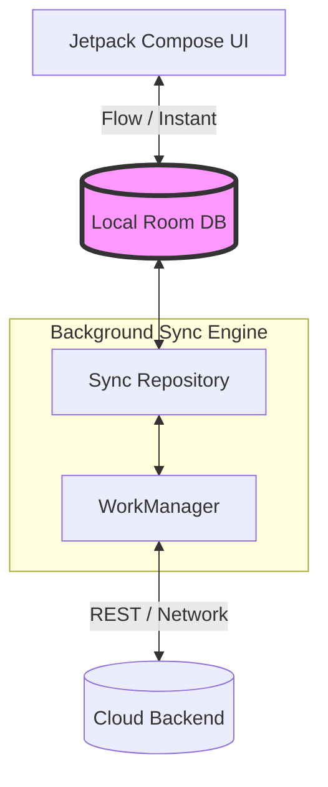

# System Design: Offline Sync

## The Prompt

*"Design an application that works fully offline, such as Google Keep, Evernote, or a field-worker data collection app. Users can create, edit, and delete notes while in a subway tunnel. When they regain connectivity, the data must seamlessly synchronize with the backend without losing any work."*

## 1. Requirements & Clarification (RADIO Framework)

Before drawing boxes, a Staff Engineer establishes the boundaries of the sync engine.

### Functional Requirements
- Users can create, update, and delete text notes while completely offline.
- When the network returns, local changes sync to the cloud.
- Changes made on another device (e.g., Desktop Web) sync down to the Android app.
- Conflict resolution: What happens if I edit "Note A" offline, and my co-worker edits "Note A" on the web simultaneously?

### Non-Functional Requirements (NFRs)
- **Data Integrity (Priority 0):** A user's note can *never* be silently deleted due to a sync conflict.
- **Battery & Network:** The sync engine must not poll infinitely in the background, draining the battery.
- **Latency:** Local UI updates must be instantaneous (Optimistic UI). The user should not wait for a network round-trip to see their new note.

## 2. High-Level Architecture

The golden rule of Offline Sync is **The Single Source of Truth**. 
The UI *only* talks to the local database (SQLite/Room). The UI *never* talks to the Network. The Sync Engine (Repository/WorkManager) sits between the Network and the Database.



## 3. Data Model & API

This is where Junior designs fail. If your Room database just mirrors the cloud database, you cannot support offline edits. You must track **Sync State**.

### The Local Database (Room)

Every entity must have a `sync_status` column.

```kotlin
@Entity(tableName = "notes")
data class NoteEntity(
    @PrimaryKey val id: String, // MUST be a UUID generated on the client
    val text: String,
    val lastModifiedAt: Long,   // Unix timestamp
    val syncStatus: SyncStatus, // PENDING_CREATE, PENDING_UPDATE, PENDING_DELETE, SYNCED
    val isDeleted: Boolean      // Soft delete flag
)

enum class SyncStatus {
    PENDING_CREATE, PENDING_UPDATE, PENDING_DELETE, SYNCED
}
```

**Crucial Constraints:**
1. **Client-Generated IDs:** If you rely on the backend to generate an auto-incrementing `id` (e.g., `1, 2, 3`), you cannot create a note offline because you don't have an ID yet. You *must* use client-generated `UUIDv4`.
2. **Soft Deletes:** If a user deletes a note offline, you cannot `DELETE FROM notes`. If you do, the Sync Engine will forget the note ever existed and won't tell the server to delete it. You must use an `isDeleted = true` flag (Tombstoning).

### The API Contract

The API must support fetching deltas (only what changed) to save bandwidth.

```json
// GET /sync/notes?since=1672531200
{
  "server_timestamp": 1672531205,
  "upserts": [
    { "id": "uuid-1", "text": "New note", "last_modified": 1672531201 }
  ],
  "tombstones": [ "uuid-2", "uuid-3" ]
}
```

## 4. The Sync Engine Logic

When the device regains connectivity, the Sync Engine executes a strict mathematical flow.

### Step 1: Push (Client to Server)
1. Query Room for all notes where `syncStatus != SYNCED`.
2. Group them by status (`PENDING_CREATE`, `PENDING_UPDATE`, `PENDING_DELETE`).
3. Send a batch `POST /sync/push` request to the server.
4. On HTTP 200 Success, update the local database: set `syncStatus = SYNCED`, and permanently delete `isDeleted = true` rows (Purging the Tombstones).

### Step 2: Pull (Server to Client)
1. Read the `last_successful_sync_timestamp` from `SharedPreferences`.
2. Call `GET /sync/notes?since=<timestamp>`.
3. Insert/Update the `upserts` into Room.
4. Delete the `tombstones` from Room.
5. Save the new `server_timestamp` to `SharedPreferences`.

*(Staff Note: Always Push before you Pull, otherwise you risk overwriting un-synced local changes with older server data).*

## 5. Failure Modes & Edge Cases (The Deep Dive)

This is the most critical part of the interview. The interviewer will attack your conflict resolution.

### The Conflict Resolution Problem
*Interviewer:* "I go into an airplane. I edit Note A. My wife is on her laptop at home. She edits Note A simultaneously. I land and turn off airplane mode. Who wins?"

**Staff Answer:**
"Conflict resolution is a spectrum from Simple to Perfect."
1.  **Last-Write-Wins (LWW):** The simplest approach. We compare the `lastModifiedAt` timestamps. Whoever clicked 'Save' last overwrites the other person. This is easy to implement but violates Data Integrity (someone's work is silently destroyed).
2.  **Server-Wins with Forking (The Dropbox/Evernote approach):** If the server detects a collision (e.g., the client's `lastModifiedAt` is older than the server's current version), the server rejects the update. The mobile app creates a brand new note locally named "Note A (Conflicting Copy)". The user manually merges them. This guarantees zero data loss.
3.  **CRDTs (Conflict-Free Replicated Data Types):** The mathematically perfect solution. Characters in the text are treated as arrays of mathematical operations (Insert 'X' at index 4). Both edits merge seamlessly (like Google Docs). However, building a CRDT engine from scratch takes 6 months.

*My Recommendation:* "Given this is a standard note app, we will use **Server-Wins with Forking**. It guarantees zero data loss and can be built in a week."

### The Battery Drain Problem
*Interviewer:* "How do you trigger the sync without draining the battery?"

**Staff Answer:**
"I will use Android's `WorkManager`. 
When a user edits a note offline, I enqueue a `OneTimeWorkRequest` with `setRequiredNetworkType(NetworkType.CONNECTED)`. 
The beauty of `WorkManager` is that the Android OS will wait until the device connects to Wi-Fi/Cellular, batch our sync job with other apps' network requests, and execute it in the background, minimizing radio wake-ups. 
If the API returns a `500 Server Error`, `WorkManager` handles the Exponential Backoff automatically."

## 6. Probing Questions (For Practice)

1.  Explain why auto-incrementing integer IDs (e.g., 1, 2, 3) generated by a SQL database fail entirely in an Offline-First architecture.
2.  Describe the concept of "Tombstoning." Why can you never run a true SQL `DELETE` statement in an offline app?
3.  If an API uses a `/sync?since=<timestamp>` endpoint, what catastrophic failure happens if the mobile device's local hardware clock is manually changed by the user? How do you fix it?
4.  Why is the "Last-Write-Wins" (LWW) conflict resolution strategy considered dangerous for user trust in a collaborative application?
5.  Explain the architectural rule "The UI only talks to the Database, never the Network" (Single Source of Truth). How does this eliminate the need for loading spinners during offline edits?
6.  Walk through the exact order of operations in a Sync Engine. Why must the client Push its local changes *before* Pulling server changes?
7.  How does `WorkManager` protect the device's battery life compared to a custom `BroadcastReceiver` listening for network connectivity changes?
8.  Describe the "Server-Wins with Forking" strategy for conflict resolution. How does it guarantee zero data loss?
9.  If a user has 50,000 notes, what mechanisms must the Sync Engine implement to prevent a `GET /sync` response from causing an `OutOfMemoryError` on the device?
10. What is a CRDT (Conflict-Free Replicated Data Type), and why might a Staff Engineer advise *against* building one for a simple to-do list app?

## Further Reading

- [`offline-first-app.md`](../reference-architectures/offline-first-app.md) — The complete Blueprint Reference Architecture for this design.
- [`crdts.md`](../distributed-systems/crdts.md) — The deep math behind perfect conflict resolution.
- [`idempotency.md`](../distributed-systems/idempotency.md) — Why the `POST /sync/push` request must be idempotent.
