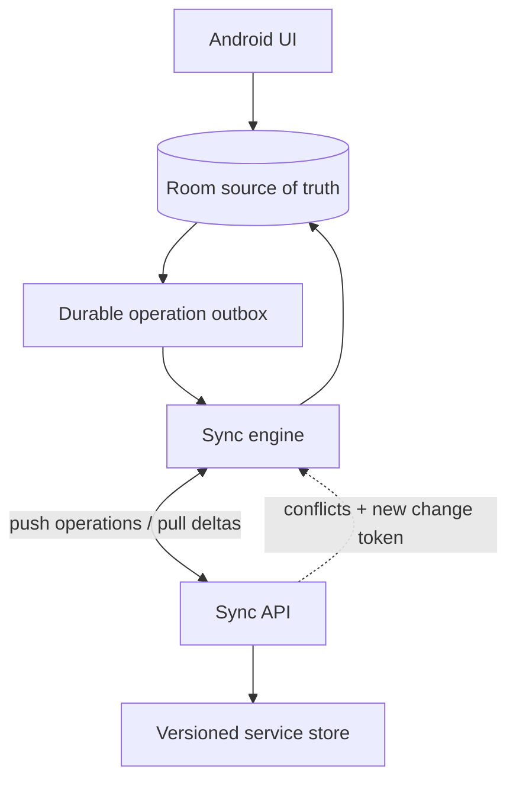
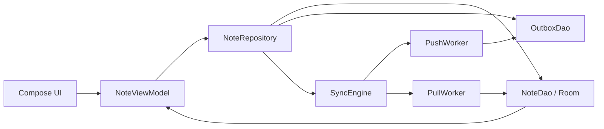

# Offline Sync (Notes / Tasks / CRM-style)

> A 45-60 minute mobile system-design walkthrough for an offline-first app where users mutate state without a network (Apple Notes, Todoist, Salesforce Mobile). The bulk of this file is the *client* sync engine — outbox, delta pull, conflict resolution — with the server reduced to an API contract.

---

## 1. Gathering Requirements (~5 min)

> **Interviewer:** "Design offline sync for a notes app."
> **Candidate:** "The interesting client problem is making writes durable, the read flow eventually consistent, and conflicts comprehensible to the user. I'll deep-dive the outbox + merge path."

### Functional Requirements
- **Create, edit, delete notes** while offline. Changes are durable.
- **Sync up** on reconnect — no user button required.
- **Sync down** changes made on other devices.
- **Conflict resolution** that doesn't silently destroy user work.
- **Last-modified timestamps** visible to the user.

### Non-Functional Requirements
- **Local writes are instant** — UI never blocks on the server.
- **Eventually consistent** across devices within minutes of reconnect.
- **No duplicates** after retries.
- **Survives reinstall** — server is the ultimate source of record.
- **Low data usage** — only deltas, not full state.

### Out of Scope
- Real-time collaborative editing (separate file — see `collaborative-editing.md`)
- Rich text / media attachments inside notes
- End-to-end encryption (assume TLS only)
- Multi-account on one device
- Background sync on a hostile OEM (best-effort)

---

## 2. Clarifying Questions (~3 min)

| Question | Why it matters |
|---|---|
| Single-user across devices, or shared notebooks? | LWW is fine for single-user; shared notebooks need merge UX |
| Note size? | Whole-record vs field-level diffs |
| Average notes per user? | Initial sync time, page size |
| How often do conflicts actually happen? | LWW vs CRDT vs manual-merge tradeoff |
| Hard delete or trash? | Tombstones, retention policy |
| Background sync expectations? | WorkManager periodic vs on-demand |
| Compliance (right to delete)? | Tombstone propagation |

> **Candidate:** "Assume 1 user across 2-3 devices, < 5KB notes, ~500 notes/user typical, conflicts rare (< 1%), trash with 30-day retention, periodic background sync."

---

## 3. High-Level Diagram (~10 min)



Local writes commit to Room and the outbox before network delivery; sync exchanges idempotent operations and deltas, then reconciles canonical state back into the UI source of truth.

**Server-side (named, not designed):**
- **Sync API (BFF)** — accepts a batch of client ops in `/push`; returns deltas since a change token in `/pull`.
- **Notes Service** — applies ops, assigns server version, emits change events.
- **Versioned Store** — durable persistence with monotonic per-record versions.

---

## 4. API Contract

### Push (client → server)

```json
POST /v1/sync/push
{
  "ops": [
    { "op": "upsert", "clientId": "8f7…uuid", "id": "n_42",
      "title": "Groceries", "body": "milk\neggs", "baseVersion": 7, "updatedAt": 1750000000 },
    { "op": "delete", "clientId": "c92…uuid", "id": "n_99", "baseVersion": 3 }
  ]
}

200 OK
{
  "applied": [
    { "clientId": "8f7…", "id": "n_42", "newVersion": 8 }
  ],
  "conflicts": [
    { "clientId": "c92…uuid", "id": "n_99", "reason": "VERSION_MISMATCH", "serverVersion": 5,
      "serverState": { "title": "...", "body": "...", "updatedAt": ... } }
  ]
}
```

### Pull (server → client)

```json
GET /v1/sync/pull?since=ct_8f3a&limit=100
200 OK
{
  "changes": [
    { "id": "n_77", "version": 12, "title": "...", "body": "...",
      "updatedAt": ..., "deleted": false },
    { "id": "n_03", "version": 9, "deleted": true, "deletedAt": ... }
  ],
  "nextToken": "ct_910c",
  "hasMore": false
}
```

### Idempotency
- Every operation, including `delete`, carries a stable `clientId` (UUID). The server dedupes retries by that ID and echoes it in the result so the client can resolve the exact outbox row.
- Every record has a monotonic `version`. Client sends `baseVersion`; server rejects with `VERSION_MISMATCH` if it advanced.
- Server returns a `nextToken` (opaque change cursor) for the next pull.

> **Wire-level rule:** the client never sends "full state" — only ops since the last successful push. Pulls are always deltas after the first sync.

### Versioned operation envelope

The outbox stores operations for days or weeks. That means the app may enqueue an op on version 4.12, upgrade to 4.15, and only then get network back. The worker must still understand the old row.

Wrap every operation in an envelope:

```json
{
  "opId": "8f7...uuid",
  "opType": "note.upsert",
  "opVersion": 2,
  "entityType": "note",
  "entityId": "n_42",
  "baseVersion": 7,
  "createdAt": 1750000000,
  "payload": {
    "title": "Groceries",
    "body": "milk\neggs"
  }
}
```

Rules:
- **Add new optional payload fields** freely.
- **Never change the meaning** of an existing `opType` + `opVersion`.
- **Introduce a new op version** when server semantics change.
- **Keep an upgrader** from old local op versions to the latest supported wire shape.
- **Preserve the original `opId`** during upgrade so idempotency survives process death and app upgrades.

If an outbox row is too old to upgrade safely, do not drop it silently. Mark it `NEEDS_USER_REVIEW` or `FAILED_PERMANENT` and surface a repair path.

---

## 5. Mobile App Architecture (~10 min)

### Module structure

```
:app
:feature:notes-list
:feature:note-editor
:core:network        ← Ktor 3 / Retrofit
:core:database       ← Room 2.7+
:core:work           ← SyncWorker (periodic) + PushWorker (on-write)
:core:sync           ← Outbox, ChangeTokenStore, ConflictResolver
:domain:notes
:data:notes
```

### Layered diagram



The repository owns atomic local writes, while workers execute durable push and pull policy without becoming alternate sources of UI state.

### Key class signatures

```kotlin
interface NoteRepository {
    fun notes(): Flow<List<Note>>
    suspend fun create(title: String, body: String): String   // returns id
    suspend fun update(id: String, title: String, body: String)
    suspend fun delete(id: String)
}

class SyncEngine @Inject constructor(
    private val outboxDao: OutboxDao,
    private val noteDao: NoteDao,
    private val tokenStore: ChangeTokenStore,
    private val api: SyncApi,
    private val resolver: ConflictResolver,
) {
    suspend fun push(): SyncResult
    suspend fun pull(): SyncResult
}
```

---

## 6. Local Storage (Room as the only thing the UI reads)

```kotlin
@Entity(tableName = "notes")
data class NoteEntity(
    @PrimaryKey val id: String,             // client UUID or server id (stabilized after first push)
    val title: String, val body: String,
    val version: Int,                        // last known server version
    val updatedAt: Long,
    val deleted: Boolean,                    // tombstone for sync
    val dirty: Boolean                       // local changes not yet pushed
)

@Entity(tableName = "outbox")
data class OutboxEntry(
    @PrimaryKey val clientId: String,        // UUID per operation
    val noteId: String, val opType: OpType,  // UPSERT, DELETE
    val baseVersion: Int,
    val payloadJson: String,                 // snapshot at enqueue time
    val attempts: Int, val firstAttemptedAt: Long?
)

@Entity(tableName = "sync_state")
data class SyncStateEntity(
    @PrimaryKey val key: String,             // "lastChangeToken", "lastPushAt"
    val value: String
)
```

> **Probing Q:** "Why a separate outbox and not just `dirty=true` rows?" Because an outbox op is a snapshot — if the user edits the same note 3 times offline, you get 3 ops with 3 client IDs, kept in order. The push worker sends one op per note at a time and rebases the next op onto the version the previous ack returned, so the second op does not conflict with the first. The `dirty` flag is a UI-side hint; the outbox is the durable transmission queue.

---

## 7. Deep Dive: Outbox + Conflict Resolution (~15 min)

> *I'd pick this as the deep dive because it covers durability, idempotency, retry semantics, and the user-visible conflict UX — the parts that actually break in production.*

### Write path (online or offline, same code)

```kotlin
suspend fun update(id: String, title: String, body: String) {
    db.withTransaction {
        val current = noteDao.get(id)
        val updated = current.copy(title = title, body = body,
                                   updatedAt = clock.now(), dirty = true)
        noteDao.upsert(updated)                   // UI sees it immediately
        outboxDao.insert(OutboxEntry(
            clientId = UUID.randomUUID().toString(),
            noteId = id, opType = OpType.UPSERT,
            baseVersion = current.version,         // server-known version at enqueue
            payloadJson = json.encodeToString(updated),
            attempts = 0, firstAttemptedAt = null,
        ))
    }
    workManager.enqueueUniqueWork("push", ExistingWorkPolicy.KEEP, pushWorkRequest())
}
```

The Room transaction commits the note and outbox row together. WorkManager's enqueue is a separate asynchronous operation, so it cannot be part of that transaction. On app foreground, check for pending outbox rows and schedule the push again. A periodic outbox sweep provides recovery if the process dies after the Room commit but before WorkManager persists the request, or if `KEEP` ignores a trigger while a worker finishes. A sweep schedules work only when rows remain; it does not create duplicate operations.

> [!WARNING]
> **The Outbox Flaw:** A `CoroutineScope.launch { upload() }` alone loses its work when the process dies. If the server applies an operation but the app dies before deleting its outbox row, the next push must replay that same row. A persisted WorkManager request can run later under its constraints; the foreground check and periodic sweep also recover rows whose push was never scheduled. The stable `clientId` lets the server return the previous result instead of applying a replay twice.

### Push path (`PushWorker`, `@HiltWorker`)

```kotlin
override suspend fun doWork(): Result {
    outboxDao.compactUnsentUpserts()              // merge never-sent upserts per note
    val batch = outboxDao.takeOldestPerNote(100)  // at most one op per note
    if (batch.isEmpty()) return Result.success()
    // Committed before sending: compaction never merges into a row that may be applied.
    outboxDao.markAttempted(batch, at = clock.now())
    val resp = api.push(PushReq(batch.toOps()))
    db.withTransaction {
        resp.applied.forEach { applied ->
            outboxDao.delete(applied.clientId)
            // The next queued op for this note builds on the version this ack created.
            outboxDao.rebaseNext(applied.id, baseVersion = applied.newVersion)
            val stillQueued = outboxDao.countFor(applied.id) > 0
            noteDao.updateVersion(applied.id, applied.newVersion, dirty = stillQueued)
        }
        resp.conflicts.forEach { conflict ->
            // Later queued edits are already in the local row the resolver keeps.
            outboxDao.deleteAllFor(conflict.id)
            resolver.handle(conflict)            // see below
        }
    }
    return if (outboxDao.size() > 0) Result.retry() else Result.success()
}
```

Each op is written with the last server-known `baseVersion`, so two ops for one note in the same batch would conflict: once the first is applied, the second's `baseVersion` is stale and the server returns `VERSION_MISMATCH`. The worker therefore takes the oldest op per note, rebases that note's next op onto the returned `newVersion`, and clears `dirty` only when no op for the note remains. A rebased op still conflicts if another device changed the note in between.

Before taking a batch, the worker merges adjacent upserts to the same note that have never been sent into one op: it keeps the oldest row's `clientId` and `baseVersion` and the newest payload. "Never sent" is durable state: the worker commits `attempts` and `firstAttemptedAt` for the batch before the request leaves, and compaction skips any row with `attempts > 0`. A response can be lost after the server applied an op; merging a newer payload into that row would make the server return the earlier result for its `clientId` and drop the newer edit.

When an op conflicts, the worker removes every queued op for that note, not only the conflicted one. Those later edits were made on top of the losing local state, and they are already in the local row that the resolver keeps as the conflict copy, so nothing is lost. Resolving the conflict in the Conflicts inbox (keep mine or merge) enqueues one new upsert based on `serverVersion`.

`PushWorker` is unique-named with `KEEP`, so a new trigger does not cancel an active push. The worker checks for remaining rows, while foreground and periodic recovery cover a missed trigger. Backoff is exponential with jitter; max 5 attempts per row before flipping to a `FAILED_PERMANENT` state.

### Pull path (`PullWorker`, periodic + on FCM hint)

```kotlin
override suspend fun doWork(): Result {
    var token = tokenStore.lastToken
    do {
        val resp = api.pull(since = token, limit = 200)
        db.withTransaction {
            resp.changes.forEach { change ->
                val local = noteDao.get(change.id)
                if (local?.dirty == true) {
                    resolver.handleDownstream(local, change)    // local has unpushed edits
                } else {
                    noteDao.upsert(change.toEntity())
                }
            }
            tokenStore.lastToken = resp.nextToken
        }
        token = resp.nextToken
    } while (resp.hasMore)
    return Result.success()
}
```

### Conflict resolution

Three strategies, picked per record type at design time:

| Strategy | When | UX |
|---|---|---|
| **Last-write-wins (LWW)** | Notes, prefs — when last edit usually reflects intent | Silent; show "synced just now" |
| **HLC-LWW** (hybrid logical clock) | Devices with skewed clocks | Same UX, robust ordering |
| **Manual merge** | Anything irreplaceable (long-form, structured data) | Banner: "This note was edited on another device. Keep mine / Keep theirs / Merge" |
| **CRDT (last-writer-set / RGA)** | Truly concurrent edits to one note | Auto-merge; out of scope for this round |

**Default for this design:** LWW for trivial fields, **manual merge** for body when `serverVersion > baseVersion` AND `local.dirty`. The losing version is preserved as `n_42_conflict_v5` so nothing is destroyed.

```kotlin
class ConflictResolver {
    fun handle(conflict: PushConflict) {
        val local = noteDao.get(conflict.id) ?: return
        // Save local as a conflict copy
        noteDao.upsert(local.copy(id = "${conflict.id}_conflict_${local.version}", dirty = false))
        // Accept server state as the canonical record
        noteDao.upsert(conflict.serverState.toEntity())
        // Surface in a "Conflicts" inbox
        conflictInboxDao.insert(ConflictRecord(conflict.id, local.version, conflict.serverVersion))
    }
}
```

### Tombstones + delete propagation

Deletes are **soft** server-side: the record gets `deleted=true` and stays around for ~30 days so other devices can pull the tombstone. Client mirrors: setting `deleted=true` instead of removing the row, then purging after the next successful pull confirms the tombstone.

### Protocol evolution: tokens, compaction, tombstones

Offline sync has three version boundaries: the app binary, the local database schema, and the server sync protocol. Treat them as one migration plan.

| Boundary | Failure mode | Production discipline |
|---|---|---|
| Outbox op version | New app cannot upload an old queued op | Store `opVersion`; ship local upgraders; keep idempotency key stable |
| Delta token | Server changes token format or invalidates history | Return typed `TOKEN_EXPIRED`; client performs paginated full resync |
| Tombstone retention | Device offline longer than tombstone window | Server forces full resync or account repair flow |
| Op compaction | Offline user edits same note 200 times | Compact adjacent local upserts only when order and conflict semantics are preserved |
| Conflict semantics | Server changes merge rules | Version conflict response shape and keep old resolver tests |

**Delta-token invalidation:** `nextToken` is opaque. The client must never parse it, cache assumptions about its timestamp, or synthesize one. If the server returns `TOKEN_EXPIRED`, wipe only the token, not the local database, then run a paginated full pull that reconciles by record ID/version.

**Tombstone retention:** pick a retention window based on real offline behavior. Thirty days is reasonable for consumer notes; field-service or enterprise apps may need 90-180 days. If the user can be offline longer than tombstones live, the protocol must include a repair path, usually a full resync with delete reconciliation.

**Op compaction:** coalesce only operations that are safe to reorder into the same final intent. Multiple local title/body upserts to the same note can usually collapse to the latest payload. A delete followed by an edit, payment retry, inventory reservation, or message send must not be compacted casually because each op may have business meaning.

### Sync triggers

| Trigger | Worker |
|---|---|
| User edit | `PushWorker` (debounced 2s) |
| App foreground | `PullWorker` (one-shot); check pending outbox rows and schedule `PushWorker` |
| FCM "sync hint" data message | `PullWorker` (one-shot, expedited) |
| Periodic | `PullWorker` every 30 min (`PeriodicWorkRequest`) |
| Periodic outbox sweep | Check pending rows and schedule `PushWorker` if needed |
| Reconnect | `PushWorker` + `PullWorker` (chain) |

### Failure modes

| What breaks | Behavior |
|---|---|
| App killed mid-push | Outbox rows persist; pending work or a foreground/periodic sweep schedules a retry |
| Server returns 409 conflict | Resolver writes conflict copy + surfaces in inbox |
| Token store wiped | Pull falls back to full sync (paginated) |
| Clock skew (laptop in past) | HLC or server-side timestamp wins |
| Outbox grows huge (weeks offline) | Push in pages of 100; show "syncing X of Y" |

---

## 8. Trade-offs

### Sync strategy

| Option | Pros | Cons | Verdict |
|---|---|---|---|
| **Op log + delta pull** (this design) | Bandwidth efficient, supports conflicts | Schema discipline, more code | Pick this |
| Full-state diff | Trivial | Crushes battery + data | Skip |
| Realtime CRDT replication | Best UX | Complex; needs CRDT library + server | For collab editing only |
| Full-state push every change | Trivial | Wastes bandwidth | Skip |

### Conflict resolution

| Option | Pros | Cons | Use when |
|---|---|---|---|
| **LWW** | No code | Silent data loss possible | Single-user, low-stakes |
| **HLC-LWW** | Robust ordering | Slightly more logic | Single-user, multi-device |
| **Manual merge** | No data loss | Bothers user | Stakes are high |
| **CRDT** | Auto-merge, no UX | Heavy library, schema lock-in | Real concurrent editing |

### Local storage

| Option | Verdict |
|---|---|
| **Room** | Pick — query + Flow + migrations |
| Realm Sync | Powerful but paid, vendor lock-in |
| SQLDelight | Good if KMP from day 1 |
| Plain files | No queries, no atomicity |

### Background scheduler

| Option | Verdict |
|---|---|
| **WorkManager** | Pick — survives reboot, constraints, expedited, periodic |
| AlarmManager | Lower-level; no constraints |
| Foreground Service | Only for user-initiated long syncs |
| GcmTaskService | Deprecated |

---

## 9. Major Concerns

- **Durability.** Outbox is in Room (WAL mode). Every op is a transaction. No in-memory queue.
- **Clock skew.** Don't trust device clocks. Use HLC or server-assigned `updatedAt`. Show "synced X ago" relative to last successful pull.
- **Battery.** Periodic pull at 30 min; on-write push debounced by 2s; FCM hint for high-priority pulls. No keep-alive sockets unless the product needs them.
- **OEM kill.** `WorkManager` with `setRequiresBatteryNotLow(false)` and `NetworkType.CONNECTED`. Foreground service only for user-initiated big restores.
- **Token loss.** If `tokenStore.lastToken` is corrupted, fall back to full pull (paginated). Document the cost; it's rare but it happens.
- **Schema migrations.** Every Room version ships an explicit migration. Outbox payloads use a versioned JSON envelope so old rows survive code changes.
- **Conflict UX.** Don't surprise the user. A conflict inbox with "Mine | Theirs | Merge" is better than silent overwrites. Track the rate; if it's > 1% something is wrong.
- **Privacy / delete-my-data.** Hard-delete locally on request; server propagates tombstones; honor GDPR window.

---

## 10. Follow-up Questions

> **Q: Why version per record instead of a global change number?**
> Per-record versioning lets the server detect conflicts on the row that changed without locking everything. Global versions force serialization and don't scale.

> **Q: What's the difference between dirty and outbox?**
> `dirty=true` is a UI hint ("this note has unsynced edits — show a dot"). The outbox is the durable queue of ops to send. They can diverge: the worker may be mid-push, in which case the row is still dirty until the ack for its last queued op lands.

> **Q: A user edits the same note 5 times offline — what does the server see?**
> Usually one op. Each edit is written with the last server-known `baseVersion`, so five ops sent together would conflict after the first one applies. Before each push, the worker calls `compactUnsentUpserts()`, which merges never-sent upserts to the same note into one op with the latest payload; a sent op is never merged, because it may already be applied under its `clientId`. If one edit was already sent, the rest go one per note at a time, each rebased onto the `newVersion` from the previous ack, so the server applies them in order and the last one wins.

> **Q: How do you guarantee no duplicates if push retries after a timeout?**
> Each op has `clientId`. Server returns the same `newVersion` for the same `clientId`. Client deletes the outbox row on success — retries are idempotent.

> **Q: How do you handle a really long offline period (weeks)?**
> Outbox grows. Push in pages of 100 with a visible "syncing X of Y" indicator. Pull paginates over `nextToken` until `hasMore=false`. Don't block UI; sync is background.

> **Q: How is this tested?**
> Fake API server returning scripted responses (success, 409, network error). Run the sync engine against the fake in a JVM test. Property-based test for the resolver: any sequence of (push, pull, conflict) ends in a deterministic state.

---

## 11. Out of Scope (defended)

- **Real-time collaboration** — operational transforms or CRDTs are a different beast (see `collaborative-editing.md`).
- **End-to-end encryption** — encrypt at the op layer with libsodium; here we assume TLS only.
- **Cross-account sync** — assume one account per install.
- **Binary attachments inside notes** — separate flow (pre-signed upload, content-addressed blobs).
- **Server scaling internals** — the change-token store is a black box.

---

## 12. Further Reading

- [weeeBox/mobile-system-design](https://github.com/weeeBox/mobile-system-design) — reference format.
- [Android Developers — WorkManager guide](https://developer.android.com/topic/libraries/architecture/workmanager) — official guide; expedited + constraints.
- [Android Developers — ExistingWorkPolicy](https://developer.android.com/reference/androidx/work/ExistingWorkPolicy) — `KEEP` leaves existing pending work in place; `REPLACE` cancels it.
- [Android Developers — WorkManager Operation](https://developer.android.com/reference/androidx/work/Operation) — enqueue is asynchronous and returns an operation that reports completion.
- [Local-first software (Ink & Switch)](https://www.inkandswitch.com/local-first/) — manifesto behind offline-first design.
- [Hybrid Logical Clocks paper](https://cse.buffalo.edu/tech-reports/2014-04.pdf) — the HLC algorithm.
- [Yjs CRDT docs](https://docs.yjs.dev/) — when you need real concurrent merge.

---

> **Closing in the interview:** "I anchored on the outbox + resolver because that's where bugs live in production. Happy to next discuss FCM-driven pull hints, schema-evolution discipline, or how the conflict inbox UI is designed."
