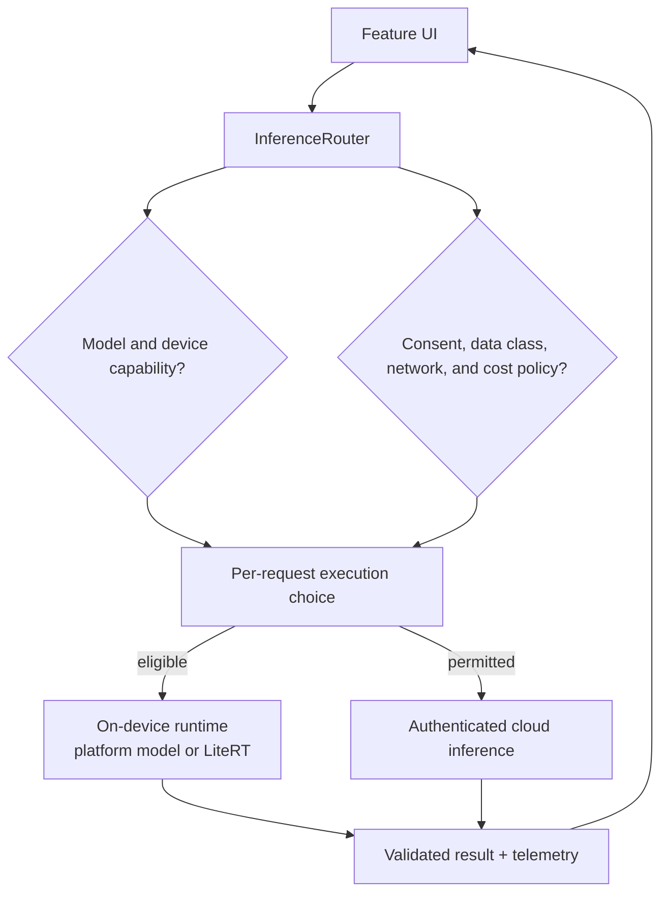

# On-Device AI (Gemini Nano, ML Kit GenAI, LiteRT)

**The prompt:** "Design an AI-powered feature for our Android app — say, message summarization or a smart-reply composer. Decide what runs on device, what runs in the cloud, and how the system degrades across our device fleet."

This is the newest entry in the platform/SDK design cluster, and the one where the ground moves fastest. Everything below reflects the platform as of mid-2026; re-verify API status before an interview or a design review, because the GenAI APIs are still graduating from Beta.

---

## 1. Gathering Requirements (~5 min)

### Functional Requirements

- Generate text output from user content (summarize a conversation, rewrite a draft, describe an image).
- Work for the whole fleet, not just flagships — the feature must define behavior on devices without on-device model support.
- Results appear inline in the UI with streaming or progressive rendering where latency is perceptible.

### Non-Functional Requirements

- **Privacy:** user content used for inference should not leave the device unless the user is told and the policy allows it. This is frequently the *reason* on-device is chosen at all.
- **Latency:** first token < 1s perceived; on-device inference avoids network round trips but pays a model-load cost.
- **Cost:** cloud inference has per-call cost that scales with DAU; on-device inference is free per call but costs engineering effort and download bytes.
- **Availability:** must work offline if the product promise includes it (e.g., summarizing an already-downloaded conversation).

### Out of Scope (defended)

- Training or fine-tuning models — consumer Android apps consume foundation models; they don't train them.
- Server-side model serving architecture (that's a backend design; here we own the client contract with it).

---

## 2. The Decision: On-Device vs Cloud vs Hybrid

This is the deep-dive interviewers want. The honest answer is a routing decision per request, not a one-time platform bet.

| Dimension | Gemini Nano via AICore | Your model on LiteRT | Cloud (Gemini API via Firebase AI Logic or your backend) |
|---|---|---|---|
| Privacy | Content never leaves device; strongest story for messages, health, photos | Same | Content crosses the network; needs consent framing, DPA coverage |
| Latency | No network RTT, but a model-load cost, and "resident" isn't a guarantee of a warm start | No network RTT; load cost depends on your model and backend | Network-bound; but big models stream fast once connected |
| Offline | Works once downloaded | Works once packaged or downloaded | Doesn't |
| Cost at scale | Zero marginal cost per inference, subject to AICore's per-app quotas | Zero marginal cost; you pay for delivery and validation | Per-token billing × DAU — this is what kills naive designs |
| Capability | Small model; short-context tasks: summarize, rewrite, proofread, describe | Whatever you ship and can fit: classification, ranking, embedding, vision, small generation | Frontier models; long context, complex reasoning, tools |
| Fleet coverage | Supported devices only (see §4), flagship-skewed | Depends on your model size and backend; CPU runs broadly, while GPU and NPU vary. LiteRT's minimum is Android 7.0 | Every device with a network connection |
| Update cadence | Model updated by the platform — you don't control the version | You select, version, deliver and validate it | You pin the model version server-side |
| Background use | Top foreground app only | Your choice, within normal background limits | Your choice |

**Staff-level framing:** choose on-device when the task is small, private, and frequent; choose cloud when the task is large, rare, or needs frontier capability; and design the *hybrid router* so the product behaves acceptably in all four quadrants (supported/unsupported device × online/offline).

---

## 3. High-Level Architecture



Routing is a policy decision per request, not a permanent feature switch: capability, privacy, connectivity, model freshness, latency, and cost determine whether local or cloud execution is allowed.

The **InferenceRouter** is the piece you own. It is a policy engine, not a convenience wrapper: it encodes which data classes may go to the cloud, which tasks the on-device model is trusted with, and what the fallback chain is when either path fails.

---

## 4. The On-Device Stack (know the layers)

Three layers, and interviewers probe whether you know which one you program against:

1. **Gemini Nano** — the foundation model itself. You never touch it directly.
2. **AICore** — the Android *system service* that hosts Gemini Nano: it manages model distribution and updates, runs inference with hardware acceleration, and applies platform safety filters. It follows Private Compute Core principles — restricted package binding, indirect internet access through Private Compute Services, and no persistence of inputs/outputs after processing. Because AICore owns the model, **you don't pick the model version**; the platform updates it under you. Design your prompts and evals to tolerate that.
3. **ML Kit GenAI APIs** — the developer surface. As of mid-2026: **Summarization, Proofreading, Rewriting, Image Description, and direct model access are Beta.** Speech Recognition, Speech Translation, Text to Speech and agentic workflows are Alpha, and Embeddings is in Preview. The task-specific APIs are tuned and safety-evaluated for their narrow job. Direct model access gives you custom prompting through `GenerativeModel`; the documentation path and the `genai-prompt` artifact still say "prompt". Its sub-features mature separately: structured output is Alpha and prefix caching is Experimental. Link the [status list](https://developers.google.com/ml-kit/genai) in your design rather than copying it, because it changes.

**Fleet reality:** GenAI APIs run on optimized Qualcomm Snapdragon, MediaTek Dimensity, and Google Tensor platforms, on mostly recent flagships. Device support differs by feature: direct model access is listed by Gemini Nano version, and the task-specific APIs have their own list, so check the [current lists](https://developers.google.com/ml-kit/genai) for the feature you use. That is a minority of a global fleet. **Never gate a core flow on Gemini Nano availability.**

**Custom models — LiteRT:** when the task is classification, ranking, embedding, or vision rather than generation, ship your own model with **LiteRT** (the renamed TensorFlow Lite; same `.tflite` format, converts from TensorFlow, PyTorch, and JAX). The newer **CompiledModel API** (LiteRT Next) adds automated accelerator selection across GPU and NPU (Qualcomm, MediaTek, Samsung, Google Tensor) and async execution; the classic Interpreter API remains, including via the Google Play services runtime so you don't bundle the engine in your APK.

### Capability detection & model download

The feature status check is asynchronous and has four values: available, downloadable, downloading, or unavailable. `AVAILABLE` means the model is ready, not that a request may run right now (see §6):

```kotlin
val summarizer = Summarization.getClient(summarizerOptions)
when (summarizer.checkFeatureStatus().await()) {
    FeatureStatus.AVAILABLE -> runInference()          // model resident
    FeatureStatus.DOWNLOADABLE, FeatureStatus.DOWNLOADING ->
        downloadThenRun()                              // Wi-Fi-aware UX; show progress
    FeatureStatus.UNAVAILABLE -> routeToCloudOrHide()  // device not supported
}
```

Treat the model download like a dynamic-feature download: it may be hundreds of MB fleet-wide (AICore shares it across apps, but first use on a device can still trigger it), so trigger it opportunistically, not on the critical path of a tap.

---

## 5. API Contract (hybrid routing)

Keep the app-facing API backend-agnostic so the router can move traffic without UI changes:

```kotlin
interface GenAiClient {
    // One request type regardless of where it executes.
    suspend fun generate(request: GenAiRequest): Flow<GenAiChunk>
}

data class GenAiRequest(
    val task: Task,               // SUMMARIZE | REWRITE | PROOFREAD | DESCRIBE_IMAGE | FREEFORM
    val input: Content,           // text / image; tagged with a DataClass
    val dataClass: DataClass,     // PUBLIC | PERSONAL | SENSITIVE — drives routing policy
    val allowCloud: Boolean,      // user consent state, evaluated by the router
)
```

Routing policy lives in remote config so you can change it without a release: e.g., `PERSONAL → on-device preferred, cloud with consent`; `PUBLIC → cheapest available`. One rule is hardcoded in the client: `SENSITIVE → on-device only, else feature hidden`. A bad config push must not be able to send private data to the cloud, and any config that widens cloud use still has to pass a consent check.

The router's inputs also include whether the app is in the foreground and whether AICore recently reported a quota error.

---

## 6. Failure Modes

- **Model not yet downloaded at first use.** Don't spin forever; render the cloud result (if permitted) or a graceful "preparing" state, and prefetch in the background.
- **App not in the foreground.** GenAI inference is allowed only when the app is the top foreground app. Calls from the background, including from a foreground service, return `BACKGROUND_USE_BLOCKED`, even though status says `AVAILABLE`. So a message-summary worker can't use Nano. Summarize when the user opens the conversation; for `SENSITIVE` data, defer rather than route to the cloud.
- **AICore quota.** Too many requests in a short time return `BUSY`, so retry with exponential backoff. Exceeding a long-duration quota returns `PER_APP_BATTERY_USE_QUOTA_EXCEEDED`, which backoff won't fix, so fall back or wait.
- **On-device output quality miss.** Nano-class models fail on long inputs and nuanced instructions. Constrain tasks (chunk long conversations before summarizing), and keep a golden-set eval you re-run when AICore ships a new model version — the platform updates the model without telling your release train.
- **Safety filter rejection.** AICore applies its own safety evaluation; your request can be refused. Surface a neutral fallback, never a raw error.
- **Cloud path quota/abuse.** If clients call the Gemini API via Firebase AI Logic, enforce per-user quotas and App Check attestation; a leaked-key or scripted-abuse scenario is a cost incident, not just a security one.
- **Version skew.** Different devices run different Nano generations (nano-v2 vs nano-v3 vs Nano 4 on newer flagships). Same prompt, different behavior. Log model/APIs versions with every inference for debuggability.

---

## 7. Monitoring

- Inference latency split by backend (on-device vs cloud) and by model version.
- Fallback rate: % of requests that intended on-device but served from cloud (capability, download, or failure) — this is your fleet-coverage SLI.
- Quality: thumbs-up/down or edit-distance-after-suggestion as an online proxy; offline golden-set evals per model version.
- Cost: cloud tokens per DAU, alarmed against budget.

## 8. Security & Privacy

- On-device inference is the privacy headline, but log lines are the leak: never log prompt or output content; log lengths, task types, and model versions.
- Cloud path needs the same treatment as any PII egress: consent, regional routing, retention limits (see [Security & Privacy](security-and-privacy.md) and [Privacy, GDPR & Data Residency](../security/privacy-gdpr-data-residency.md)).
- Generated content is untrusted input to the rest of your app — sanitize before rendering as rich text or executing as deep links.

## 9. Rollout

- Ship behind a feature flag with the router defaulting to cloud where policy allows, or hidden, so you can dark-launch on-device inference and compare quality/latency before flipping.
- Stage by device cohort: Pixel/Tensor first (best-tested path), then partner chipsets.
- Keep a kill switch per backend: on-device inference misbehaving after an AICore model update must be remotely disableable without an app release.

## 10. Further Reading

- [Gemini Nano on Android](https://developer.android.com/ai/gemini-nano) — AICore architecture and access paths
- [ML Kit GenAI APIs](https://developers.google.com/ml-kit/genai) — API list, Beta/Alpha status, supported devices
- [LiteRT](https://developers.google.com/edge/litert) — custom-model deployment, CompiledModel API, NPU/GPU acceleration
- [Firebase AI Logic](https://firebase.google.com/docs/ai-logic) — cloud Gemini access from mobile clients
