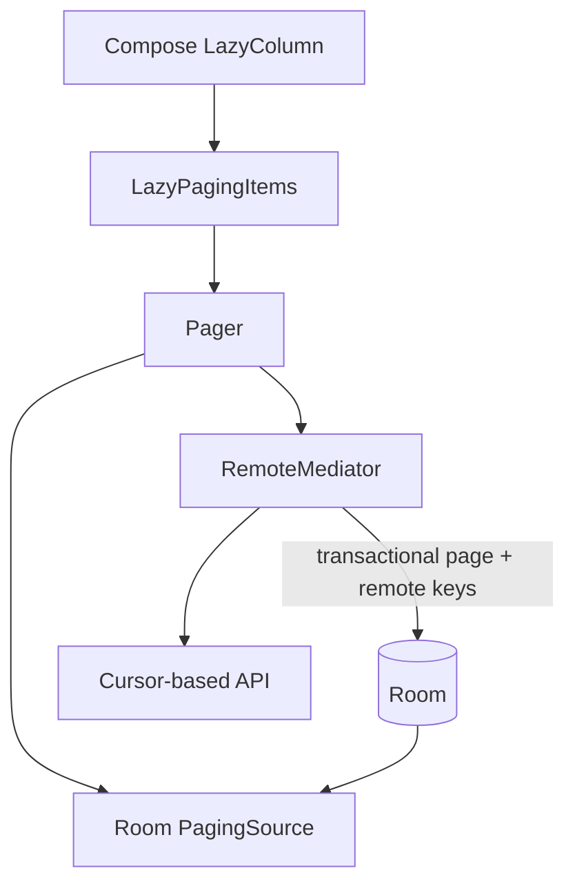
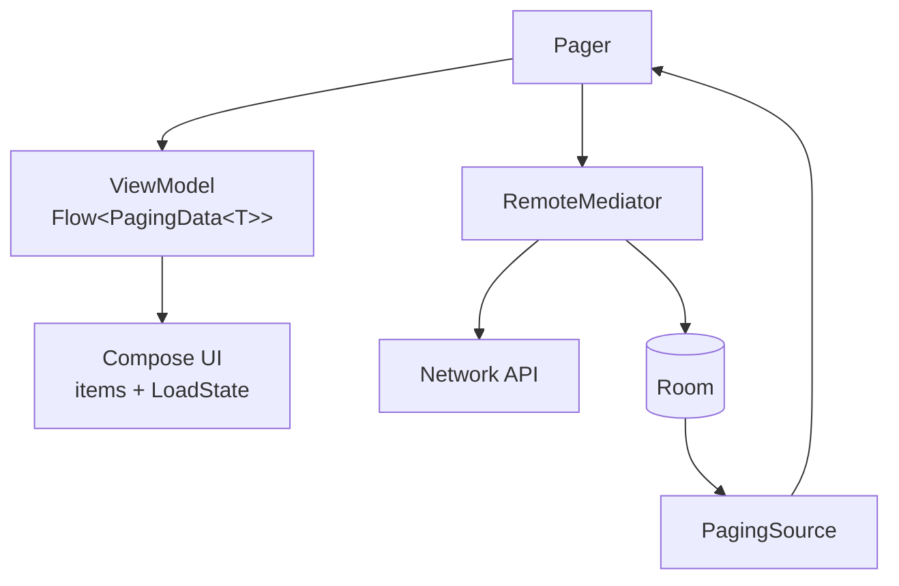

# Pagination Library

> A 45-60 minute mobile system-design walkthrough for a pagination library/component on Android. Cursor vs offset, prefetch radius, RemoteMediator, error/retry UX, scroll restoration. Think Paging 3's design problem.

---

## 1. Gathering Requirements (~5 min)

> **Interviewer:** "Design a pagination library for a long list."
> **Candidate:** "The interesting questions are which pagination model to use, how to coordinate network + local cache, and how scroll position survives all the things that can kill it. I'll deep-dive the load orchestration."

### Functional Requirements
- **Forward pagination** ("load more" as user scrolls).
- **Pull-to-refresh** ("reset and reload").
- **Local cache** — render from disk while network loads.
- **Error + retry** UX per page.
- **Stable item identity** so the list animates correctly.

### Non-Functional Requirements
- **Stable across inserts** (new items don't cause dupes).
- **Scroll restoration** across config change + process death.
- **Cellular-aware** (prefetch only on Wi-Fi if configured).
- **Coroutine-native** API.
- **Testable** without a real network.

### Out of Scope
- Bidirectional pagination (older + newer in same list — rare)
- Realtime push (use a separate stream that invalidates pages)
- Sectioned / grouped lists (Pager doesn't know about sections; consumer composes)
- Sort/filter (consumer's domain)

---

## 2. Clarifying Questions (~3 min)

| Question | Why it matters |
|---|---|
| Server supports cursors? | Cursor (good) vs offset (fragile) |
| Page size expectation? | Network round trips vs perceived smoothness |
| Personalised order (re-ranks per session)? | Cache invalidation rules |
| Local SSOT or network-only? | RemoteMediator vs PagingSource |
| Compose or View? | API shape (`LazyPagingItems` vs `PagedListAdapter`) |
| Bidirectional? | Hugely complicates; rarely needed |
| Strict order or "near-real-time"? | Tolerance for shifting indices |

> **Candidate:** "Cursor-paginated, page size 20-50, local cache as SSOT, Compose-first, forward-only, Android 9+."

---

## 3. High-Level Diagram (~10 min)



Room remains the UI source of truth: the mediator fetches and transactionally stores pages and remote keys, while invalidated database data drives rendering.

**Components:**
- **`Pager`** — config: page size, prefetch distance, max in-memory pages.
- **`PagingSource`** — reads from local store; the Pager invalidates this on RemoteMediator events.
- **`RemoteMediator`** — fetches network pages, writes to local store, signals end-of-pagination.
- **`LazyPagingItems` (Compose)** — composable consumer; surfaces `LoadState`.

---

## 4. API Contract

### Builder / configuration

```kotlin
val pager = Pager(
    config = PagingConfig(
        pageSize = 30,
        prefetchDistance = 10,
        initialLoadSize = 60,
        enablePlaceholders = false,
        maxSize = 300,
    ),
    initialKey = null,
    remoteMediator = FeedRemoteMediator(api, db),
    pagingSourceFactory = { db.feedDao().pagingSource() },
).flow.cachedIn(viewModelScope)
```

### Network page contract

```json
GET /v1/items?cursor=eyJvIjozMH0=&limit=30
{
  "items": [ { "id": "i_991", ... }, ... ],
  "nextCursor": "eyJvIjo2MH0=",   // null = end of pagination
  "sessionId": "s_abc"            // optional: stabilises cursor for the session
}
```

### LoadState surface

```kotlin
sealed class LoadState {
    object NotLoading : LoadState()
    object Loading : LoadState()
    data class Error(val throwable: Throwable) : LoadState()
}

// items.loadState.refresh, items.loadState.append, items.loadState.prepend
```

---

## 5. Mobile App Architecture

### Module structure

```
:lib:paging
    paging-core            ← Pager, PagingSource, RemoteMediator (or use AndroidX Paging 3)
    paging-compose         ← LazyPagingItems integration
:domain:<feature>
:data:<feature>            ← Pager + RemoteMediator wired
```

> In practice, prefer AndroidX Paging 3 over hand-rolling. This file's "library" framing is for understanding the design; in production we lean on the AndroidX library.

### Layered diagram



Load state is part of the presentation contract, while page storage and remote-key updates share a transaction so retries cannot corrupt the pagination boundary.

---

## 6. Local Storage

```kotlin
@Entity(tableName = "feed_pages")
data class PageEntity(
    @PrimaryKey val itemId: String,
    val payloadJson: String,
    val pageIndex: Int,
    val insertedAt: Long
)

@Entity(tableName = "remote_keys")
data class RemoteKey(
    @PrimaryKey val itemId: String,
    val prevCursor: String?, val nextCursor: String?
)
```

> The `remote_keys` table is the bridge between item id and its page cursor — without it, you can't resume pagination from any given item.

---

## 7. Deep Dive: Load Orchestration with RemoteMediator (~15 min)

> *I'd pick this as the deep dive because it covers the dance between network and local cache: how REFRESH, APPEND, PREPEND map to HTTP calls, when to invalidate, and how errors surface to the UI.*

### RemoteMediator core

```kotlin
@OptIn(ExperimentalPagingApi::class)
class FeedRemoteMediator(
    private val api: FeedApi,
    private val db: AppDatabase,
) : RemoteMediator<Int, PageEntity>() {

    override suspend fun initialize() = InitializeAction.LAUNCH_INITIAL_REFRESH

    override suspend fun load(
        loadType: LoadType,
        state: PagingState<Int, PageEntity>,
    ): MediatorResult {
        val cursor = when (loadType) {
            LoadType.REFRESH -> null
            LoadType.PREPEND -> return MediatorResult.Success(endOfPaginationReached = true)
            LoadType.APPEND  -> {
                val lastItem = state.lastItemOrNull()
                    ?: return MediatorResult.Success(endOfPaginationReached = true)
                db.remoteKeysDao().get(lastItem.itemId).nextCursor
                    ?: return MediatorResult.Success(endOfPaginationReached = true)
            }
        }
        return try {
            val resp = api.feed(cursor, limit = state.config.pageSize)
            db.withTransaction {
                if (loadType == LoadType.REFRESH) {
                    db.feedDao().clear()
                    db.remoteKeysDao().clear()
                }
                val items = resp.items.toEntities(loadType)
                val keys = resp.items.map { RemoteKey(it.id, prevCursor = cursor, nextCursor = resp.nextCursor) }
                db.feedDao().insertAll(items)
                db.remoteKeysDao().insertAll(keys)
            }
            MediatorResult.Success(endOfPaginationReached = resp.nextCursor == null)
        } catch (t: Throwable) {
            MediatorResult.Error(t)
        }
    }
}
```

### Compose UI consumer

```kotlin
@Composable
fun FeedScreen(vm: FeedViewModel = hiltViewModel()) {
    val items = vm.feed.collectAsLazyPagingItems()
    val state = rememberLazyListState()

    LazyColumn(state = state) {
        items(items.itemCount, key = items.itemKey { it.id }) { i ->
            items[i]?.let { ItemCard(it) }
        }
        when (val s = items.loadState.append) {
            is LoadState.Loading -> item { Spinner() }
            is LoadState.Error   -> item { RetryChip { items.retry() } }
            is LoadState.NotLoading -> Unit
        }
    }

    when (val s = items.loadState.refresh) {
        is LoadState.Loading -> if (items.itemCount == 0) FullScreenLoader()
        is LoadState.Error   -> if (items.itemCount == 0) FullScreenError { items.refresh() }
        is LoadState.NotLoading -> if (items.itemCount == 0) EmptyState()
    }
}
```

### Prefetch + max-size

- `prefetchDistance = 10` triggers `APPEND` when the user is 10 items from the end.
- `maxSize = 300` drops oldest pages from memory once exceeded — prevents OOM on long scrolls. Items stay in Room.
- On scroll-back beyond memory, `PagingSource` re-reads from Room (cheap).

### Scroll restoration

```kotlin
// ViewModel
val firstVisible: StateFlow<Int> = savedState.getStateFlow("firstVisible", 0)
fun onScroll(i: Int) { savedState["firstVisible"] = i }

// Compose
val state = rememberLazyListState(initialFirstVisibleItemIndex = vm.firstVisible.collectAsStateWithLifecycle().value)
LaunchedEffect(state) {
    snapshotFlow { state.firstVisibleItemIndex }.collect { vm.onScroll(it) }
}
```

### Pull-to-refresh

```kotlin
PullToRefreshBox(
    isRefreshing = items.loadState.refresh is LoadState.Loading,
    onRefresh = { items.refresh() }
) {
    LazyColumn(...) { ... }
}
```

`refresh()` triggers REFRESH on the mediator, which clears Room + reloads.

### Failure modes

| What breaks | Behavior |
|---|---|
| First load fails | `LoadState.Error` on `refresh`; full-screen error with retry |
| Append fails | Inline retry chip at bottom |
| Token expired (401) | Mediator can short-circuit on caller's interceptor; UI shows generic error or triggers re-auth |
| Server returns dupes | DAO `OnConflictStrategy.REPLACE` upserts by id |
| Cursor invalidated | Mediator forces a REFRESH |
| Process death mid-load | Pager re-issues from the last known cursor on relaunch |

---

## 8. Trade-offs

### Pagination scheme

| Option | Pros | Cons | Verdict |
|---|---|---|---|
| **Cursor** | Stable across inserts; opaque to client | Server must generate cursors | Pick this |
| Offset | Trivial | Breaks when items shift; wasteful | Skip |
| Keyset (e.g., `id > last`) | Efficient | Exposes ordering implementation | Acceptable |
| Time-bucketed (`?before=ts`) | Natural for timelines | Ties to time-ordered data | Acceptable if monotonic |

### Cache strategy

| Option | Verdict |
|---|---|
| **PagingSource on Room + RemoteMediator** | Pick — Local SSOT, offline cache, RemoteMediator drives network |
| `PagingSource` from network directly | OK for stateless lookup (e.g., search results) |
| In-memory only | Loses state across process death |

### Page sizing

| Strategy | Reason |
|---|---|
| `pageSize = 30, initialLoadSize = 60` | First paint feels full without over-fetching |
| `prefetchDistance = 10` | Fetch next page before user reaches end |
| `maxSize = 9× pageSize` | Bound memory; Room is the backup |

### UI

| Option | Verdict |
|---|---|
| **Compose `LazyPagingItems` + `LazyColumn`** | Pick — Compose-native |
| RecyclerView `PagingDataAdapter` | Legacy XML; still supported |
| Hand-rolled scroll listener | Skip; reinventing |

### Error UX

| Pattern | When |
|---|---|
| Full-screen error | First load fails AND no cached data |
| Inline retry chip | Append/Prepend fails after some items exist |
| Snackbar | Pull-to-refresh fails but old data is fine |

---

## 9. Major Concerns

- **Stable keys.** `items.itemKey { it.id }`. Without keys, scroll + animations break on insert.
- **Memory.** Cap `maxSize` so we don't OOM on long scrolls. Room is cheap; memory pages are not.
- **Bandwidth.** Don't double-fetch: `cachedIn(viewModelScope)` keeps the Flow alive across config changes.
- **Cellular.** `RemoteMediator` can check `ConnectivityManager.isActiveNetworkMetered` and skip APPEND prefetch.
- **Reactive updates.** If the underlying Room data changes, `PagingSource.invalidate()` triggers reload. Pattern: a `Flow<Unit>` invalidation bus.
- **Process death.** Scroll index in `SavedStateHandle`. Pager re-fetches the cursor for the visible page.
- **Testing.** Use `Pager.flow.asSnapshot { }` (Paging test library). Fake API returning scripted pages.
- **Error visibility.** `LoadState` is the single source of truth. Don't try to manage your own "isLoading" boolean in parallel.

---

## 10. Follow-up Questions

> **Q: User likes an item — do we re-fetch the page?**
> No. Like is a Room write to the same row; `Flow` from `PagingSource` emits the updated row. Pager picks it up. Server reconciliation happens on next REFRESH (eventual).

> **Q: New items arrive (e.g., new posts at top of a feed) — how to signal?**
> Either: a separate WebSocket/FCM "new posts available" channel that the UI shows as a banner; tapping banner triggers `items.refresh()`. Or: a PREPEND mediator that fetches forward. The former is simpler and standard.

> **Q: How big is each page in bytes?**
> Depends on the item. Rule of thumb: keep a page under 100 KB on average. If items are heavy (images embedded), reduce `pageSize` or fetch URLs only and lazy-load media.

> **Q: How do you avoid the empty-list flash?**
> Cached pages render immediately; `LoadState.Loading` on refresh doesn't block the existing list. Show a refresh indicator at the top, not a full-screen loader.

> **Q: Why both PagingSource and RemoteMediator?**
> `PagingSource` is the read source (where items come from). `RemoteMediator` is the write source (when to fetch from network and persist to local). Splitting them lets you mix and match: in-memory list + network mediator, Room list + network mediator, network-only list with no mediator.

> **Q: How do you handle a user signing out?**
> Clear Room data for that user's namespace; invalidate the PagingSource. New Pager instance binds to the next user.

---

## 11. Out of Scope (defended)

- **Bidirectional pagination** — rare in practice; complicates indexing significantly.
- **Realtime push** — use a separate channel that invalidates pages.
- **Section headers / grouping** — caller composes around `PagingData`.
- **Optimistic insertion** — write to Room first; `Flow` emits.
- **Sort/filter** — separate Pager per sort key; not a paging concern.

---

## 12. Further Reading

- [Android Developers — Paging 3 overview](https://developer.android.com/topic/libraries/architecture/paging/v3-overview) — official guide.
- [Android Developers — Paging with network and database](https://developer.android.com/topic/libraries/architecture/paging/v3-network-db) — RemoteMediator walk-through.
- [Now in Android sample](https://github.com/android/nowinandroid) — production Pager + Compose feed.
- [Paging test guide](https://developer.android.com/topic/libraries/architecture/paging/test) — `asSnapshot` and fakes.
- [Cursor pagination explained](https://shopify.engineering/pagination-relative-cursors) — Shopify engineering blog on cursor schemes.

---

> **Closing in the interview:** "Load orchestration was my deep dive because RemoteMediator is where novices get confused. Happy to go into the invalidation bus, the cursor stabilisation pattern, or how a 'new items' banner integrates next."
