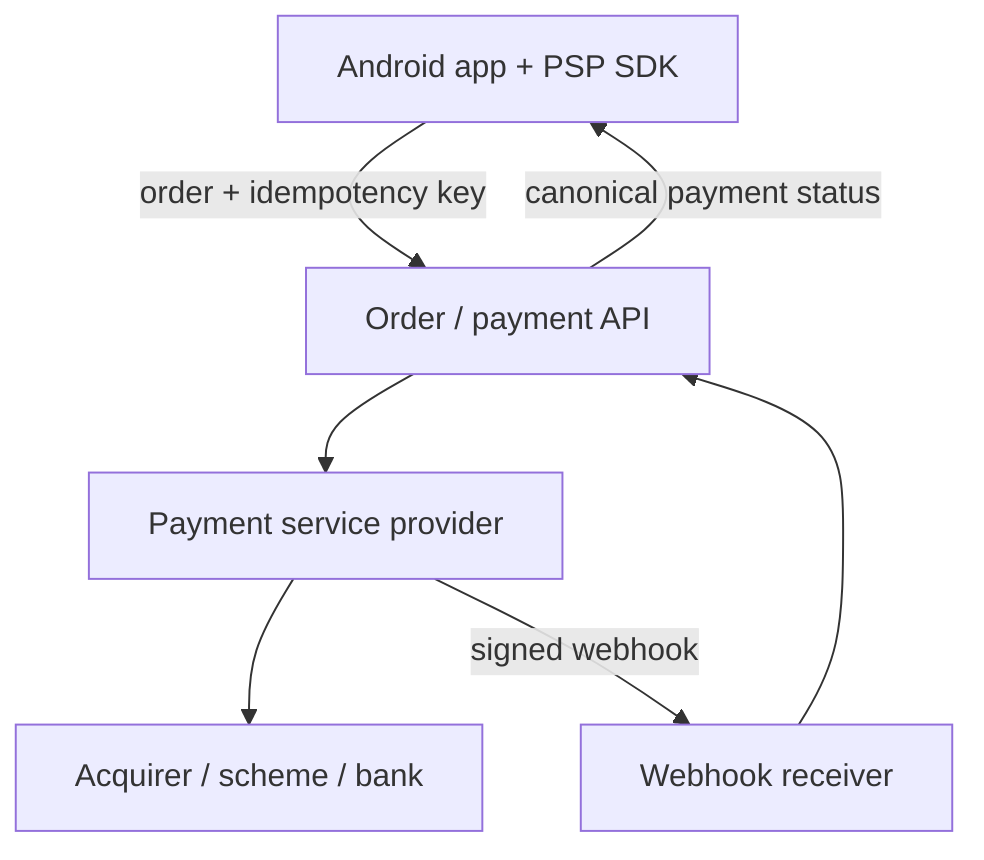
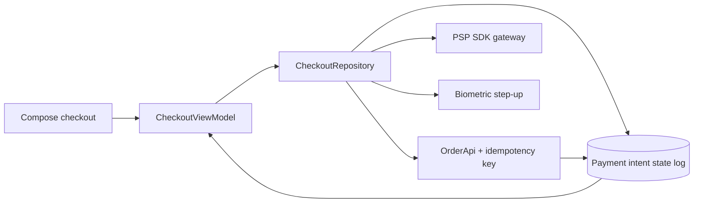
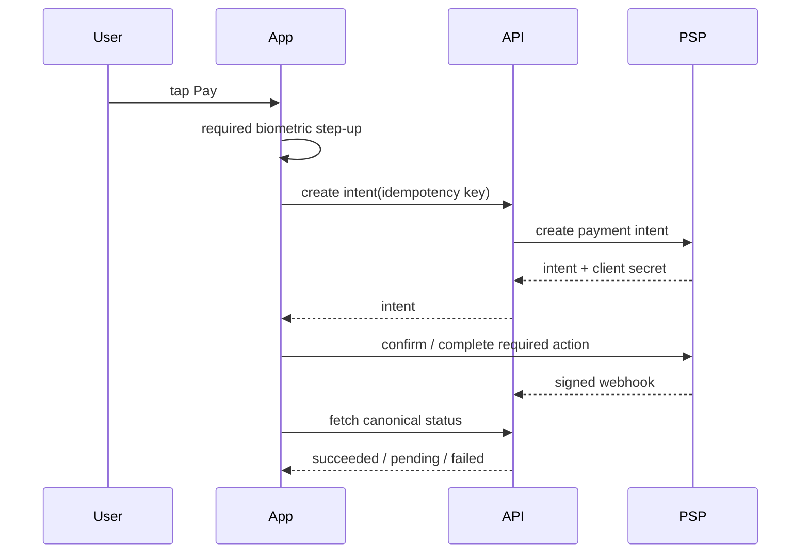

# Payment Flow (Card Checkout)

> A 45-60 minute mobile system-design walkthrough for an in-app card payment flow (Stripe/Adyen/Razorpay integration). The PSP, vault, and acquiring stack are server concerns — the bulk of this file is how the *Android app* tokenizes, never double-charges, handles 3DS, and survives network drops.

---

## 1. Gathering Requirements (~5 min)

> **Interviewer:** "Design the checkout flow for paying with a card."
> **Candidate:** "The two things that ruin payments are double-charges and ambiguous outcomes after a flaky network. I'll center the deep dive on idempotent submission and the 3DS challenge round-trip."

### Functional Requirements
- **Card entry** (number, expiry, CVC) with PAN never leaving the PSP SDK's surface.
- **Save card** for future use (with explicit consent).
- **Confirm and pay** for an order with biometric gate.
- **3DS challenge** handling for SCA (PSD2).
- **Show clear success / failure / retry** states.

### Non-Functional Requirements
- **No double-charges**, ever, under any retry path.
- **PCI scope reduction** — app never sees the raw PAN; SDK fields only.
- **Resilient to network drop** between confirm and acknowledgement.
- **Accessible** — TalkBack on every field, error association.
- **Auditable** — every state transition logged.

### Out of Scope
- Refunds, chargebacks, dispute UX
- Card-on-file management screens (CRUD)
- Recurring subscription billing
- Apple Pay / Google Pay — separate file if needed
- Anti-fraud rules (server-side)
- Real PSP onboarding (we use one — Stripe/Adyen — as a black box)

---

## 2. Clarifying Questions (~3 min)

| Question | Why it matters |
|---|---|
| Which PSP / region? | SDK choice, SCA requirements |
| Geographic markets? | PSD2 (EU), 3DS variants, alternative payment methods |
| Guest checkout or signed-in only? | Save-card flow, token lifetime |
| Median order value? | Risk thresholds for SCA exemption |
| Currencies / FX handling? | Display rules, server-side conversion |
| Save card by default or opt-in? | GDPR / consent UX |
| Android API floor? | Biometric APIs, Autofill |
| Webhook timeliness expectations? | Polling vs FCM for the final status |

> **Candidate:** "Assume signed-in users only, Stripe PaymentSheet on Android, EUR/USD/GBP, PSD2 in scope, Android 9+, biometric required > €30."

---

## 3. High-Level Diagram (~10 min)



The client never handles raw card data and never declares success from an SDK callback alone; the backend reconciles signed provider events into canonical order state.

**Server-side (named, not designed):**
- **BFF / Order API** — creates a `PaymentIntent` on the PSP, holds the secret, exposes a `clientSecret` to the app.
- **PSP** — Stripe-like service that talks to schemes and acquirers.
- **Webhook Receiver** — listens for `payment_intent.succeeded` / `.failed` / `.requires_action` events.

> The Android app never touches raw cards. It exchanges a `clientSecret` with the PSP SDK, gets a `paymentMethodId`, and confirms.

---

## 4. API Contract

### Create PaymentIntent (server-side)

```json
POST /v1/payments/intent
{ "orderId": "o_42", "amount": 4999, "currency": "EUR" }

200 OK
{
  "intentId": "pi_abc",
  "clientSecret": "pi_abc_secret_xyz",   // passed to SDK; never logged
  "amount": 4999, "currency": "EUR",
  "requiresAction": false
}
```

### Confirm result (server-side, after PSP webhook)

```json
GET /v1/payments/intent/{intentId}
{ "intentId": "pi_abc", "status": "SUCCEEDED",
  "paymentMethodId": "pm_111", "chargeId": "ch_555", "lastUpdated": ... }
```

### Idempotency
- The **order ID** is the natural idempotency key. The BFF reuses the same `PaymentIntent` for the same `orderId` across retries.
- The PSP's `clientSecret` is single-use per intent; multiple confirms with the same secret are idempotent.
- The app sends an `Idempotency-Key` header on `/v1/payments/intent` to prevent the BFF from creating two intents for the same order.

### Status mapping

| PSP state | Client state | UX |
|---|---|---|
| `requires_payment_method` | NEEDS_INPUT | Show form |
| `requires_action` | NEEDS_3DS | Open challenge flow |
| `processing` | PROCESSING | Spinner; poll/await webhook |
| `succeeded` | SUCCESS | Receipt screen |
| `requires_capture` | AUTHORIZED | Awaiting capture (if used) |
| `canceled` | CANCELED | Show reason |

---

## 5. Mobile App Architecture (~10 min)

### Module structure

```
:app
:feature:checkout       ← entry + review + confirm screens
:feature:receipt
:core:network           ← Retrofit + OkHttp
:core:secure            ← Keystore, biometric prompts
:core:psp               ← Stripe SDK wrapper (single integration point)
:core:work              ← StatusPollWorker (rarely; webhook usually wins)
:domain:checkout
:data:checkout
```

### Layered diagram



The repository coordinates authentication, provider UI, backend intent creation, and durable status; the screen renders state rather than interpreting provider callbacks directly.

### Key class signatures

```kotlin
interface CheckoutRepository {
    suspend fun createIntent(orderId: String): IntentDescriptor
    suspend fun confirm(intent: IntentDescriptor, method: PaymentMethod): ConfirmResult
    suspend fun pollStatus(intentId: String): PaymentStatus
    fun observeStatus(intentId: String): Flow<PaymentStatus>
}

sealed class ConfirmResult {
    data class Success(val chargeId: String) : ConfirmResult()
    data class NeedsAction(val redirect: ChallengeRequest) : ConfirmResult()
    data class Failed(val reason: ReasonCode) : ConfirmResult()
}
```

> **Boundary discipline:** Only `:core:psp` imports the PSP SDK. The rest of the app deals in domain types (`PaymentMethod`, `ConfirmResult`). Swapping PSPs becomes one module change.

---

## 6. Local Storage (Room as audit log)

```kotlin
@Entity(tableName = "payment_intents")
data class PaymentIntentEntity(
    @PrimaryKey val intentId: String,
    val orderId: String, val amount: Long, val currency: String,
    val status: PaymentStatus,           // CREATED, CONFIRMING, REQUIRES_ACTION, PROCESSING, SUCCEEDED, FAILED
    val lastEventAt: Long,
    val clientReference: String          // Idempotency-Key
)
```

> We don't store PANs, CVCs, or `clientSecret`s. The Room row exists for: (a) on-launch reconciliation, (b) UX state restoration, (c) audit if a user disputes.

---

## 7. Deep Dive: Payment Submission Flow (~15 min)

> *I'd pick this as the deep dive because it covers idempotency, the 3DS challenge round-trip, biometric gating, and the network-drop-after-confirm scenario — the parts most likely to ruin trust.*

### Happy path



Ambiguous network outcomes become a status-reconciliation problem, not a second charge attempt; the same idempotency key identifies every retry of one user intent.

### Idempotency in detail

```kotlin
suspend fun confirm(orderId: String, method: PaymentMethod): ConfirmResult {
    val key = "$orderId-v1"
    val descriptor = api.createIntent(
        idempotencyKey = key,
        body = CreateIntent(orderId)
    ).also { dao.upsert(PaymentIntentEntity(it.intentId, orderId, ..., status = CREATED, clientReference = key)) }

    return runCatching {
        psp.confirm(descriptor.clientSecret, method)
    }.fold(
        onSuccess = { handle(it, descriptor.intentId) },
        onFailure = { t ->
            if (t.isNetworkError) {
                dao.update(descriptor.intentId, status = CONFIRMING)
                workManager.enqueueUniqueWork("poll-$intentId", REPLACE, pollWork(descriptor.intentId))
                ConfirmResult.Failed(ReasonCode.NETWORK_UNCERTAIN)
            } else throw t
        }
    )
}
```

**Why this is safe:** even if the SDK call times out, the server's PSP did or didn't charge. We never call `confirm` twice with a different intent — the same `clientSecret` is reused, and the same `Idempotency-Key` is sent. The truth is recovered by polling the intent status, not by guessing.

### 3DS / SCA challenge

```kotlin
sealed class ChallengeRequest {
    data class Redirect(val url: Uri) : ChallengeRequest()
    data class InlineSdk(val challengePayload: ByteArray) : ChallengeRequest()
}

// Launched as ActivityResultContract — survives process death
val challengeLauncher = registerForActivityResult(ThreeDsContract()) { result ->
    when (result) {
        is ChallengeResult.Completed -> vm.onChallengeCompleted(result.intentId)
        is ChallengeResult.Cancelled -> vm.onChallengeCancelled()
    }
}
```

The challenge runs in a dedicated Activity (Stripe SDK does this internally) — if the user is killed mid-challenge by Doze or returns from a banking app, the SDK resumes the flow via `onNewIntent`.

### Reconciliation on resume

```kotlin
override fun onResume() {
    super.onResume()
    vm.reconcileInFlight()    // any CONFIRMING/REQUIRES_ACTION row → poll
}

suspend fun reconcileInFlight() {
    dao.inFlightIntents().forEach { entity ->
        val status = repo.pollStatus(entity.intentId)
        dao.update(entity.intentId, status = status)
        if (status == SUCCEEDED) navigate(to = Receipt(entity.orderId))
    }
}
```

### Biometric gate

```kotlin
class BiometricPromptManager @Inject constructor() {
    suspend fun require(activity: FragmentActivity, title: String): BiometricResult = suspendCancellableCoroutine { cont ->
        val prompt = BiometricPrompt(activity, ContextCompat.getMainExecutor(activity),
            object : BiometricPrompt.AuthenticationCallback() {
                override fun onAuthenticationSucceeded(result: AuthenticationResult) {
                    cont.resume(BiometricResult.Ok)
                }
                override fun onAuthenticationError(code: Int, msg: CharSequence) {
                    cont.resume(BiometricResult.Failed(code))
                }
            })
        prompt.authenticate(promptInfo(title))
    }
}
```

Triggered only when amount > threshold OR risk score from PSP is elevated.

### Failure modes

| What breaks | Behavior |
|---|---|
| Network drops after SDK confirm | Status moves to `CONFIRMING`; poll worker resolves |
| User backgrounds during 3DS | SDK resumes via `onNewIntent`; reconcile on resume |
| User taps Pay twice fast | Single-click guard in VM; `Idempotency-Key` covers the network race |
| Process killed mid-confirm | Room row in `CONFIRMING`; reconcile on next launch |
| PSP returns `requires_action` after we showed success | Cannot happen if VM waits for terminal status; assert with tests |
| Webhook lags | Poll backoff up to 30 s; show "We're confirming your payment…" |

---

## 8. Trade-offs

### Where to put card capture

| Option | Verdict |
|---|---|
| **PSP SDK fields (Stripe PaymentSheet)** | Pick — PCI scope = SAQ-A, no PAN in app |
| Custom UI + PSP token API | Possible but raises PCI scope; rarely worth it |
| WebView checkout | Bad UX, deep linking complexity |

### Idempotency mechanism

| Option | Pros | Cons | Verdict |
|---|---|---|---|
| **Order-ID-derived key** | Stable across retries | Need to rotate on user-initiated retry | Pick this |
| Random UUID per attempt | Trivial | Same retry creates two intents | Skip |
| Server-generated key | Single source of truth | Race during creation | Server still validates |

### Confirm transport

| Option | Verdict |
|---|---|
| **PSP SDK (direct)** | Pick — SDK handles 3DS, retries, PCI boundary |
| Our BFF acts as proxy | Adds latency, doesn't gain anything; PCI scope grows |
| Webhook-only | App can't show realtime status; only as backup signal |

### State tracking

| Option | Use |
|---|---|
| **Room intent log** | Source of truth for client state, reconciliation |
| In-memory ViewModel only | Lost on process death |
| DataStore | Wrong shape for tabular history |

### Biometric

| Option | Verdict |
|---|---|
| **BiometricPrompt + AndroidX** | Pick — class-3 (strong) where available |
| FingerprintManager (deprecated) | Skip |
| No biometric | Acceptable below threshold; required above |

---

## 9. Major Concerns

- **Double-charge prevention.** Same `Idempotency-Key` for the same logical attempt. Server's PSP integration dedupes. Client never re-creates an intent for the same order.
- **PCI scope.** Stay in SAQ-A: use PSP SDK fields. Never log card data, even masked, even in debug.
- **Network-uncertain state.** "Did it go through?" must be resolvable: poll the intent status until terminal. Never assume failure on timeout.
- **Process death during 3DS.** Activity result + Room state must survive. SDK handles its own resume; you reconcile from your log.
- **Webhook lag.** Build the UI assuming up to 30s delay. Spinner with explanatory text > false success.
- **Security.** `FLAG_SECURE` on checkout screens. TLS 1.3 + cert pinning. Tokens only in Keystore-wrapped storage. No payment data in screenshots or recents.
- **Replay attack.** PSP SDK uses single-use `clientSecret`. Don't echo it to logs. Rotate on retry.
- **Accessibility.** TalkBack on every error. Don't rely on color alone.
- **Geo edge.** PSD2 mandates SCA above thresholds; show challenge clearly; don't silently fail for low-friction users in non-EU regions where exemptions apply.

---

## 10. Follow-up Questions

> **Q: User taps Pay, sees "no internet" — they walk away, come back, what now?**
> On resume, reconcile any `CONFIRMING` rows by polling `/v1/payments/intent/{id}`. If `SUCCEEDED`, navigate to receipt — they paid. If `FAILED`, allow retry. The bank already decided; we only display the truth.

> **Q: How do you prevent the user paying twice by tapping fast?**
> ViewModel-level single-flight guard (`MutableStateFlow<Boolean>` for `inFlight`). Compose disables the button while `inFlight`. The idempotency key covers the network race even if the button somehow fires twice.

> **Q: Saving cards — where does the token live?**
> The PSP returns a `paymentMethodId`. We store it server-side, scoped to the user. On future checkouts, the app passes `paymentMethodId` instead of fresh card details. The token is not sensitive on its own; it's only useful via your account.

> **Q: How is 3DS tested?**
> PSP sandbox provides test cards that always trigger challenge, succeed, or fail. End-to-end tests with the SDK mocked to return each `ConfirmResult` variant. Manual smoke tests on real devices for the actual web challenge handoff.

> **Q: Apple Pay / Google Pay — how does it slot in?**
> Same `CheckoutRepository.confirm` API; the `PaymentMethod` source is GooglePayLauncher instead of card fields. The PSP SDK returns the same `ConfirmResult`. Architecture absorbs it cleanly.

> **Q: Refunds?**
> Out of scope here, but architecturally: a different screen, server-side reverse charge, no biometric required, optimistic UI not needed (rare action). Bank notification arrives via webhook.

---

## 11. Out of Scope (defended)

- **Refunds and chargebacks** — separate flow, different threat model.
- **Card management CRUD** — list/delete/set-default screens.
- **Subscriptions / recurring billing** — different lifecycle entirely; for digital goods on Android that's Play Billing, covered in [Play Billing: IAP & Subscriptions](play-billing-and-subscriptions.md).
- **Apple Pay / Google Pay** — one slot-in component; not the architectural core.
- **Anti-fraud rules** — server-side risk engine; client just shows challenges.
- **PSP onboarding** — that's the merchant team's problem.

---

## 12. Further Reading

- [weeeBox/mobile-system-design](https://github.com/weeeBox/mobile-system-design) — reference format.
- [Stripe — Idempotent Requests](https://stripe.com/docs/api/idempotent_requests) — canonical idempotency-key pattern.
- [Stripe Android SDK — PaymentSheet](https://stripe.com/docs/payments/accept-a-payment?platform=android) — PCI-reducing card capture.
- [PSD2 / SCA — what it means for mobile](https://stripe.com/guides/strong-customer-authentication) — challenge flow design.
- [Android Developers — BiometricPrompt](https://developer.android.com/training/sign-in/biometric-auth) — class-3 biometric integration.

---

> **Closing in the interview:** "Idempotent confirm and the reconciliation pattern were my deep dive because that's where money goes missing. Happy to dig into Google Pay slot-in, the biometric class story, or the receipt screen reliability next."
