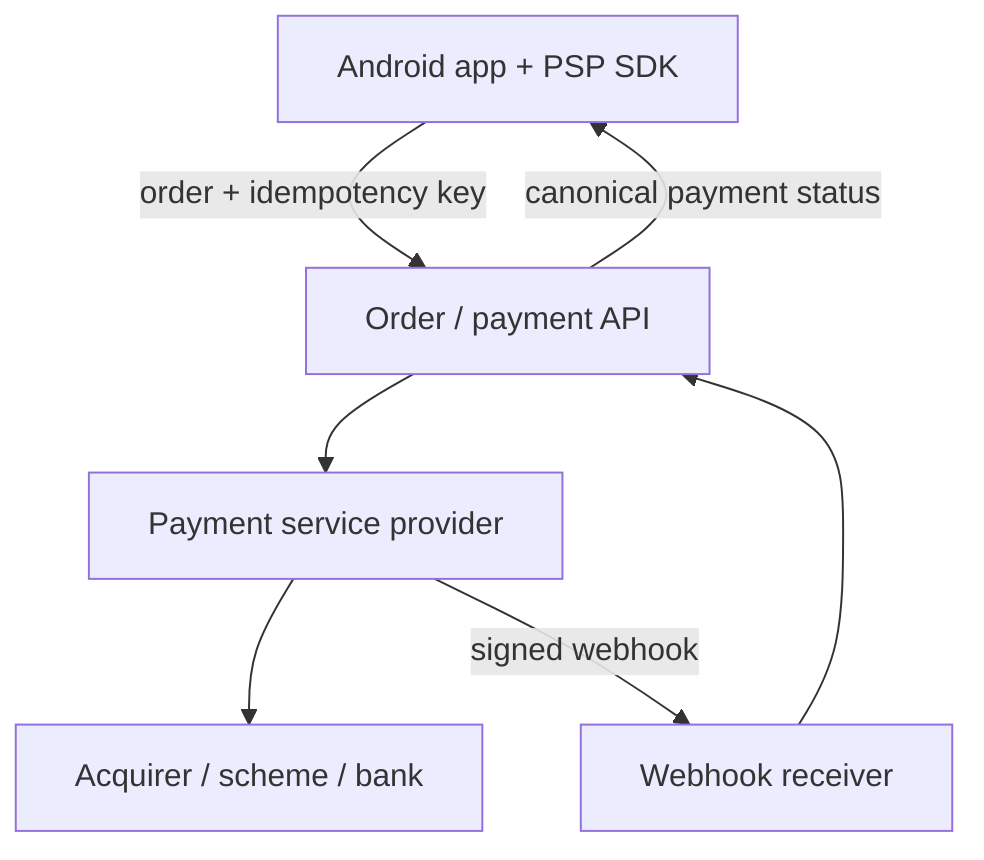
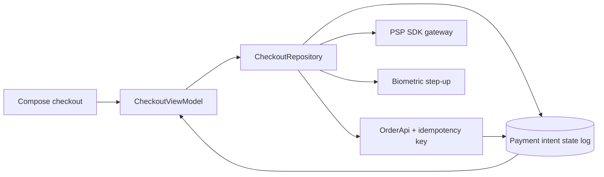
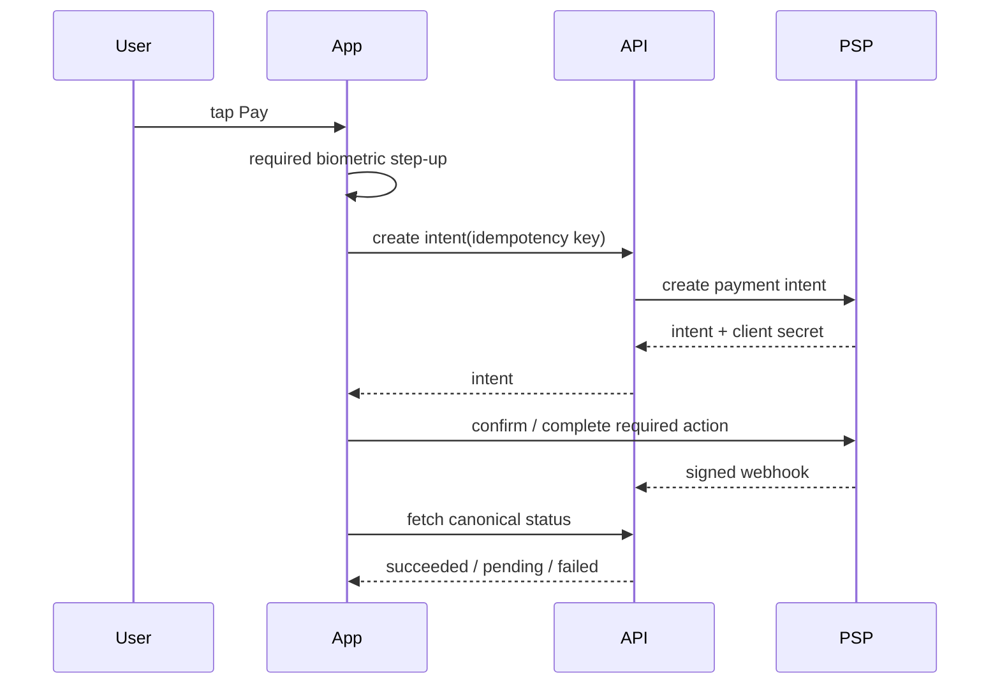

# Payment Flow (Card Checkout)

> A 45-60 minute mobile system-design walkthrough for an in-app card payment flow (Stripe/Adyen/Razorpay integration). The PSP, vault, and acquiring stack are server concerns — the bulk of this file is how the *Android app* tokenizes, never double-charges, handles 3DS, and survives network drops.

---

## 1. Gathering Requirements (~5 min)

> **Interviewer:** "Design the checkout flow for paying with a card."
> **Candidate:** "The two things that ruin payments are double-charges and ambiguous outcomes after a flaky network. I'll center the deep dive on idempotent submission and the 3DS challenge round-trip."

### Functional Requirements
- **Card entry** (number, expiry, CVC) with PAN never leaving the PSP SDK's surface.
- **Save card** for future use (with explicit consent).
- **Confirm and pay** for an order, with a biometric gate as our own product policy.
- **3DS challenge** handling, because the cardholder's bank can require SCA (PSD2) at any amount.
- **Show clear success / failure / retry** states.

### Non-Functional Requirements
- **No double-charges**, ever, under any retry path.
- **PCI scope reduction** — app never sees the raw PAN; SDK fields only.
- **Resilient to network drop** between confirm and acknowledgement.
- **Accessible** — TalkBack on every field, error association.
- **Auditable** — every state transition logged.

### Out of Scope
- Refunds, chargebacks, dispute UX
- Card-on-file management screens (CRUD)
- Recurring subscription billing
- Apple Pay / Google Pay — separate file if needed
- Anti-fraud rules (server-side)
- Real PSP onboarding (we use one — Stripe/Adyen — as a black box)

---

## 2. Clarifying Questions (~3 min)

| Question | Why it matters |
|---|---|
| Which PSP / region? | SDK choice, SCA requirements |
| Geographic markets? | PSD2 (EU), 3DS variants, alternative payment methods |
| Guest checkout or signed-in only? | Save-card flow, token lifetime |
| Median order value? | Which SCA exemptions the PSP can request, and how often the bank may refuse them |
| Currencies / FX handling? | Display rules, server-side conversion |
| Save card by default or opt-in? | GDPR / consent UX |
| Android API floor? | Biometric APIs, Autofill |
| Webhook timeliness expectations? | Polling vs FCM for the final status |

> **Candidate:** "Assume signed-in users only, Stripe PaymentSheet on Android, EUR/USD/GBP, PSD2 in scope, Android 9+, and a product rule that asks for biometrics above €30. That threshold is our policy, separate from the bank's SCA decision."

---

## 3. High-Level Diagram (~10 min)



The client never handles raw card data and never declares success from an SDK callback alone; the backend reconciles signed provider events into canonical order state.

**Server-side (named, not designed):**
- **BFF / Order API** — creates a `PaymentIntent` on the PSP, holds the secret, exposes a `clientSecret` to the app.
- **PSP** — Stripe-like service that talks to schemes and acquirers.
- **Webhook Receiver** — listens for `payment_intent.succeeded`, `payment_intent.processing`, `payment_intent.payment_failed` and `payment_intent.requires_action` events.

> The Android app never touches raw cards. It hands a `clientSecret` to PaymentSheet, which collects the details, confirms the payment and runs any 3DS challenge. The app learns only that the sheet completed, was canceled or failed, then asks the backend what happened.

---

## 4. API Contract

### Create PaymentIntent (server-side)

```json
POST /v1/payments/intent
{ "orderId": "o_42" }                     // backend derives the price; a client amount is never trusted

200 OK
{
  "intentId": "pi_abc",
  "clientSecret": "pi_abc_secret_xyz",   // passed to SDK; never logged
  "amount": 4999, "currency": "EUR",
  "requiresAction": false
}
```

### Confirm result (server-side, after PSP webhook)

```json
GET /v1/payments/intent/{intentId}
{ "intentId": "pi_abc", "status": "SUCCEEDED",
  "paymentMethodId": "pm_111", "chargeId": "ch_555",
  "lastErrorCode": null,                  // set when an attempt was declined
  "revision": 7,                          // increases with every transition of this intent
  "lastUpdated": ... }
```

### Idempotency
- The **order ID** is the natural idempotency key. The BFF keeps one `orderId` → `intentId` row with a uniqueness rule and reuses that `PaymentIntent` across retries. The row matters because PSP idempotency keys expire: Stripe can prune v1 keys after 24 hours.
- The `clientSecret` isn't an idempotency token and doesn't rotate on retry. It lets the client complete the payment on that intent, so it stays out of logs and URLs. A failed attempt returns the same intent to `requires_payment_method`, ready to try again.
- The app sends an `Idempotency-Key` header on `/v1/payments/intent` to prevent the BFF from creating two intents for the same order.
- Create a new intent only after the old one is known to be dead, for example `canceled`. A timeout never justifies one.

### Status mapping

| PSP state | Client state | UX |
|---|---|---|
| `requires_payment_method`, no last error | NEEDS_INPUT | Show form |
| `requires_payment_method`, with last error | DECLINED | Show the decline; allow retry on the same intent |
| `requires_action` | NEEDS_3DS | Offer "Continue payment"; relaunch the SDK flow |
| `processing` | PROCESSING | "We're confirming your payment"; can last days for delayed methods |
| `succeeded` | SUCCESS | Receipt screen |
| `requires_capture` | AUTHORIZED | Awaiting capture (if used) |
| `canceled` | CANCELED | Show reason |

---

## 5. Mobile App Architecture (~10 min)

### Module structure

```
:app
:feature:checkout       ← entry + review + confirm screens
:feature:receipt
:core:network           ← Retrofit + OkHttp
:core:secure            ← Keystore, biometric prompts
:core:psp               ← Stripe SDK wrapper (single integration point)
:core:work              ← StatusPollWorker (rarely; webhook usually wins)
:domain:checkout
:data:checkout
```

### Layered diagram



The repository coordinates authentication, provider UI, backend intent creation, and durable status; the screen renders state rather than interpreting provider callbacks directly.

### Key class signatures

```kotlin
interface CheckoutRepository {
    suspend fun prepareSheet(ownerId: String, orderId: String): SheetRequest   // Present(clientSecret), or Settled
    suspend fun reconcile(ownerId: String, intentId: String)                   // updates Room; the UI observes it
}

sealed class CheckoutOutcome {
    data class Paid(val orderId: String) : CheckoutOutcome()
    data class Declined(val reason: ReasonCode) : CheckoutOutcome()      // same intent can retry
    data class NeedsAction(val intentId: String) : CheckoutOutcome()     // relaunch the SDK flow
    data class Pending(val intentId: String) : CheckoutOutcome()         // processing or unknown; never "failed"
    object NeedsInput : CheckoutOutcome()
    object Canceled : CheckoutOutcome()
}
```

> **PaymentSheet's result is a prompt, not the truth.** `Completed` doesn't mean paid for delayed methods, and `Failed` doesn't mean no money moved. Every result leads to `reconcile`, because only the backend's status counts.

> **Boundary discipline:** Only `:core:psp` imports the PSP SDK. The rest of the app deals in domain types (`SheetRequest`, `CheckoutOutcome`). Swapping PSPs becomes one module change.

---

## 6. Local Storage (Room as audit log)

```kotlin
@Entity(tableName = "payment_intents")
data class PaymentIntentEntity(
    @PrimaryKey val intentId: String,
    val ownerId: String,                 // signed-in user; reconcile only touches this user's rows
    val orderId: String, val amount: Long, val currency: String,
    val status: PaymentStatus,           // CONFIRMING, NEEDS_INPUT, DECLINED, REQUIRES_ACTION, PROCESSING, AUTHORIZED, SUCCEEDED, CANCELED
    val revision: Long,                  // the backend's per-intent revision; orders every update
    val lastEventAt: Long,
    val clientReference: String          // Idempotency-Key
)
```

> We don't store PANs, CVCs, or `clientSecret`s. The Room row exists for: (a) on-launch reconciliation, (b) UX state restoration, (c) audit if a user disputes.

---

## 7. Deep Dive: Payment Submission Flow (~15 min)

> *I'd pick this as the deep dive because it covers idempotency, the 3DS challenge round-trip, biometric gating, and the network-drop-after-confirm scenario — the parts most likely to ruin trust.*

### Happy path



Ambiguous network outcomes become a status-reconciliation problem, not a second charge attempt; the same idempotency key identifies every retry of one user intent.

### Idempotency in detail

```kotlin
// ownerId is fixed when checkout starts. Every call uses that owner's credentials,
// and the network layer refuses any other token.
suspend fun prepareSheet(ownerId: String, orderId: String): SheetRequest {
    val descriptor = api.createIntent(ownerId, idempotencyKey = orderId, body = CreateIntent(orderId))

    // A retry starts from what the backend knows, so it can't pay an order that already went through.
    val current = api.status(ownerId, descriptor.intentId)
    when (current.status) {
        NEEDS_INPUT, DECLINED, REQUIRES_ACTION -> Unit
        else -> return SheetRequest.Settled(descriptor.intentId, current.status)
    }

    // Commit before the SDK can move money: if the process dies from here on, reconcile finds this row.
    dao.upsertConfirming(descriptor.toEntity(ownerId, status = CONFIRMING, revision = current.revision, clientReference = orderId))
    return SheetRequest.Present(descriptor.intentId, descriptor.clientSecret)
}

fun onPaymentSheetResult(result: PaymentSheetResult) {
    // Completed, Canceled and Failed all lead to the same question for the backend.
    reconcileInFlight()
}

// Updates Room. The screen renders from Room, so overlapping calls can't show conflicting answers.
suspend fun reconcile(ownerId: String, intentId: String) {
    try {
        // Atomic: accepts a higher revision, or the same revision while the row is locally CONFIRMING.
        dao.applyStatus(ownerId, intentId, api.status(ownerId, intentId))
    } catch (e: IOException) {
        enqueuePoll(ownerId, intentId)      // a timeout is unknown, not failed, and can't undo a known result
        return
    }
    if (dao.get(ownerId, intentId)?.isStillMoving == true) enqueuePoll(ownerId, intentId)
}

private fun enqueuePoll(ownerId: String, intentId: String) =
    workManager.enqueueUniqueWork("poll-$intentId", KEEP, pollWork(ownerId, intentId))
```

**Why this is safe:** a timeout or provider 5xx tells us nothing about the charge, so the outcome stays `Pending` and the button stays disabled until the backend answers. We never pay through a different intent, and a retry first checks the current status. Stripe's v1 API replays a saved 500 for a repeated key, so the BFF treats that as unknown too, and looks up the status through its `orderId` row instead of retrying blindly. `isStillMoving` covers a just-confirmed intent or a lagging webhook. Polling backs off and stops after a bounded time: `requires_action` waits for the user and `processing` can last days, so neither ends by polling. Those states wait for a webhook-driven update or the next launch.

### 3DS / SCA challenge

With PaymentSheet, the SDK runs the challenge itself and the app never sees a redirect or challenge payload. If we chose a custom integration instead, we'd own that flow, along with a larger PCI scope.

Don't assume the flow survives process death. An Activity Result callback only returns if the launcher is registered again when the activity is recreated, and any state needed to handle the result has to be saved separately. The system can also kill the process while the user is in a banking app. So the design doesn't depend on the SDK resuming. On return, the row is still `CONFIRMING`, reconcile asks the backend, and each answer has a defined path:

| Backend status | What the app does |
|---|---|
| `succeeded` | Receipt |
| `processing` | "We're confirming your payment"; fulfil only on success |
| `requires_action` | Offer "Continue payment": fetch the client secret again and relaunch the SDK flow for this integration |
| `requires_payment_method` | Show the decline if there's a last error, otherwise return to checkout |

### Reconciliation on resume

```kotlin
// The ViewModel is created for one ownerId and is cleared when that account signs out.
val checkout: StateFlow<CheckoutOutcome> =
    dao.observeByOrder(ownerId, orderId).map { it.toOutcome() }.stateIn(...)

override fun onResume() {
    super.onResume()
    vm.reconcileInFlight()    // launches in viewModelScope
}

fun reconcileInFlight() = viewModelScope.launch {
    // Every non-terminal row for this user: CONFIRMING, REQUIRES_ACTION, PROCESSING, AUTHORIZED.
    dao.inFlightIntents(ownerId).forEach { repo.reconcile(ownerId, it.intentId) }
}
```

The screen and receipt navigation follow `checkout`. Room holds one answer, ordered by revision, so if one call commits `SUCCEEDED` and another times out, the user still sees the receipt. A timestamp can't give that ordering: two transitions can share a tick, and statuses can cycle through decline and retry, so the order of status names doesn't help either.

At sign-out, cancel that owner's work, clear its ViewModel, call `PaymentSheet.resetCustomer()` and purge its rows, so the next user neither polls nor sees them. A request already suspended can still return afterwards, but its row carries the old `ownerId`, so the next user's queries never see it, and the next launch sweeps rows for accounts no longer signed in. A sheet result arriving for a cleared ViewModel is dropped, and the sweep or that owner's next sign-in reconciles the payment. Poll work takes `ownerId` as input and fetches with credentials for that owner, so a poll that outlives a sign-in can't run under the next user's token.

### Biometric gate

```kotlin
class BiometricPromptManager @Inject constructor() {
    suspend fun require(activity: FragmentActivity, title: String): BiometricResult = suspendCancellableCoroutine { cont ->
        val prompt = BiometricPrompt(activity, ContextCompat.getMainExecutor(activity),
            object : BiometricPrompt.AuthenticationCallback() {
                override fun onAuthenticationSucceeded(result: AuthenticationResult) {
                    cont.resume(BiometricResult.Ok)
                }
                override fun onAuthenticationError(code: Int, msg: CharSequence) {
                    cont.resume(BiometricResult.Failed(code))
                }
            })
        prompt.authenticate(promptInfo(title))
        cont.invokeOnCancellation { prompt.cancelAuthentication() }
    }
}
```

Triggered only when amount > threshold OR risk score from PSP is elevated. This is a local check with no `CryptoObject` or server proof, so a modified client can skip it. Treat it as a guard against someone else holding the phone, separate from the bank's SCA. If it must be a real control, have the backend require a key-bound proof.

### Failure modes

| What breaks | Behavior |
|---|---|
| Network drops after SDK confirm | Row is already `CONFIRMING`; outcome is `Pending`; poll worker resolves |
| User backgrounds during 3DS | Reconcile on resume; if still `requires_action`, offer "Continue payment" |
| User taps Pay twice fast | Single-click guard in VM; `Idempotency-Key` covers the network race |
| Process killed mid-confirm | Row was committed as `CONFIRMING` before the sheet; reconcile on next launch shows the receipt, decline or continue option |
| Card declined | Intent returns to `requires_payment_method`; show the reason; retry uses the same intent |
| Delayed method still `processing` | Tell the user it's pending; fulfil on `payment_intent.succeeded`, and offer another attempt on `payment_intent.payment_failed` |
| PSP returns `requires_action` after we showed success | Cannot happen if VM waits for the backend's status; assert with tests |
| Webhook lags | Poll backoff up to 30 s; show "We're confirming your payment…" |
| Another user signs in | Every call and query is scoped to a fixed `ownerId`; a late result for the previous user is invisible and swept |
| Two reconciles overlap | Room keeps the highest revision; a stale response or a timeout can't undo a known result |

---

## 8. Trade-offs

### Where to put card capture

| Option | Verdict |
|---|---|
| **PSP SDK fields (Stripe PaymentSheet)** | Pick — no PAN in app, and SAQ A can apply when only the official UI components handle card data on the customer's own device. Confirm eligibility for your integration |
| Custom UI + PSP token API | Possible but raises PCI scope; rarely worth it |
| WebView checkout | Bad UX, deep linking complexity |

### Idempotency mechanism

| Option | Pros | Cons | Verdict |
|---|---|---|---|
| **Order-ID-derived key** | Stable across retries, including a user-initiated retry on the same intent | Backend needs its own `orderId` → `intentId` row, since PSP keys expire | Pick this |
| Random UUID per attempt | Trivial | Same retry creates two intents | Skip |
| Server-generated key | Single source of truth | Race during creation | Server still validates |

### Confirm transport

| Option | Verdict |
|---|---|
| **PSP SDK (direct)** | Pick — SDK handles 3DS, retries, PCI boundary. Stripe now steers most new integrations to its Checkout Sessions API, so check current guidance; the reconciliation design here doesn't change |
| Our BFF acts as proxy | Adds latency, doesn't gain anything; PCI scope grows |
| Webhook-only | App can't show realtime status; only as backup signal |

### State tracking

| Option | Use |
|---|---|
| **Room intent log** | Source of truth for client state, reconciliation |
| In-memory ViewModel only | Lost on process death |
| DataStore | Wrong shape for tabular history |

### Biometric

| Option | Verdict |
|---|---|
| **BiometricPrompt + AndroidX** | Pick — class-3 (strong) where available |
| FingerprintManager (deprecated) | Skip |
| No biometric | Acceptable below our product threshold; this doesn't change whether the bank asks for SCA |

---

## 9. Major Concerns

- **Double-charge prevention.** Same `Idempotency-Key` for the same logical attempt. Server's PSP integration dedupes. Client never re-creates an intent for the same order.
- **PCI scope.** Aim for SAQ A: only the PSP SDK's own UI handles card data, on the customer's own device. Custom card-handling code loses that. Never log card data, even masked, even in debug.
- **Network-uncertain state.** "Did it go through?" must be resolvable: reconcile against the backend, with bounded polling and webhook updates. Never assume failure on timeout.
- **Process death during 3DS.** The Room row survives even if the SDK flow doesn't. Reconcile from your log, and handle an intent still in `requires_action` by offering to continue.
- **Webhook lag.** Build the UI assuming up to 30s delay. Spinner with explanatory text > false success.
- **Security.** `FLAG_SECURE` on checkout screens. TLS 1.3 + cert pinning. Tokens only in Keystore-wrapped storage. No payment data in screenshots or recents.
- **Client secret.** It can complete a payment on its intent, so don't log it, put it in URLs or store it in Room. Protection against a duplicate charge comes from one intent per order and server-side idempotency.
- **Accessibility.** TalkBack on every error. Don't rely on color alone.
- **Geo edge.** SCA is the default for in-scope customer-initiated online payments, with scope set by where the business and the cardholder's bank are (EEA, plus the UK's own regime). There's no amount below which it simply stops: low-value (under €30 or £25) and risk-analysis routes are exemptions the PSP requests, and the bank decides. Low-value exemptions also run out after five uses or €100 since the last authentication. So handle `requires_action` at any amount, and show the challenge clearly.

---

## 10. Follow-up Questions

> **Q: User taps Pay, sees "no internet" — they walk away, come back, what now?**
> On resume, reconcile every non-terminal row through `/v1/payments/intent/{id}`. If `SUCCEEDED`, navigate to receipt — they paid. If the intent is back at `requires_payment_method`, show the decline and allow a retry on the same intent. If it's still `requires_action`, offer to continue. The bank already decided; we only display the truth.

> **Q: How do you prevent the user paying twice by tapping fast?**
> ViewModel-level single-flight guard (`MutableStateFlow<Boolean>` for `inFlight`). Compose disables the button while `inFlight`. The idempotency key covers the network race even if the button somehow fires twice.

> **Q: Saving cards — where does the token live?**
> The PSP returns a `paymentMethodId`. We store it server-side, scoped to the user. On future checkouts, the app passes `paymentMethodId` instead of fresh card details. The token is not sensitive on its own; it's only useful via your account.

> **Q: How is 3DS tested?**
> PSP sandbox provides test cards that always trigger challenge, succeed, or fail. End-to-end tests mock each `PaymentSheetResult` against each backend status, including `Failed` with a `succeeded` intent. Manual smoke tests on real devices for the actual web challenge handoff.

> **Q: Google Pay — how does it slot in?**
> Pass `PaymentSheet.GooglePayConfiguration` when configuring the sheet. It's one more option inside the same sheet, on the same intent, and the result still goes to `reconcile`. Apple Pay has no Android path; it belongs to the iOS client.

> **Q: Refunds?**
> Out of scope here, but architecturally: a different screen, server-side reverse charge, no biometric required, optimistic UI not needed (rare action). Bank notification arrives via webhook.

---

## 11. Out of Scope (defended)

- **Refunds and chargebacks** — separate flow, different threat model.
- **Card management CRUD** — list/delete/set-default screens.
- **Subscriptions / recurring billing** — different lifecycle entirely; for digital goods on Android that's Play Billing, covered in [Play Billing: IAP & Subscriptions](play-billing-and-subscriptions.md).
- **Apple Pay / Google Pay** — one slot-in component; not the architectural core.
- **Anti-fraud rules** — server-side risk engine; client just shows challenges.
- **PSP onboarding** — that's the merchant team's problem.

---

## 12. Further Reading

- [weeeBox/mobile-system-design](https://github.com/weeeBox/mobile-system-design) — reference format.
- [Stripe — Idempotent Requests](https://stripe.com/docs/api/idempotent_requests) — canonical idempotency-key pattern.
- [Stripe Android SDK — PaymentSheet](https://docs.stripe.com/payments/accept-a-payment?payment-ui=mobile&platform=android) — PCI-reducing card capture.
- [How Payment Intents work](https://docs.stripe.com/payments/paymentintents/lifecycle) — every status, and what a failed attempt returns to.
- [PSD2 / SCA — what it means for mobile](https://stripe.com/guides/strong-customer-authentication) — challenge flow design.
- [Android Developers — BiometricPrompt](https://developer.android.com/training/sign-in/biometric-auth) — class-3 biometric integration.

---

> **Closing in the interview:** "Idempotent confirm and the reconciliation pattern were my deep dive because that's where money goes missing. Happy to dig into Google Pay slot-in, the biometric class story, or the receipt screen reliability next."
