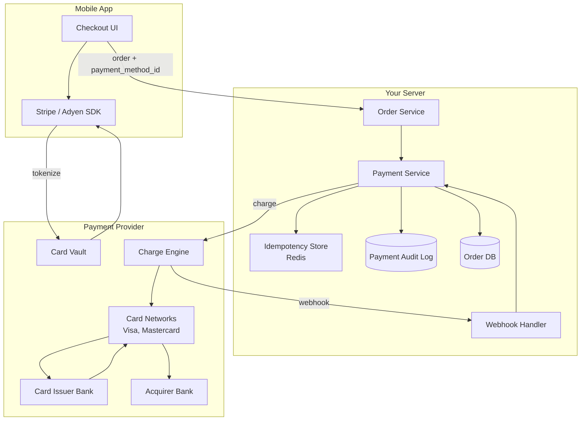
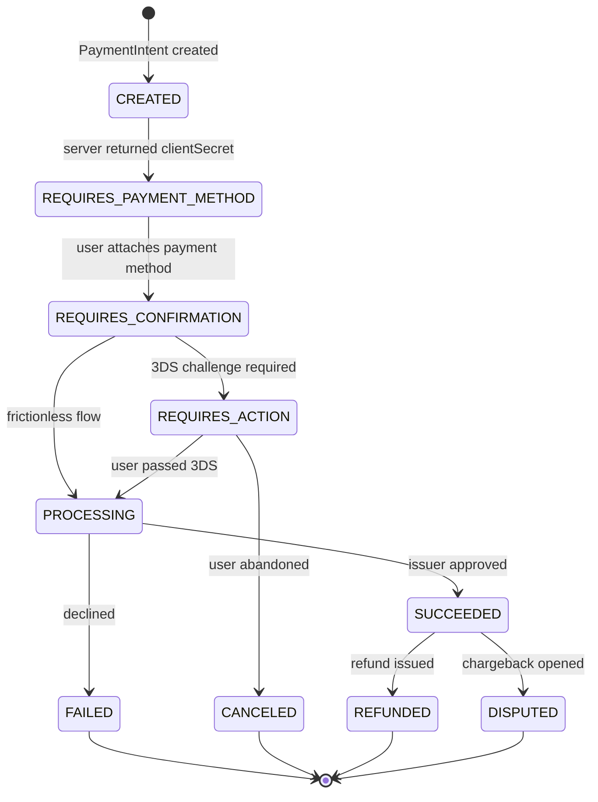
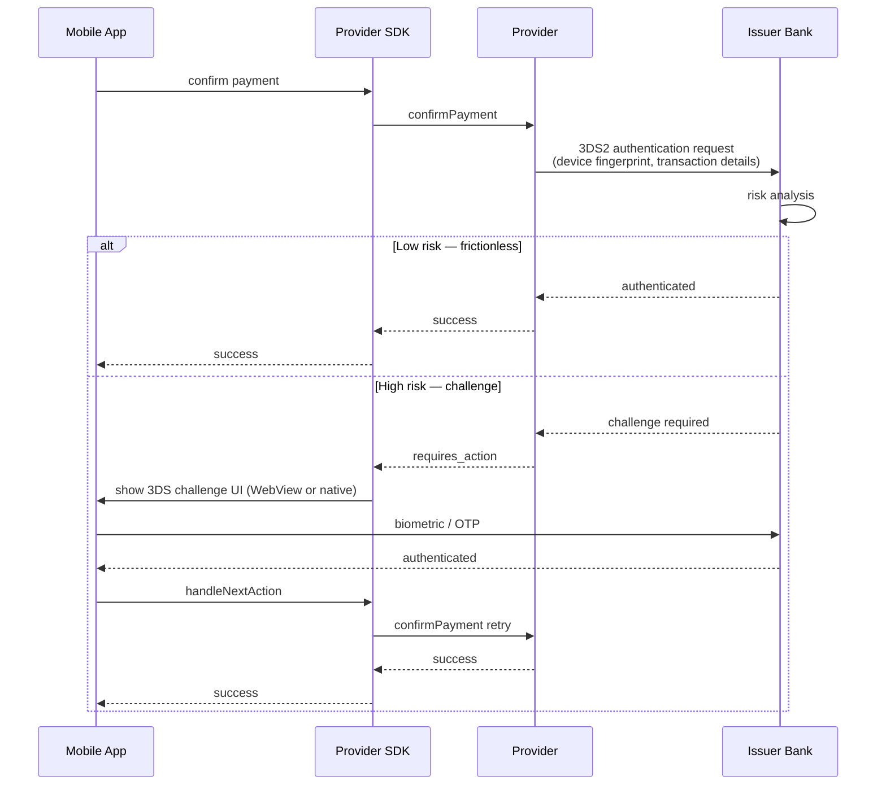
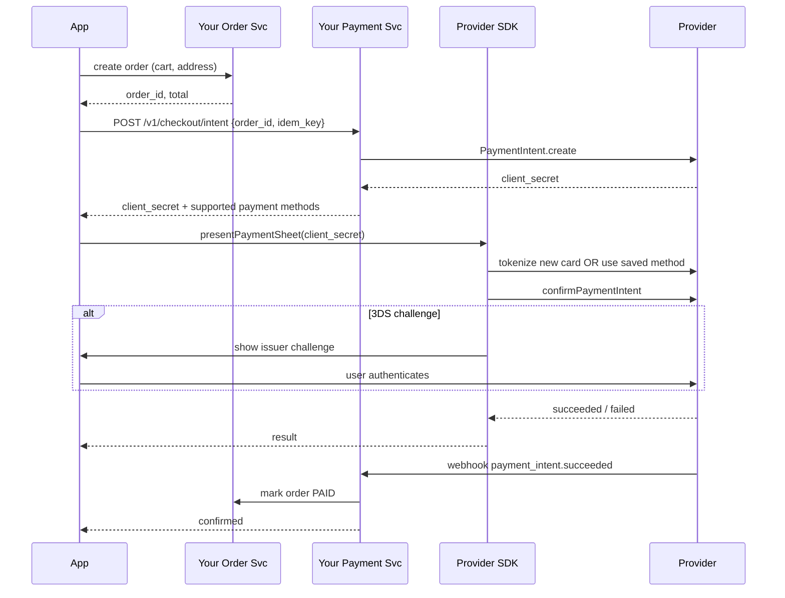

# Payment Flow System Design

> Interview-style deep dive on designing mobile payment processing (Stripe / Adyen / Braintree / Razorpay / PayPal integrations). Covers PCI DSS scope reduction via tokenization, the full payment lifecycle from card capture to settlement, idempotency for double-charge prevention, 3D Secure (PSD2 SCA), Strong Customer Authentication challenge flow, Apple Pay / Google Pay integration, webhooks, refunds and chargebacks, fraud signals, and the regulatory landscape (PCI DSS, PSD2, GDPR, country-specific schemes).

---

## 1. Problem Statement

Design the payment system for a mobile commerce app where users can:

- Save and re-use payment methods (cards, Apple Pay, Google Pay, bank accounts).
- Complete one-tap purchases (card-on-file).
- Pay via 3DS challenge when issuer requires SCA.
- Receive instant confirmation or "pending" status.
- View receipts, request refunds.
- Handle declines gracefully with clear messaging.

### Functional Requirements

- Card tokenization (no raw PAN ever touches your server).
- Multiple payment methods per user (cards, wallets).
- One-time and recurring payments.
- 3D Secure 2 authentication flow with frictionless and challenge variants.
- Idempotent charge requests.
- Refunds (full and partial).
- Webhooks from payment provider for async status updates.
- Multi-currency support.
- Payment dispute handling.

### Non-Functional Requirements

| Concern | Target |
|---|---|
| Charge confirmation latency | p95 < 3s including 3DS frictionless |
| 3DS challenge wait | Acceptable up to 30s (user interaction) |
| Idempotency window | 24h minimum |
| Webhook delivery reliability | At-least-once; client must handle duplicates |
| Refund latency | < 5 business days reflecting on customer card |
| PCI DSS scope | SAQ A (smallest scope) via hosted fields |
| Storage durability | 11 nines, immutable audit log |
| Availability | 99.99% during business hours |

### Scale Assumptions

For a mid-large e-commerce app (~10M users, 1M DAU):

| Quantity | Estimate |
|---|---|
| Payments per day | 200K |
| Peak payments per second | 50 |
| Saved payment methods per user | 1.5 avg |
| Refund rate | 1-3% |
| Chargeback rate | < 0.1% |
| Fraud-flagged transactions | 0.5-2% |

---

## 2. PCI DSS Scope & Tokenization

### 2.1 Why scope matters

If your servers ever **see** raw card numbers (PAN — Primary Account Number), you fall under PCI DSS Level 1, requiring:

- Quarterly external vulnerability scans.
- Annual penetration test.
- Network segmentation.
- Logging, encryption, key management.
- A Qualified Security Assessor (QSA) audit.
- ~$50K-200K/year operational cost.

If your servers **never see** PAN, you can qualify for SAQ A — much smaller scope, mostly self-attested.

### 2.2 Tokenization architecture

Provider (Stripe, Adyen, Braintree) gives you SDKs that capture card data **directly from device to provider**, returning a token:

```mermaid
sequenceDiagram
    participant App as Mobile App
    participant SDK as Provider SDK
    participant Provider as Provider Vault
    participant Server as Your Server

    App->>SDK: collect card details (PaymentSheet)
    SDK->>Provider: POST card details over TLS
    Provider->>Provider: store PAN in vault; mint token
    Provider-->>SDK: { payment_method_id: "pm_xxx" }
    SDK-->>App: token
    App->>Server: POST /payments { token, amount }
    Server->>Provider: charge with token
```

Your server only sees the **token** (an opaque string). The card data goes provider→vault, never touching your servers. Your PCI scope reduces to SAQ A.

### 2.3 SDK integration

Stripe Android example:

```kotlin
class CheckoutActivity : ComponentActivity() {
    private lateinit var paymentSheet: PaymentSheet

    override fun onCreate(savedInstanceState: Bundle?) {
        super.onCreate(savedInstanceState)
        PaymentConfiguration.init(applicationContext, BuildConfig.STRIPE_PUBLISHABLE_KEY)
        paymentSheet = PaymentSheet(this, ::onPaymentResult)
        setContent { CheckoutScreen { presentPaymentSheet(it) } }
    }

    private fun presentPaymentSheet(clientSecret: String) {
        paymentSheet.presentWithPaymentIntent(
            paymentIntentClientSecret = clientSecret,
            configuration = PaymentSheet.Configuration(merchantDisplayName = "MyShop")
        )
    }

    private fun onPaymentResult(result: PaymentSheetResult) {
        when (result) {
            is PaymentSheetResult.Completed -> showSuccess()
            is PaymentSheetResult.Canceled -> showCancel()
            is PaymentSheetResult.Failed -> showError(result.error.message)
        }
    }
}
```

The PaymentSheet UI is rendered by Stripe's SDK. Card fields are protected by Stripe — your code never receives them. The client uses the `clientSecret` (created server-side) to confirm.

### 2.4 Wallet integration

Apple Pay / Google Pay further reduce scope. The wallet returns a **payment token** containing a network-encrypted single-use credential. The provider decrypts on its side; the user's actual card number never leaves the device.

```kotlin
fun isReadyToPay(client: PaymentsClient, onReady: (Boolean) -> Unit) {
    val request = IsReadyToPayRequest.fromJson(buildIsReadyJson().toString())
    client.isReadyToPay(request).addOnCompleteListener { task ->
        onReady(task.isSuccessful && task.result == true)
    }
}

fun launchGooglePay(client: PaymentsClient, amount: Long, currency: String, launcher: ActivityResultLauncher<IntentSenderRequest>) {
    val paymentDataRequestJson = buildPaymentDataRequestJson(amount, currency)
    val request = PaymentDataRequest.fromJson(paymentDataRequestJson.toString())
    val task = client.loadPaymentData(request)
    task.addOnSuccessListener { /* sent via launcher */ }
}
```

---

## 3. High-Level Architecture



### Tier responsibilities

- **Provider SDK** runs in the mobile app, hosts card-input UI in a separate process / WebView, and submits card details to the provider's vault.
- **Your Order Service** owns the cart, totals, and order lifecycle.
- **Payment Service** orchestrates the charge: builds a `PaymentIntent`, confirms with the provider, handles 3DS, listens for webhooks.
- **Idempotency Store** (Redis with TTL) keys client-supplied idempotency keys to results.
- **Audit Log** is immutable, append-only, for compliance and reconciliation.

---

## 4. Payment Lifecycle

### 4.1 State machine



### 4.2 PaymentIntent pattern

Stripe's PaymentIntent (or Adyen's equivalent) is a server-side object representing the lifecycle of a single payment attempt:

```kotlin
// Server: create PaymentIntent
suspend fun createPaymentIntent(order: Order, customerId: String, idemKey: String): PaymentIntent {
    return stripe.paymentIntents.create(
        PaymentIntentCreateParams.builder()
            .setAmount(order.totalCents)
            .setCurrency(order.currency.code)
            .setCustomer(customerId)
            .setAutomaticPaymentMethods(
                PaymentIntentCreateParams.AutomaticPaymentMethods.builder()
                    .setEnabled(true).build()
            )
            .setMetadata(mapOf("order_id" to order.id))
            .build(),
        RequestOptions.builder().setIdempotencyKey(idemKey).build()
    )
}
```

The server returns `client_secret` to the app. The app uses Stripe SDK to confirm:

```kotlin
val params = ConfirmPaymentIntentParams.createWithPaymentMethodId(
    paymentMethodId = paymentMethodId,
    clientSecret = clientSecret
)
stripe.confirmPayment(this, params)
```

---

## 5. Idempotency

### 5.1 The risk

Without idempotency:

1. User taps Pay. App fires `POST /payments`.
2. Network blip. App retries.
3. Server charged twice.

### 5.2 Solution

Client generates a UUID per payment intent (per checkout tap). Server stores `{ idempotency_key → result }` for ≥ 24h.

```kotlin
suspend fun charge(req: ChargeRequest): ChargeResult {
    val key = req.idempotencyKey
    val cached = idempotencyStore.get(key)
    if (cached != null) {
        if (cached.requestHash != hash(req)) {
            throw IdempotencyConflictException("Same key, different body")
        }
        return cached.response
    }
    val response = providerClient.charge(req)
    idempotencyStore.set(key, IdempotencyEntry(hash(req), response), ttl = 24.hours)
    return response
}
```

Critical: the cached result must include the **same** response, even if the underlying provider call returned errors. A retried "card declined" must consistently return declined.

The provider (Stripe, Adyen) itself implements idempotency — but you should also implement it locally because:
- Provider rate limits.
- Network conditions between you and provider.
- Audit trail completeness.

### 5.3 Client-side mechanics

```kotlin
class CheckoutViewModel(...) : ViewModel() {
    private val idemKey = UUID.randomUUID().toString()    // generated once per checkout

    fun submit(paymentMethodId: String) {
        viewModelScope.launch {
            val result = withRetry(maxAttempts = 3) {
                api.charge(ChargeRequest(
                    orderId = orderId,
                    paymentMethodId = paymentMethodId,
                    idempotencyKey = idemKey
                ))
            }
            handle(result)
        }
    }
}
```

The `idemKey` is created once when the user enters checkout. Every retry of the same checkout uses the same key. New checkout (back, retry, etc.) generates new key.

---

## 6. 3D Secure 2 (PSD2 SCA)

### 6.1 Why 3DS

PSD2 (EU regulation) mandates **Strong Customer Authentication** for card transactions. Two factors required:
- Knowledge (PIN, password).
- Possession (phone, device).
- Inherence (biometric).

3DS 2 satisfies this by adding an authentication step with the issuer bank.

### 6.2 Frictionless vs Challenge flow



The frictionless flow (~70% of EU transactions) completes in <1s with no user interaction. The challenge flow (~30%) presents a screen requiring biometric / OTP / passkey.

### 6.3 Liability shift

Successful 3DS2 authentication shifts liability for fraudulent chargebacks **from merchant to issuer**. This is the major business reason to enable 3DS even where not strictly required.

### 6.4 Mobile UX

```kotlin
private fun onPaymentResult(result: PaymentSheetResult) {
    when (result) {
        is PaymentSheetResult.Completed -> {
            // success — even after 3DS challenge
        }
        is PaymentSheetResult.Failed -> {
            when (result.error) {
                is StripeException -> handleStripeError(result.error)
                else -> showGenericError()
            }
        }
    }
}
```

The PaymentSheet handles the 3DS UI internally. For custom UI, the SDK's `handleNextAction` triggers WebView or Custom Tabs presentation of the issuer's authentication page.

---

## 7. Webhooks

The provider sends webhooks to confirm events asynchronously:

| Event | When |
|---|---|
| `payment_intent.succeeded` | charge approved |
| `payment_intent.payment_failed` | charge declined |
| `charge.refunded` | refund processed |
| `charge.dispute.created` | chargeback opened |
| `payment_method.attached` | new payment method saved |
| `customer.subscription.created` | subscription started |

### 7.1 Webhook security

Each webhook is signed with a shared secret. Verify before processing:

```kotlin
@PostMapping("/v1/webhooks/stripe")
fun handleStripeWebhook(
    @RequestBody payload: String,
    @RequestHeader("Stripe-Signature") signature: String
): ResponseEntity<Void> {
    val event = try {
        Webhook.constructEvent(payload, signature, webhookSecret)
    } catch (e: SignatureVerificationException) {
        return ResponseEntity.status(400).build()
    }
    eventProcessor.handle(event)
    return ResponseEntity.ok().build()
}
```

### 7.2 Idempotency

Webhooks may be delivered multiple times. Store the event_id; skip duplicates:

```kotlin
fun handle(event: StripeEvent) {
    val eventId = event.id
    if (processedEventDao.exists(eventId)) return
    processInTransaction(event) {
        processedEventDao.insert(eventId)
    }
}
```

### 7.3 Reconciliation

Even with webhooks, periodically reconcile by polling provider's API for state. Webhooks can be missed (your server down, network failure); reconciliation catches gaps.

---

## 8. Refunds & Chargebacks

### 8.1 Refunds

Initiated by your business or customer service:

```kotlin
suspend fun refund(paymentId: String, amount: Long?, reason: RefundReason): Refund {
    val params = RefundCreateParams.builder()
        .setPaymentIntent(paymentId)
        .apply { amount?.let { setAmount(it) } }
        .setReason(reason.toProviderReason())
        .build()
    return stripe.refunds.create(params)
}
```

Refunds typically settle to customer's card in 5-10 business days. The webhook `charge.refunded` confirms; your UI updates the order to "refunded."

### 8.2 Chargebacks

The customer disputes the charge with their bank:
1. Bank issues chargeback.
2. Provider sends `charge.dispute.created` webhook.
3. Funds are held / withdrawn from your account.
4. You can challenge with evidence (delivery confirmation, signed receipt).
5. After dispute resolves, funds return or stay withdrawn.

Mitigation: 3DS shifts liability. Fraud signals (velocity checks, device fingerprinting) prevent disputes. Customer-friendly refund policies prevent friendly fraud.

---

## 9. Recurring Payments / Subscriptions

For subscriptions (Netflix, SaaS), the saved payment method is charged automatically:

```kotlin
suspend fun createSubscription(customerId: String, planId: String): Subscription {
    return stripe.subscriptions.create(
        SubscriptionCreateParams.builder()
            .setCustomer(customerId)
            .addItem(SubscriptionCreateParams.Item.builder().setPlan(planId).build())
            .setPaymentBehavior(SubscriptionCreateParams.PaymentBehavior.DEFAULT_INCOMPLETE)
            .setPaymentSettings(
                SubscriptionCreateParams.PaymentSettings.builder()
                    .setSaveDefaultPaymentMethod(SubscriptionCreateParams.PaymentSettings.SaveDefaultPaymentMethod.ON_SUBSCRIPTION).build()
            )
            .build()
    )
}
```

The first charge confirms with 3DS if needed; subsequent charges use the saved method off-session.

### 9.1 Off-session payments

When the user isn't actively in the app:

```kotlin
val params = PaymentIntentCreateParams.builder()
    .setAmount(amountCents)
    .setCurrency(currency)
    .setCustomer(customerId)
    .setPaymentMethod(paymentMethodId)
    .setOffSession(true)
    .setConfirm(true)
    .build()
```

If the issuer requires SCA, the off-session attempt fails with `authentication_required`. You notify the user via email/push, they return to the app, and you retry on-session with 3DS.

### 9.2 Dunning & retries

Failed recurring charges retry on a schedule (Stripe Smart Retries: try at 1d, 3d, 7d). Track:
- Past-due subscriptions.
- Customer notification cadence.
- Cancellation after N failed attempts.

---

## 10. Fraud & Risk

### 10.1 Signals

| Signal | What it indicates |
|---|---|
| Multiple cards on one device | Account selling |
| One card on many devices | Stolen card |
| IP geolocation vs billing address mismatch | High risk |
| Velocity (N charges in last hour) | Card testing |
| BIN range (issuer country) vs IP country | Cross-border fraud |
| Device fingerprint changed | Suspicious |
| Previous chargebacks on this card | Decline |

Providers (Stripe Radar, Adyen RevenueProtect) score risk; you can set thresholds for auto-decline or manual review.

### 10.2 Play Integrity / DeviceCheck

Anti-bot attestation prevents emulators / rooted devices from carding attacks:

```kotlin
val integrityManager = IntegrityManagerFactory.create(applicationContext)
val tokenResponse = integrityManager.requestIntegrityToken(
    IntegrityTokenRequest.builder().setNonce(nonce).build()
).await()
val token = tokenResponse.token()
// Send token to server; server verifies with Google Play Integrity API
```

### 10.3 FLAG_SECURE for screen captures

```kotlin
class CheckoutActivity : ComponentActivity() {
    override fun onCreate(savedInstanceState: Bundle?) {
        super.onCreate(savedInstanceState)
        window.setFlags(WindowManager.LayoutParams.FLAG_SECURE,
                        WindowManager.LayoutParams.FLAG_SECURE)
        // Now system screenshots and screen recording disabled
    }
}
```

---

## 11. Mobile Client Architecture

### 11.1 Checkout flow



### 11.2 Saved payment methods UI

```kotlin
class WalletViewModel(val paymentsRepository: PaymentsRepository) : ViewModel() {
    val methods: StateFlow<List<PaymentMethod>> = paymentsRepository.observeMethods()

    fun setDefault(id: String) { viewModelScope.launch { paymentsRepository.setDefault(id) } }
    fun delete(id: String) { viewModelScope.launch { paymentsRepository.delete(id) } }
    fun addNew() { /* trigger SetupIntent flow */ }
}
```

For adding a method without making a payment, use `SetupIntent`:

```kotlin
val setupIntentResult = stripe.confirmSetupIntent(
    activity,
    ConfirmSetupIntentParams.create(paymentMethodId, clientSecret)
)
```

This tokenizes + saves to the customer; 3DS may still trigger to verify "this user actually owns this card."

### 11.3 Loading and error states

```kotlin
sealed class CheckoutState {
    object Idle : CheckoutState()
    object PreparingPayment : CheckoutState()        // creating intent
    object AwaitingUserAction : CheckoutState()      // 3DS challenge active
    object Processing : CheckoutState()              // provider working
    data class Succeeded(val orderId: String) : CheckoutState()
    data class Failed(val message: String, val retryable: Boolean) : CheckoutState()
}
```

The UI maps state to UX:
- `PreparingPayment` → button shows spinner.
- `AwaitingUserAction` → modal indicates "complete verification."
- `Failed` → human-readable message; "Try a different card" if retryable.

---

## 12. Failure Modes

**Network drop during charge.** Idempotency key + retry retrieves the original result.

**User abandons 3DS.** Provider returns `requires_action` indefinitely; PaymentIntent times out after ~24h. App should poll status or rely on webhook.

**Provider outage.** Show "payment temporarily unavailable" with retry; do not allow order completion. Consider fallback provider for critical flows (rare).

**Card declined for non-fraud reason.** Surface specific provider decline code (insufficient funds, expired). Suggest "use a different card." Don't lose the cart.

**Charge succeeded but webhook never arrives.** Reconciliation job polls provider for charges in last 24h; finds the success; updates order. UI hopefully showed success already.

**Refund failed.** Refund itself can fail (closed card). Provider returns failure; your UI shows "refund pending" until resolved. Manual intervention may be required.

**Race: webhook arrives before client-side confirmation.** Your server-side state is already PAID; client sees confirmation. Handle out-of-order arrival via state machine.

**Subscription card expired.** Off-session charge fails; notify customer; pause subscription; collect new card on-session.

**SCA challenge on saved card off-session.** The off-session attempt fails; you must notify customer (email/push) and walk them through on-session re-authentication.

**Currency mismatch.** User in UK, card in USD. Provider can charge or decline; surface clearly.

**Duplicate webhook.** Idempotency on event_id prevents double-processing.

**FX rate fluctuation between intent creation and confirmation.** Stripe locks rate at intent creation; gap is fine.

---

## 13. Tradeoffs

**Provider hosted UI vs custom UI**

| Hosted (PaymentSheet) | Custom (Elements) |
|---|---|
| Less work | More design control |
| SAQ A scope | SAQ A-EP scope |
| Provider styling constraints | Your brand |

**3DS2 always vs dynamic**

| Always | Dynamic (only when issuer requires) |
|---|---|
| Liability shift on all | Smooth UX for low-risk |
| Higher friction | Some risk on missed challenges |

**Save card by default vs opt-in**

| Default | Opt-in |
|---|---|
| Smoother re-purchase | Privacy preference |
| GDPR considerations | More taps next time |

**One provider vs multi-provider**

| Single | Multi |
|---|---|
| Simpler | Resilient (failover) |
| Better support | Higher complexity, multiple PCI scopes |

---

## 14. Probing Questions

1. Walk through why PCI DSS scope matters and how tokenization keeps you in SAQ A.
2. Idempotency keys: explain the bug they prevent, where they're generated, and what TTL is appropriate.
3. Frictionless vs challenge 3DS2: walk through both end-to-end and when each happens.
4. A webhook arrives twice for the same `payment_intent.succeeded`. What's your dedup strategy?
5. The provider returns "requires_action" — what's required, and how does the mobile SDK present it?
6. A user is charged twice for one tap. Walk through how this happened and how you prevent it.
7. The user enters checkout, completes 3DS, but the network drops before the SDK reports success. What's the next-time flow?
8. Saved card off-session subscription renewal. Card was issued in a country requiring SCA. What happens?
9. Apple Pay / Google Pay return a payment token. How does it differ from a regular Stripe `payment_method_id`?
10. Chargeback prevention: list five technical signals and how each helps.
11. Webhook signature verification: walk through the algorithm and what happens if it fails.
12. The customer disputes a charge with their bank. Walk through the next 60 days.
13. Reconciliation job: what does it do, when does it run, and what discrepancies does it catch?
14. Multi-currency: user has USD card; merchant settles in EUR. Where's the FX done and locked?
15. FLAG_SECURE: what does it prevent, and what are the gaps?
16. Provider outage: design a fallback that still allows the user to complete an order.
17. Subscription dunning: design the retry schedule and notification cadence.
18. Card-on-file UI: how do you confirm "this is really the user's card" before charging it again?
19. PCI DSS Level 1 vs SAQ A: what's the cost difference and what causes the jump?
20. A high-value transaction. What additional signals do you check before submitting the charge?

---

## 15. Further Reading

In this repository:

- [`authentication.md`](authentication.md) — auth tokens for API calls.
- [`security-and-privacy.md`](security-and-privacy.md) — Keystore, biometrics, FLAG_SECURE.
- [`push-notifications.md`](push-notifications.md) — confirmation pushes.
- [`../distributed-systems/idempotency.md`](../distributed-systems/idempotency.md) — idempotency keys.
- [`../distributed-systems/delivery-semantics.md`](../distributed-systems/delivery-semantics.md) — webhook delivery guarantees.
- [`../engineering-fundamentals/state-machines.md`](../engineering-fundamentals/state-machines.md) — PaymentIntent state machine.
- [`../android/networking-and-security/security-and-keystore.md`](../android/networking-and-security/security-and-keystore.md) — Hardware-backed key storage for tokens.

External:

- [Stripe System Design](https://grokkingthesystemdesign.com/guides/stripe-system-design/) — interview-level Stripe walkthrough.
- [What is PCI DSS compliance? — Stripe](https://stripe.com/guides/pci-compliance) — official PCI scope guide.
- [Adyen 3D Secure 2 documentation](https://docs.adyen.com/online-payments/3d-secure) — definitive 3DS2 reference.
- [PSD2 and Strong Customer Authentication — Chargebee](https://www.chargebee.com/docs/payments/2.0/psd2-sca.html) — PSD2 SCA exhaustive guide.
- [Designing a Payment Processing System](https://dev.to/matt_frank_usa/designing-a-payment-processing-system-stripe-architecture-3i06) — Stripe-style architecture analysis.
- [PCI DSS Compliance for Mobile Payment Apps](https://www.decryptcode.com/blog/pci-dss-mobile-payment-app/) — mobile-specific PCI scope.
- [Stripe Mobile SDKs (Android)](https://stripe.com/docs/payments/quickstart) — official Android integration docs.
- [Google Pay API for Android](https://developers.google.com/pay/api/android) — Google Pay integration.
- [Apple Pay on the Web / Native](https://developer.apple.com/apple-pay/) — Apple Pay reference.
- *Payment Systems in the U.S.* by Carol Coye Benson — accessible book on payment ecosystems.
- *Mastering Stripe* by Justin Tan — engineering-focused Stripe practices.
