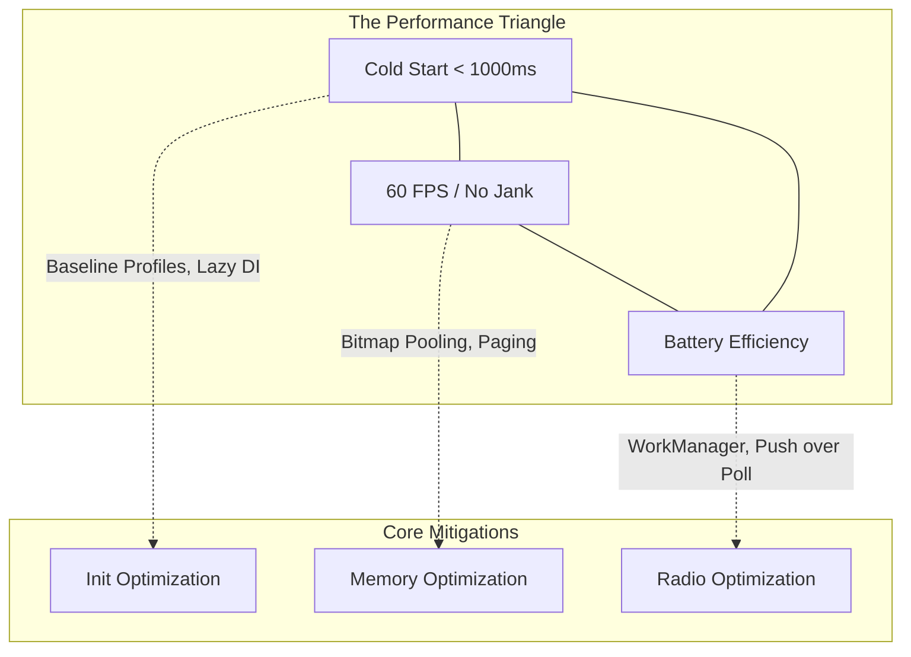

# System Design: Performance

## Overview

In standard software engineering, "Performance" usually refers to Backend throughput—how many requests per second (RPS) a server can handle before it melts. 

In Mobile System Design, **Performance** means exactly three things:
1.  **Cold Start Time:** How fast does the app open?
2.  **Jank (Frame Rate):** Does the screen stutter when the user scrolls?
3.  **Battery & Thermal Drain:** Does using the app make the phone hot and drain 10% of the battery in 15 minutes?

A Staff Engineer designing a mobile system must prove to the interviewer that their architectural choices will not violate these three core constraints. If you design a beautiful offline-syncing GraphQL architecture, but it takes 4 seconds for the app to open, the design has failed.

## Why It Matters

Mobile users are phenomenally impatient. Google's internal telemetry shows that for every 1 second delay in App Startup time, user drop-off increases exponentially. 

If you are designing an E-commerce app, a 2-second Cold Start delay translates directly to millions of dollars in lost revenue. Performance is not a "nice to have" polish item; it is a foundational business requirement.

## First Principles (The 3 Pillars)

### 1. Cold Start
- **Definition:** The time from when the user taps the app icon to when the first frame of usable UI is drawn on the screen. The Android OS has to fork the Zygote process, boot the ART runtime, and execute your `Application.onCreate()`.
- **The Enemy:** Synchronous I/O on the Main Thread (reading `SharedPreferences`), massive Dependency Injection graph initialization, and blocking network calls.

### 2. Jank (Dropped Frames)
- **Definition:** The human eye perceives smooth motion at 60 Frames Per Second (FPS). That means you have exactly **16.6 milliseconds** to measure, layout, and draw every single frame. If you take 17ms, you drop a frame. The screen stutters (Jank).
- **The Enemy:** Garbage Collection (GC) pauses caused by allocating too many objects in tight loops (e.g., `onDraw`), complex nested UI hierarchies (`ConstraintLayout` measuring itself multiple times), and parsing massive JSON payloads on the Main Thread.

### 3. Battery & Thermals
- **Definition:** The phone's CPU and Cellular Radio consume massive power when active. The goal is to finish work instantly and let the hardware go back to "Sleep" state.
- **The Enemy:** Wakelocks, Polling the network every 5 seconds, keeping WebSockets open in the background, and spinning the CPU in infinite retry loops.

## System Design Interview Tactics

When asked about Performance in a System Design interview, you must aggressively isolate the bottlenecks.

### Strategy 1: The App Startup Bottleneck
*Interviewer:* "How do you ensure this chat app opens in under 1 second?"

*Staff Answer:* 
"App startup is dominated by `Application.onCreate()`. 
First, I will strictly defer the initialization of heavy SDKs (like Crashlytics or Analytics) to a background thread using Androidx `App Startup` or `WorkManager`. They do not block the UI.
Second, I will lazy-load my Dependency Injection graph. If I am using Dagger/Hilt, I will ensure Singletons are only instantiated when they are first injected, not all at once at boot.
Third, I will implement a **Baseline Profile** (`baseline-prof.txt`). This tells the ART compiler exactly which methods to Ahead-Of-Time (AOT) compile during APK installation, completely bypassing the JIT compiler during the first critical second of startup."

### Strategy 2: The Scrolling Bottleneck (Jank)
*Interviewer:* "The user is scrolling through a massive feed of 10,000 photos. How do you prevent stuttering?"

*Staff Answer:*
"Stuttering happens if we exceed 16.6ms per frame. The biggest risk here is Bitmap memory allocation causing Garbage Collection (GC) pauses, and UI measurement thrashing.
First, I will enforce **Pagination** (e.g., Paging 3). We only hold 50 items in memory at a time.
Second, for image loading, I will use a library like `Coil` or `Glide`, which utilizes a Bitmap Pool. Instead of destroying and allocating massive 5MB Bitmaps (which triggers the GC), the library reuses the exact same byte arrays in memory for new photos.
Third, if using Jetpack Compose, I will strictly enforce `Stable` and `Immutable` annotations on my UI state models to prevent unnecessary Recomposition sweeps."

### Strategy 3: The Network/Battery Bottleneck
*Interviewer:* "We need to sync the user's contacts to the server. How do you do this without draining the battery?"

*Staff Answer:*
"The cellular radio is the most expensive hardware on the phone. Waking it up costs battery.
I will absolutely not use a `while(true)` polling loop or a foreground Service.
I will use Android's **WorkManager**. I will schedule a background job with specific `Constraints`: `setRequiredNetworkType(UNMETERED)` (Wi-Fi only) and `setRequiresCharging(true)`. 
This allows the Android OS to batch my contact sync together with other apps' background jobs, waking the radio up only once, drastically saving battery life."

## Architecture (The Performance Triangle)

## Failure Modes

- **The "JSON in the UI" Freeze:**
  You download a 5MB JSON string on a background thread (good). But you pass the raw string to the `ViewModel` and call `Moshi.fromJson()` on the Main Thread. The CPU locks up for 200ms to parse it, dropping 12 frames instantly.
  *(Fix: All deserialization and heavy data transformation MUST happen on `Dispatchers.Default` before the UI state is updated).*
- **The SharedPreferences Lock:**
  A developer calls `sharedPreferences.getString("token")` inside `Application.onCreate()`. `SharedPreferences` reads from the physical disk. Disk I/O is notoriously slow and unpredictable. It blocks the Main Thread and causes StrictMode violations.
  *(Fix: Migrate to `DataStore` which uses Kotlin Flows and guarantees asynchronous reads, or read from memory caches instead of disk during the critical startup path).*

## Staff Engineer Thinking

When reviewing code for Performance, a Staff engineer focuses on the **Critical Path**.

1.  **Macro vs Micro Optimization:** I do not care if a developer uses a slightly slower sorting algorithm for a list of 5 items. I *do* care if they initialize a massive database connection on the Main Thread during app startup. We optimize the Macro architecture (Thread routing, I/O boundaries) before we worry about Micro syntax.
2.  **Telemetry is Mandatory:** You cannot fix what you cannot measure. I mandate Firebase Performance Monitoring or New Relic. If a PR degrades the P90 Cold Start time by 100ms, the CI pipeline fails. Performance is tracked continuously, not just before a big release.
3.  **Perceived Performance vs Real Performance:** If a network call takes 2 seconds, we cannot fix physics. But we *can* fix Perceived Performance. I mandate Optimistic UI Updates (updating the local screen instantly before the server replies) and Skeleton Loaders. If the app *feels* instant, the user is happy, even if the background math is slow.

## Probing Questions

1.  Explain why Mobile System Design defines "Performance" completely differently than Backend System Design (FPS/Battery vs RPS/Throughput).
2.  What is the "16.6ms rule," and what happens to the user experience if the Main Thread violates it?
3.  How does a "Baseline Profile" drastically reduce Cold Start time by interacting directly with the Android Runtime (ART)?
4.  Why is Garbage Collection (GC) thrashing the primary enemy of smooth 60fps scrolling, and how do Bitmap Pools solve it?
5.  Explain why using Android's `WorkManager` with constraints (`RequiresCharging`) is vastly superior for battery life compared to running a custom background `Thread` or `Service`.
6.  Describe the severe performance consequences of performing JSON serialization/deserialization on the Main Thread.
7.  How does lazy-loading a Dependency Injection (DI) graph improve Cold Start time?
8.  What is "Perceived Performance," and how can an Optimistic UI update make a slow network connection feel instantaneous to the user?
9.  Why is reading from `SharedPreferences` during `Application.onCreate()` considered an architectural anti-pattern for performance?
10. If an interviewer asks you to design a highly complex, animation-heavy screen, why is it critical to mention `Stable` and `Immutable` annotations if using Jetpack Compose?

## Further Reading

- [`jank.md`](../android/performance/jank.md) — Deep dive into the 16.6ms render loop.
- [`baseline-profiles.md`](../android/performance/jank.md) — The technical implementation of AOT compilation for startup speed.
- [`push-vs-poll-vs-sse-vs-websockets.md`](../backend-for-mobile/push-vs-poll-vs-sse-vs-websockets.md) — The battery tradeoffs of different network transports.
