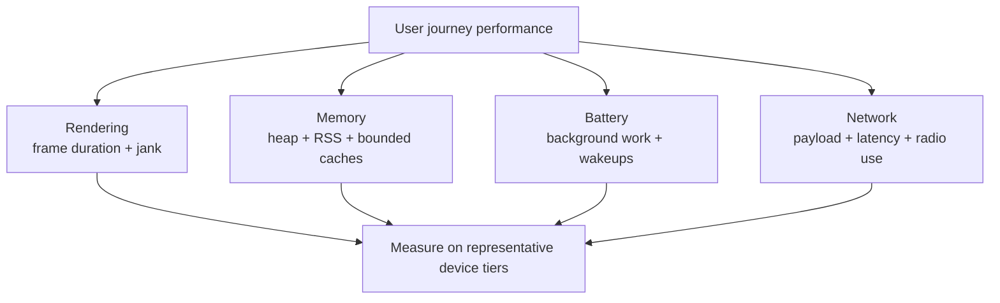

# Mobile Performance (Frame Rate, Memory, Battery, Network)

> A 45-60 minute mobile system-design walkthrough for the *performance engineering* of an Android app — how to keep the UI smooth, the memory bounded, the battery happy, and the network frugal. Not a single feature, but a horizontal concern that crosses every screen.

---

## 1. Gathering Requirements (~5 min)

> **Interviewer:** "How would you keep an Android app performant at scale?"
> **Candidate:** "Performance is a set of budgets across four dimensions: rendering, memory, battery, network. I'll set the budgets first, then walk through the levers, then deep-dive frame-rate."

### Functional Requirements
- **Smooth scroll** across all list/feed screens.
- **Cold start under a budget** (this design targets < 1.5s TTID on a mid-tier device; Android vitals flags cold starts of 5s or longer as excessive).
- **Memory pressure handled** (no OOM, no jank from GC).
- **Battery drain bounded** (no measurable drain at idle).
- **Network usage minimised** on cellular.

### Non-Functional Requirements
- **Measurable**: every budget has a dashboard.
- **Regression-blocking**: PRs that worsen budgets get flagged.
- **Per-device-tier**: budgets differ for low-end vs flagship.
- **Real-user, not lab-only**: production telemetry, not just benchmarks.
- **No surprise debt**: every "slow" feature has a known root cause.

### Out of Scope
- Backend latency optimization (server problem)
- App size optimization (separate; APK / AAB minification, dynamic delivery)
- Game-loop / OpenGL performance (specialist)
- ML model inference on device (separate concern)
- Performance regressions specific to one feature (debug as needed)

---

## 2. Clarifying Questions (~3 min)

| Question | Why it matters |
|---|---|
| Device-tier distribution (low-end share)? | Where to focus budgets |
| Target refresh rate (60, 90, 120 Hz)? | Frame budget (16.7 / 11.1 / 8.3 ms) |
| Cold start budget? | Splash, modules to defer |
| Major user flows (feed, video, camera)? | Per-flow budgets |
| Battery telemetry source (Android Vitals, in-app)? | Measurement infra |
| Cellular constraints (data caps)? | Compression / quality strategy |
| Memory target (heap, RSS)? | LowMemoryKiller risk |

> **Candidate:** "70% mid-tier, 90 Hz, < 1.5s cold start, feed + video + camera as critical paths, Android Vitals + in-app telemetry, payload < 100 KB per page, heap target < 200 MB."

---

## 3. High-Level Diagram (~10 min)



Performance is a coupled budget rather than a single startup or frame metric: an optimization is incomplete until its memory, battery, and network costs are measured on representative devices.

**Telemetry sources:**
- **Android Vitals** (Play Console) — Real-User-Monitoring; ANR, crash, jank, slow start.
- **In-app telemetry SDK** — fine-grained, custom traces (see `telemetry-sdk.md`).
- **Macrobenchmark** (Jetpack) — CI-time startup/jank/baseline profiles.
- **Perfetto** — system-level traces during debugging.

---

## 4. Example Performance Budgets (per device tier)

These are example product targets for this interview, not platform guarantees; set yours from field data. The only official startup thresholds are Android vitals' "excessive" startup levels, measured on TTID: cold 5s or longer, warm 2s or longer, hot 1.5s or longer ([Android vitals startup time](https://developer.android.com/google/play/vitals/launch-time)).

| Budget | Low-tier | Mid-tier | Flagship |
|---|---|---|---|
| Cold start (TTID) | < 2.5 s | < 1.5 s | < 1.0 s |
| Cold start (TTFD) | < 4.0 s | < 2.5 s | < 1.8 s |
| Frame p95 (60 Hz) | < 16.7 ms | < 16.7 ms | < 8.3 ms (120 Hz) |
| Heap | < 150 MB | < 200 MB | < 300 MB |
| Battery (active hour) | < 8% | < 5% | < 4% |
| Page payload (feed) | < 60 KB | < 100 KB | < 150 KB |

> **TTID** = Time to Initial Display. **TTFD** = Time to Full Display.

---

## 5. Levers per Dimension

### Rendering

- Pass a stable `key = { it.id }` to lazy `items` so item state and animations follow the item across inserts and reorders.
- `derivedStateOf` for computed UI state.
- `LazyColumn` with stable item types, not `Column { items.forEach { } }`.
- `remember` mutable state at the right scope.
- Defer fast-changing state reads to the layout or draw phase with lambda modifiers (`Modifier.offset { }`, `drawBehind { }`).
- Diagnose parameter stability before adding `@Immutable` or `@Stable`; these annotations promise a contract the type must uphold.
- Check the Compose compiler version before changing skipping settings; strong skipping is on by default with Kotlin 2.0.20+.
- Baseline profiles for hot startup paths.

### Memory

- Coil with `MemoryCache.Builder().maxSizePercent(context, 0.25)` — bounded bitmap memory.
- `DisposableEffect(player) { onDispose { player.release() } }` for ExoPlayer.
- `LruCache` for any in-memory caches.
- Profile leaks with LeakCanary; never leak `Activity`/`Context`.

### Battery

- Foreground-only sockets; FCM for background events.
- WorkManager constraints (NetworkType.CONNECTED, BatteryNotLow) instead of fighting Doze.
- No `WakeLock`s unless absolutely necessary.
- Use `setExpedited(...)` only for user-initiated, user-visible work; `OutOfQuotaPolicy.RUN_AS_NON_EXPEDITED_WORK_REQUEST` makes it fall back to normal work when the expedited quota is exhausted. Below Android 12, expedited workers must implement `getForegroundInfo()`.
- Throttle quote/location streams when stationary or backgrounded.

### Network

- HTTP/2 + connection keep-alive (OkHttp default).
- Brotli or gzip for JSON.
- Image-tier selection by `ConnectivityManager.isActiveNetworkMetered`.
- Pagination + cache-first reads.
- Bundle small updates instead of chatty calls.
- Single source of truth (Room) so the UI re-renders without re-fetching; observe Room queries as `Flow` so the UI updates when the data changes.

---

## 6. Local Storage (telemetry of perf data)

Perf events flow through the telemetry SDK with category `perf` — see `telemetry-sdk.md`. No separate storage.

---

## 7. Deep Dive: Frame Rate / Jank (~15 min)

> *I'd pick this as the deep dive because frame jank is the most visible perf problem to users. Smooth scroll under load demands discipline across rendering, memory, and threading.*

### Measure first

```kotlin
class JankMonitor @Inject constructor(activity: Activity) {
    private val jankStats: JankStats = JankStats.createAndTrack(activity.window) { frame ->
        if (frame.isJank) {
            Telemetry.recordJank(
                screen = currentScreen(),
                frameDurationMs = frame.frameDurationUiNanos / 1_000_000.0,
                states = frame.states.joinToString(",") { it.key }
            )
        }
    }
}
```

`JankStats` reports janky frames in production. Combine with `Macrobenchmark` for CI-time regression detection.

### Compose stability

```kotlin
@Immutable
data class Post(val id: String, val title: String, val author: Author, val createdAt: Long)

@Composable
fun PostCard(post: Post, onLike: () -> Unit) { ... }
```

`@Immutable` promises that `Post` and its properties will not change after construction; that includes `Author`. Use it only when this contract is true. Check compiler stability reports before adding an annotation: with strong skipping enabled, a restartable composable can also skip when it receives the same instance of an unstable parameter.

### LazyColumn discipline

```kotlin
LazyColumn(state = listState) {
    items(items.itemCount, key = items.itemKey { it.id }) { i ->
        items[i]?.let { post ->
            PostCard(
                post = post,
                onLike = remember(post.id) { { vm.onLike(post.id) } }
            )
        }
    }
}
```

- **`key`** — stable identity across data changes, so item state and animations move with the item when the list is reordered.
- **`remember(post.id) { { ... } }`** — only needed when strong skipping is disabled. With strong skipping (the default on Kotlin 2.0.20+), the compiler remembers lambdas inside composables automatically.

### derivedStateOf for computed UI

```kotlin
val showFab by remember { derivedStateOf { listState.firstVisibleItemIndex > 5 } }
```

`derivedStateOf` only triggers recomposition when the *computed value* changes — not every time `firstVisibleItemIndex` changes by 1.

### Baseline profiles

Baseline profiles are AOT-compiled hot paths shipped with the APK. Generated via `Macrobenchmark`:

```kotlin
class BaselineProfileGenerator {
    @get:Rule
    val rule = BaselineProfileRule()

    @Test
    fun generate() = rule.collect("com.app") {
        startActivityAndWait()
        device.findObject(By.text("Open feed")).click()
        device.wait(Until.hasObject(By.text("Latest")), 5_000)
        // scroll feed for a few seconds
    }
}
```

The generated profile is packaged with the app so ART can compile covered paths ahead of time. Measure the cold-start change on representative devices; the gain depends on the paths covered and the app's other startup costs.

### Strong-skipping mode

Strong skipping is enabled by default with Kotlin 2.0.20+. For older Compose compiler setups, follow the official compiler configuration for that version. It makes restartable composables skippable even with unstable parameters; stable parameters use equality, while unstable parameters use instance identity.

See [Android's strong-skipping guide](https://developer.android.com/develop/ui/compose/performance/stability/strongskipping) and [stability guidance](https://developer.android.com/develop/ui/compose/performance/stability/fix).

### Bitmap memory

```kotlin
val imageLoader = ImageLoader.Builder(context)
    .memoryCache { MemoryCache.Builder().maxSizePercent(context, 0.25).build() }
    .diskCache { DiskCache.Builder().directory(cacheDir.resolve("images")).maxSizeBytes(150 * MB).build() }
    .build()
```

This configuration caps Coil's memory cache at 25% of the app's available memory; Coil's default is 20% (15% on low-RAM devices). Give every in-memory cache an explicit budget, and profile with `Bitmap.getAllocationByteCount()` aggregated.

### Off-screen GPU surfaces

```kotlin
// Inside a LazyColumn item:
if (isVisible) {
    AndroidView(factory = { /* expensive map view */ })
} else {
    SimplePlaceholder()
}
```

Don't instantiate heavy views off-screen. `LazyColumn` already does this for its children, but custom logic can defeat it.

### Threading discipline

| Work | Where |
|---|---|
| UI / Compose | Main |
| Network | OkHttp dispatcher (default), Ktor's `Dispatchers.IO` |
| Disk (Room) | `Dispatchers.IO` (Room handles internally for suspend DAOs) |
| Image decode | Coil's decode dispatcher |
| Cryptographic | `Dispatchers.Default` |
| WorkManager (`CoroutineWorker`) | `Dispatchers.Default` by default; switch to `Dispatchers.IO` for blocking I/O |

Never `runBlocking` on Main. Use `withContext(Dispatchers.IO)` in repositories.

### Failure modes

| What breaks | Behavior |
|---|---|
| Jank during scroll | Profile with Perfetto; suspect bitmap decode, layout passes, GC |
| OOM | Bound caches; release players; profile Bitmap allocations |
| Slow cold start | Audit startup providers and `Application.onCreate`; lazily initialize non-critical work and measure a baseline profile |
| ANR | Profile main-thread work; move I/O off main |
| Battery drain | Audit sockets, WorkManager, FCM frequency |
| Network spike | Aggregate analytics; check for chatty endpoints |

---

## 8. Trade-offs

### Measurement source

| Option | Pros | Cons | Verdict |
|---|---|---|---|
| **Android Vitals + in-app telemetry SDK + Macrobenchmark** | Real-user + CI gates | Three tools | Pick all three (use each for its strength) |
| Vitals only | Free, real-user | Only Play Console; coarse | Necessary but not sufficient |
| Lab benchmarks only | Reproducible | Doesn't match user reality | Skip-only |

### Memory budget enforcement

| Option | Verdict |
|---|---|
| **Cap per-component (Coil, Glide, custom)** | Pick — bounded |
| Trust the system | Bad — OOM in low-mem |
| Manual GC | Don't — counterproductive |

### Compose perf

| Lever | When |
|---|---|
| `@Immutable` / `@Stable` | Only when the type meets the contract and compiler reports show a useful stability issue |
| `items(key = …)` on lazy lists | Always |
| `remember { }` for derived state | Yes |
| Strong-skipping mode | Default with Kotlin 2.0.20+; check compiler version on older builds |
| Baseline profile | Yes for cold start |

### Battery measurement

| Option | Verdict |
|---|---|
| **Android Vitals (background drain)** | Pick |
| Battery Historian | Use for deep dive |
| In-app battery API (`BatteryManager`) | OK for in-app indicators |

---

## 9. Major Concerns

- **Perceived vs measured.** A user judges by feel, not p99. Target p95 + animations + skeleton screens for perceived smoothness.
- **Tier diversity.** A flagship feels fine; a mid-tier doesn't. Always test on the lowest-tier supported device.
- **Regression gates.** Macrobenchmark in CI flags PR-level regressions before merge.
- **Background work.** The biggest battery wins come from honouring Doze and not fighting it.
- **GC pressure.** Allocating in tight loops (e.g., per-frame composable) causes jank from GC pauses; cache where possible.
- **Cold start budget.** Audit both startup providers and `Application.onCreate`. Disable automatic App Startup discovery for non-critical SDKs and initialize them when needed.
- **Network in startup.** Don't block first paint on network. Skeleton + async hydrate.
- **Profile, don't guess.** Perfetto > intuition. Macrobenchmark > stopwatch.

---

## 10. Follow-up Questions

> **Q: How do you decide what to measure first?**
> Start with the user complaint or business metric — "feed scroll feels janky" → JankStats per-screen breakdown. Don't optimize what no one notices.

> **Q: A feature is slow on low-tier devices but fine on flagships. What do you do?**
> Tiered behavior: smaller image variants, fewer prefetched items, simpler animations. Make the tradeoff explicit; degrade gracefully.

> **Q: Compose recompositions are happening more than expected — how to debug?**
> Start with Compose compiler reports and a benchmark of the affected screen. Add `@Stable` or `@Immutable` only when the type fulfills its contract and the change measurably helps.

> **Q: How do you decide between baseline profile and ahead-of-time compilation?**
> Baseline Profiles identify code paths for ART to compile ahead of time. Compilation timing depends on Android version and installation route: Google Play can compile profiles during installation or background updates, while other installs may rely on later background optimization. Check the profile's compiled state and measure cold-start performance on the target devices.

> **Q: How is battery drain debugged in production?**
> Android Vitals shows aggregate. For per-user, request `dumpsys batterystats` on a specific device. The biggest culprits are: wake-locks, JobScheduler abuse, foreground services, background sockets.

> **Q: Memory usage suddenly grew in a release — how do you bisect?**
> `MAT` or `Android Profiler` snapshot before/after the suspect feature. Diff retained heap. Common culprits: held listeners, leaked contexts, undisposed players, bitmap caches without size budget.

---

## 11. Out of Scope (defended)

- **APK size optimisation** — different concern (R8, dynamic delivery, AAB).
- **Backend latency** — server problem.
- **Game engines** — specialist.
- **On-device ML** — separate latency model.
- **Specific bug fixes** — performance is the system; bugs are individual.

---

## 12. Further Reading

- [Android Developers — App Performance overview](https://developer.android.com/topic/performance) — official guide.
- [JankStats library](https://developer.android.com/topic/performance/jankstats) — RUM frame metrics.
- [Macrobenchmark](https://developer.android.com/topic/performance/benchmarking/macrobenchmark-overview) — CI startup/jank gates.
- [Baseline Profiles](https://developer.android.com/topic/performance/baselineprofiles/overview) — AOT-compile hot paths.
- [Compose performance](https://developer.android.com/jetpack/compose/performance) — stability, recomposition, derivedStateOf.

---

> **Closing in the interview:** "I anchored on frame jank because it's the visible problem. Happy to dig into cold-start optimisation, memory pressure handling, or the battery-discipline patterns next."
