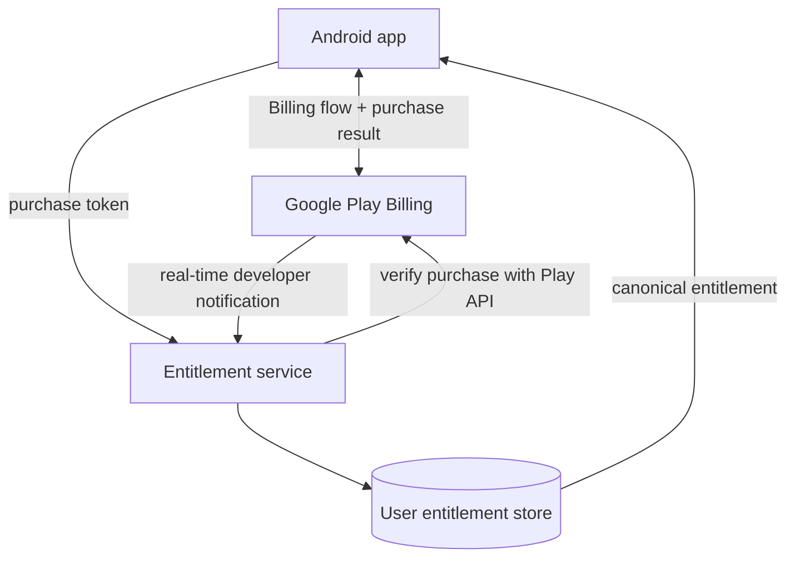
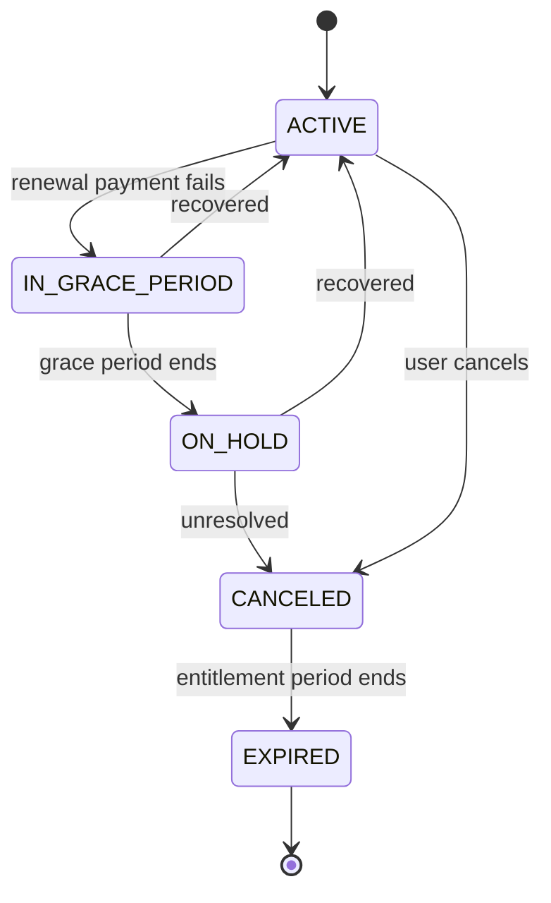

# Play Billing: IAP & Subscriptions

**The prompt:** "Design in-app subscriptions for our Android app — purchase, entitlement, renewal, involuntary churn recovery, upgrades. Assume Google Play Billing."

This is the sibling of [Payment Flow (Card Checkout)](payment-flow.md), and the first thing to establish is that they are different systems. In card checkout you own the PSP relationship, the idempotency keys, and the state machine. With Play Billing, **Google owns the payment and the renewal state machine; you own entitlement**. Your design problem is synchronizing your entitlement database with a state machine you don't control, through two channels (client library and server notifications) that can each lag or lie.

Version context (verify before an interview — this moves): Play Billing Library 9.1.0 is current as of June 2026; Play requires **PBL 8+ for all new apps and updates from August 31, 2026** (extension to November 1, 2026). That deadline is a publishing gate, not a runtime kill switch — shipped binaries keep transacting.

---

## 1. Gathering Requirements (~5 min)

### Functional Requirements

- Purchase a subscription (tiers: e.g., Basic / Premium) and one-time products.
- Entitlement reflected across all the user's devices and on the web, not just the purchasing device.
- Upgrades, downgrades, cancellation, and recovery from failed payments.

### Non-Functional Requirements

- **Entitlement correctness:** no paying user locked out (worst failure), no non-payer entitled (revenue leak, abuse vector).
- **Cross-device latency:** entitlement propagates to other devices in seconds-to-minutes (via your backend), not on next app open.
- **Auditability:** every entitlement change traceable to a Play notification or API response.

### Out of Scope (defended)

- Card checkout for physical goods — Play Billing is *required* for digital in-app goods and *prohibited* for physical ones; that flow is [Payment Flow](payment-flow.md).
- Alternative/external billing programs (region-specific: PBL 8.2/8.3 added `enableBillingProgram` APIs for external payments) — mention they exist, don't design them.
- Paywall/pricing experimentation — that's [Experimentation Platform](experimentation-platform.md).

---

## 2. The Product Model (get the vocabulary right)

Modern Play subscriptions are a three-level hierarchy — one **subscription product** ("premium") contains **base plans** (monthly, annual — each with its own price and billing period), which carry **offers** (free trials, intro pricing, win-back offers) with eligibility rules. One purchase resolves to product + base plan + offer.

Two base-plan types matter architecturally:

- **Auto-renewing** — the default; the lifecycle in §5 applies.
- **Prepaid** — no auto-renewal; the user *tops up* to extend. Acknowledgment windows are tighter (≥1-week plans: 3 days; shorter plans: half the plan duration) and a missed acknowledgment means revocation plus refund.

Installment plans (pay monthly for an annual commitment; Brazil/France/Italy/Spain) exist — know they change cancellation semantics (takes effect at commitment end, signaled by `SUBSCRIPTION_CANCELLATION_SCHEDULED`).

## 3. High-Level Architecture



The purchase token is evidence to verify, not an entitlement by itself; the backend verifies with Google Play, acknowledges or consumes when required, and owns access across devices.

Note the split by product type: subscriptions verify via `purchases.subscriptionsv2.get` and acknowledge via the subscriptions endpoint, while **one-time products have their own path** — verify via `purchases.productsv2.getproductpurchasev2`, then `purchases.products.acknowledge` for non-consumables or `purchases.products.consume` for consumables (consume also acknowledges, and re-enables repurchase). Their RTDNs are separate types too (`ONE_TIME_PRODUCT_PURCHASED`, `ONE_TIME_PRODUCT_CANCELED`). Routing a one-time token through the subscriptions endpoint fails verification.

The non-negotiable staff-level rule: **the server is the source of truth for entitlement.** The client's `queryPurchasesAsync()` is a local cache used for UX (unlock immediately on purchase, offline grace), never the authority — client-side-only entitlement is trivially defeated and can't serve the user's other devices.

Two synchronization channels, both required:

- **RTDN (Real-time developer notifications)** via Cloud Pub/Sub — Google pushes a ~1 KB message on every state change. Critically, **RTDNs are triggers, not payloads**: they tell you *that* something changed, and you must call `purchases.subscriptionsv2.get` for the actual state. Designs that parse entitlement out of the notification itself are wrong.
- **Reconciliation job** — RTDN delivery is at-least-once but your subscriber can be down; a periodic sweep of non-terminal subscriptions via the API catches drift and keeps you honest about Pub/Sub outages. Poll frugally: quota exhaustion on the Play Developer API is a real incident class.

### The acknowledgment contract

Every purchase must be **acknowledged within 3 days** or Play revokes and refunds it automatically. Acknowledge from the server, *after* you've durably granted entitlement — acknowledgment is your "I have processed this" signal, so acknowledging before the entitlement write can leak a refund-proof failure window. This ordering (verify → grant → acknowledge) is the Play analogue of the idempotency discipline in [Payment Flow](payment-flow.md).

## 4. Data Model

```
entitlements
  user_id            -- YOUR account id, not the Google one
  product_id, base_plan_id
  state              -- mirror of subscriptionsv2 state
  expiry_time        -- from Play; extends dynamically in grace period
  purchase_token     -- current token (rotates on upgrade/resubscribe!)
  linked_purchase_token -- previous token, for dedup on replacement
  acknowledged_at, updated_at, source (RTDN | RECONCILE | CLIENT)
```

Map purchases to your users with `obfuscatedAccountId` set at purchase time — it comes back in the subscription resource, which is how you attribute an out-of-app renewal or a Play-website purchase to an account. **Purchase tokens rotate**: an upgrade, downgrade, or pre-expiry resubscribe creates a *new* token whose resource carries `linkedPurchaseToken` pointing at the old one. Process replacements idempotently by retiring the linked token's entitlement when granting the new one — double-granting on upgrade is the classic bug. **Post-expiry resubscribes are the exception:** the old subscription expired completely, so there is *no* `linkedPurchaseToken` — the prior purchase surfaces instead in `outOfAppPurchaseContext` (`expiredPurchaseToken` plus the `expiredExternalAccountIdentifiers` you set originally), present only while the new purchase is unacknowledged. An entitlement service that attributes users solely via `linkedPurchaseToken` silently drops exactly the customers who came back.

Tokens remain queryable until ~60 days after expiry; after that, reconciliation can't see them, so record terminal states when they happen.

## 5. Deep Dive: The Subscription Lifecycle (~15 min)

The involuntary-churn path is where designs are judged, because it's where access and payment disagree:



Access policy follows the verified subscription state: grace generally retains access, hold revokes it, and cancellation may retain access until the paid entitlement period expires.

- **Grace period** (developer-configurable; even "0 days" keeps a minimum 1-day silent grace): user keeps full access, `expiryTime` keeps extending, Google dunning prompts the user to fix payment. Recovery here does *not* reset the billing date.
- **Account hold** (up to ~60 days minus the grace length): **revoke access now**. The subscription stops appearing in `queryPurchasesAsync()` by default — a client that treats "not in the list" as "show the resubscribe paywall" gives on-hold users a confusing double-charge path; show a "fix your payment method" state instead, driven by server entitlement. Recovery from hold *does* reset the billing date.
- **Canceled ≠ expired**: a voluntary cancel keeps access until `expiryTime`. Revoking at cancel-time is the most common self-inflicted support-ticket generator. During this window Play's "resubscribe" is a **restore** (same token, cancellation undone); after expiry it's a **resubscribe** — a new token attributed via `outOfAppPurchaseContext`, not `linkedPurchaseToken` (see §4).
- **Paused** (user-initiated, 1 week–3 months): access revoked during pause; auto-resume can fail into on-hold.

Every transition arrives as an RTDN (`SUBSCRIPTION_RENEWED`, `_IN_GRACE_PERIOD`, `_ON_HOLD`, `_RECOVERED`, `_CANCELED`, `_EXPIRED`, `_PAUSED`, …); your entitlement service is a projection of this event stream, verified against `subscriptionsv2.get` per event.

## 6. Upgrades, Downgrades, Proration

Replacement modes (set via `SubscriptionProductReplacementParams` on PBL 8.1+; the older `SubscriptionUpdateParams.setSubscriptionReplacementMode` path is deprecated — and note `ProrationMode` itself was removed back in PBL 7):

| Mode | Effect | Typical use |
|---|---|---|
| `WITH_TIME_PRORATION` (default) | Switch now; remaining value becomes extra time; next billing date shifts | Upgrade without charging today |
| `CHARGE_PRORATED_PRICE` | Switch now; charge the price difference; billing date unchanged | Upgrade, keep cycle (upgrades only) |
| `CHARGE_FULL_PRICE` | Switch now; charge full new price; remainder credited/prorated | Period change (monthly → annual) |
| `WITHOUT_PRORATION` | Switch now; new price starts at next renewal | Tier bump as a courtesy |
| `DEFERRED` | Entitlement changes only at renewal; old plan runs out first | Downgrades — never claw back mid-cycle |
| `KEEP_EXISTING` (PBL 8.1+) | Leave this item's schedule untouched | Multi-item carts with add-ons |

Staff-level defaults: **upgrades charge-prorated or time-prorated, downgrades deferred.** And remember the platform precondition: the existing purchase must already be acknowledged before Play will let you replace it.

## 7. Failure Modes

- **PENDING purchases** (cash top-ups, parental approval): enable pending-purchase handling, grant nothing until `PURCHASED` arrives — possibly days later, via RTDN, with the app closed.
- **RTDN subscriber outage:** entitlements freeze in place; grace-period users keep access (fine), recovered users stay locked out (not fine). The reconciliation sweep is the backstop; alert on Pub/Sub backlog age.
- **Acknowledgment misses** → automatic refunds three days later. Alert on `acknowledged_at IS NULL AND age > 24h`.
- **Voided purchases** (refunds/chargebacks): consume the Voided Purchases API and revoke — this is your clawback path, cross-cutting with abuse detection.
- **Connection churn on-device:** PBL 8's `enableAutoServiceReconnection()` removes most manual `SERVICE_DISCONNECTED` retry code; sub-response codes (e.g., `PAYMENT_DECLINED_DUE_TO_INSUFFICIENT_FUNDS`, `USER_INELIGIBLE`) let the UI say something more useful than "purchase failed."

## 8. Monitoring

- **Entitlement mismatch rate:** sampled diff between your DB and `subscriptionsv2.get` — the SLI for the whole design.
- **Grace→recovered vs grace→hold conversion** (involuntary-churn recovery): the business metric this system exists to protect.
- **RTDN processing lag** (publish→entitlement-write) and Pub/Sub backlog age.
- **Acknowledgment latency histogram** with alerting well inside the 3-day window; auto-refund count (should be ~0).

## 9. Security

- Never trust client-reported purchase state; verify server-side via the Play Developer API (which also handles what the client can't: refunds, revokes, defers).
- `obfuscatedAccountId` should be an opaque per-user value — not an email, not a raw user id (it flows through Play systems; treat it as pseudonymous PII).
- Replay/duplicate defense is structural: key entitlement writes by purchase token, retire `linkedPurchaseToken` predecessors idempotently.

## 10. Rollout

- Test the full matrix with **license testers**: renewal periods compress drastically (a monthly plan renews every 5 minutes, up to 6 renewals; grace period becomes 5 minutes, account hold 10), so the whole involuntary-churn path is testable in an afternoon — and **Play Billing Lab** can force state transitions directly.
- Ship the entitlement service consuming RTDN *before* the client paywall; run it in shadow mode against existing purchases to validate the projection.
- Keep the paywall behind a remote-config kill switch; a billing regression is a revenue incident, and app rollback ships at Play-review speed, not incident speed (see [Kill Switches](../release-engineering/kill-switches.md)).

## 11. Further Reading

- [Play Billing overview & getting ready](https://developer.android.com/google/play/billing/getting-ready) — RTDN setup, server API, acknowledgment rules
- [Subscription lifecycle](https://developer.android.com/google/play/billing/lifecycle/subscriptions) — states, notifications, restore vs resubscribe
- [Subscriptions: base plans, offers, replacement modes](https://developer.android.com/google/play/billing/subscriptions)
- [Billing Library release notes](https://developer.android.com/google/play/billing/release-notes) — current version and API changes
- [Billing Library version deprecation](https://developer.android.com/google/play/billing/deprecation-faq) — the PBL 8+ deadline mechanics
