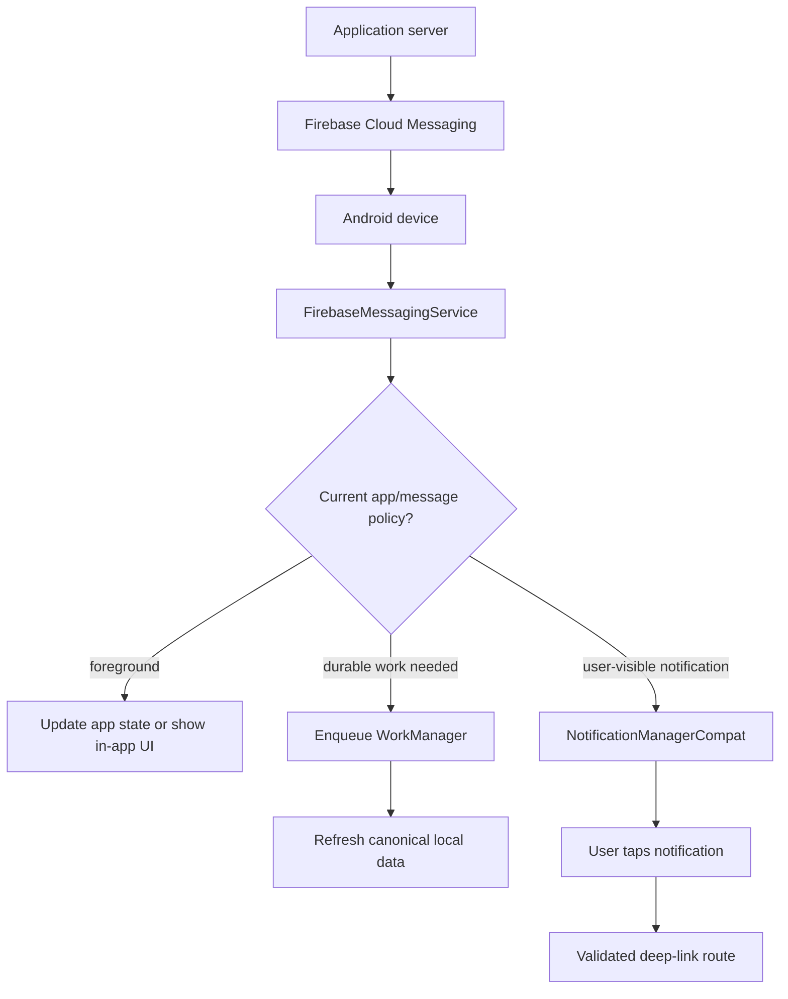
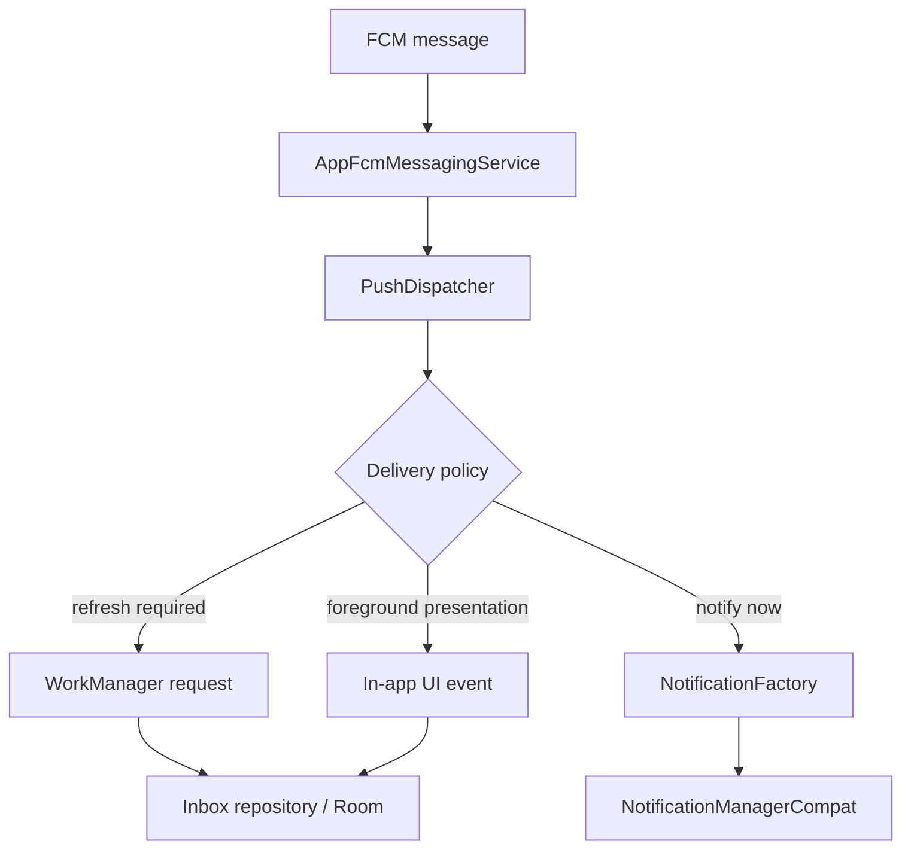

# Push Notifications (FCM Client-Side)

> A 45-60 minute mobile system-design walkthrough for the Android *client* side of push: FCM token lifecycle, data vs notification messages, MessagingStyle, channels, deep linking, and OEM kill resilience. The server-side delivery fan-out is the next file (`notification-system.md`).

---

## 1. Gathering Requirements (~5 min)

> **Interviewer:** "Design how the app receives and displays push notifications."
> **Candidate:** "The client-side problems are: token registration with backend, data vs notification choice, lifecycle (foreground vs background vs killed), MessagingStyle, deep links, and the OEM-kill problem. I'll deep-dive the receive pipeline."

### Functional Requirements
- **Register FCM token** with backend on install / token rotation.
- **Receive data messages** when the app is foreground, background, killed.
- **Display rich notifications** (`MessagingStyle`, large image, actions).
- **Tap to deep-link** to the right screen with the right state.
- **Channels + groups** so users can mute categories.

### Non-Functional Requirements
- **Always-on**: notifications must arrive even if the app is killed.
- **Battery**: no polling, no background socket for the sake of notifications.
- **Privacy**: notification content respects lock-screen visibility settings.
- **OEM resilience**: best-effort delivery on aggressive vendors (Xiaomi, OPPO, Vivo).
- **Compliance**: notification permission flow (Android 13+).

### Out of Scope
- Server-side delivery infrastructure (see `notification-system.md`)
- Web push / desktop
- iOS APNs (separate stack entirely)
- In-app messages (Braze-style overlays)
- Notification analytics dashboards

---

## 2. Clarifying Questions (~3 min)

| Question | Why it matters |
|---|---|
| FCM only or also vendor pushes (HMS for Huawei)? | Token model, sender abstraction |
| Notification content sensitivity? | Lock-screen visibility per channel |
| Are notifications also visible in an in-app inbox? | Need a Room mirror |
| Localization done server-side or client-side? | Payload size, dynamic strings |
| Need direct reply (chat)? | `RemoteInput` integration |
| Android API floor (esp. 13+ for `POST_NOTIFICATIONS`)? | Permission rationale UX |
| OEM markets of concern? | Vendor-specific guides to whitelist |

> **Candidate:** "FCM only for now; client-side localization; in-app inbox mirror; Android 9-14; direct reply for chat; emerging markets including India + LatAm."

---

## 3. High-Level Diagram (~10 min)



FCM is a delivery hint, not the source of truth: route foreground behavior explicitly, hand durable work to WorkManager, and make notification taps enter through the same validated link path as any external URL.

**Components:**
- **`FcmTokenService`** — fetches and uploads FCM token to BFF; handles rotation.
- **`AppFcmMessagingService`** — extends `FirebaseMessagingService`; receives data messages.
- **`PushDispatcher`** — decides foreground vs background; chooses worker or direct notify.
- **`NotificationFactory`** — builds `Notification` with style, actions, deep-link `PendingIntent`.
- **`InboxRepository`** — mirrors notifications to Room for in-app inbox.

---

## 4. API Contract

### FCM token registration

```http
POST /v1/devices
Authorization: Bearer …
{ "fcmToken": "ey…", "platform": "android", "appVersion": "4.12.1",
  "locale": "en-IN", "tz": "Asia/Kolkata" }

200 OK
{ "deviceId": "d_42" }
```

> Token uploaded on (a) first sign-in, (b) `onNewToken`, (c) every fresh launch (cheap idempotent confirm).

### Data message (server → FCM → app)

```json
{
  "to": "<fcm-token>",
  "priority": "high",
  "data": {
    "type": "chat.message",
    "convId": "c_42",
    "serverId": "m_991",
    "sender": "Sam",
    "previewBody": "yo",
    "deepLink": "myapp://chat/c_42?message=m_991"
  }
}
```

> **We send `data` messages, not `notification` messages.** The client decides whether and how to show a notification (mute settings, in-app banner, etc.).

### Categories → channels

| Category | Channel ID | Default importance |
|---|---|---|
| Chat — DM | `chat_dm` | HIGH (sound + heads-up) |
| Chat — group | `chat_group` | DEFAULT |
| Promotion | `promo` | LOW (silent) |
| Account / security | `account_security` | HIGH (cannot be silenced) |
| Order update | `order_update` | DEFAULT |

---

## 5. Mobile App Architecture

### Module structure

```
:app                         ← registers FCM service in manifest
:core:notifications          ← service, dispatcher, factory, channels
:core:network                ← device registration API
:core:work                   ← workers for decrypt/fetch flows
:feature:inbox               ← in-app notification list
:data:notifications          ← Room mirror
```

### Layered diagram



The dispatcher converts an untrusted transport payload into an application policy decision; repositories hold durable state, while presentation paths remain replaceable and testable.

Validated against: [Receive messages in an Android app](https://firebase.google.com/docs/cloud-messaging/android/receive) and [WorkManager](https://developer.android.com/topic/libraries/architecture/workmanager).

### Key class signatures

```kotlin
class AppFcmMessagingService : FirebaseMessagingService() {
    @Inject lateinit var dispatcher: PushDispatcher

    override fun onMessageReceived(message: RemoteMessage) {
        dispatcher.handle(message.data)
    }

    override fun onNewToken(token: String) {
        FcmTokenRegistrar.uploadAsync(token)
    }
}

interface PushDispatcher {
    fun handle(data: Map<String, String>)
}
```

---

## 6. Local Storage (Inbox mirror)

```kotlin
@Entity(tableName = "inbox_items")
data class InboxItem(
    @PrimaryKey val id: String,        // server message id
    val type: String, val title: String, val body: String,
    val deepLink: String?, val imageUrl: String?,
    val receivedAt: Long, val readAt: Long?,
    val payloadJson: String
)
```

The inbox is for an in-app "Notifications" screen. The OS notification shade is the OS's view; the inbox is *our* view, and they're synced via this Room mirror.

---

## 7. Deep Dive: Receive Pipeline (~15 min)

> *I'd pick this as the deep dive because it covers: data-vs-notification choice, foreground vs background routing, lifecycle constraints on `FirebaseMessagingService`, WorkManager handoff for non-trivial work, MessagingStyle assembly, and deep-link integrity.*

### `FirebaseMessagingService` lifecycle

- Called on a background thread.
- Has ~10 seconds before Android can kill it.
- Cannot do long work (decrypt + network fetch + image download in 10s on a cold start? Risky).
- **Pattern:** offload to `WorkManager` immediately; service returns fast.

```kotlin
class AppFcmMessagingService : FirebaseMessagingService() {
    @Inject lateinit var dispatcher: PushDispatcher
    override fun onMessageReceived(message: RemoteMessage) {
        dispatcher.handle(message.data)
    }
}
```

### Dispatcher

```kotlin
class DefaultPushDispatcher @Inject constructor(
    private val workManager: WorkManager,
    private val notifier: SimpleNotifier,
    private val foreground: ForegroundObserver,
) : PushDispatcher {

    override fun handle(data: Map<String, String>) {
        val type = data["type"] ?: return
        val needsWork = type in setOf("chat.message", "order.update")    // needs fetch/decrypt
        if (foreground.isAppInForeground() && type == "chat.message") {
            inAppBus.publish(data)   // in-app banner; no system notification
            return
        }
        if (needsWork) {
            workManager.enqueue(
                OneTimeWorkRequestBuilder<DecryptAndNotifyWorker>()
                    .setInputData(workDataOf("data" to data.toJson()))
                    .setExpedited(OutOfQuotaPolicy.RUN_AS_NON_EXPEDITED_WORK_REQUEST)
                    .build()
            )
        } else {
            notifier.notifySimple(data)
        }
    }
}
```

### Worker (heavy lifting)

```kotlin
@HiltWorker
class DecryptAndNotifyWorker @AssistedInject constructor(
    @Assisted ctx: Context, @Assisted params: WorkerParameters,
    private val chatRepo: ChatRepository,
    private val factory: NotificationFactory,
    private val inboxRepo: InboxRepository,
) : CoroutineWorker(ctx, params) {

    override suspend fun doWork(): Result {
        val data = inputData.getString("data")?.fromJson<Map<String, String>>()
            ?: return Result.failure()
        val decrypted = chatRepo.decryptIncoming(data)
        chatRepo.persist(decrypted)             // Room write → UI updates if foreground
        inboxRepo.insert(decrypted.toInbox())
        val notification = factory.buildChat(decrypted)
        NotificationManagerCompat.from(applicationContext)
            .notify(decrypted.notificationTag(), CHAT_NOTIF_ID, notification)
        return Result.success()
    }
}
```

### MessagingStyle for chat

```kotlin
fun NotificationFactory.buildChat(msg: ChatMessage): Notification {
    val person = Person.Builder().setName(msg.senderName).build()
    val style = NotificationCompat.MessagingStyle(person)
        .addMessage(msg.text, msg.timestamp, person)

    val replyIntent = ReplyReceiver.intentFor(applicationContext, msg.convId)
    val reply = NotificationCompat.Action.Builder(
        R.drawable.ic_send, "Reply",
        PendingIntent.getBroadcast(applicationContext, msg.convId.hashCode(), replyIntent,
            PendingIntent.FLAG_MUTABLE or PendingIntent.FLAG_UPDATE_CURRENT)
    )
        .addRemoteInput(RemoteInput.Builder(KEY_REPLY).setLabel("Message").build())
        .setAllowGeneratedReplies(true)
        .build()

    return NotificationCompat.Builder(applicationContext, Channels.CHAT_DM)
        .setSmallIcon(R.drawable.ic_chat)
        .setStyle(style)
        .setContentIntent(deepLinkPendingIntent(msg))
        .addAction(reply)
        .setAutoCancel(true)
        .build()
}
```

### Deep-link `PendingIntent`

```kotlin
fun deepLinkPendingIntent(msg: ChatMessage): PendingIntent {
    val intent = Intent(Intent.ACTION_VIEW, Uri.parse(msg.deepLink)).apply {
        flags = Intent.FLAG_ACTIVITY_NEW_TASK or Intent.FLAG_ACTIVITY_CLEAR_TOP
    }
    return PendingIntent.getActivity(
        applicationContext, msg.id.hashCode(),
        intent,
        PendingIntent.FLAG_IMMUTABLE or PendingIntent.FLAG_UPDATE_CURRENT
    )
}
```

> `FLAG_IMMUTABLE` is mandatory on Android 12+.

### Channel registration (one-time, idempotent)

```kotlin
class NotificationChannels @Inject constructor(@ApplicationContext ctx: Context) {
    init {
        val mgr = ctx.getSystemService(NotificationManager::class.java)
        listOf(
            channel(CHAT_DM, "Direct messages", IMPORTANCE_HIGH),
            channel(ORDER_UPDATE, "Order updates", IMPORTANCE_DEFAULT),
            channel(PROMO, "Promotions", IMPORTANCE_LOW),
        ).forEach(mgr::createNotificationChannel)
    }
}
```

### Permission flow (Android 13+)

```kotlin
val launcher = registerForActivityResult(ActivityResultContracts.RequestPermission()) { granted ->
    analytics.log("notif_permission_${if (granted) "granted" else "denied"}")
}
LaunchedEffect(Unit) {
    if (Build.VERSION.SDK_INT >= 33 &&
        ContextCompat.checkSelfPermission(ctx, POST_NOTIFICATIONS) != PERMISSION_GRANTED) {
        // Show rationale first, then request
        if (shouldShowRationale) showRationale()
        launcher.launch(POST_NOTIFICATIONS)
    }
}
```

### Failure modes

| What breaks | Behavior |
|---|---|
| App killed by OEM | FCM still delivers (mostly); WorkManager picks up |
| Token rotated | `onNewToken` re-uploads |
| Notification disabled by user | App still receives data; in-app inbox stays in sync |
| User taps notification while app is killed | Cold-start with deep-link Intent; nav graph resolves |
| Direct reply over flaky network | `Reply` worker queues; outbox covers send |
| Notification arrives but image download fails | Notification shown without large image; retry on next fetch |

---

## 8. Trade-offs

### Data vs notification message

| Type | When server controls display | When client controls display | Verdict |
|---|---|---|---|
| `notification` | Yes (auto-shown when backgrounded) | No (no `onMessageReceived` when backgrounded) | Skip for any rich logic |
| **`data`** | No | Yes (always reaches the service) | Pick — total control |

### Service work pattern

| Option | Verdict |
|---|---|
| All work in `onMessageReceived` | Risky — 10s limit |
| **Handoff to `WorkManager`** | Pick — survives, can be expedited |
| Foreground service for heavy decrypt | Overkill; risks `ForegroundServiceStartNotAllowedException` |

### Backend transport

| Choice | Pick | Reason |
|---|---|---|
| **FCM HTTP v1** | Yes | Modern, scoped tokens |
| Legacy FCM | No | Deprecated |
| Self-hosted MQTT | Skip | Loses background delivery |
| HMS (Huawei) | Add if you ship to Huawei devices |

### Channel granularity

| Strategy | Verdict |
|---|---|
| **One channel per user-meaningful category** | Pick — clean settings UI |
| One channel total | User can't mute categories |
| One channel per conversation | OS limit + user overload |

### Notification UX

| Element | Pick |
|---|---|
| Style for chat | `MessagingStyle` |
| Style for media | `BigPictureStyle` |
| Style for text | `BigTextStyle` |
| Action button | `Reply` (RemoteInput), `Snooze`, `Mark Read` |

---

## 9. Major Concerns

- **OEM kill.** Aggressive battery savers on Xiaomi/OPPO/Vivo kill the app and may not wake on FCM. Document; provide in-app "trust this app" guide; consider HMS push on Huawei.
- **Token rotation.** `onNewToken` fires; re-upload immediately. Backend keeps multiple tokens per user (one per device).
- **Privacy.** `setVisibility(VISIBILITY_PRIVATE)` for sensitive content; provide a per-channel visibility override.
- **Permission UX.** Don't request on first launch. Request when user has done something meaningful (subscribed, opted into chat).
- **Channels are forever.** Once created, the user controls them. Don't proliferate channels you can't justify.
- **Deep link integrity.** Validate the deep link target before nav. Don't trust the FCM payload blindly (server signed payloads if security matters).
- **Battery.** No background polling, no socket. FCM is the entire transport.
- **Inbox sync.** Notification dismissals don't sync to the inbox; users may see dupes. Provide explicit "mark read" actions.

---

## 10. Follow-up Questions

> **Q: User signs out — what happens to the FCM token?**
> Call `FirebaseMessaging.deleteToken()`. Server-side, remove the device row. New sign-in fetches a fresh token (and a new server `deviceId`).

> **Q: Notification delivered while app is foreground — do we show a heads-up?**
> No. Suppress system notification, render in-app banner instead. Avoids redundant noise.

> **Q: What if the user enables battery optimisation for our app?**
> FCM high-priority data messages bypass Doze (with quota). Document the limitation. Build a settings nudge for users in critical flows.

> **Q: How does this interact with Android Auto / wearables?**
> `Notification.CarExtender` for Auto; `NotificationCompat.WearableExtender` for Wear. Reuse the same channel. Reply actions surface as voice on Wear.

> **Q: How do you test push end-to-end?**
> Firebase Console "Send test message" with a real device token. Integration test: fake `FirebaseMessagingService` shim that dispatches a `RemoteMessage` directly; assert notification was posted via `NotificationManagerCompat`.

> **Q: User uninstalls — what about the token?**
> FCM eventually returns `UNREGISTERED` to the server, which then prunes the row. We don't get a callback.

---

## 11. Out of Scope (defended)

- **Server delivery fan-out** — see `notification-system.md`.
- **iOS / web push** — different transports.
- **In-app messages** — Braze/Iterable-style overlays, separate SDK pattern.
- **Notification analytics dashboards** — observability concern.
- **HMS / vendor pushes** — slot-in via a `PushTransport` interface; not architectural.

---

## 12. Further Reading

- [Android Developers — Notifications overview](https://developer.android.com/develop/ui/views/notifications) — official guide.
- [Firebase Cloud Messaging — Android setup](https://firebase.google.com/docs/cloud-messaging/android/client) — service registration, token lifecycle.
- [Android Developers — MessagingStyle + RemoteInput](https://developer.android.com/develop/ui/views/notifications/build-notification) — direct reply patterns.
- [Don't kill my app](https://dontkillmyapp.com/) — OEM behavior catalog.
- [Android Developers — POST_NOTIFICATIONS permission](https://developer.android.com/develop/ui/views/notifications/notification-permission) — Android 13+ runtime permission.

---

> **Closing in the interview:** "Receive pipeline was my deep dive because the service-lifecycle constraint and the WorkManager handoff are where novice implementations fail. Happy to dig into the inbox/notification reconciliation, OEM workarounds, or direct-reply send flow next."
