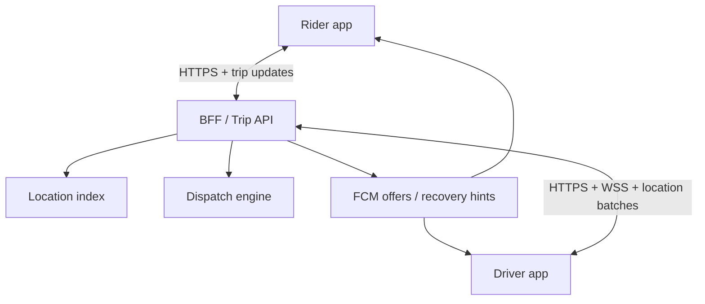
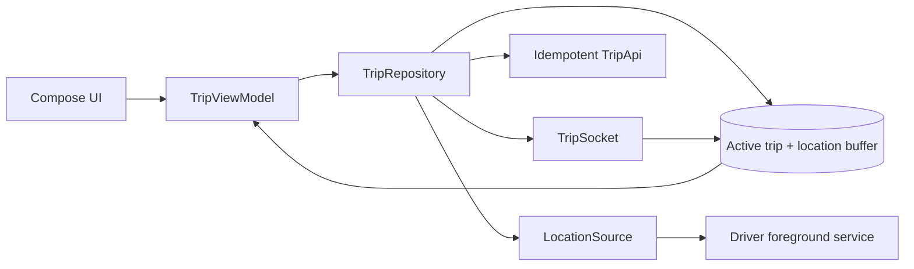
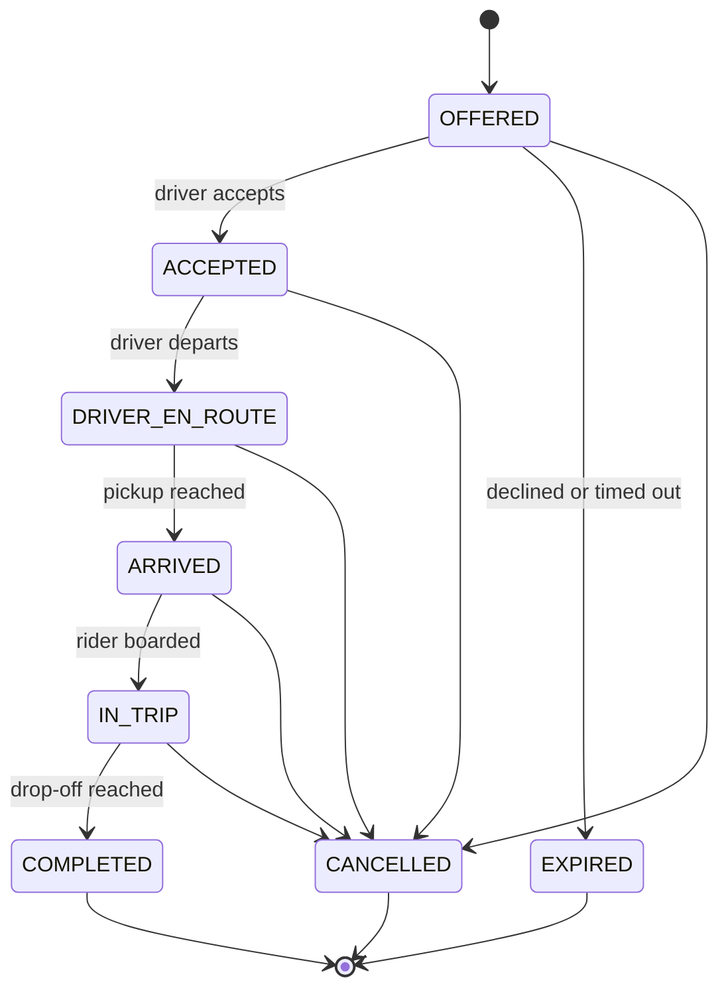

# Ride-Hailing (Uber / Lyft-style)

> A 45-60 minute mobile system-design walkthrough for a ride-hailing client (Android-first). The dispatch algorithm, H3 hexagonal indexing, and surge engine live on the backend — the bulk of this file is what the *Android apps* (rider + driver) do: location streaming, foreground service discipline, the trip state machine, and battery survival.

---

## 1. Gathering Requirements (~5 min)

> **Interviewer:** "Design a ride-hailing app like Uber."
> **Candidate:** "Two clients, very different battery profiles: rider is bursty, driver streams location continuously. I'll deep-dive driver location streaming + the trip state machine, since that's the hard mobile problem."

### Functional Requirements
- **Rider:** request a ride, see nearby cars on a map, get matched, track driver, complete trip.
- **Driver:** go online, receive offers, accept/decline, navigate to pickup, complete trip.
- **Both apps:** real-time location updates, in-trip ETAs, push notifications for state changes.

### Non-Functional Requirements
- **Driver app must last a shift** (8-12 hours) — battery is critical. A single charge only covers that below about 8% per hour; otherwise assume a car charger.
- **Trip state machine must be authoritative server-side**, with both apps converging on the same state.
- **Location accuracy** under 50 m in city, under 100 m on highway.
- **Offline tolerance** — queue location pings; don't lose a trip if a tunnel kills signal for 2 minutes.
- **Compliance** — show driver earnings, surge transparency, post-trip receipts.

### Out of Scope
- Pricing / surge calculation (server-side)
- Background fare estimation
- Driver onboarding, document verification
- In-app chat (separate file — see `chat-messaging.md`)
- Payment (separate file — see `payment-flow.md`)
- Route optimization internals (we call the routing SDK as a black box)

---

## 2. Clarifying Questions (~3 min)

| Question | Why it matters |
|---|---|
| Rider or driver app focus? | Different lifecycle, different battery profile |
| Geography / market? | GPS accuracy expectations vary by density |
| Android API floor? | Foreground service rules, location permission tiers |
| Trip density per driver per hour? | Local cache, push frequency |
| Two-way chat in scope? | Reuse chat module or scope out |
| Maps SDK? | Google Maps SDK, Mapbox, or HERE |
| Routing/navigation in-app or hand off? | If in-app, use a navigation SDK and check its terms; hand-off is simpler |
| Fleet partner integrations? | Identity, trip handoff |

> **Candidate:** "Focus on driver app primarily, rider as secondary. Google Maps SDK + Routes API with hand-off to a navigation app, urban + suburban, 1-2 trips/hour for a typical driver, Android 9+, in-app chat reuses the messaging stack."

---

## 3. High-Level Diagram (~10 min)



The Trip API owns canonical state, the location index and dispatch engine support matching, and push only wakes clients that must recover the current trip version.

**Server-side (named, not designed):**
- **BFF / Trip API** — auth, trip CRUD, websocket fan-out.
- **Location Index** — H3 hex index of online drivers (black box).
- **Dispatch Engine** — picks driver for rider request (black box).
- **Push (FCM)** — high-priority offers, state changes.

---

## 4. API Contract

### Driver location upstream (frequent)

```json
POST /v1/driver/location          // batch: each ping on a trip, up to 20 s apart when idle
{
  "pings": [
    { "id": "p_01", "lat": 37.7749, "lng": -122.4194, "accuracy": 5.2,   // id lets the server drop resent pings
      "speed": 12.3, "bearing": 95, "t": 1750000000123 },
    { "id": "p_02", "lat": 37.7751, "lng": -122.4192, "accuracy": 4.8, ..., "t": 1750000004123 }
  ],
  "tripId": "t_42"   // null if not on trip
}
```

### Trip state (server → both apps, via WebSocket)

```json
{ "type": "trip.update", "tripId": "t_42",
  "state": "DRIVER_EN_ROUTE",       // OFFERED, EXPIRED, ACCEPTED, DRIVER_EN_ROUTE, ARRIVED, IN_TRIP, COMPLETED, CANCELLED
  "driver": { "lat": ..., "lng": ..., "eta": 240, "bearing": 95 },
  "v": 7                              // monotonic version
}
```

### Trip commands (REST)

| Method | Path | Use |
|---|---|---|
| `POST` | `/v1/trips` | Request a ride (`Idempotency-Key` header) |
| `GET` | `/v1/trips/{id}` | Poll/recover canonical state |
| `GET` | `/v1/trips/active` | The signed-in user's current trip, for recovery when Room has none |
| `POST` | `/v1/trips/{id}/cancel` | Idempotent cancel |
| `POST` | `/v1/trips/{id}/transitions` | Driver accept, decline, depart, arrive, start, complete. Body has `commandId`, `to` and `expectedVersion` |
| `GET` | `/v1/drivers/nearby?lat=…&lng=…` | Map ghosts (rate-limited) |

### Driver offer (FCM data message)

```json
{ "type": "ride.offer", "tripId": "t_42", "expiresAt": 1750000020000,
  "pickup": {"lat": ..., "lng": ...}, "estPay": "$8.50" }
```

> **Idempotency:** rider's `POST /v1/trips` uses an `Idempotency-Key` so a retry after a dropped response doesn't create two trip requests. Driver commands do the same with `commandId`: a retried accept returns the first result. The server rejects an accept after `expiresAt`, whatever the client believes.

---

## 5. Mobile App Architecture (~10 min)

### Module structure (shared across two apps)

```
:app-rider
:app-driver
:feature:map               ← shared map composable
:feature:trip              ← shared state-machine UI
:feature:driver-online     ← driver-only: go-online toggle
:feature:rider-request     ← rider-only: pickup/dropoff entry
:core:network              ← OkHttp + Retrofit + WebSocket
:core:database             ← Room
:core:location             ← Fused + foreground service
:core:notifications        ← FCM + MessagingStyle
:core:work                 ← LocationFlushWorker
:domain:trip
:data:trip
```

### Layered diagram



All REST, socket, and location updates reconcile through a versioned active-trip record, preventing two transports from independently driving UI state.

### Key class signatures

```kotlin
interface TripRepository {
    fun activeTrip(): Flow<Trip?>
    suspend fun request(pickup: LatLng, dropoff: LatLng): Result<Trip>
    suspend fun cancel(tripId: String): Result<Unit>
    suspend fun transition(tripId: String, to: TripState): Result<Trip>   // commandId saved before sending
    suspend fun recoverActive(): Trip?                                    // GET /v1/trips/active into Room
    fun connectionState(): StateFlow<ConnectionState>
}

interface LocationSource {
    fun stream(intervalMs: Long = 4_000, accuracy: Priority): Flow<Location>
    suspend fun lastKnown(): Location?
}
```

---

## 6. Local Storage (Room)

```kotlin
// Trips and location history belong to one account.
@Entity(tableName = "trips", primaryKeys = ["ownerId", "id"])
data class TripEntity(
    val ownerId: String, val id: String,
    val state: TripState, val role: Role,           // RIDER, DRIVER
    val pickupLat: Double, val pickupLng: Double,
    val dropoffLat: Double, val dropoffLng: Double,
    val driverId: String?, val riderId: String?,
    val version: Int, val updatedAt: Long
)

@Entity(tableName = "location_buffer")
data class LocationPing(
    @PrimaryKey val id: String, val ownerId: String, val tripId: String?,
    val lat: Double, val lng: Double, val accuracy: Float,
    val speed: Float, val bearing: Float, val t: Long
)

@Entity(tableName = "pending_trip_commands")
data class PendingTripCommand(
    @PrimaryKey val commandId: String, val ownerId: String, val tripId: String?,
    val type: String, val payloadJson: String, val createdAt: Long
)
```

Pings are deleted once the server acknowledges them, because a precise location trail shouldn't outlive its purpose. At 4 s over a 12-hour shift it would otherwise reach about 10,800 rows. A flush takes `ownerId` as immutable input, selects only that owner's rows, and gets credentials for that owner, with the network layer refusing any other token. So one driver's pings can never upload under another's token, even if the account changes mid-request. Sign-out tries a final flush for that account, then deletes its rows.

> **Probing Q:** "Why buffer locations in Room and not in memory?" Because tunnels exist. A driver going under a 90-second tunnel must not lose their location trail — the worker drains the buffer on reconnect.

---

## 7. Deep Dive: Driver Location Streaming + Trip State Machine (~15 min)

> *Driver-side location is a continuous foreground operation. Getting it wrong drains the battery, gets the app killed by OEMs, or — worst — drops the trip mid-route. The state machine is the second pillar: both apps must converge on the same authoritative state from the server.*

### Foreground service for active drivers

```kotlin
class DriverLocationService : LifecycleService() {
    private var job: Job? = null

    override fun onStartCommand(intent: Intent?, flags: Int, startId: Int): Int {
        super.onStartCommand(intent, flags, startId)
        try {
            ServiceCompat.startForeground(
                this, NOTIF_ID, buildOngoingNotification(),
                FOREGROUND_SERVICE_TYPE_LOCATION
            )
        } catch (e: RuntimeException) {   // SecurityException or ForegroundServiceStartNotAllowedException
            showTapToResumeTrackingNotification()
            stopSelf(startId)
            return START_NOT_STICKY
        }
        if (job == null) {                // a redelivered start must not add a second collector
            job = lifecycleScope.launch {
                val owner = session.driverId() ?: run { stopSelf(); return@launch }
                locationSource.stream(intervalMs = 4_000, Priority.HIGH_ACCURACY)
                    .collect { loc ->
                        // Read from Room: an in-memory trip ID would be null after a restart.
                        bufferDao.insert(loc.toEntity(owner, tripId = tripDao.activeTripId(owner)))
                        flushIfDue()
                    }
            }
        }
        return START_REDELIVER_INTENT
    }
}
```

`FOREGROUND_SERVICE_TYPE_LOCATION` is mandatory on Android 14+, along with the `FOREGROUND_SERVICE` and `FOREGROUND_SERVICE_LOCATION` permissions. The service runs only while the driver is online or on a trip — never otherwise.

Start it from the visible "Go online" tap. Android 14+ restricts creating a location foreground service from the background. It needs `ACCESS_BACKGROUND_LOCATION`, or a start on the separate [while-in-use exemption list](https://developer.android.com/develop/background-work/services/fgs/restrictions-bg-start#wiu-restrictions), such as a notification interaction or a system component. An FCM message may allow a normal background start but isn't on that list by itself, so it can't reliably restart tracking for a driver who chose "While using the app". Whether a system restart after a kill keeps location access needs testing on real devices. `START_REDELIVER_INTENT` asks for a restart but doesn't guarantee one. The driver gets a "tap to resume tracking" notification, and the server treats a driver with no recent ping as unavailable.

### LocationSource over Fused Provider

```kotlin
class FusedLocationSource @Inject constructor(
    private val client: FusedLocationProviderClient,
) : LocationSource {
    override fun stream(intervalMs: Long, accuracy: Priority): Flow<Location> = callbackFlow {
        val request = LocationRequest.Builder(intervalMs)
            .setPriority(accuracy.toFused())
            .setWaitForAccurateLocation(false)   // no minimum distance: stationary detection needs samples
            .build()
        val cb = object : LocationCallback() {
            override fun onLocationResult(r: LocationResult) {
                r.locations.forEach { trySend(it) }
            }
        }
        client.requestLocationUpdates(request, cb, Looper.getMainLooper())
        awaitClose { client.removeLocationUpdates(cb) }
    }
}
```

### Batching + upstream flush

| Condition | Action |
|---|---|
| On a trip AND online | POST each ping, so the rider's dot stays within a few seconds |
| Idle AND online | POST at 5 pings or 20 s, whichever comes first, so a part-filled buffer still goes out |
| Network drops | Stop POSTing; pings accumulate in Room |
| Reconnect | Flush oldest-first; delete rows once acknowledged |
| App backgrounded but on trip | Service stays alive (notification visible) |
| Trip ends | Stop service after final ping flushed |

### Battery discipline

- **Adaptive interval:** 4 s normal, 10 s when stationary (speed < 1 m/s for 60 s), 1 s when ETA < 30 s to next state transition.
- **Doze + App Standby Buckets:** a foreground service keeps the app out of App Standby's idle state, but it isn't a blanket Doze exemption, and a driver waiting with the phone parked and the screen off is the case to test. "Online" always means the foreground service is running. Periodic WorkManager (15-minute minimum) and background location (a few updates an hour) are far too stale for dispatch.
- **Wake lock:** none by default. Neither the notification nor the service keeps the CPU awake by itself, so test that samples keep arriving with the screen off, and add a bounded lock only if they stop.
- **CPU:** all map drawing on the GPU surface; never decode polylines on the main thread.

### Trip state machine



Only the server advances the canonical trip version; clients render legal transitions and recover with a snapshot when an event is missed or arrives out of order.

The **server is authoritative**. Both apps receive `trip.update` over WebSocket; if local optimistic state diverges from `v` versioning, server wins.

```kotlin
@Composable
fun TripScreen(vm: TripViewModel = hiltViewModel()) {
    val trip by vm.trip.collectAsStateWithLifecycle()
    when (trip?.state) {
        OFFERED          -> OfferSheet(trip, vm::accept, vm::decline)
        ACCEPTED, DRIVER_EN_ROUTE -> NavigateToPickupMap(trip)
        ARRIVED          -> WaitingForRider(trip)
        IN_TRIP          -> NavigateToDropoffMap(trip)
        COMPLETED        -> ReceiptSheet(trip)
        CANCELLED        -> CancelledSheet(trip)
        EXPIRED, null    -> HomeMap()
    }
}
```

### WebSocket lifecycle (driver app on duty)

| Event | Action |
|---|---|
| Driver toggles "go online" | Start foreground service + connect socket |
| App backgrounded, online or on trip | Keep socket; service maintains foreground state |
| Socket unavailable while online | FCM `ride.offer` is the backup; it needs a visible notification and carries `expiresAt` |
| Socket drop | Exponential backoff with jitter (1, 2, 4, 8 s, capped at 30 s) |
| Network restored | Reconnect, request `/v1/trips/{id}` to reconcile any missed state |
| Driver goes offline | Disconnect socket, stop service |

### Failure modes

| What breaks | Behavior |
|---|---|
| Tunnel (60-120 s no signal) | Buffer pings in Room; flush on reconnect; trip resumes |
| OEM kills the service | Foreground notification + `FOREGROUND_SERVICE_TYPE_LOCATION` reduce this; warn driver in onboarding; the server marks the driver stale when pings stop |
| Tracking can't restart from the background | Catch the exception; tapping the "tap to resume tracking" notification restarts it through an exempt path |
| Process death mid-trip | On launch, `activeTrip()` Flow restores UI; if Room has no trip, `recoverActive()` asks the server; reconcile via REST |
| Offer accepted after it expired | Server rejects the command; client shows "offer expired" |
| GPS lost (urban canyon) | Show stale-location badge; fall back to network location |
| Driver rejects offer twice in a row | Server takes them off the queue briefly |
| Rider cancels after pickup | State → CANCELLED; driver app shows reason |

---

## 8. Trade-offs

### Location API

| Option | Pros | Cons | Verdict |
|---|---|---|---|
| **FusedLocationProviderClient** | Best accuracy/battery balance, batching | Google Play Services dependency | Pick this |
| `LocationManager` (raw) | No GMS | Worse accuracy, more battery | Last-resort |
| Periodic WorkManager | Battery-friendly | 15-minute minimum; too stale for dispatch or a trip | Only for non-dispatch sync |
| FLP `getCurrentLocation` | One-shot fix | Not a stream | Use for one-shots |

### Background execution

| Option | When |
|---|---|
| **Foreground Service (LOCATION)** | Driver online, waiting for offers or on a trip |
| WorkManager periodic | Non-location sync only; not for an online driver's position |
| Plain background | Forbidden by platform for high-frequency location |
| Geofence APIs | "Driver arrived near pickup" event (low-power) |

### Real-time trip updates

| Option | Pros | Cons | Verdict |
|---|---|---|---|
| **WebSocket** | Low latency, bidirectional | Battery in deep background | Pick — foreground while on duty |
| **FCM push** | Can reach a stopped service, unless the user force-stopped the app | Deprioritized if it shows no notification or notifications are off | Pick — as the backup path for offers |
| Polling | Trivial | Awful latency + battery | Skip |
| SSE | One-way | Can't send acks on same channel | Skip |

### Map SDK

| Option | Verdict |
|---|---|
| **Google Maps SDK + Routes API** | Pick for most regions — mature, polylines, traffic. For in-app guidance, use the Navigation SDK or hand off; check the [Maps Platform terms](https://cloud.google.com/maps-platform/terms) before building your own |
| Mapbox | Strong for custom styling, fewer GMS dependencies |
| HERE | Useful in fleet / enterprise contexts |
| OSMDroid | Acceptable if you must avoid Google but lacks polish |

### Idempotency for trip request

| Option | Verdict |
|---|---|
| **Client UUID `Idempotency-Key`** | Pick — same retry, same trip |
| Server-generated trip ID after creation | Doesn't help with retries before ID exists |

---

## 9. Major Concerns

- **Battery.** Adaptive intervals, foreground service only when on duty, no wake lock unless testing proves one is needed. Target < 8% drop per active hour on a modern device, which a 12-hour shift only just survives.
- **OEM kill.** Xiaomi/OPPO/Vivo aggressively kill location services. Mitigations: foreground service + persistent notification, in-app guide to whitelist the app, FCM offers as a backup path, and server-side staleness so a silent driver stops receiving offers.
- **Permissions UX.** Request `ACCESS_FINE_LOCATION` first. A location foreground service started from "Go online" counts as foreground location. Request `ACCESS_BACKGROUND_LOCATION` separately only if tracking must restart from the background, and expect Play's review of that permission. Explain *why* in the rationale dialog. Handle "Approximate only" gracefully (degrade to coarse markers).
- **Process death mid-trip.** Room holds what the client knows, and the server is the truth. On launch, `activeTrip()` Flow rehydrates UI, and `recoverActive()` fills the gap if the crash came before Room was written. `START_REDELIVER_INTENT` asks for a service restart; if none comes, the driver resumes it from the app or a notification.
- **Map performance.** Tile cache + polyline simplification. Don't redraw the polyline every location update — animate marker only.
- **Network partition during state change.** WebSocket dropped between ACCEPTED and DRIVER_EN_ROUTE? On reconnect, fetch `/v1/trips/{id}` for canonical state. Don't trust local optimistic state across reconnects.
- **Privacy.** Location only transmitted while on duty. Delete pings once acknowledged, scope them to the signed-in driver, and purge at sign-out. Don't log lat/lng in analytics; aggregate to H3 cell at L7 if you must.
- **Compliance.** Surge transparency, fare breakdown, refund flow, cancellation policy — all server-driven.
- **Accessibility.** Voice cues for driver (navigation runs over Bluetooth audio focus), large buttons, color-blind-friendly map markers.

---

## 10. Follow-up Questions

> **Q: Driver enters a 2-minute tunnel — what happens?**
> Service keeps running; location pings buffer to Room. Socket drops; backoff timer starts. On exit: pings flush oldest-first, socket reconnects, REST reconciles trip state. From the rider's perspective the dot pauses then jumps; we smooth client-side with interpolated marker animation.

> **Q: How do you prevent two trips for the same request?**
> `Idempotency-Key` on `POST /v1/trips`. Server returns the same `tripId` on retry. Client-side single-flight guard on the request button.

> **Q: Driver accepts, then app crashes — does the rider still see them?**
> If the server committed the accept, yes. The crash can come before the response arrives or Room is written, so the client saves `commandId` before sending. On launch it replays the command or calls `GET /v1/trips/active`, and the same `commandId` returns the first result. If the offer expired first, the server rejects it and the driver lands on home. Tracking resumes from the visible app; a restart from the background isn't guaranteed.

> **Q: Why FCM for offers but WebSocket for trip updates?**
> An online driver's service holds a socket, so offers normally arrive there. FCM covers a dropped socket or dead service, but treat it as a hint rather than a guarantee: it can be delayed, and high priority can be deprioritized if messages show no notification or the driver denied notifications. So every offer has `expiresAt`, and the server re-offers on silence. WebSocket stays lower-latency for the burst of updates during the trip.

> **Q: How is the foreground service notification designed?**
> Persistent (low priority), shows trip state ("En route to pickup"), tappable to open trip screen. The service doesn't need `POST_NOTIFICATIONS` to start, though it must still supply a notification. If the driver denies the permission on Android 13+, the notice appears only in Task Manager, not the drawer, and offer notifications stop too. Users can also block a channel. So detect both, and explain in the app why they matter for offers.

> **Q: What about driver app on Android Auto?**
> Out of scope for this round; if asked, mention Android Auto SDK + Templates API; the data model already supports it because state is server-authoritative.

---

## 11. Out of Scope (defended)

- **Surge pricing logic** — pure backend.
- **Driver onboarding / KYC** — separate flow.
- **In-app chat** — reuses the `chat-messaging.md` stack.
- **Payment flow** — reuses `payment-flow.md`.
- **Route optimization internals** — Routes SDK is the black box.
- **Fleet / aggregator integrations** — separate, partner-specific.

---

## 12. Further Reading

- [weeeBox/mobile-system-design](https://github.com/weeeBox/mobile-system-design) — reference format.
- [Android Developers — Foreground services](https://developer.android.com/develop/background-work/services/foreground-services) — official guidance, including type=LOCATION.
- [FusedLocationProvider — best practices](https://developer.android.com/develop/sensors-and-location/location) — adaptive sampling, accuracy tiers.
- [Uber Engineering — H3 hexagonal index](https://www.uber.com/blog/h3/) — server-side spatial indexing (context only).
- [Android Developers — Background location guidance](https://developer.android.com/training/location/background) — permission UX and limits.

---

> **Closing in the interview:** "Driver location + trip state was my deep dive because it's the hardest mobile problem in this product. Happy to take rider-side ETA polling, the offer accept/decline race, or the FCM-to-foreground-service handshake next."
