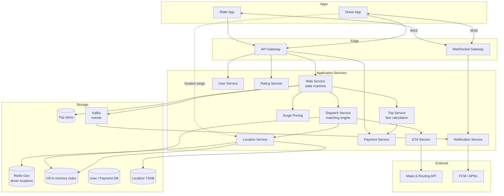
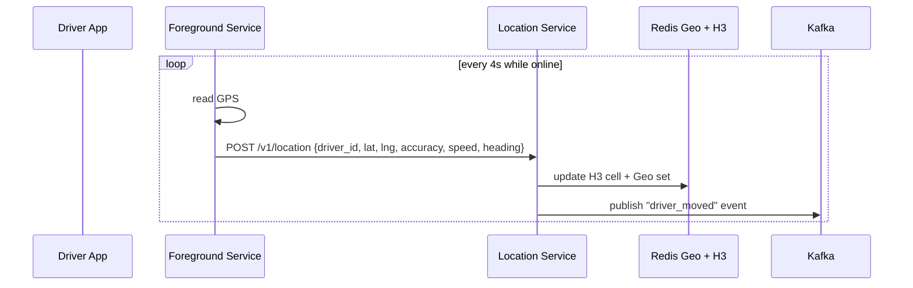
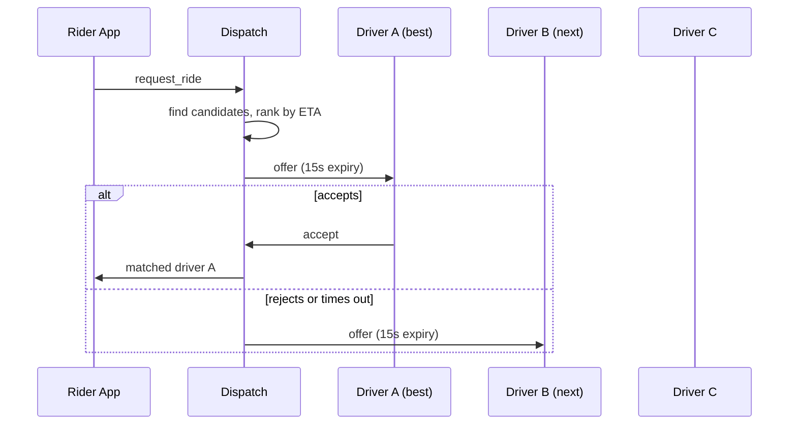
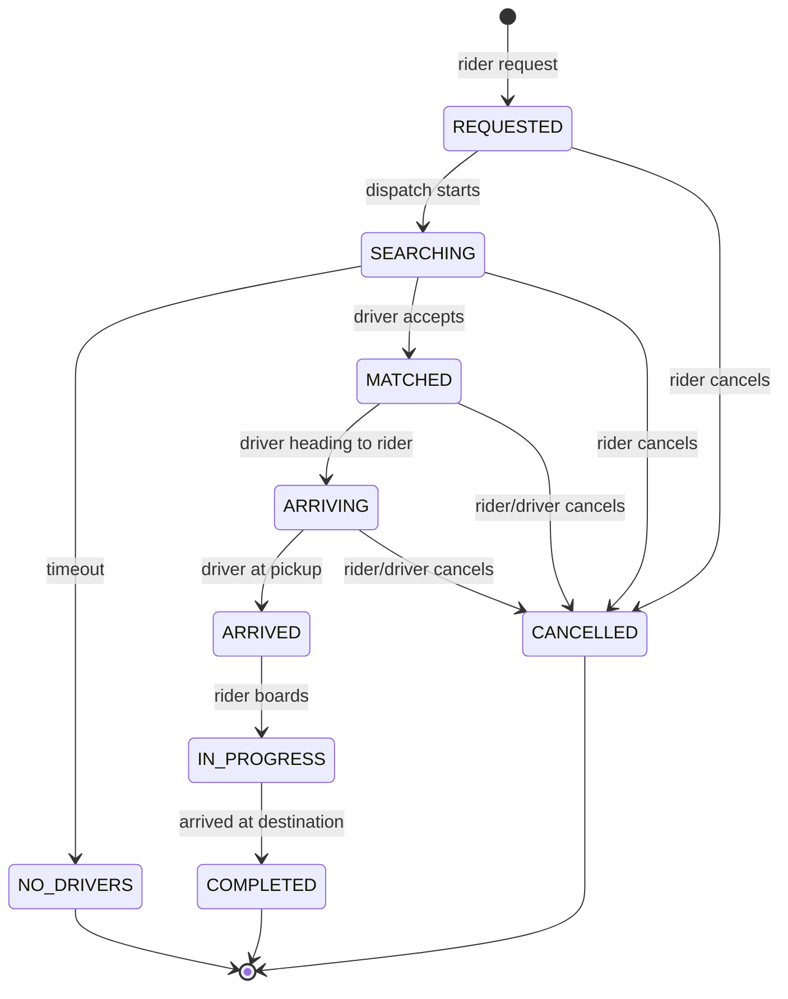

# Ride-Hailing System Design

> Interview-style deep dive on designing ride-hailing apps (Uber / Lyft / Ola / Grab / DiDi). Covers driver-rider matching at scale via H3 hexagonal indexing, real-time location streaming, dispatch algorithm with ETA scoring, the trip state machine across two devices, surge pricing per cell, route navigation, ratings, and the mobile-specific concerns (battery, foreground service, location accuracy, network resilience).

---

## 1. Problem Statement

Design the matching, dispatch, and trip-tracking system for a global ride-hailing app where:

- Riders open the app, set destination, request a ride.
- Available drivers are matched and dispatched.
- The driver app shows turn-by-turn navigation; the rider app shows live car position.
- Trip completes; fare is calculated; payment processes.
- Both parties rate each other.

### Functional Requirements

- Rider: request ride, see driver location, cancel, complete payment, rate.
- Driver: receive ride requests, accept/reject, navigate, complete, get paid.
- Real-time location tracking (rider sees driver; driver sees route).
- Surge pricing (demand vs supply).
- ETA estimation (rider waiting time + trip duration).
- Multiple ride types (UberX, Pool, Premium, etc.).
- Cancellation policies + cancellation fees.

### Non-Functional Requirements

| Concern | Target |
|---|---|
| Driver-rider match latency | p95 < 5s |
| Location ping ingestion | 100K+ per second peak |
| Location latency (driver moves → rider sees update) | < 4s |
| Trip start-to-end events | exactly-once delivery |
| Battery cost on driver app | < 5%/hour while online |
| Battery cost on rider app | < 1%/hour while waiting |
| Geographic coverage | 10K cities globally |
| Availability | 99.99% (every minute offline is lost revenue) |

### Scale Assumptions

For a global ride-hailing platform:

| Quantity | Estimate |
|---|---|
| Drivers online simultaneously | 2M peak (across cities) |
| Riders requesting per second | 5K peak |
| Location pings per second | 200K (drivers ping every 4s) |
| Trips per day | 30M |
| Trip events per day | 300M (state transitions, location updates) |
| Avg trip duration | 15min |

---

## 2. Glossary

| Term | Meaning |
|---|---|
| **H3** | Uber's hexagonal hierarchical geospatial index. Each cell at resolution 8 covers ~0.74km². |
| **S2** | Google's spherical geospatial index. Square cells, hierarchical. |
| **Dispatch** | The algorithm that picks which driver receives a ride request. |
| **Pool / Shared** | Multiple riders share a ride; complex matching. |
| **Surge** | Multiplier applied to base fare when demand > supply in a cell. |
| **ETA** | Estimated Time of Arrival (rider's wait or trip duration). |
| **Ping** | Periodic location update from driver's phone to server. |
| **Foreground service** | Android service that keeps location running even with app backgrounded (driver). |

---

## 3. High-Level Architecture



### Tier responsibilities

- **Location Service** ingests pings from drivers, updates Redis Geo + H3 index, fans out to relevant rider subscriptions.
- **Dispatch** finds candidate drivers near the rider, scores by ETA, sends offer.
- **Ride Service** owns the trip state machine: REQUESTED → MATCHED → ARRIVED → IN_TRIP → COMPLETED.
- **ETA Service** queries Maps for road-network shortest path with live traffic.
- **Surge** computes per-cell multiplier from supply/demand.
- **Trip Service** computes fare on completion, triggers payment.

---

## 4. Geospatial Indexing with H3

### 4.1 Why hexagons

Square grids (used by geohash) have an issue: distance to neighbors is uneven. Diagonal neighbors are √2 farther than edge neighbors. For "find drivers within radius," this asymmetry causes false negatives or expensive corrections.

Hexagons have 6 equidistant neighbors. For "k-ring around me," the result set is uniform. Uber's H3 library partitions Earth into a hierarchy of hexagonal cells.

### 4.2 H3 resolution

H3 has 16 resolution levels (0 = world, 15 = ~1m²). For ride dispatch:

- **Resolution 8** (~0.74km² per hex) — typical for urban driver search.
- **Resolution 9** (~0.1km²) — denser areas.
- **Resolution 7** (~5.2km²) — surge pricing aggregation.

```kotlin
val rider = LatLng(37.7749, -122.4194)
val h3 = H3Core.newInstance()
val cell = h3.geoToH3(rider.lat, rider.lng, 8)
// cell is a 64-bit integer

val neighbors = h3.kRing(cell, 2)   // 19 cells: self + 6 + 12
// search drivers in these cells
```

### 4.3 Driver location storage

```
Per H3 cell: Redis SortedSet
Key: drivers:h3:{cell_id}
Score: last-ping timestamp
Member: driver_id

# Driver ping handler:
def on_ping(driver_id, lat, lng):
    cell = h3.geoToH3(lat, lng, 8)
    prev_cell = redis.get(f"driver:cell:{driver_id}")
    if prev_cell != cell:
        if prev_cell: redis.zrem(f"drivers:h3:{prev_cell}", driver_id)
        redis.zadd(f"drivers:h3:{cell}", time.now(), driver_id)
        redis.set(f"driver:cell:{driver_id}", cell)
    else:
        redis.zadd(f"drivers:h3:{cell}", time.now(), driver_id)
    redis.set(f"driver:location:{driver_id}", f"{lat},{lng}")
    redis.expire(f"driver:cell:{driver_id}", 60)
```

When a driver moves between cells, we update the indices.

### 4.4 Finding candidate drivers

```python
def candidates(rider_lat, rider_lng):
    cell = h3.geoToH3(rider_lat, rider_lng, 8)
    cells = h3.kRing(cell, 2)
    drivers = []
    for c in cells:
        members = redis.zrangebyscore(
            f"drivers:h3:{c}",
            min=time.now() - 30,    # within 30s ping
            max=time.now()
        )
        drivers.extend(members)
    return drivers
```

A 2-ring around the rider covers 19 cells ≈ 14 km² — a few hundred drivers in a busy city.

---

## 5. Driver Ping Flow



### 5.1 Mobile location streaming (driver)

```kotlin
class LocationForegroundService : Service() {
    private val fusedClient by lazy { LocationServices.getFusedLocationProviderClient(this) }

    override fun onCreate() {
        super.onCreate()
        startForeground(NOTIFICATION_ID, buildNotification())
        startStreaming()
    }

    private fun startStreaming() {
        val request = LocationRequest.Builder(Priority.PRIORITY_HIGH_ACCURACY, 4000L)
            .setMinUpdateIntervalMillis(2000L)
            .setMaxUpdateDelayMillis(8000L)
            .build()
        fusedClient.requestLocationUpdates(request, callback, mainLooper)
    }

    private val callback = object : LocationCallback() {
        override fun onLocationResult(result: LocationResult) {
            result.locations.lastOrNull()?.let { loc ->
                scope.launch { uploader.upload(loc) }
            }
        }
    }

    override fun onDestroy() {
        fusedClient.removeLocationUpdates(callback)
        super.onDestroy()
    }
}
```

The foreground service shows a persistent notification (Android requirement); this lets it continue running and reading GPS even after the user switches apps.

### 5.2 Adaptive ping frequency

- **High frequency** (1s) — when actively in a trip, rider needs precise tracking.
- **Medium** (4s) — when online and available.
- **Low** (30s) — when on break / idle.
- **Off** — when offline.

Battery savings: dropping from 1s to 4s saves significant battery on the GPS chip's wake cycles.

### 5.3 Batching for bandwidth

```kotlin
class PingUploader(val api: LocationApi) {
    private val batch = mutableListOf<Ping>()
    private val flushInterval = 4.seconds

    suspend fun upload(loc: Location) {
        synchronized(batch) {
            batch.add(Ping(loc.latitude, loc.longitude, loc.accuracy, loc.speed,
                           loc.bearing, loc.time))
            if (batch.size >= 4) flush()
        }
    }

    private suspend fun flush() {
        val toSend = synchronized(batch) { batch.toList().also { batch.clear() } }
        api.upload(BatchUpload(toSend))
    }

    init { scope.launch { while (true) { delay(flushInterval); flush() } } }
}
```

Batching trades latency for bandwidth: 4 pings in one POST every 16s instead of 4 individual requests.

---

## 6. Dispatch Algorithm

### 6.1 Candidate selection

Step 1: H3 lookup gives ~100-500 nearby drivers within ~5km.

### 6.2 Filtering

Remove drivers that:
- Are on a current trip.
- Are paused / break.
- Are wrong vehicle type for request.
- Have ping age > 30s (likely offline).
- Are blocked / rated very low.

### 6.3 ETA scoring

```python
def score(driver, rider, destination):
    eta_pickup = maps.eta(driver.location, rider.location, traffic=true)
    rating = driver.rating
    completion_rate = driver.completion_rate  # historical
    return alpha * eta_pickup - beta * rating - gamma * completion_rate
```

Lower score = better match. Pickup ETA dominates; rating breaks ties.

### 6.4 Offer flow



If no driver accepts within ~60s total, expand search radius or notify rider "no drivers available."

### 6.5 Pool / shared rides (advanced)

Multiple riders share. The dispatch problem becomes:

- Pickup A, pickup B, drop A, drop B (matching constraint)
- Detour penalty per rider
- ETA accuracy across all legs

This is NP-hard in general; production uses heuristics + ML scoring + tree search.

---

## 7. Trip State Machine



Each transition is persisted to the trip event log:

```cql
CREATE TABLE trip_events (
    trip_id UUID,
    seq INT,
    event_type TEXT,
    event_ts TIMESTAMP,
    actor TEXT,
    metadata JSONB,
    PRIMARY KEY (trip_id, seq)
);
```

Audit, dispute resolution, and analytics all read this log.

---

## 8. Real-Time Tracking Channel

The rider needs to see the driver's live position; the driver needs to see the rider's pickup + route.

### 8.1 Pub/sub per trip

```
Topic: trip:{trip_id}:location

Driver publishes: { lat, lng, heading, speed, ts }
Rider subscribes via WebSocket
```

```kotlin
// Rider side
class RiderTripViewModel(...) : ViewModel() {
    val driverLocation: StateFlow<DriverLocation> = tripChannel
        .subscribe("trip:${tripId}:location")
        .map { decode(it) }
        .stateIn(viewModelScope, SharingStarted.WhileSubscribed(), DriverLocation.NULL)
}
```

### 8.2 Map UI

```kotlin
@Composable
fun TripMap(driverLocation: DriverLocation, route: List<LatLng>) {
    val markerState = remember { MarkerState(driverLocation.toLatLng()) }
    LaunchedEffect(driverLocation) {
        animateMarker(markerState, driverLocation.toLatLng())
    }
    GoogleMap(...) {
        Marker(state = markerState, icon = bitmapDescriptorFromVector(R.drawable.car))
        Polyline(points = route, color = Color.Blue)
    }
}

suspend fun animateMarker(state: MarkerState, target: LatLng) {
    val start = state.position
    val frames = 30
    val durationMs = 1500L
    repeat(frames) { i ->
        val t = (i + 1f) / frames
        state.position = LatLng(
            start.latitude + (target.latitude - start.latitude) * t,
            start.longitude + (target.longitude - start.longitude) * t
        )
        delay(durationMs / frames)
    }
}
```

Animation smooths the discrete 4s pings into continuous motion.

### 8.3 Snap-to-road

GPS is noisy. Raw pings can jump 10-20 meters even when stationary. Snap-to-road API (Google Maps Roads API) projects pings onto the nearest road centerline:

```kotlin
val snapped = roadsClient.snapToRoads(pings)
```

Use snapped points for display; use raw for trip distance calculation.

---

## 9. Surge Pricing

### 9.1 Computation

```python
def surge_multiplier(cell, time_window=300):
    requests = redis.get(f"requests:cell:{cell}:5min")  # last 5 min
    drivers_available = redis.zcard(f"drivers:h3:{cell}")
    if drivers_available == 0:
        return 5.0  # cap
    ratio = requests / drivers_available
    return min(max(1.0, 0.5 + ratio * 0.3), 5.0)  # base + slope, capped
```

Per H3 cell at resolution 7 or 8 (larger cells for surge aggregation). Updated every 30-60s.

### 9.2 Predictive surge

Machine learning forecasts demand 5-10 min ahead based on time of day, weather, events. The surge engine reacts but also pre-positions.

### 9.3 Quote vs ride

Rider sees a quoted fare with surge applied. The fare is locked at request time so the rider isn't surprised if surge changes mid-trip.

---

## 10. ETA Estimation

### 10.1 Road network routing

Underlying data: a directed graph of road segments with edge weights = expected travel time.

```kotlin
val route = routingEngine.computeRoute(
    origin = driverLoc,
    destination = riderLoc,
    options = RoutingOptions(
        considerTraffic = true,
        avoidTolls = false,
        vehicleType = VehicleType.CAR
    )
)
// route.duration, route.distance, route.polyline
```

Algorithms: A* on contracted hierarchies (CH) gives sub-millisecond queries on continental graphs. Live traffic updates edge weights every few minutes.

### 10.2 Sources for traffic

- Anonymized fleet GPS pings (your own drivers).
- Open data (Waze, Google).
- Historical baselines per (segment, time-of-day, day-of-week).

### 10.3 Mobile-side ETA

The driver app shows turn-by-turn nav. Use Google Maps SDK Directions; cache result + reroute if user takes wrong turn.

---

## 11. Payment & Fare Calculation

```kotlin
data class Fare(
    val base: Money,
    val timeCharge: Money,
    val distanceCharge: Money,
    val surge: BigDecimal,
    val tolls: Money,
    val total: Money,
    val driverEarnings: Money,
    val platformFee: Money
)

fun computeFare(trip: Trip): Fare {
    val time = trip.duration.minutes * trip.rate.perMinute
    val dist = trip.distance.km * trip.rate.perKm
    val subtotal = (trip.rate.base + time + dist) * trip.surgeMultiplier + trip.tolls
    val platformFee = subtotal * 0.20  // example 20% platform take
    return Fare(...)
}
```

On trip completion: fare calculated server-side, charged via Stripe (or equivalent — see [`payment-flow.md`](payment-flow.md)). Driver paid out weekly via ACH/bank transfer.

---

## 12. Failure Modes

**Driver app loses GPS in tunnel.** Last known ping cached; H3 entry expires after 30s; driver removed from candidate pool. Rider may briefly see car "frozen"; UI shows "reconnecting."

**Dispatch timeout — no driver accepts.** Expand search radius, re-rank with more lenient criteria, eventually notify rider "no drivers nearby." Don't charge.

**Driver accepted but disappeared.** Heartbeat lost; if no ping for 60s while assigned, auto-cancel the trip with reason "driver unavailable"; re-dispatch.

**Trip state divergence between rider and driver.** Driver thinks arrived; rider doesn't see it. Reconciler reads server's authoritative state and pushes to both clients.

**WebSocket disconnect mid-trip.** Client reconnects with backoff + jitter; on reconnect, syncs current trip state.

**GPS spoofing.** Driver simulating long routes to inflate fare. Mitigation: sanity-check ping velocity (>200 mph = invalid); compare actual path to expected route; ML anomaly detection.

**Hot cell.** Stadium event → 10K riders in one H3 cell at game end. Mitigation: surge dampens demand; partitions drivers across multiple workers per cell.

**Currency or country mismatch.** Driver from one country processing ride in another. Geo-locked dispatch; risk engine checks regulatory compliance.

**Cancellation fee dispute.** Rider cancels at 4:59 minutes (free cancel threshold). State machine timestamps must be authoritative; client clocks not trusted.

---

## 13. Mobile-Specific Concerns

| Concern | Strategy |
|---|---|
| Driver foreground service | Persistent notification; STARTED service; Doze-resilient |
| Driver battery | Adaptive ping frequency; release GPS in idle |
| Rider waiting screen | Subscribe to driver location channel; animate marker |
| Network change | Reconnect WS; sync state on reconnect |
| Trip resume on cold start | Re-subscribe to trip channel; redraw map from cached state |
| Map tile prefetch | Pre-download driver's route at trip start |
| Voice navigation | TTS on Android; pause on incoming calls |
| Background ride | FCM if driver app killed: high-priority data push to wake |

---

## 14. Tradeoffs

**H3 vs S2 vs geohash**

| | H3 | S2 | Geohash |
|---|---|---|---|
| Neighbor distance | uniform | uneven on diagonals | uneven |
| Hierarchy | yes (16 levels) | yes | yes |
| Library maturity | strong (Uber OSS) | strong (Google OSS) | universal |
| Use | ride matching | global mapping | simple geo |

**Sync vs async dispatch**

| | Sync (in-request) | Async (queue) |
|---|---|---|
| Latency | low | higher |
| Throughput | bounded | scalable |
| Complexity | simpler | more parts |

**Single-best vs broadcast offer**

| Single (sequential) | Broadcast (parallel) |
|---|---|
| Better driver experience | Lower latency for rider |
| Fairer to drivers | Race condition (multiple accept) |
| Standard | Some apps use it |

**Quote vs metered fare**

| Quoted upfront | Calculated at end |
|---|---|
| Predictable for rider | Accurate to actual route |
| Risk to platform if route changes | Risk to rider for traffic surprises |

---

## 15. Probing Questions

1. Walk through H3 indexing. Why hexagons over squares? What does resolution control?
2. A driver moves 5 km in the last 4 seconds. What's the driver-cell update flow?
3. Dispatch picks the best driver. Walk through the candidate selection → filtering → ETA scoring → offer sequence.
4. The driver accepts but their GPS goes dead in a tunnel for 90 seconds. What does the rider see?
5. Surge pricing per cell: walk through the computation and what data it needs.
6. The rider app shows a smoothly moving car. Pings arrive every 4s. How is the marker animation engineered?
7. Snap-to-road: what does it do, and why do we use snapped pings for display but raw for distance?
8. Trip state machine has CANCELLED. Walk through what happens to fare and to driver compensation in different cancel timings.
9. The driver app is force-killed by Android (battery saver). How does the foreground service mitigate?
10. ETA: explain road-network routing with A* on contracted hierarchies and where live traffic data enters.
11. Pool / shared rides: what makes the matching problem NP-hard?
12. A driver is detected to be spoofing GPS (impossible velocity). What's the immediate action and the long-term countermeasure?
13. A stadium event ends — 10K riders in one cell. Walk through demand absorption (queueing, surge, fan-out).
14. Currency / country mismatch on cross-border ride. What rules apply?
15. The rider WebSocket disconnects. On reconnect, how does the client recover the trip state?
16. A dispatcher offered the ride to Driver A, but B accepted first (rare race). How is this prevented?
17. Pickup ETA was 5 minutes; reality became 12 minutes due to traffic. Should the rider see the new estimate?
18. Rating is on 1-5 scale. How do you prevent a single bad rating from materially hurting a driver?
19. Payment runs through Stripe. A trip ends but the charge fails. Who absorbs the loss?
20. The dispatch ML model proposes a slightly worse-ETA driver because they're rated higher. How do you tune this tradeoff?

---

## 16. Further Reading

In this repository:

- [`google-maps-location-system.md`](google-maps-location-system.md) — location infrastructure details.
- [`payment-flow.md`](payment-flow.md) — Stripe payment integration.
- [`push-notifications.md`](push-notifications.md) — FCM for ride alerts.
- [`offline-sync.md`](offline-sync.md) — driver app's offline tolerance.
- [`../backend-for-mobile/push-vs-poll-vs-sse-vs-websockets.md`](../backend-for-mobile/push-vs-poll-vs-sse-vs-websockets.md) — transport.
- [`../distributed-systems/idempotency.md`](../distributed-systems/idempotency.md) — exactly-once dispatch.
- [`../distributed-systems/delivery-semantics.md`](../distributed-systems/delivery-semantics.md) — trip event delivery.
- [`../engineering-fundamentals/state-machines.md`](../engineering-fundamentals/state-machines.md) — trip state machine.
- [`../android/concurrency/services.md`](../android/concurrency/services.md) — foreground service mechanics.

External:

- [H3: Uber's Hexagonal Hierarchical Spatial Index](https://www.uber.com/us/en/blog/h3/) — Uber's official H3 announcement.
- [H3 Geospatial Indexing: How Uber Finds Nearby Drivers](https://tanhdev.com/series/ride-hailing-realtime-architecture/part-2-geospatial-indexing/) — practical H3 walkthrough.
- [Designing Uber, Part 2: H3 Hexagons & Matching Algorithms](https://karishma-agr1996.medium.com/designing-uber-part-2-h3-hexagons-matching-algorithms-and-the-location-service-c73c9dca0347) — interview-grade write-up.
- [Ride-Sharing System Design (Uber / Lyft)](https://intervu.dev/blog/ride-sharing-uber-lyft-system-design/) — FAANG interview perspective.
- [Uber Engineering blog](https://www.uber.com/blog/engineering/) — official posts on dispatch, ML, location.
- [H3 library on GitHub](https://github.com/uber/h3) — open-source implementation.
- *Trade-offs of Dispatch Algorithms in Ride-Sharing Systems* — research papers in arXiv.
- Lyft Engineering blog on routing — graph algorithms applied at scale.
