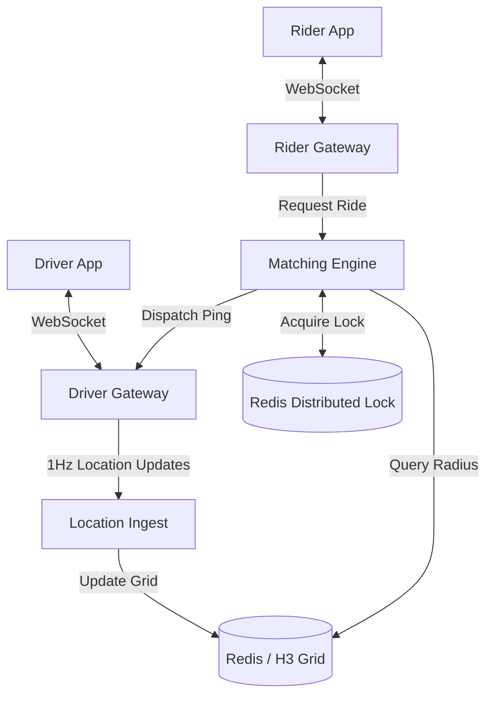

# System Design: Ride-Hailing Matching (Uber / Lyft)

## The Prompt

*"Design the core Ride-Matching system for Uber. A Rider opens the app and sees 5 cars driving around them on a map. They tap 'Request Ride'. The system must find the closest Driver, send them a ping, and connect the two users. Handle the edge case where the Driver rejects the ping or loses cell service."*

## 1. Requirements & Clarification (RADIO Framework)

### Functional Requirements
- Rider can see nearby cars on a map (Real-time).
- Rider can request a ride.
- Driver receives a ride offer.
- System matches them and transitions both to the 'On Trip' state.

### Non-Functional Requirements (NFRs)
- **Concurrency (Priority 0):** Two Riders cannot be matched with the same Driver simultaneously.
- **Latency:** Finding nearby drivers must be ultra-fast (< 500ms). We cannot scan the entire database of cars globally.
- **State Machine Integrity:** The Rider and Driver apps must perfectly sync their states (Searching -> Matched -> Arriving -> On Trip).

## 2. High-Level Architecture (The Quadtree / S2 Geometry)

A Junior engineer stores Driver locations in a SQL database: `SELECT * FROM drivers WHERE lat = X AND lng = Y`. This takes minutes to run across 1 million cars.
A Staff engineer uses a **Geospatial Index** (like Google's S2 library, or Uber's H3 Hexagon grid) stored in Redis.

## 3. The Core Flows (Deep Dive)

### Flow 1: Seeing Cars on the Map (H3 Hexagons)
*Interviewer:* "When the Rider opens the app, how do you instantly show the 5 closest cars without querying the whole database?"

**Staff Answer:**
"We divide the Earth into a grid of hexagons using Uber's **H3 indexing system**. 
1. The Rider's latitude/longitude is mathematically converted into an H3 Hexagon ID (e.g., `Hex-99A`).
2. The Backend uses this ID to query Redis: `HGETALL Hex-99A`.
3. Redis returns the IDs of all Drivers currently residing in `Hex-99A` in `O(1)` time.
4. The Rider Gateway sends those 5 Driver locations to the Rider App via the persistent WebSocket.
5. As drivers move, the Location Ingest service recalculates their H3 ID. If they cross a boundary, they are deleted from the old Hex and inserted into the new one."

### Flow 2: The Matching Engine (Distributed Locks)
*Interviewer:* "Rider A and Rider B are standing on the same street corner. They both hit 'Request Ride' at the exact same millisecond. They are both matched to Driver C. Driver C's phone crashes. How do you prevent this?"

**Staff Answer:**
"This is a classic Concurrency race condition. The Matching Engine must use **Distributed Locks**.
1. The Matching Engine queries the H3 grid and finds Driver C is closest to both Riders.
2. For Rider A, the Engine attempts to acquire a Redis Distributed Lock on Driver C: `SET driver_c_lock 1 NX EX 10`. It succeeds.
3. The Engine sends the ping to Driver C for Rider A.
4. For Rider B, the Engine attempts to acquire the lock on Driver C. It fails (`NX` means Only Set if Not Exists).
5. The Engine skips Driver C and looks for the next closest driver for Rider B.
This mathematically guarantees a driver can only receive one ping at a time."

### Flow 3: The State Machine Synchronization
*Interviewer:* "Driver C receives the ping. They accept. The backend creates the match. But the Rider's phone loses cell service right as the match happens. The Driver drives to the pickup spot, but the Rider's app still says 'Searching...'"

**Staff Answer:**
"This requires a rigorous **State Machine** built on the Single Source of Truth architecture.
1. The Backend is the absolute Source of Truth for the Trip State (e.g., `SEARCHING`, `DISPATCHED`, `ARRIVED`).
2. The Mobile Apps are *dumb terminals*. They only render what the Backend tells them.
3. The Backend changes the state to `DISPATCHED`. It attempts to push this to the Rider via WebSocket.
4. If the WebSocket is dead, the Backend does nothing. It just waits.
5. When the Rider reconnects to cellular, the Rider App immediately executes an HTTP `GET /trip/current-state`.
6. The Backend returns `DISPATCHED` along with the Driver's details.
7. The Rider App instantly transitions from the 'Searching' UI to the 'Driver is arriving' UI. The client never attempts to guess or hold its own state."

## 4. Failure Modes & Bottlenecks

### Bottleneck: The Driver Rejects the Ping (Cascading Fallback)
1. The Engine pings Driver C. It sets a 10-second expiration on the Redis Lock.
2. Driver C ignores the ping. The 10 seconds expire.
3. The Android App for Driver C automatically replies to the server: "Ping Expired".
4. The Engine releases the lock, adds Driver C to a "Rejected List" for this specific trip, and queries the H3 grid for the *next* closest driver. It pings Driver D.

### Bottleneck: The Phantom Driver
*Interviewer:* "Driver C deletes the Uber app while on shift. The backend still thinks they are in `Hex-99A`. The Matching engine keeps trying to ping them. Riders wait forever."

**Staff Answer:**
"We implement **Heartbeats (TTL)**.
1. Every time Driver C sends a 1Hz location update, the Redis entry is written with a Time-To-Live (TTL) of 15 seconds.
2. If Driver C deletes the app, turns off their phone, or drives into a tunnel, the 1Hz updates stop.
3. 15 seconds later, Redis automatically deletes Driver C from `Hex-99A`.
4. The Matching Engine will never see Driver C again until they come back online and resume heartbeats."

## 5. Staff Engineer Thinking: Graceful Degradation

A Staff Engineer anticipates what happens when the absolute worst-case scenario occurs.

*What happens if the WebSocket gateway completely crashes globally?*
If we only rely on WebSockets, Uber stops making money globally. I must implement **Graceful Degradation to HTTP Polling**.
If the Android WebSocket client detects that the socket has dropped and cannot reconnect after 3 attempts, it must degrade into polling `GET /trip/current-state` every 5 seconds. The user experience degrades (higher latency, more battery drain), but the business continues to function, rides are completed, and revenue is secured while the SRE team fixes the WebSocket gateway.

## 6. Probing Questions (For Practice)

1.  Explain why querying a SQL relational database for geographic coordinates (Lat/Lng) is too slow for real-time ride matching, and how Geospatial Indexing (like H3) solves this.
2.  Describe the "Double Match" race condition. How does a Redis Distributed Lock prevent two riders from being assigned the same driver simultaneously?
3.  Why is it an architectural failure for the Android application to manage its own Trip State (e.g., manually changing UI from 'Searching' to 'Matched' based on local logic)?
4.  Explain the concept of TTL (Time-To-Live) Heartbeats. How does this prevent the backend from attempting to ping drivers who have lost their cellular connection?
5.  Walk through the "Cascading Fallback" logic when a driver ignores a ping for 10 seconds. What must the mobile app do, and what must the backend do?
6.  Describe Graceful Degradation in the context of persistent connections. What is the fallback mechanism if the WebSocket Gateway fails entirely?
7.  If the Rider's app disconnects from the network while the backend matches them with a driver, how does the app recover the correct UI state when it regains connection?
8.  Why do Uber and Lyft separate the "Location Ingest" pipeline (high volume writes) from the "Matching Engine" (high volume reads/locks)?
9.  Explain how the Android client can ensure the Driver's 10-second "Accept Ride" ringtone/timer stays perfectly synced with the backend's 10-second timeout.
10. If a Driver puts their phone to sleep and Doze Mode activates, what Android OS mechanism must the Uber app use to guarantee it can still receive a Ride Ping?

## Further Reading

- [`google-maps-location-system.md`](google-maps-location-system.md) — The continuous tracking architecture that feeds the H3 Grid.
- [`push-vs-poll-vs-sse-vs-websockets.md`](../backend-for-mobile/push-vs-poll-vs-sse-vs-websockets.md) — The WebSocket gateway mechanics.
- [`state-machines.md`](../engineering-fundamentals/state-machines.md) — How to model the Trip State correctly.
