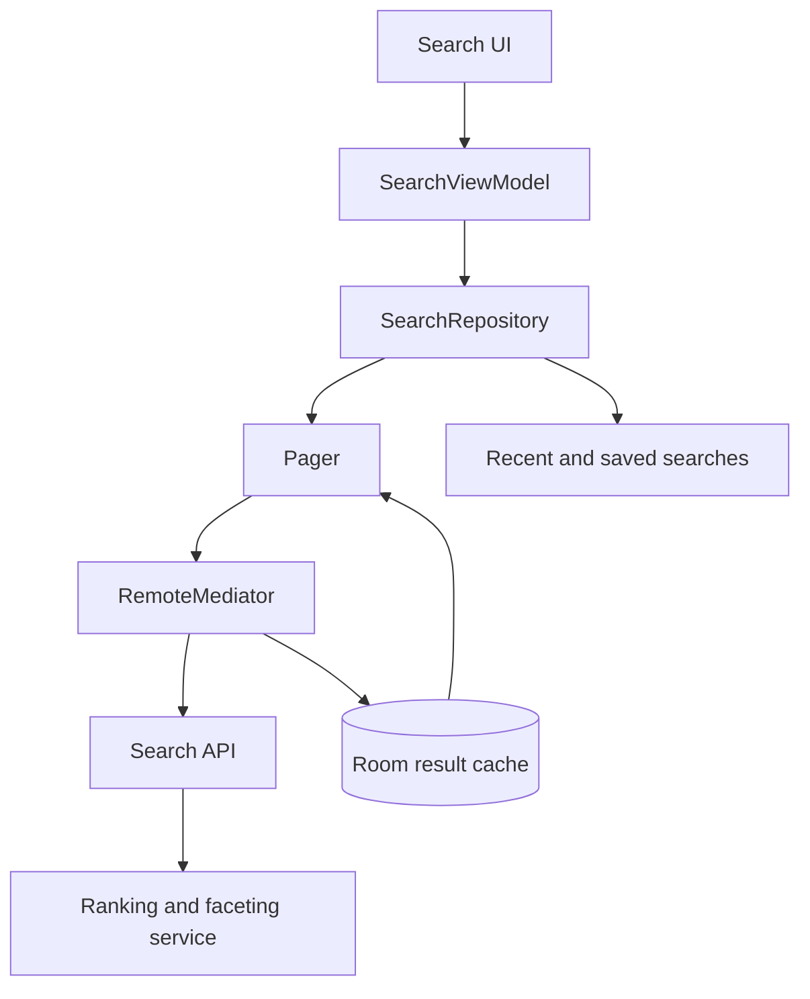
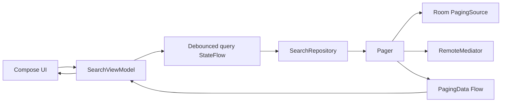

# Search Experience (Mobile)

> A 45-60 minute mobile system-design walkthrough for the *main search experience* in an app (results screen, filters, history, recents). Typeahead/autocomplete is the separate `typeahead-autocomplete-search.md` file.

---

## 1. Gathering Requirements (~5 min)

> **Interviewer:** "Design search for a mobile app."
> **Candidate:** "Two screens really: the search entry (typeahead) and the results screen. I'll scope this to the results experience — query submission, paging through results, filters, history. I'll deep-dive the query → results lifecycle."

### Functional Requirements
- **Submit a query** and render ranked results (mixed types if needed).
- **Filters / facets** (e.g., type, price, distance).
- **Sort options**.
- **Search history** (recent + saved).
- **Pull-to-refresh, infinite scroll**.

### Non-Functional Requirements
- **Fast first paint** — show cached state immediately, refresh in background.
- **Cancelable** — typing a new query aborts the previous request.
- **Cellular-aware** — small page size, defer images on metered networks.
- **Offline tolerance** — show last results + history when offline.
- **Telemetry** — every query, result tap, dwell time logged.

### Out of Scope
- Typeahead suggestion engine (see `typeahead-autocomplete-search.md`)
- Ranking model internals (server)
- Voice search (separate stack)
- Image search / OCR
- Personalization model internals

---

## 2. Clarifying Questions (~3 min)

| Question | Why it matters |
|---|---|
| Domains (products, users, content)? | Mixed result rendering |
| Filter taxonomy depth? | Filter UI complexity |
| Server-side facets or client-derived? | API surface |
| Personalized results? | Cache invalidation rules |
| Offline expectations? | Local index or just last-results cache |
| Avg results per query? | Page size, prefetch |
| Latency target? | Local cache strategy |

> **Candidate:** "Single domain (e.g., products), server-side facets, personalized, ~30 results per page, cache last 5 queries for offline, target < 400 ms p95 result render."

---

## 3. High-Level Diagram (~10 min)



The client owns query lifecycle, cached presentation, and pagination; ranking and facets remain a server contract rather than duplicated client logic.

**Components:**
- **`SearchRepository`** — query orchestration, result paging.
- **`HistoryRepository`** — recents + saved.
- **`RemoteMediator`** — drives network paging.
- **`SearchSession`** — debounce + cancellation for the active query.

---

## 4. API Contract

### Query

```http
GET /v1/search?q=running+shoes&filters=brand:nike,size:9&sort=relevance&cursor=&limit=30
{
  "items": [ { "id": "p_1", "title": "...", "price": ..., "imageUrl": "..." }, ... ],
  "facets": {
    "brand": [ { "value": "nike", "count": 142 }, { "value": "adidas", "count": 89 } ],
    "color": [ { "value": "black", "count": 220 }, ... ]
  },
  "nextCursor": "eyJvIjozMH0=",
  "queryId": "q_abc",
  "totalEstimate": 1240
}
```

### Click logging (analytics)

```json
POST /v1/search/click
{ "queryId": "q_abc", "itemId": "p_1", "position": 3, "ts": ... }
```

> `queryId` ties subsequent clicks back to the query for ranking telemetry.

---

## 5. Mobile App Architecture

### Module structure

```
:feature:search           ← SearchScreen, FiltersSheet, ResultRow
:domain:search            ← Query, Filter, Result models
:data:search              ← Repository, RemoteMediator, history DAO
:core:network
:core:database
```

### Layered diagram



Each accepted query creates a new paging generation, so old requests and results cannot leak into the current search state.

### Key class signatures

```kotlin
data class Query(val accountId: String, val text: String, val filters: Filters, val sort: Sort)

interface SearchRepository {
    fun search(query: Query): Flow<PagingData<Result>>
    fun lastResults(accountId: String): Flow<List<Result>>   // offline fallback
    fun facets(queryId: String): Flow<Facets?>
}

interface HistoryRepository {
    fun recents(accountId: String): Flow<List<RecentQuery>>
    suspend fun rememberQuery(q: Query)
    suspend fun clear(accountId: String)
}
```

---

## 6. Local Storage

```kotlin
@Entity(tableName = "search_recents", primaryKeys = ["accountId", "text"])
data class RecentQuery(
    val accountId: String,
    val text: String,
    val filtersJson: String, val lastUsedAt: Long, val useCount: Int
)

@Entity(tableName = "search_results_cache", primaryKeys = ["queryKey", "itemId"])
data class CachedResult(
    val itemId: String,
    val accountId: String,         // a hash can't be deleted by account, so keep the id too
    val queryKey: String,          // hash of (accountId + text + filters + sort)
    val rank: Int, val payloadJson: String, val fetchedAt: Long
)
```

Every cached row belongs to one account. A switch keeps each account's rows apart, because reads filter by account. Sign-out deletes that account's results, facets and recents.

> **Probing Q:** "Why cache results?" For the "user types a query, taps a result, comes back" flow. Re-running the search wastes a network call; if the cache is < 5 min old we render it immediately.

> **Probing Q:** "What about full offline search?" For true offline search, index a local catalog with SQLite full-text search. Use **FTS4** with the platform-backed Room 2 stack for broad Android compatibility, or **FTS5** only when the app uses Room 3 with `BundledSQLiteDriver`, which supplies an FTS5-enabled SQLite build. Both use virtual tables optimized for fast local text matching without a network request.

---

## 7. Deep Dive: Query → Results Lifecycle (~15 min)

> *I'd pick this as the deep dive because it covers debounce, cancellation, paging, history persistence, and the offline fallback — the whole journey of a single query.*

### Debounce + cancellation

```kotlin
@HiltViewModel
class SearchViewModel @Inject constructor(
    private val repo: SearchRepository,
    private val history: HistoryRepository,
    session: SessionRepository,
    savedState: SavedStateHandle,
) : ViewModel() {

    val text = savedState.getMutableStateFlow("text", "")
    val filters = savedState.getMutableStateFlow("filters", Filters.EMPTY)   // Filters and Sort must be Parcelable
    val sort = savedState.getMutableStateFlow("sort", Sort.RELEVANCE)

    private val accountId = session.currentAccountId()      // a fixed value when signed out

    val recents: StateFlow<List<RecentQuery>> = history.recents(accountId)
        .stateIn(viewModelScope, SharingStarted.WhileSubscribed(5_000), emptyList())

    private val query: Flow<Query> = combine(text, filters, sort) { t, f, s ->
        Query(accountId, t.trim(), f, s)     // no timestamp: distinctUntilChanged must see equal queries
    }
        .debounce(250.milliseconds)
        .distinctUntilChanged()
        .filter { it.text.isNotBlank() }

    val results: Flow<PagingData<Result>> = query
        .flatMapLatest { q ->
            viewModelScope.launch { history.rememberQuery(q) }
            repo.search(q)
        }
        .cachedIn(viewModelScope)
}
```

`flatMapLatest` automatically cancels the previous query when a new one arrives.

This ViewModel belongs to one account. An account switch or sign-out pops that account's whole navigation graph without saving state, which clears the ViewModel, its saved query and its in-memory pages. The next account gets a new ViewModel, so it can't inherit the old query or see those pages.

### RemoteMediator

```kotlin
class SearchRemoteMediator(
    private val api: SearchApi,
    private val db: AppDatabase,
    private val query: Query,
) : RemoteMediator<Int, CachedResult>() {

    override suspend fun initialize() =
        if (db.cachedResultsDao().isFresh(query.key(), maxAge = 5.minutes)) InitializeAction.SKIP_INITIAL_REFRESH
        else InitializeAction.LAUNCH_INITIAL_REFRESH

    override suspend fun load(loadType: LoadType, state: PagingState<...>): MediatorResult {
        val cursor = when (loadType) {
            LoadType.REFRESH -> null
            LoadType.PREPEND -> return MediatorResult.Success(true)
            LoadType.APPEND -> state.lastItemOrNull()?.let { /* derive cursor */ } ?: return MediatorResult.Success(true)
        }
        return try {
            val resp = api.search(query.text, query.filters.toQueryString(), query.sort, cursor, PAGE)
            db.withTransaction {
                if (loadType == LoadType.REFRESH) db.cachedResultsDao().clearForKey(query.key())
                val firstRank = db.cachedResultsDao().countForKey(query.key())    // ranks continue across pages
                resp.items.forEachIndexed { i, item ->
                    db.cachedResultsDao().insert(item.toCached(accountId = query.accountId, queryKey = query.key(), rank = firstRank + i))
                }
                db.facetsDao().upsert(query.accountId, resp.queryId, resp.facets)
            }
            MediatorResult.Success(endOfPaginationReached = resp.nextCursor == null)
        } catch (e: IOException) {
            MediatorResult.Error(e)
        } catch (e: HttpException) {
            MediatorResult.Error(e)
        }
    }
}
```

### Compose UI

```kotlin
@Composable
fun SearchScreen(vm: SearchViewModel = hiltViewModel()) {
    val text by vm.text.collectAsStateWithLifecycle()
    val items = vm.results.collectAsLazyPagingItems()
    val recents by vm.recents.collectAsStateWithLifecycle()

    Column {
        SearchBar(
            text = text,
            onTextChange = { vm.text.value = it },
            onSubmit = { vm.submit() }
        )
        when {
            text.isBlank() -> RecentsList(recents, onTap = { vm.text.value = it.text })
            items.itemCount == 0 && items.loadState.refresh is LoadState.Loading -> ResultsSkeleton()
            items.itemCount == 0 -> EmptyState(text)
            else -> ResultsList(items)
        }
    }
}
```

### Filters sheet

```kotlin
@Composable
fun FiltersSheet(currentFilters: Filters, facets: Facets, onApply: (Filters) -> Unit) {
    var draft by remember { mutableStateOf(currentFilters) }
    LazyColumn {
        facets.brand.let { items ->
            item { Section("Brand") }
            items(items) { facet ->
                FacetRow(facet, checked = facet.value in draft.brand,
                    onToggle = { draft = draft.copy(brand = draft.brand.toggle(facet.value)) })
            }
        }
    }
    Button(onClick = { onApply(draft) }) { Text("Apply") }
}
```

Applying filters updates `vm.filters`, the combined `query` flow re-emits, paging resets via `flatMapLatest`.

### Offline fallback

```kotlin
fun search(query: Query): Flow<PagingData<Result>> = flow {
    val pager = Pager(
        config = PagingConfig(pageSize = 30, prefetchDistance = 10, enablePlaceholders = false),
        remoteMediator = SearchRemoteMediator(api, db, query),
        pagingSourceFactory = { db.cachedResultsDao().pagingSource(queryKey = query.key()) }
    )
    emitAll(pager.flow)
}
```

If the network is dead, `RemoteMediator` returns `Error`. The `PagingSource` still serves whatever was cached for that query key — usually the last successful results.

### Click telemetry

```kotlin
fun onResultClicked(result: Result, position: Int) {
    analytics.log(
        SearchClickEvent(queryId = lastQueryId, itemId = result.id, position = position)
    )
    navigator.go(Route.Product(result.id))
}
```

### Failure modes

| What breaks | Behavior |
|---|---|
| Network fail mid-query | Last cached results render; "Couldn't refresh" toast |
| User types fast | `debounce + flatMapLatest` cancels mid-flight |
| Server returns 0 results | Empty state, suggest spelling correction |
| Process death | Query text + filters in `SavedStateHandle`; restore on resume |
| Account switch | Navigation graph is popped, clearing the ViewModel; the new account's id gives it its own query keys and recents, so the old account's rows can't show |
| Sign-out | Navigation graph is popped, then that account's results, facets and recents are deleted; a write that finishes late stays under the old id, so no other account can see it |
| Stale cache (item deleted server-side) | Tap → product screen handles "not found" |
| Filters with no facet results | Show greyed-out option (count=0) |

---

## 8. Trade-offs

### Cancellation

| Option | Pros | Cons | Verdict |
|---|---|---|---|
| **`flatMapLatest`** | Cancels previous on new emission | Need to scope `viewModelScope` correctly | Pick this |
| `combine + Pager` invalidation | More control | More wiring | Skip unless `flatMapLatest` doesn't fit |
| Manual `Job.cancel` per query | Verbose | Easy to leak | Skip |

### Caching

| Option | Pros | Cons | Verdict |
|---|---|---|---|
| **Per-query-key Room cache** | Offline + back-stack reuse | Storage cost | Pick this |
| Memory-only cache | Fast; lost on death | Bad UX after kill | Skip |
| HTTP-cache only (OkHttp) | Zero code | No per-query keys, less flexible; personalized responses must not be reused across accounts | Acceptable as supplement |

### Filters UX

| Option | Verdict |
|---|---|
| **Bottom sheet** | Pick — mobile-native |
| Side drawer | Tablet/landscape only |
| Inline chips | Good for 2-3 filters, not 20 |

### Recents

| Option | Verdict |
|---|---|
| **On-device Room** | Pick — privacy + offline |
| Server-synced recents | Better cross-device, more complexity, privacy review |
| No recents | Easier; users miss them |

---

## 9. Major Concerns

- **Cancellation correctness.** Every keystroke fires a query? No — `debounce(250ms)`. Every new query cancels the previous? Yes — `flatMapLatest`.
- **Cellular cost.** Page size 30, image lazy-loaded via Coil with low-quality variant on metered networks.
- **Process death.** Query text + filters in `SavedStateHandle`. Last results cached in Room. Restored seamlessly.
- **Empty state.** Don't show a blank screen. Skeleton during load, "No results" with suggested terms or popular queries when truly empty.
- **Personalization.** Results may differ per user — don't share cache across accounts. `Query.key()` includes the account id, so the same text gets a different key per account. Test it: run the same query as account A, then as account B, offline, and assert no A rows appear.
- **History privacy.** Recents are stored per account and deleted at sign-out. Provide "Clear search history" in settings; honour incognito mode if app has one.
- **Telemetry.** Log query + facet selections + click positions. `queryId` ties them together for ranking.
- **Accessibility.** Results list must have proper semantics; filter sheet announces selections.
- **Latency budget.** First paint < 200 ms (cached); fresh results < 400 ms p95.

---

## 10. Follow-up Questions

> **Q: User types "shoes" then "shoes red" rapidly — what's emitted?**
> Debounce drops intermediate. Only "shoes" (after 250ms) and "shoes red" (after 250ms) fire if the user paused. If they type continuously, only the final state debounces. `distinctUntilChanged` prevents identical re-fetches.

> **Q: How are facets refreshed when filters change?**
> Facets are part of the same response (`/v1/search`). When filters change, the query key changes, RemoteMediator resets, new facets arrive.

> **Q: How do you handle the "did you mean..." flow?**
> Server returns a `corrected` field when confidence is high. Client renders "Showing results for 'shoes' — search instead for 'shoees'" as a banner above the results list.

> **Q: What about search-as-you-type results (no submit needed)?**
> That's typeahead/autocomplete; see the separate file. The submit flow here is the full results experience with filters and ranking.

> **Q: How is ranking measured client-side?**
> Click position + dwell time on the result are sent back as feedback. Server uses for offline ranking model training. Client only collects.

> **Q: How would you A/B test a new ranker?**
> Server-side assignment. Client passes `experimentId` along with each query (already part of the auth/headers). Server returns the variant's results; analytics tags exposure.

---

## 11. Out of Scope (defended)

- **Typeahead suggestions** — `typeahead-autocomplete-search.md`.
- **Voice search** — different stack (Speech-to-text + intent classifier).
- **Image search / OCR** — uploading + server-side model.
- **Personalization internals** — server's job; client uses results as-is.
- **Ranking model internals** — black box for the client.

---

## 12. Further Reading

- [Android Developers — Paging 3 with network and DB](https://developer.android.com/topic/libraries/architecture/paging/v3-network-db) — official guide.
- [Compose and other libraries](https://developer.android.com/jetpack/compose/libraries) — Compose integration, including Paging.
- [Kotlin Flow — flatMapLatest](https://kotlinlang.org/api/kotlinx.coroutines/kotlinx-coroutines-core/kotlinx.coroutines.flow/flat-map-latest.html) — cancellation semantics.
- [Elastic blog](https://www.elastic.co/blog/) — vendor articles on search relevance.
- [Mobile UX](https://www.nngroup.com/articles/mobile-ux/) — Nielsen Norman Group.

---

> **Closing in the interview:** "I anchored on the query→results lifecycle because that's where cancellation and caching collide. Happy to dig into facet rendering, the click-feedback pipeline, or offline-cache eviction next."
