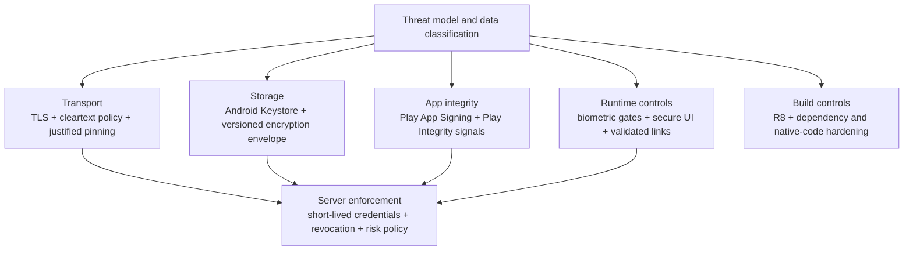

# Security & Privacy (Android Mobile)

> A 45-60 minute mobile system-design walkthrough for the security & privacy posture of an Android app: TLS + pinning, Keystore, biometric, screen capture, root/rebrand detection, PII handling, GDPR. A horizontal concern referenced across every other file.

---

## 1. Gathering Requirements (~5 min)

> **Interviewer:** "Walk me through the security and privacy decisions for a mobile app."
> **Candidate:** "Security breaks down into transport, storage, app integrity, and runtime. Privacy is about minimisation, consent, and compliance. I'll cover both and deep-dive Keystore-wrapped credential storage."

### Functional Requirements
- **TLS 1.3** for all network traffic.
- **Certificate pinning** in production builds.
- **Token storage** in Keystore-wrapped storage.
- **Biometric** for high-stakes actions.
- **PII redaction** in logs and analytics.
- **GDPR / CCPA** compliance: consent + delete-my-data.

### Non-Functional Requirements
- **Defense in depth** — multiple layers; no single point of failure.
- **No surprises** — security choices documented in code.
- **Compatible** with security review processes.
- **Tested**: pen-tested annually; regression caught in CI.
- **Failures don't crash** — graceful degradation.

### Out of Scope
- Server-side security (separate domain)
- Anti-fraud ML (server)
- App Store distribution security (Play handles signing, downloads)
- Hardware-level attestation deep dive (touched lightly)
- Compliance audits (legal team)

---

## 2. Clarifying Questions (~3 min)

| Question | Why it matters |
|---|---|
| Domain (banking, social, retail)? | Threat model intensity |
| Tokens (JWT, session)? | Storage strategy |
| Biometric tier (Class 3 required)? | Keystore binding |
| Markets (GDPR, CCPA, COPPA)? | Consent flow |
| OS floor? | Keystore features, biometric APIs |
| Anti-tamper requirements? | Root detection, Play Integrity |
| Network certificate rotation cadence? | Pinning UX |

> **Candidate:** "Retail with payments; JWT access + rotating refresh; Class-3 biometric on transactions > €30; GDPR + CCPA + COPPA; Android 9+; Play Integrity for high-risk actions; pinning rotation every 6 months with overlap."

---

## 3. The Security Stack on Android



No layer proves trust alone. Device-side controls reduce exposure and produce signals, while the backend still enforces credential lifetime, authorization, revocation, and risk decisions.

Validated against: [Android security best practices](https://developer.android.com/privacy-and-security/security-best-practices) and [Play Integrity overview](https://developer.android.com/google/play/integrity/overview).

---

## 4. Transport (TLS + Pinning)

### Strict TLS

```kotlin
val okHttp = OkHttpClient.Builder()
    .connectionSpecs(listOf(
        ConnectionSpec.Builder(ConnectionSpec.MODERN_TLS)
            .tlsVersions(TlsVersion.TLS_1_3, TlsVersion.TLS_1_2)
            .cipherSuites(*MODERN_CIPHERS)
            .build()
    ))
    .build()
```

Disable plaintext via `network_security_config.xml`:

```xml
<network-security-config>
    <base-config cleartextTrafficPermitted="false">
        <trust-anchors>
            <certificates src="system" />
        </trust-anchors>
    </base-config>
    <domain-config>
        <domain includeSubdomains="true">api.example.com</domain>
        <pin-set expiration="2026-12-31">
            <pin digest="SHA-256">primaryPinBase64==</pin>
            <pin digest="SHA-256">backupPinBase64==</pin>
        </pin-set>
    </domain-config>
</network-security-config>
```

### Pinning ops

- **Always have a backup pin** — primary pin compromise without backup = bricked app.
- **Rotate with overlap** — add new pin before retiring old.
- **Expire annually** — forces rotation cadence.
- **Pin only your domains** — don't pin third-party APIs.
- **Have a kill switch** — flag to disable pinning in case of emergency (review carefully).

### Cleartext blocker

```xml
<application android:usesCleartextTraffic="false">
```

Hard fail if any code path tries `http://`.

---

## 5. Storage (Keystore, Private Storage, SQLCipher)

### Token storage

Keep access tokens in memory when possible. When persistence is required, generate a direct `AndroidKeyStore` key, encrypt into a versioned `IV + ciphertext` envelope, and store that envelope in private storage. AndroidX Security Crypto deprecated `EncryptedSharedPreferences`; existing installations need a migration rather than being copied into new designs. See [Secure Storage on Android](../security/secure-storage-on-android.md).

Non-exportable does not mean unusable by a compromised process. Token TTL, rotation, revocation, audience restriction, and server-side anomaly controls remain mandatory.

### Room with SQLCipher

```kotlin
val passphrase = SQLiteDatabase.getBytes(keystoreWrappedPassphrase)
val factory = SupportFactory(passphrase)
val db = Room.databaseBuilder(context, AppDatabase::class.java, "app.db")
    .openHelperFactory(factory)
    .build()
```

The passphrase is generated once and wrapped by a direct Keystore AES key. Store only the versioned passphrase ciphertext in app-private storage.

### Keystore-bound biometric key

```kotlin
val keyGen = KeyGenerator.getInstance(KeyProperties.KEY_ALGORITHM_AES, "AndroidKeyStore")
keyGen.init(
    KeyGenParameterSpec.Builder("biometric_key",
        KeyProperties.PURPOSE_ENCRYPT or KeyProperties.PURPOSE_DECRYPT)
        .setBlockModes(KeyProperties.BLOCK_MODE_GCM)
        .setEncryptionPaddings(KeyProperties.ENCRYPTION_PADDING_NONE)
        .setUserAuthenticationRequired(true)
        .setUserAuthenticationParameters(0, KeyProperties.AUTH_BIOMETRIC_STRONG)
        .build()
)
```

Using this key requires fresh biometric authentication. Decrypting a stored token = biometric prompt.

---

## 6. App Integrity (Play Integrity)

```kotlin
val integrityManager = IntegrityManagerFactory.create(context)
val request = IntegrityTokenRequest.builder()
    .setNonce(serverProvidedNonce)
    .build()
integrityManager.requestIntegrityToken(request)
    .addOnSuccessListener { response ->
        // Send response.token() to your server for verification
    }
```

Server-side verification confirms: app is unmodified, signed by you, installed from Play (not sideloaded), running on a real device.

Use for: high-value actions (transfers, account changes). Not for ordinary reads.

---

## 7. Runtime Protections

### Screen capture / overlays

```kotlin
class PaymentActivity : ComponentActivity() {
    override fun onCreate(savedInstanceState: Bundle?) {
        super.onCreate(savedInstanceState)
        window.addFlags(WindowManager.LayoutParams.FLAG_SECURE)
    }
}
```

- Blocks screenshots of this activity.
- Hides from screen recording.
- Blacks out content in app switcher.

Use on: payment screens, security setup, sensitive content (medical, legal).

### Deep-link validation

```kotlin
fun handleDeepLink(uri: Uri): Boolean {
    if (uri.scheme != "https" || uri.host != "example.com") return false
    val path = uri.pathSegments
    // ... parse safely; never `eval` URI fragments
}
```

App Links + Digital Asset Links verification (see `deep-links-and-universal-links.md`).

### Tap-jacking

```kotlin
Button(modifier = Modifier.systemGestureExclusion()) { ... }

// Manifest:
android:filterTouchesWhenObscured="true"
```

Blocks malicious overlays from capturing taps.

---

## 8. Code Obfuscation & Shrinking

```kotlin
// build.gradle.kts
buildTypes {
    release {
        isMinifyEnabled = true
        isShrinkResources = true
        proguardFiles(
            getDefaultProguardFile("proguard-android-optimize.txt"),
            "proguard-rules.pro"
        )
    }
}
```

R8 obfuscates class/method names — raises the bar for reverse engineering. Doesn't stop a determined attacker but stops casual decompilation.

For sensitive constants:
- API keys: never in code. Inject via build config, server-driven if possible.
- Crypto secrets: never embed; derive from user input or server.

---

## 9. Deep Dive: Token Storage with a Keystore Envelope (~15 min)

> *I'd pick this as the deep dive because token storage is the most-attacked surface — credentials live forever and unlock everything else.*

### Why Keystore?

A token stored in ordinary private storage is protected by the UID sandbox but is plaintext if that file is extracted. A Keystore-backed envelope adds a non-exportable encryption key and optional authentication requirements. A compromised app process may still invoke an authorized key, so this is one layer rather than a complete root defense.

### The layering

```
User token (string)
    ↓ encrypted with
AES-GCM using a non-exportable key handle
    ↓ ciphertext + IV stored in
Private file / DataStore / SharedPreferences / database
    ↓ key material held by
Android Keystore (TEE or StrongBox only when verified)
```

### Key and envelope ownership

Use the direct `KeyGenerator` + `KeyGenParameterSpec` pattern in the canonical secure-storage page. If StrongBox is requested, handle `StrongBoxUnavailableException`; the platform does not promise a silent fallback. Record the envelope schema version, IV, ciphertext, key generation, and associated-data contract.

### Reading the token

```kotlin
val encrypted = keystoreAead.encrypt(
    plaintext = json.encodeToString(tokens).encodeToByteArray(),
    associatedData = accountId.encodeToByteArray(),
)
privateStore.write(encrypted)
```

### Biometric-bound variant

For apps where credentials must be biometric-gated on each use (e.g., banking):

```kotlin
suspend fun loadTokenWithBiometric(activity: FragmentActivity): String? {
    val cipher = createCipherForKeystoreKey("biometric-key")
    val ok = biometricPrompt.authenticate(activity, BiometricPrompt.CryptoObject(cipher))
    if (!ok) return null
    val encrypted = privateStore.read() ?: return null
    return decryptAuthenticatedBlob(cipher, encrypted).decodeToString()
}
```

`decryptAuthenticatedBlob` restores the stored IV before calling `doFinal`. Without successful biometric authentication, the configured key cannot perform the operation.

### Backup exclusion

```xml
<application android:fullBackupContent="@xml/backup_rules"
             android:dataExtractionRules="@xml/data_extraction_rules">
```

```xml
<!-- backup_rules.xml -->
<full-backup-content>
    <exclude domain="file" path="token-vault.bin" />
</full-backup-content>
```

Don't let Google Drive auto-backup carry tokens to other devices.

### Rotation on suspicion

If you detect a security event (failed biometric attempts, suspicious geo, server alert), force a token rotation:

```kotlin
suspend fun forceRotate() {
    vault.clear()
    navigator.replaceWithLogin(reason = ReAuthReason.SECURITY_EVENT)
}
```

---

## 10. Privacy & Compliance

### Minimisation

- Don't collect what you don't need.
- Aggregate locations to H3 cell, not raw lat/lng.
- Redact PII in logs and crash reports.

```kotlin
class PiiRedactor {
    private val patterns = mapOf(
        "email" to "[REDACTED_EMAIL]",
        "phone" to "[REDACTED_PHONE]",
        "card" to "[REDACTED_CARD]",
    )
    fun redact(message: String): String = patterns.entries.fold(message) { msg, (key, replacement) ->
        msg.replace(key.toRegex(), replacement)
    }
}
```

### Consent

```kotlin
data class Consent(val analytics: Boolean, val marketing: Boolean, val crashReporting: Boolean)
```

Gate every category through `Consent`. Default `false` for non-essential.

### Delete-my-data

```kotlin
suspend fun handleDeleteRequest() {
    api.deleteAccount()                    // server cascade
    db.clearAllTables()                    // local Room
    tokenVault.clear()                    // local secrets and dependent ciphertext
    notifierClear.cancelAll()              // active notifications
    workManager.cancelAllWork()            // pending workers
    auth.signOut()                          // session
}
```

Document this flow. Audit annually. Reach for the same code path as the GDPR delete endpoint.

### Lock-screen visibility

```kotlin
NotificationCompat.Builder(ctx, CHANNEL_SENSITIVE)
    .setVisibility(NotificationCompat.VISIBILITY_SECRET)    // hide content on lock screen
    ...
```

---

## 11. Common Misses

| Miss | Fix |
|---|---|
| Token in plain storage without a threat-model decision | Direct Keystore-backed vault when encryption is required; otherwise short-lived private storage with server controls |
| No pinning | Network Security Config + pin set |
| `usesCleartextTraffic=true` | Set to false |
| `allowBackup=true` carrying tokens | Exclude in backup rules |
| Logging tokens in OkHttp interceptor | Redact `Authorization` header |
| Screenshots possible on payment screen | `FLAG_SECURE` |
| Hardcoded API keys | BuildConfig + server-driven where possible |
| Wide-open deep link parser | Validate scheme + host |
| `runBlocking` on main exposing IO | Move to dispatcher |
| Storing biometric template (you can't) | Use Keystore-bound key + BiometricPrompt instead |

---

## 12. Testing & Audits

- **Static**: `Detekt`, `Lint`, OWASP Mobile checks in CI.
- **Dynamic**: Mob-SF (Mobile Security Framework), Frida-based runtime tests.
- **Pen-test**: annual by an external firm; high-stakes products quarterly.
- **Dependency scan**: `OWASP Dependency-Check`, `Snyk`, `Dependabot`.

---

## 13. Further Reading

- [Android Developers — Security best practices](https://developer.android.com/topic/security/best-practices) — official baseline.
- [Android Keystore system](https://developer.android.com/training/articles/keystore) — key storage internals.
- [Network Security Configuration](https://developer.android.com/training/articles/security-config) — pinning + TLS.
- [Play Integrity API](https://developer.android.com/google/play/integrity) — integrity verification.
- [OWASP Mobile Top 10](https://owasp.org/www-project-mobile-top-10/) — vulnerability checklist.

---

> **In short:** security is defense in depth — TLS + pinning, Keystore-wrapped storage, biometric for sensitive actions, FLAG_SECURE on payment, R8 obfuscation, Play Integrity for high-stakes flows, consent gates everywhere. Privacy is minimisation + redaction + a delete path. Test annually; gate in CI; never log credentials.
