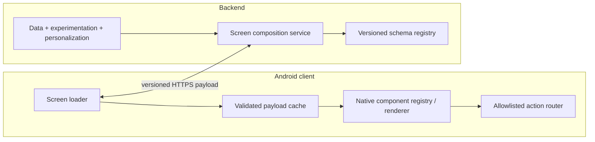

# Server-Driven UI (SDUI)

> A platform-design walkthrough for a server-driven UI system: the server decides *what* renders on a screen; the client owns *how* it renders. This is the architecture behind Airbnb's Ghost Platform, Lyft's home screen, and DoorDash's Mosaic — and the standard answer to "how do we ship UI changes without waiting for app releases and Play review?"

---

## 1. Gathering Requirements (~5 min)

> **Interviewer:** "Design a system where the server controls the app's screens."
> **Candidate:** "Let me scope which *kind* of server-driven we're building — the term covers everything from remote config to shipping a full interpreter."

### Functional Requirements

- **Server-composed screens** — the backend returns an ordered list of typed UI sections with data and actions; the client renders them with native components.
- **Same-day UI changes** — reorder sections, change copy, insert a new banner on existing component types without an app release.
- **New component rollout** — introduce a *new* component type to old app versions safely (they must degrade gracefully, not crash).
- **Interaction handling** — taps, form inputs, and impressions route through server-declared actions (navigate, mutate, open deep link).
- **Per-user/per-market composition** — screens vary by user segment, experiment bucket, and locale.

### Non-Functional Requirements

- **Render latency:** cached screen renders instantly; network-fresh screen p95 < 800ms.
- **Crash safety:** a malformed or unknown payload must *never* crash the app — worst case is a skipped section or a fallback screen.
- **Offline:** last-fetched screen renders offline; actions queue or disable explicitly.
- **Accessibility & theming parity:** server-driven screens meet the same a11y bar as native screens — semantics ship in the schema, not as an afterthought.
- **Observability:** every render, fallback, and unknown-component event is measurable per app version.

### Out of Scope (defended)

- Shipping executable logic (JS/Lua interpreters, Compose-runtime-over-the-wire) — that's a different risk class (app-store policy, security, debugging) and a different design.
- Server-driven *navigation graph* redesign (we handle per-screen composition; full flow orchestration is a follow-up).
- The CMS/authoring tool that product teams use to compose screens (we design the contract it must emit).
- Web rendering (same schema can serve web, but we design the Android client).

---

## 2. Clarifying Questions (~3 min)

| Question | Why it matters |
|---|---|
| How dynamic is "dynamic"? Copy/order changes, or new layouts weekly? | Decides schema generality vs simplicity |
| Who authors screens — engineers, PMs via CMS, ML ranking? | Drives validation strictness and preview tooling |
| Min supported app version / update lag? | Old binaries live 1-2+ years; forward compatibility is the core problem |
| One team or many teams contributing components? | Registry governance, naming, review process |
| Is the screen personalized per request? | Cache strategy: shared CDN cache vs per-user payloads |
| Existing design system? | Components map 1:1 to design-system components or SDUI fragments into pixel-level primitives |

> **Candidate:** "I'll assume: a design-system-backed component vocabulary (~30 types), PM-authored composition via a backend tool, apps up to 18 months old in the wild, personalized screens, 10M DAU."

---

## 3. High-Level Diagram (~10 min)



The server composes only schemas and actions the installed client advertises; the client validates, renders native components, and safely falls back for unknown types rather than executing arbitrary server code.

**Server-side (named, not designed):** a screen-composition BFF assembles sections from data services, filtered by the requesting app's **supported schema version and component set**; the component registry is the shared contract both sides build against. Airbnb's Ghost Platform does exactly this over a single shared GraphQL schema for web/iOS/Android.

---

## 4. API Contract

### Screen payload

```json
{
  "schemaVersion": "3",
  "screenId": "home",
  "ttlSeconds": 900,
  "sections": [
    {
      "id": "promo-banner-1",
      "type": "Banner",
      "typeVersion": 2,
      "props": {
        "title": "Summer sale",
        "imageUrl": "https://cdn.example.com/x.webp",
        "a11yLabel": "Summer sale. Up to 40 percent off."
      },
      "action": { "type": "deeplink", "uri": "app://sale/summer" },
      "fallback": { "behavior": "skip" },
      "analytics": { "impressionId": "imp_8821" }
    },
    {
      "id": "listing-carousel-1",
      "type": "Carousel",
      "typeVersion": 1,
      "props": { "items": [ { "...": "..." } ] },
      "fallback": { "behavior": "replaceWith", "type": "ListSection", "typeVersion": 1 }
    }
  ]
}
```

### Version negotiation (request)

```http
GET /v1/screens/home
X-SDUI-Schema-Version: 3
X-SDUI-Components: Banner:2,Carousel:1,ListSection:1,Grid:1
```

The client declares what it can render; the server composes only from that set (or attaches fallbacks). This single design decision is what makes 18-month-old binaries safe.

### The contract rules

- **Components are data, not code.** `props` are typed values validated against the registry schema — never templates or expressions to evaluate.
- **Actions are an enum, not a script.** `deeplink | navigate | mutate | dismiss | openSheet` — each handled by native code.
- **Every section carries a fallback policy** (`skip`, `replaceWith`, or `useNativeDefault`).
- **`a11y` fields are required** in the schema for any component with user-facing text or imagery — validated at authoring time, not left to client guesswork.

---

## 5. Mobile App Architecture

### Module structure

```
:core:sdui:schema        // payload models + parser (tolerant reader)
:core:sdui:renderer      // section list -> Compose, component registry
:core:sdui:actions       // action router (navigation, mutations)
:core:designsystem       // the native components SDUI maps onto
:feature:home            // hosts an SDUI screen with native chrome
```

### Key class signatures

```kotlin
// Registry: the client's declared vocabulary
interface ComponentRegistry {
    fun rendererFor(type: String, typeVersion: Int): SectionRenderer?
    fun supported(): Map<String, Int>          // sent in X-SDUI-Components
}

interface SectionRenderer {
    @Composable fun Render(section: Section, dispatch: (Action) -> Unit)
}

// Tolerant parsing: unknown fields ignored, unknown sections preserved
sealed interface ParsedSection {
    data class Known(val section: Section) : ParsedSection
    data class Unknown(val type: String, val fallback: Fallback?) : ParsedSection
}

class SduiScreenViewModel(
    private val loader: ScreenLoader,          // cache-then-network
    private val registry: ComponentRegistry,
) : ViewModel() { /* exposes StateFlow<SduiScreenState> */ }
```

The renderer maps section types onto **design-system components** — SDUI composes the design system; it does not bypass it. This keeps theming, a11y semantics, and interaction states native and consistent (see [`../platform-engineering/design-systems-architecture.md`](../platform-engineering/design-systems-architecture.md)).

## 6. Local Storage

One table, keyed by screen + user segment:

```sql
CREATE TABLE sdui_screens (
  screen_id TEXT NOT NULL,
  segment_key TEXT NOT NULL,      -- user/market/experiment hash
  payload BLOB NOT NULL,          -- raw JSON, re-parsed on read
  schema_version INTEGER NOT NULL,
  fetched_at INTEGER NOT NULL,
  ttl_seconds INTEGER NOT NULL,
  PRIMARY KEY (screen_id, segment_key)
);
```

Store the **raw payload**, not parsed models — a client update with a newer parser can re-read old cached payloads, and parse failures fall back exactly like network failures.

## 7. Deep Dive: Versioning & Forward Compatibility (~15 min)

The hard problem: **the server evolves weekly; binaries in the field are frozen for months.**

Three layers of defense:

1. **Tolerant reader.** The parser ignores unknown fields, treats missing optionals as defaults, and turns unknown section types into `ParsedSection.Unknown` instead of throwing. A parse error in one section never poisons the screen.
2. **Capability negotiation.** The client declares `type:typeVersion` pairs; the server never sends a component the binary can't render *without* a fallback the binary can.
3. **Server-declared fallbacks.** For gradual rollout of a new component, the payload carries `replaceWith` fallbacks expressed in old vocabulary. The authoring tool refuses to publish a screen whose fallback chain doesn't bottom out in components supported by the minimum live app version.

```kotlin
fun render(parsed: List<ParsedSection>): List<@Composable () -> Unit> =
    parsed.mapNotNull { p ->
        when (p) {
            is ParsedSection.Known ->
                registry.rendererFor(p.section.type, p.section.typeVersion)
                    ?.let { r -> { r.Render(p.section, ::dispatch) } }
                    ?: fallbackOf(p.section.fallback)      // known type, too-new version
            is ParsedSection.Unknown -> fallbackOf(p.fallback)
        }
    }
// fallbackOf: skip -> null; replaceWith -> render substitute; useNativeDefault -> native section
```

**Failure-mode table for this cycle:**

| Failure | Behavior | Signal |
|---|---|---|
| Unknown component type | Apply fallback (skip/replace) | `sdui_unknown_component{type, appVersion}` counter |
| Known type, newer `typeVersion` | Same as unknown | same counter, `reason=version` |
| Malformed props (schema mismatch) | Drop section, keep screen | `sdui_parse_error` with section id |
| Whole payload malformed | Serve cached payload; else native fallback screen | `sdui_screen_fallback` |
| Action type unknown | No-op + log (never crash) | `sdui_unknown_action` |

The observability requirement is structural: **unknown-component rate per app version** is the metric that tells the authoring side when a fallback chain is wrong — alert on it like a crash rate ([`../observability/metrics.md`](../observability/metrics.md)).

## 8. Trade-offs

| Axis | Native screens | SDUI (this design) | Shipping an interpreter (JS/DSL) |
|---|---|---|---|
| UI iteration speed | App release + rollout | Server deploy | Server deploy |
| New *behavior* | App release | App release (actions are enum) | Server deploy — and that's the problem |
| Crash risk from remote change | None | Low (fallbacks) | High (arbitrary logic) |
| Store policy risk | None | Low — payloads are data | Real: dynamic code raises review/policy questions |
| Debuggability | Full | Medium (payload + version matrix) | Poor (which script version did the user have?) |
| A11y/theming consistency | Native | Native (via design system) | Re-implemented per component |
| Cost | Per-feature | Platform team + registry governance | Platform team + language/runtime team |

The honest framing: SDUI moves iteration speed from "release-bound" to "deploy-bound" **for composition and content** while deliberately keeping *behavior* release-bound. Teams that need behavior-level dynamism are choosing the third column and should price its risks explicitly.

## 9. Major Concerns

- **Testing matrix explosion** — every payload shape × every live app version. Mitigate: contract tests generated from the registry; a "min-supported-version renderer" CI job that renders every published screen with the oldest binary's component set.
- **The registry becomes the bottleneck** — one team gate-keeping component additions recreates the release train socially. Mitigate: paved-road contribution process with schema linting, not human review for every prop.
- **Analytics drift** — server-composed screens must emit impressions/taps consistently; put `impressionId` in the schema so the server owns identity and the client owns delivery ([`analytics-sdk.md`](analytics-sdk.md)).
- **Performance** — deep section lists are still `LazyColumn` items with stable keys (`section.id`); payload-driven UI doesn't exempt you from [stability discipline](../android/compose/stability.md).
- **Offline UX honesty** — a stale cached screen with a dead promo is worse than a generic screen; TTL + "content may be outdated" states are product decisions to force early.

## 10. Follow-up Questions (anticipate)

- "How would you A/B test two screen compositions?" → the composition service consumes the experimentation platform ([`experimentation-platform.md`](experimentation-platform.md)); bucket in the segment key so caches don't cross-contaminate.
- "How do forms work — isn't input state behavior?" → input components own local state natively; submission is a `mutate` action with a typed payload; validation rules ship as data (regex/required/ranges), complex validation stays server-side.
- "How do you handle SDUI state management for interactive components?" → Components maintain ephemeral state (like text input or toggle state) locally via standard ViewModels, which is aggregated and dispatched as a unified payload upon a designated submit action, keeping the server stateless during interaction.
- "Could this drive the whole app?" → chrome (tabs, auth, settings) stays native; SDUI earns its keep on high-iteration surfaces (home, search results, checkout upsells) — Airbnb reports most-used surfaces on it, but they built authoring, preview, and observability tooling to match.

## 11. Out of Scope (defended earlier, restated)

Interpreter-based dynamism, server-driven navigation graphs, the authoring CMS, and multi-platform web rendering — each is its own design with its own failure modes.

## 12. Further Reading

- [A Deep Dive into Airbnb's Server-Driven UI System](https://medium.com/airbnb-engineering/a-deep-dive-into-airbnbs-server-driven-ui-system-842244c5f5) — the Ghost Platform: sections, single GraphQL schema, cross-platform frameworks.
- [InfoQ summary of Airbnb's SDUI platform](https://www.infoq.com/news/2021/07/airbnb-server-driven-ui/) — condensed architecture overview.
- [`feature-flags-and-remote-config.md`](feature-flags-and-remote-config.md) — the simpler sibling: values, not composition.
- [`versioning-and-backward-compatibility.md`](versioning-and-backward-compatibility.md) — the canonical version-negotiation treatment.
- [`../backend-for-mobile/bff-pattern.md`](../backend-for-mobile/bff-pattern.md) — the composition service is a BFF specialization.
- [`../platform-engineering/design-systems-architecture.md`](../platform-engineering/design-systems-architecture.md) — the component vocabulary SDUI composes.
