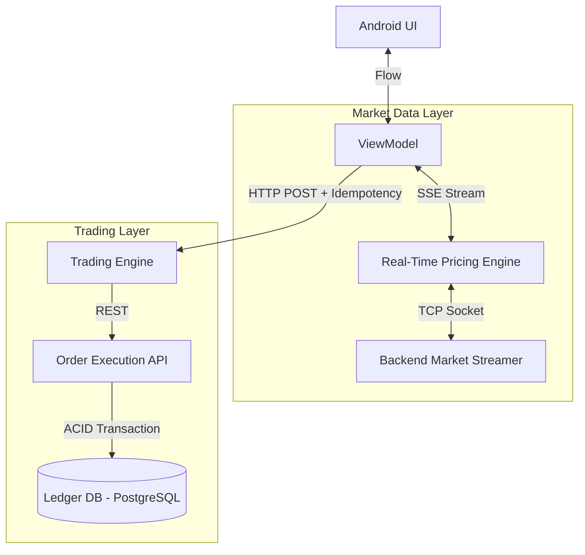

# System Design: Stock Trading App (Robinhood / Webull)

## The Prompt

*"Design a mobile Stock Trading application. The user must be able to view their portfolio, see a real-time line chart of a stock's price that ticks every millisecond, and execute a 'Buy' order. The system must prevent the user from buying more stock than they have cash for, even if they tap 'Buy' simultaneously on their phone and tablet."*

## 1. Requirements & Clarification (RADIO Framework)

### Functional Requirements
- Display real-time stock prices (tickers) on the home screen.
- Render a live-updating line chart of historical and current prices.
- Execute Buy/Sell orders.

### Non-Functional Requirements (NFRs)
- **Data Freshness (Priority 0):** Polling HTTP for stock prices is unacceptable. Prices change in milliseconds. Data must stream.
- **Transactional Integrity:** Zero double-spending. If the user has $100, they cannot buy $200 worth of stock by submitting two rapid requests.
- **Battery & CPU:** Parsing thousands of JSON price ticks per second will destroy the CPU and battery.

## 2. High-Level Architecture (The Streaming Architecture)

This architecture relies heavily on persistent, bi-directional streams and Server-Sent Events (SSE).

*Staff Rule:* We strictly separate the **Market Data** (high volume, read-only, disposable) from the **Trading Layer** (low volume, read-write, strict consistency).

## 3. The Core Flows (Deep Dive)

### Flow 1: Real-Time Price Ticking (SSE vs WebSockets)
*Interviewer:* "You need to show the live price of AAPL, TSLA, and MSFT on the home screen. How does the data get to the phone?"

**Staff Answer:**
"I will use **Server-Sent Events (SSE)**.
While WebSockets provide bi-directional communication (like Chat), stock prices are purely unidirectional (Server to Client). SSE operates over standard HTTP/2, automatically handles connection dropping/reconnection, and easily multiplexes across a single TCP connection.
1. The app opens an SSE connection: `GET /stream/prices?tickers=AAPL,TSLA,MSFT`.
2. The server holds the HTTP connection open and streams raw text events: `data: {"ticker":"AAPL", "price":150.25}`.
3. The Android app parses the stream using Kotlin Coroutines (`Flow`) and instantly updates the UI."

### Flow 2: The CPU Melt (Protobufs & Throttling)
*Interviewer:* "The market opens at 9:30 AM. AAPL is trading 10,000 times a second. Your SSE stream receives 10,000 JSON payloads per second. The Android JSON parser (Gson/Moshi) melts the CPU. The phone gets blazing hot. Fix it."

**Staff Answer:**
"Two massive optimizations are required:
1.  **Drop JSON for Protobuf:** JSON is a text format. Parsing it requires expensive string manipulation. We switch the SSE stream to transmit binary **Protocol Buffers (Protobuf)**. Protobuf parsing is mathematically vastly faster and reduces payload size by ~40%.
2.  **UI Throttling (Sample/Debounce):** The human eye cannot process 10,000 price changes a second. The screen only refreshes at 60Hz (60 times a second max). I will apply a `sample(16L)` operator to the Kotlin Flow. The app consumes all 10,000 ticks in the background to maintain an accurate internal state, but only emits the *latest* price to the UI once every 16 milliseconds (60 FPS), completely preventing UI thread overload."

### Flow 3: The Double-Spend Attack (Trading Integrity)
*Interviewer:* "The user has $100. A stock costs $100. The user logs into their Android phone and their iPad. They tap 'Buy' on both devices at the exact same millisecond. The server processes both. Now they have 2 stocks but their balance is -$100. How do you prevent this?"

**Staff Answer:**
"The protection must exist at the Database level using **ACID Transactions**. The mobile app cannot prevent this on its own.
1. The Android app sends `POST /orders/buy` with an **Idempotency Key** to prevent network retry duplicates.
2. However, the iPad uses a *different* Idempotency Key. Both requests hit the backend.
3. The Backend opens a SQL Transaction. It issues a `SELECT balance FROM users WHERE id = 1 FOR UPDATE`.
4. The `FOR UPDATE` clause places a Row-Level Lock on the user's balance in PostgreSQL.
5. The Android request acquires the lock, reads $100, deducts $100, inserts the stock, and Commits the transaction.
6. The iPad request is blocked, waiting for the lock. Once Android finishes, iPad acquires the lock, reads $0 balance, and Aborts the transaction due to insufficient funds. The user receives a 'Failed' response on the iPad."

### Flow 4: The Live Chart Rendering
*Interviewer:* "How do you render a line chart that has 5 years of historical data, plus the real-time blinking dot of today's price, without the app crashing from drawing 100,000 data points?"

**Staff Answer:**
"We cannot use a standard UI `Canvas` to draw 100,000 points. We must use **Data Decimation**.
1. If the screen is 1080 pixels wide, it is physically impossible to display more than 1080 data points (one per pixel column).
2. Before rendering, the app groups the 100,000 historical points into 1080 buckets. It calculates the Average (or High/Low/Close) for each bucket.
3. The charting library (e.g., MPAndroidChart, or a custom Canvas) only draws the 1080 decimated points.
4. As the real-time SSE stream ticks, we dynamically append the new price to the end of the array and call `invalidate()` to redraw just the leading edge of the chart."

## 4. Staff Engineer Thinking: Eventual Consistency vs Strong Consistency

A Junior engineer treats all data the same. A Staff engineer separates it.

- **Market Data (Prices) = Eventual Consistency.** If the phone's price is 50ms delayed, it's fine. We use Redis and fast stream processors. We allow data to be slightly stale because speed is the priority.
- **Account Data (Cash/Portfolio) = Strong Consistency.** If the user's cash balance is wrong, we are sued by the SEC. We use strict SQL ACID databases. We never cache the user's cash balance in a NoSQL database or allow eventual consistency for trades.

## 5. Probing Questions (For Practice)

1.  Explain why Server-Sent Events (SSE) is architecturally superior to WebSockets for a unidirectional data stream like live stock prices.
2.  Describe the CPU bottleneck caused by parsing thousands of JSON payloads per second, and why Protocol Buffers (Protobuf) is the required solution.
3.  How does the `sample()` or `throttleLast()` operator in Kotlin Flow protect the Android Main Thread from dropping frames when receiving rapid price ticks?
4.  Walk through the "Double Spend" scenario. Explain why client-side checks are insufficient and how a SQL `SELECT ... FOR UPDATE` lock guarantees integrity.
5.  Why is it crucial to separate the Market Data streaming architecture (fast, eventual consistency) from the Trading Execution architecture (slow, strong consistency)?
6.  Explain "Data Decimation" in the context of rendering a massive 5-year stock chart on a mobile screen. Why is drawing every single data point physically impossible?
7.  If a user's network drops while an SSE connection is active, how does the client recover the missed price ticks when it reconnects?
8.  Why must an Order Execution API endpoint (`POST /buy`) require an Idempotency Key generated by the Android client?
9.  Describe the difference between an Order being "Placed" and an Order being "Filled." Why must the mobile app rely on Webhooks/SSE to notify the user of a fill, rather than waiting on the original HTTP POST?
10. If the backend is updating millions of users with stock prices simultaneously, why is a technology like Kafka generally used before pushing to the SSE Gateway?

## Further Reading

- [`push-vs-poll-vs-sse-vs-websockets.md`](../backend-for-mobile/push-vs-poll-vs-sse-vs-websockets.md) — The deep dive into why SSE wins for unidirectional streams.
- [`data-formats.md`](../backend-for-mobile/data-formats.md) — Why Protobuf parses faster than JSON.
- [`flow.md`](../android/architecture/flow.md) — How to use `sample()` to throttle UI updates.
