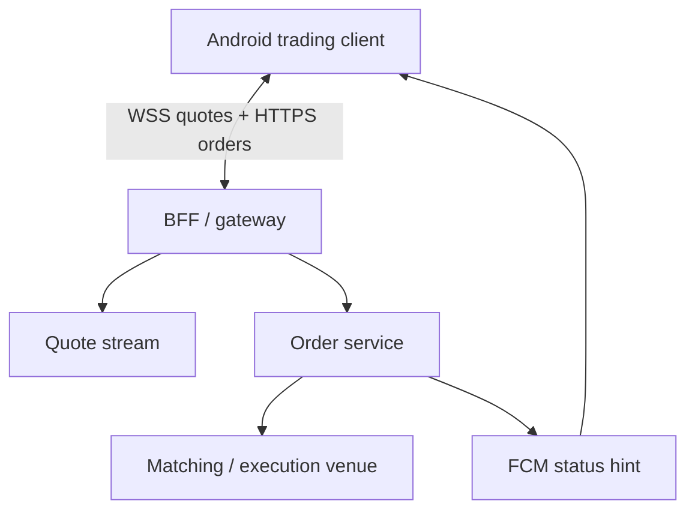
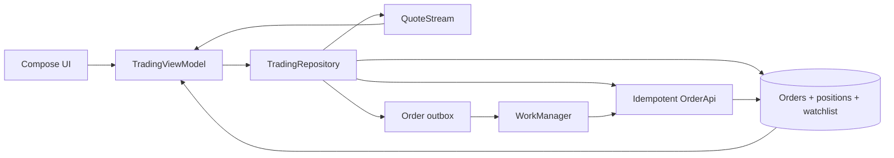

# Stock Trading App (Robinhood-style)

> A 45-60 minute mobile system-design walkthrough for a brokerage client (Android-first). The matching engine, smart routing, and PFOF mechanics live on the backend — the bulk of this file is how the Android app streams quotes, places orders without double-charges, and survives flaky networks.

---

## 1. Gathering Requirements (~5 min)

> **Interviewer:** "Design a stock trading app like Robinhood."
> **Candidate:** "Trading apps live or die on two things from the client side: real-time price streaming under bad networks, and never double-submitting an order. I'll anchor the deep dive on streaming."

### Functional Requirements
- **Real-time quotes** for a watchlist (~30-50 symbols).
- **Place a market or limit order** with confirmation and review screen.
- **View positions and order history**.
- **Charts** with intraday + historical price (line, candlestick).
- **Push notification** when an order fills or a price alert triggers.

### Non-Functional Requirements
- **Quote latency** < 250 ms p95 over LTE.
- **Order submission**: idempotent, "did it actually go through?" never ambiguous.
- **Smooth scroll** on the watchlist even during fast quote updates.
- **Secure**: biometric gate on order confirmation, no PIN/credentials in logs.
- **Regulatory**: surface day-trade count, settled cash, options approval level.

### Out of Scope
- Account opening / KYC flow
- Options chains / multi-leg orders
- Crypto trading
- Margin / lending
- Tax-lot reporting screens
- Matching engine, dark pools, PFOF (black-box server)

---

## 2. Clarifying Questions (~3 min)

| Question | Why it matters |
|---|---|
| Quote update frequency? | WebSocket throttling, render budget |
| Avg watchlist size? | Stream subscription cost, cache size |
| Real broker or simulated? | Regulatory disclosures, biometric gating |
| Markets (US-only or global)? | Session hours, after-hours states |
| Android API floor? | `setExpedited`, FGS rules |
| Pre/after-hours streaming? | Reconnect policy outside RTH |
| Order types in scope? | Validation rules, review screen |
| Audit / Reg-NMS compliance needs? | Local persistence of "what user saw" |

> **Candidate:** "Assume US equities only, market + limit + stop orders, 30-symbol watchlist, 20-100 ticks/sec aggregate, Android 9+."

---

## 3. High-Level Diagram (~10 min)



Quotes are time-sensitive presentation data, while orders are durable, idempotent commands whose canonical status comes from the order service—not the quote socket or push message.

**Server components (named, not designed):**
- **BFF / Gateway** — auth, rate-limit, fan-in.
- **Quote Stream** — WebSocket, level-1 quotes (last/bid/ask/size).
- **Order Service** — validates, persists, routes to matching engine, emits fills.
- **Matching Engine** — black box.
- **Push** — FCM data messages for fills + alerts.

---

## 4. API Contract

### Quote WebSocket

```json
// Client → Server
{ "type": "subscribe", "symbols": ["AAPL", "TSLA", "MSFT"] }

// Server → Client (frequent)
{ "type": "quote", "s": "AAPL", "last": 213.55, "bid": 213.52, "ask": 213.57,
  "bs": 200, "as": 150, "t": 1750000000123 }

// Server → Client (less frequent)
{ "type": "ohlcv", "s": "AAPL", "interval": "1m", "o": 213.10, "h": 213.80,
  "l": 213.00, "c": 213.55, "v": 12345, "t": 1750000000000 }
```

### Orders (REST)

| Method | Path | Use |
|---|---|---|
| `POST` | `/v1/orders` | Place order; **requires `Idempotency-Key`** header |
| `GET` | `/v1/orders?status=open` | List open orders |
| `DELETE` | `/v1/orders/{id}` | Cancel; idempotent |
| `GET` | `/v1/positions` | Current positions |
| `GET` | `/v1/account` | Cash, settled, day-trade count |

### Place order payload

```json
POST /v1/orders
Idempotency-Key: 8f7a-…-uuid
{
  "symbol": "AAPL", "side": "BUY", "type": "LIMIT",
  "qty": 10, "limitPrice": 213.50, "tif": "DAY"
}
```

### Fill push (FCM)

```json
{ "type": "order.fill", "orderId": "o_42", "symbol": "AAPL",
  "qty": 10, "avgPrice": 213.50, "status": "FILLED" }
```

> **Idempotency rule:** every order POST carries a client-generated UUID. Retries with the same key return the same `orderId` — the only safe way to avoid double-buys.

---

## 5. Mobile App Architecture (~10 min)

### Module structure

```
:app
:feature:watchlist
:feature:order-entry
:feature:positions
:feature:charts
:core:network        ← OkHttp + Retrofit + WebSocket
:core:database       ← Room 2.7+, watchlist + order history
:core:secure         ← Keystore, biometric prompts
:core:work           ← order Outbox worker
:domain:trading      ← order model, validators
:data:trading
```

### Layered diagram



Ephemeral quotes and durable order state remain separate streams; Room preserves orders and positions through process death while quote freshness is displayed explicitly.

### Key class signatures

```kotlin
interface QuoteStream {
    fun quotes(symbols: Set<String>): Flow<Quote>     // shared, ref-counted
    val connection: StateFlow<ConnectionState>
}

interface TradingRepository {
    fun watchlist(): Flow<List<WatchlistRow>>          // joins quote + position
    suspend fun placeOrder(req: NewOrder): Result<Order>
    suspend fun cancel(orderId: String): Result<Unit>
    fun openOrders(): Flow<List<Order>>
}
```

---

## 6. Local Storage (Room)

```kotlin
@Entity(tableName = "orders")
data class OrderEntity(
    @PrimaryKey val clientOrderId: String,      // = Idempotency-Key
    val serverOrderId: String?,                  // null until ACKed
    val symbol: String, val side: Side, val type: OrderType,
    val qty: Int, val limitPrice: Double?,
    val status: OrderStatus,                     // PENDING, ACCEPTED, FILLED, REJECTED, CANCELLED
    val submittedAt: Long, val updatedAt: Long
)
```

Tables: `orders`, `positions`, `watchlist_symbols`, `outbox`. Quotes are **never** persisted — they're ephemeral, in-memory StateFlows.

> **Probing Q you'll hear:** "Why no quote history in Room?" Because OHLCV is fetched on demand for the chart screen and lives in memory; persisting tick data is a server problem.

---

## 7. Deep Dive: Real-Time Quote Streaming (~15 min)

> *Quotes are the highest-frequency data the client touches. Done wrong: jank, battery drain, 5,000 recompositions per second. Done right: smooth scroll at 120 Hz, < 1% CPU at idle.*

### Subscription model

```kotlin
class QuoteStream @Inject constructor(private val socket: TradingSocket) {
    private val subs = MutableStateFlow<Set<String>>(emptySet())
    private val cache = ConcurrentHashMap<String, MutableStateFlow<Quote?>>()

    fun quotes(symbols: Set<String>): Flow<Quote> = flow {
        val refCounted = refCount(symbols)
        coroutineScope {
            symbols.forEach { s ->
                val flow = cache.getOrPut(s) { MutableStateFlow(null) }
                launch { flow.filterNotNull().collect(::emit) }
            }
            awaitCancellation()
        }
    }
}
```

Reference-counted subscriptions. When the last collector for `AAPL` goes away, the client sends `unsubscribe AAPL`.

### Backpressure / throttling

Quotes can arrive at 50-200/sec per symbol. Two-layer strategy:

| Layer | Technique |
|---|---|
| Network → Cache | Write every tick to `StateFlow` (cheap, conflated) |
| Cache → UI | `sample(33.ms)` on the collector — at most 30 frames/sec/symbol |
| Off-screen | `repeatOnLifecycle(STARTED)` — pause collection when scrolled away |

```kotlin
val quote: StateFlow<Quote?> = stream.quotes(setOf(symbol))
    .sample(33.milliseconds)
    .stateIn(scope, SharingStarted.WhileSubscribed(5_000), null)
```

### WebSocket lifecycle

| Event | Action |
|---|---|
| App foreground + market open | Connect; subscribe visible symbols |
| App backgrounded | Disconnect after 30s; rely on FCM for fills |
| Market closed | Disconnect; show last close + delayed badge |
| Reconnect after drop | Re-send full subscription set; backfill last quote via REST |
| Token expired | Refresh token, then reconnect |

### Compose render

```kotlin
@Composable
fun QuoteRow(symbol: String) {
    val quote by viewModel.quote(symbol).collectAsStateWithLifecycle()
    val color = priceColor(quote?.lastDelta)   // remember/derivedStateOf
    Row {
        Text(symbol)
        Text(quote?.last?.formatPrice() ?: "—", color = color)
    }
}
```

`derivedStateOf` for the color flash so the row only recomposes when the *sign* of the delta changes, not every tick.

### Order submission flow (the other critical path)

```kotlin
suspend fun placeOrder(req: NewOrder): Result<Order> {
    val key = UUID.randomUUID().toString()
    val pending = OrderEntity(clientOrderId = key, status = PENDING, ...)
    dao.insert(pending)                 // visible in UI as "Submitting"
    return runCatching {
        val resp = api.placeOrder(idempotencyKey = key, body = req)
        dao.update(pending.copy(serverOrderId = resp.id, status = ACCEPTED))
        Order.from(resp)
    }.onFailure { t ->
        if (t.isNetworkError) {
            outbox.schedule(key)         // worker retries with same key
        } else {
            dao.update(pending.copy(status = REJECTED))
        }
    }
}
```

The `Idempotency-Key` is the only thing standing between the user and a double-buy when the network drops between request and response.

---

## 8. Trade-offs

### Quote transport

| Option | Pros | Cons | Verdict |
|---|---|---|---|
| **WebSocket** | Bidirectional, low overhead, batch subscribe | Battery in background | Pick this |
| SSE | Simpler than WS, HTTP/2 | One-way; can't unsubscribe cheaply | Acceptable fallback |
| FIX | Industry standard | Heavy on mobile, TCP-only | Server-side only |
| Polling | Trivial | Awful for streaming | Avoid |

### Order submission

| Choice | Pick | Reason |
|---|---|---|
| Idempotency mechanism | **Client UUID header** | Server-generated keys race with retries |
| Outbox for orders | **Yes, but only on network error** | 4xx never retries — that's a real rejection |
| Biometric gate | **On confirm** | Defense against shoulder-surf and stolen device |
| Local "trade journal" | **Yes** | Audit + offline view of last 90 days |

### Chart rendering

| Option | Verdict |
|---|---|
| **Compose Canvas** | Pick — Compose-native, no extra dep |
| MPAndroidChart | Mature but Java + View, integration cost |
| Vico | Good Compose option for line/bar |
| WebView + chart.js | Latency, no offline |

### Persistence

| Option | Use |
|---|---|
| **Room** | Orders, positions, watchlist |
| DataStore (Proto) | User prefs (default order type, chart timeframe) |
| In-memory StateFlow | Quotes (never persisted) |
| EncryptedSharedPrefs | Auth tokens (or DataStore + Tink) |

---

## 9. Major Concerns

- **Double-submission.** Client UUID idempotency key on every order. Outbox retries on network failure. Never on 4xx.
- **Stale quotes.** Each `Quote` carries `t` (server timestamp). If `(now - t) > 5s` show a "delayed" badge. Don't auto-trade on stale data.
- **Battery.** WebSocket only in foreground + market hours. FCM for fills when backgrounded. No quote stream in background.
- **Render budget.** `sample(33ms)` per row, `derivedStateOf` for derived colors, `key` on LazyColumn items. Target < 16 ms per frame.
- **Process death.** `OrderEntity` is durable; on resume, fetch open-order status from `/v1/orders?status=open` and reconcile.
- **Security.** Biometric on order confirm. `FLAG_SECURE` on order review and account screens. TLS 1.3 + certificate pinning. No logging of order payloads.
- **Regulatory disclosures.** Day-trade count, settled cash, options-level disclaimers must render *before* the confirm button. Cache server config; don't hardcode rules.
- **Market session edges.** Pre-market, RTH, after-hours have different rules (no stop orders pre-market, etc.). The UI must reflect the current session, fetched from server.
- **Network partition during fill.** If we sent the order but missed the ack: query `/v1/orders/{clientOrderId}` (server keys by both) to resolve the truth.

---

## 10. Follow-up Questions

> **Q: How do you avoid jank on a 50-symbol watchlist with fast quotes?**
> `sample(33ms)` per row, `LazyColumn` with stable `key`s, `derivedStateOf` for any computed color/animation. Profile with `JankStats`; target < 16 ms p99 frame on a Pixel 6a.

> **Q: User submits an order, app crashes before the ack — what now?**
> On next launch, scan `orders` for `PENDING`. Call `/v1/orders/{clientOrderId}` for each. Server returns the canonical state (ACCEPTED, REJECTED, FILLED, or "unknown" if it never arrived).

> **Q: How do you handle reconnect during a market-moving event?**
> On socket open, re-send `subscribe` for all visible symbols. Then issue `/v1/quotes?symbols=…` REST snapshot to backfill the gap. Stream takes over once a tick newer than the snapshot arrives.

> **Q: What's the worst race condition you can think of?**
> User taps "Cancel" while the server is filling. `DELETE /v1/orders/{id}` returns `409 Conflict` with the filled state. Client UX must clearly say "Cancel failed — your order filled at X." Don't silently swallow it.

> **Q: Why no SQL on quotes — what if I scroll back?**
> Quotes are conflated; only the latest matters. For historical (chart), call `/v1/ohlcv?symbol=AAPL&interval=1m&from=…`. Persisting tick history on-device is wasteful and never accurate enough for the regulators to trust.

> **Q: Pre-market vs RTH vs after-hours — how is this modelled?**
> Server exposes `/v1/market/session`. Cached in Room with TTL. UI badge + order-form validators read from it. Never hardcode "9:30 AM ET" — holidays exist.

---

## 11. Out of Scope (defended)

- **Account opening / KYC** — entirely separate flow (Persona / Plaid integration). 45 min on its own.
- **Options trading** — chain UI, multi-leg builder, Greeks. Separate file.
- **Crypto** — different settlement (24/7, T+0), different regulators.
- **Margin / lending** — risk engine, maintenance call UX.
- **Tax-lot picker** — complex compliance UX, separate from buy/sell.
- **Matching-engine internals** — that's a backend interview, not mobile.

---

## 12. Further Reading

- [weeeBox/mobile-system-design](https://github.com/weeeBox/mobile-system-design) — reference format.
- [Android Developers — WorkManager idempotency patterns](https://developer.android.com/topic/libraries/architecture/workmanager) — official guide.
- [OkHttp WebSocket API](https://github.com/square/okhttp/blob/master/okhttp/src/commonJvmAndroid/kotlin/okhttp3/WebSocket.kt) — connection lifecycle.
- [Stripe API — Idempotency Keys](https://stripe.com/docs/api/idempotent_requests) — canonical reference for the pattern.
- [Robinhood Engineering blog](https://robinhood.engineering/) — production stories on quote throughput and order pipelines.

---

> **Closing in the interview:** "Real-time quotes were my deep dive because it's the highest-frequency client problem. Happy to go into the order state machine, biometric gating, or the regulatory disclosure layer next."
