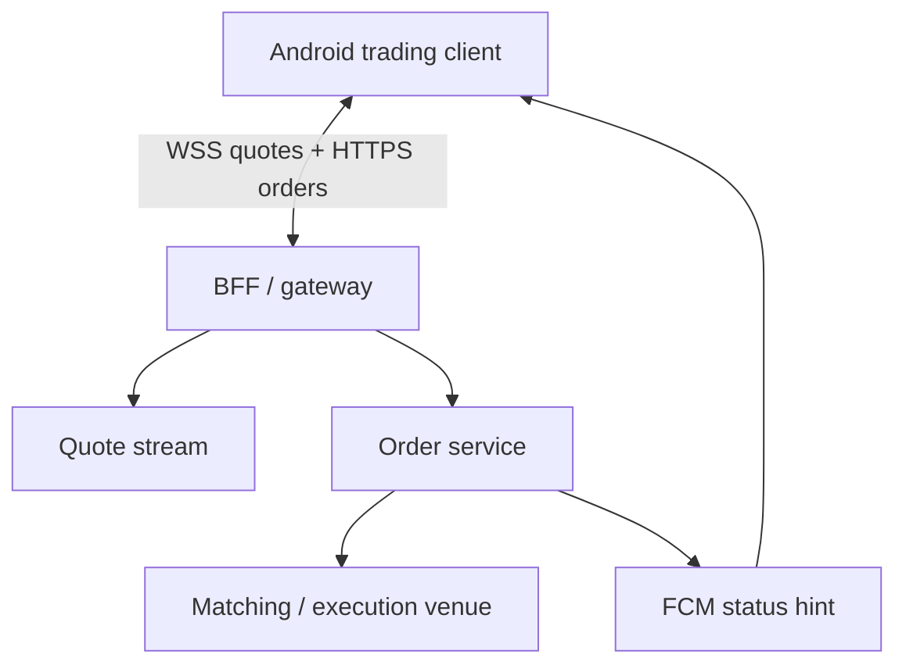
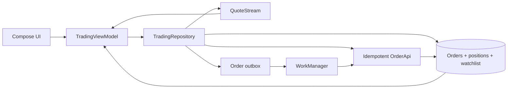

# Stock Trading App (Robinhood-style)

> A 45-60 minute mobile system-design walkthrough for a brokerage client (Android-first). The matching engine, smart routing, and PFOF mechanics live on the backend — the bulk of this file is how the Android app streams quotes, places orders without double-charges, and survives flaky networks.

---

## 1. Gathering Requirements (~5 min)

> **Interviewer:** "Design a stock trading app like Robinhood."
> **Candidate:** "Trading apps live or die on two things from the client side: real-time price streaming under bad networks, and never double-submitting an order. I'll anchor the deep dive on streaming."

### Functional Requirements
- **Real-time quotes** for a watchlist (~30-50 symbols).
- **Place a market or limit order** with confirmation and review screen.
- **View positions and order history**.
- **Charts** with intraday + historical price (line, candlestick).
- **Push notification** when an order fills or a price alert triggers.

### Non-Functional Requirements
- **Quote latency** < 250 ms p95 over LTE.
- **Order submission**: idempotent, "did it actually go through?" never ambiguous.
- **Smooth scroll** on the watchlist even during fast quote updates.
- **Secure**: biometric gate on order confirmation, no PIN/credentials in logs.
- **Regulatory**: render the disclosures and account figures the broker's backend requires, such as settled cash and buying power. They change by broker and over time.

### Out of Scope
- Account opening / KYC flow
- Options chains / multi-leg orders
- Crypto trading
- Margin / lending
- Tax-lot reporting screens
- Matching engine, dark pools, PFOF (black-box server)

---

## 2. Clarifying Questions (~3 min)

| Question | Why it matters |
|---|---|
| Quote update frequency? | WebSocket throttling, render budget |
| Avg watchlist size? | Stream subscription cost, cache size |
| Real broker or simulated? | Regulatory disclosures, biometric gating |
| Markets (US-only or global)? | Session hours, after-hours states |
| Android API floor? | `setExpedited`, FGS rules |
| Pre/after-hours streaming? | Reconnect policy outside RTH |
| Order types in scope? | Validation rules, review screen |
| Audit / broker recordkeeping needs? | Local persistence of "what user saw" |

> **Candidate:** "Assume US equities only, market + limit orders, 30-symbol watchlist, 20-100 ticks/sec aggregate, Android 9+."

---

## 3. High-Level Diagram (~10 min)



Quotes are time-sensitive presentation data, while orders are durable, idempotent commands whose canonical status comes from the order service—not the quote socket or push message.

**Server components (named, not designed):**
- **BFF / Gateway** — auth, rate-limit, fan-in.
- **Quote Stream** — WebSocket, level-1 quotes (last/bid/ask/size).
- **Order Service** — validates, persists, routes to matching engine, emits fills.
- **Matching Engine** — black box.
- **Push** — FCM data messages for fills + alerts.

---

## 4. API Contract

### Quote WebSocket

```json
// Client → Server
{ "type": "subscribe", "symbols": ["AAPL", "TSLA", "MSFT"] }

// Server → Client (frequent)
{ "type": "quote", "s": "AAPL", "last": 213.55, "bid": 213.52, "ask": 213.57,
  "bs": 200, "as": 150, "t": 1750000000123 }

// Server → Client (less frequent)
{ "type": "ohlcv", "s": "AAPL", "interval": "1m", "o": 213.10, "h": 213.80,
  "l": 213.00, "c": 213.55, "v": 12345, "t": 1750000000000 }
```

### Orders (REST)

| Method | Path | Use |
|---|---|---|
| `POST` | `/v1/orders` | Place order; **requires `Idempotency-Key`** header |
| `GET` | `/v1/orders?status=open` | List open orders |
| `GET` | `/v1/orders/by-client-id/{clientOrderId}` | Canonical state of one order, including filled or cancelled ones; 404 means no command exists yet, not that one can't still arrive |
| `POST` | `/v1/orders/by-client-id/{clientOrderId}/abandon` | Atomically fences the key: returns `ABANDONED` and refuses any later arrival, or returns the order if it already exists. Repeating it returns the same answer, so a lost response is safe to retry |
| `DELETE` | `/v1/orders/{id}` | Cancel; idempotent |
| `GET` | `/v1/positions` | Current positions |
| `GET` | `/v1/account` | Cash, settled cash, buying power, required disclosures |

### Place order payload

```json
POST /v1/orders
Idempotency-Key: 8f7a-…-uuid
{
  "accountId": "acct_1",                 // server checks this against the authenticated principal
  "symbol": "AAPL", "side": "BUY", "type": "LIMIT",
  "qty": "10", "limitPrice": "213.50", "tif": "DAY",   // decimal strings, never binary floats
  "expiresAt": 1750000060000                           // server rejects a delayed retry after this
}
```

### Fill push (FCM)

```json
{ "type": "order.update", "orderId": "o_42" }
```

The push is a hint with no symbol, quantity or price. The app fetches the order and shows details only for the signed-in account, so a late push on a shared phone leaks nothing. Sign-out unregisters the token.

> **Idempotency rule:** every order POST carries a client-generated UUID, created once for one user decision. Retries with the same key return the same `orderId` — the only safe way to avoid double-buys.

---

## 5. Mobile App Architecture (~10 min)

### Module structure

```
:app
:feature:watchlist
:feature:order-entry
:feature:positions
:feature:charts
:core:network        ← OkHttp + Retrofit + WebSocket
:core:database       ← Room 2.7+, watchlist + order history
:core:secure         ← Keystore, biometric prompts
:core:work           ← order Outbox worker
:domain:trading      ← order model, validators
:data:trading
```

### Layered diagram



Ephemeral quotes and durable order state remain separate streams; Room preserves orders and positions through process death while quote freshness is displayed explicitly.

### Key class signatures

```kotlin
interface QuoteStream {
    fun quotes(symbols: Set<String>): Flow<Quote>     // shared, ref-counted
    val connection: StateFlow<ConnectionState>
}

interface TradingRepository {
    fun watchlist(): Flow<List<WatchlistRow>>          // joins quote + position
    suspend fun placeOrder(draft: OrderDraft): OrderOutcome     // draft holds the one clientOrderId
    suspend fun cancel(orderId: String): Result<Unit>
    fun openOrders(): Flow<List<Order>>
}
```

---

## 6. Local Storage (Room)

```kotlin
@Entity(tableName = "orders")
data class OrderEntity(
    @PrimaryKey val clientOrderId: String,      // = Idempotency-Key
    val accountId: String,                       // brokerage account that owns the order
    val serverOrderId: String?,                  // null until ACKed
    val symbol: String, val side: Side, val type: OrderType,
    val qty: BigDecimal, val limitPrice: BigDecimal?,  // stored as strings; rounded to the server's tick rules
    val filledQty: BigDecimal, val avgFillPrice: BigDecimal?,
    val status: OrderStatus,                     // SUBMITTING, UNKNOWN, ACCEPTED, PARTIALLY_FILLED, FILLED, REJECTED, CANCELLED, EXPIRED
    val expiresAt: Long,                         // no resend after this without reconfirming
    val submittedAt: Long, val updatedAt: Long
)
```

Tables: `orders`, `positions`, `watchlist_symbols`, `outbox`, all keyed by `accountId` and purged at sign-out. Quotes are **never** persisted — they're ephemeral, in-memory StateFlows.

> **Probing Q you'll hear:** "Why no quote history in Room?" Because OHLCV is fetched on demand for the chart screen and lives in memory; persisting tick data is a server problem.

---

## 7. Deep Dive: Real-Time Quote Streaming (~15 min)

> *Quotes are the highest-frequency data the client touches. Done wrong: jank, battery drain, 5,000 recompositions per second. Done right: smooth scroll inside the frame budget, < 1% CPU at idle.*

### Subscription model

```kotlin
class QuoteStream @Inject constructor(private val socket: TradingSocket) {
    private val subs = MutableStateFlow<Set<String>>(emptySet())
    private val cache = ConcurrentHashMap<String, MutableStateFlow<Quote?>>()

    // channelFlow, because a plain flow can't emit from child coroutines.
    fun quotes(symbols: Set<String>): Flow<Quote> = channelFlow {
        retain(symbols)                  // subscribes on the first reference to a symbol
        try {
            symbols.forEach { s ->
                val flow = cache.getOrPut(s) { MutableStateFlow(null) }
                launch { flow.filterNotNull().collect { send(it) } }
            }
            awaitCancellation()
        } finally {
            release(symbols)             // runs on cancellation; unsubscribes the last reference
        }
    }
}
```

Reference-counted subscriptions. When the last collector for `AAPL` goes away, the client sends `unsubscribe AAPL`.

### Backpressure / throttling

The feed averages 20-100 ticks/sec across the watchlist, and a busy symbol can burst far above that. Two-layer strategy:

| Layer | Technique |
|---|---|
| Network → Cache | Write every tick to `StateFlow` (cheap, conflated) |
| Cache → UI | `sample(33.ms)` on the collector — at most 30 frames/sec/symbol |
| Screen stopped | `collectAsStateWithLifecycle` pauses collection below `STARTED` |
| Row scrolled away | `LazyColumn` disposes the row's composition, which ends its collection; `WhileSubscribed` then releases the symbol. Lifecycle state alone can't see this |

```kotlin
val quote: StateFlow<Quote?> = stream.quotes(setOf(symbol))
    .sample(33.milliseconds)
    .stateIn(scope, SharingStarted.WhileSubscribed(5_000), null)
```

The ViewModel keeps one such `StateFlow` per symbol, so a row returning to the screen reuses it.

### WebSocket lifecycle

| Event | Action |
|---|---|
| App foreground + market open | Connect; subscribe visible symbols |
| App backgrounded | Disconnect after 30s; rely on FCM for fills |
| Market closed | Disconnect; show last close + delayed badge |
| Reconnect after drop | Re-send full subscription set; backfill last quote via REST |
| Token expired | Refresh token, then reconnect |

### Compose render

```kotlin
@Composable
fun QuoteRow(symbol: String) {
    val quote by viewModel.quote(symbol).collectAsStateWithLifecycle()
    val color = priceColor(quote?.lastDelta)   // remember/derivedStateOf
    Row {
        Text(symbol)
        Text(quote?.last?.formatPrice() ?: "—", color = color)
    }
}
```

The row reads the quote to draw its price, so a new price recomposes it, and that's correct. `derivedStateOf` can't stop that. The real limits are the `sample` rate and stable keys. Move the color into its own small composable with `derivedStateOf` only if profiling shows it matters.

### Order submission flow (the other critical path)

```kotlin
// The review screen creates one OrderDraft per user decision, with its clientOrderId and accountId fixed.
suspend fun placeOrder(draft: OrderDraft): OrderOutcome {
    val key = draft.clientOrderId
    dao.insertIfAbsent(draft.toEntity(status = SUBMITTING))    // committed before sending
    return try {
        val resp = api.placeOrder(draft.accountId, idempotencyKey = key, body = draft.toRequest())
        dao.applyServerState(key, resp)
        OrderOutcome.Accepted(resp.id)
    } catch (e: CancellationException) {
        outbox.schedule(draft.accountId, key)   // the send may have happened: stay unresolved, and rethrow
        throw e
    } catch (e: Exception) {
        when (val failure = e.toOrderFailure()) {
            is OrderFailure.Rejected -> {    // the API's typed business rejection only
                dao.markRejected(key, failure.reason)
                OrderOutcome.Rejected(failure.reason)
            }
            else -> {                        // network, 408, 429, 401, 5xx: outcome unknown
                dao.markUnknown(key)
                outbox.schedule(draft.accountId, key)   // recovery keeps the same account and key
                OrderOutcome.Unknown(key)
            }
        }
    }
}

// Outbox worker: accountId comes from the work input and never changes.
// Look before resending, and never place a stale order silently.
suspend fun resolve(accountId: String, key: String) {
    val order = dao.get(accountId, key) ?: return
    when (val server = api.orderByClientId(accountId, key)) {
        is Found -> dao.applyServerState(key, server.order)
        is NotFound ->
            if (clock.now() < order.expiresAt) {
                dao.applyServerState(key, api.placeOrder(accountId, idempotencyKey = key, body = order.toRequest()))
            } else when (val result = api.abandonOrder(accountId, key)) {
                is Abandoned -> dao.markExpired(key)      // only now is non-placement proven
                is Found -> dao.applyServerState(key, result.order)
            }                                             // a failed abandon leaves it UNKNOWN; work retries
    }
}
```

**Account binding.** Every order call names its `accountId`, and the network layer gets credentials for that account, refusing to attach a token belonging to anyone else. A one-time check of the current session wouldn't protect this: the user could switch accounts while a suspended request is waiting, and A's draft would go out with B's token. The server also checks `accountId` against the authenticated principal. Cancelling an account's work at sign-out is cleanup, not the security boundary.

**Expiry needs a server decision.** A 404 doesn't prove non-placement, because a timed-out POST may still be in flight. So the client never decides alone. The server applies `expiresAt` atomically when it creates the command, and `abandon` fences the key so a slow request can't commit later. Until `abandon` answers, the order stays `UNKNOWN`, and recovery repeats the lookup and `abandon` with the same account and key.

**Ordering.** `applyServerState` keeps the newer state by the server's per-order version, not by timestamp or arrival order, and the screen reads Room rather than individual responses.

The `Idempotency-Key` is the only thing standing between the user and a double-buy when the network drops between request and response. So it's created once per decision. While an order is `SUBMITTING` or `UNKNOWN`, the UI shows "Checking your order" instead of a retry button. A different key needs a new, explicit decision from the user, and only after the old one is resolved or confirmed abandoned. HTTP status alone doesn't decide this: 408 allows a repeat, 429 may carry `Retry-After`, an expired token needs a refresh, and a coroutine cancellation says nothing about the exchange. `expiresAt` is short, because a market order sent minutes late isn't what the user approved.

---

## 8. Trade-offs

### Quote transport

| Option | Pros | Cons | Verdict |
|---|---|---|---|
| **WebSocket** | Bidirectional, low overhead, batch subscribe | Battery in background | Pick this |
| SSE | Simpler than WS, HTTP/2 | One-way; can't unsubscribe cheaply | Acceptable fallback |
| FIX | Industry standard | Heavy on mobile, TCP-only | Server-side only |
| Polling | Trivial | Awful for streaming | Avoid |

### Order submission

| Choice | Pick | Reason |
|---|---|---|
| Idempotency mechanism | **Client UUID header** | Server-generated keys race with retries |
| Outbox for orders | **Yes, for any unresolved outcome** | A typed business rejection never retries. Timeouts, 408, 429, expired auth and 5xx stay unknown and resolve with the same key |
| Biometric gate | **On confirm** | Defense against shoulder-surf and stolen device |
| Local "trade journal" | **Yes** | Audit + offline view of last 90 days |

### Chart rendering

| Option | Verdict |
|---|---|
| **Compose Canvas** | Pick — Compose-native, no extra dep |
| MPAndroidChart | Mature but Java + View, integration cost |
| Vico | Good Compose option for line/bar |
| WebView + chart.js | Latency, no offline |

### Persistence

| Option | Use |
|---|---|
| **Room** | Orders, positions, watchlist |
| DataStore (Proto) | User prefs (default order type, chart timeframe) |
| In-memory StateFlow | Quotes (never persisted) |
| DataStore + Keystore-wrapped key | Auth tokens. AndroidX `security-crypto` is deprecated, so don't start new work on EncryptedSharedPreferences |

---

## 9. Major Concerns

- **Double-submission.** One client UUID per user decision, saved before sending. Outbox resolves any unknown outcome with that key. Never retry a typed rejection.
- **Stale quotes.** Each `Quote` carries `t` (server timestamp), but the device clock can be wrong, so measure age from when the quote was received, using a monotonic clock. Past 5 s, show a "delayed" badge. Don't auto-trade on stale data.
- **Battery.** WebSocket only in foreground + market hours. FCM for fills when backgrounded. No quote stream in background.
- **Render budget.** `sample(33ms)` per row, `key` on LazyColumn items. Target the display's frame budget: 16.7 ms at 60 Hz, 8.3 ms at 120 Hz.
- **Process death.** `OrderEntity` is durable. On resume, resolve every non-terminal row through `/v1/orders/by-client-id/{clientOrderId}`, because an order that filled while the app was dead is no longer in the open list.
- **Security.** Biometric on order confirm. `FLAG_SECURE` on order review and account screens. TLS 1.3 + certificate pinning. No logging of order payloads.
- **Regulatory disclosures.** Required disclosures must render *before* the confirm button, and the server supplies them. Cache server config; don't hardcode rules. These rules do change: [FINRA's Notice 26-10](https://www.finra.org/rules-guidance/notices/26-10) removed the pattern-day-trader count test and $25,000 minimum in favour of an intraday margin standard, effective 4 June 2026, with phase-in allowed to 20 October 2027. A fixed day-trade counter would now be wrong for some brokers and still expected by others.
- **Recordkeeping.** Broker-dealer record rules govern audit storage, on the server. An on-device journal is a convenience, not the record.
- **Market session edges.** Pre-market, RTH, after-hours have different broker and venue rules. The UI must reflect the current session and allowed order types, fetched from server.
- **Network partition during fill.** If we sent the order but missed the ack: query `/v1/orders/by-client-id/{clientOrderId}` to resolve the truth.
- **Partial fills.** A limit order can fill in pieces. Show `filledQty` and `avgFillPrice`, and update positions from the server, not by assuming all or nothing.
- **Shared device.** Orders and positions are scoped to `accountId` and purged at sign-out.

---

## 10. Follow-up Questions

> **Q: How do you avoid jank on a 50-symbol watchlist with fast quotes?**
> `sample(33ms)` per row and `LazyColumn` with stable `key`s. Isolate a computed color or animation only if profiling shows it matters. Profile with `JankStats` on a mid-range 60 Hz device and a 120 Hz device, against each one's frame budget.

> **Q: User submits an order, app crashes before the ack — what now?**
> On next launch, scan `orders` for every non-terminal row. Call `/v1/orders/by-client-id/{clientOrderId}` for each. Server returns the canonical state, or 404 if no command exists yet. On 404, resend with the same key before `expiresAt`. After that, call `abandon`. Only an `ABANDONED` answer marks it expired and asks the user to confirm again; if the slow request won the race, `abandon` returns the real order.

> **Q: How do you handle reconnect during a market-moving event?**
> On socket open, re-send `subscribe` for all visible symbols. Then issue `/v1/quotes?symbols=…` REST snapshot to backfill the gap. Stream takes over once a tick newer than the snapshot arrives.

> **Q: What's the worst race condition you can think of?**
> User taps "Cancel" while the server is filling. `DELETE /v1/orders/{id}` returns `409 Conflict` with the filled state. Client UX must clearly say "Cancel failed — your order filled at X." A partial fill needs its own message: "4 of 10 filled at X; the rest cancelled." Don't silently swallow it.

> **Q: Why no SQL on quotes — what if I scroll back?**
> Quotes are conflated; only the latest matters. For historical (chart), call `/v1/ohlcv?symbol=AAPL&interval=1m&from=…`. Persisting tick history on-device is wasteful and never accurate enough for the regulators to trust.

> **Q: Pre-market vs RTH vs after-hours — how is this modelled?**
> Server exposes `/v1/market/session`. Cached in Room with TTL. UI badge + order-form validators read from it. Never hardcode "9:30 AM ET" — holidays exist.

---

## 11. Out of Scope (defended)

- **Account opening / KYC** — entirely separate flow (Persona / Plaid integration). 45 min on its own.
- **Options trading** — chain UI, multi-leg builder, Greeks. Separate file.
- **Crypto** — different settlement (24/7, T+0), different regulators.
- **Margin / lending** — risk engine, maintenance call UX.
- **Tax-lot picker** — complex compliance UX, separate from buy/sell.
- **Matching-engine internals** — that's a backend interview, not mobile.

---

## 12. Further Reading

- [weeeBox/mobile-system-design](https://github.com/weeeBox/mobile-system-design) — reference format.
- [Android Developers — Persistent work with WorkManager](https://developer.android.com/develop/background-work/background-tasks/persistent/getting-started) — official guide.
- [Stripe API — Idempotency Keys](https://stripe.com/docs/api/idempotent_requests) — canonical reference for the pattern.
- [FINRA Regulatory Notice 26-10](https://www.finra.org/rules-guidance/notices/26-10) — why disclosure rules belong on the server.

---

> **Closing in the interview:** "Real-time quotes were my deep dive because it's the highest-frequency client problem. Happy to go into the order state machine, biometric gating, or the regulatory disclosure layer next."
