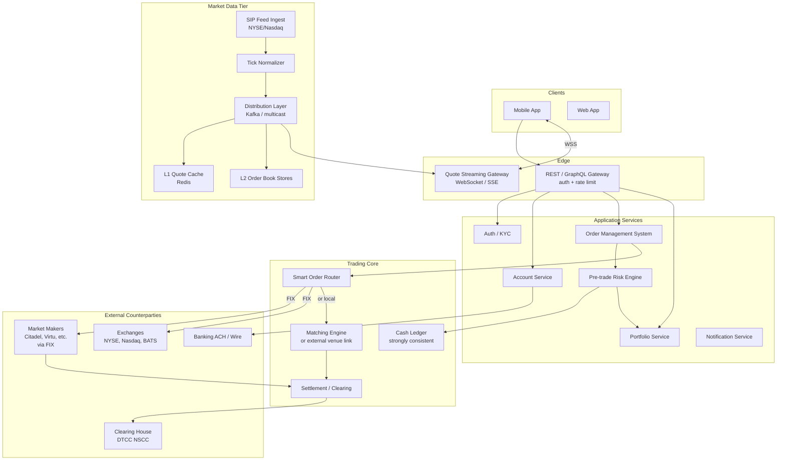
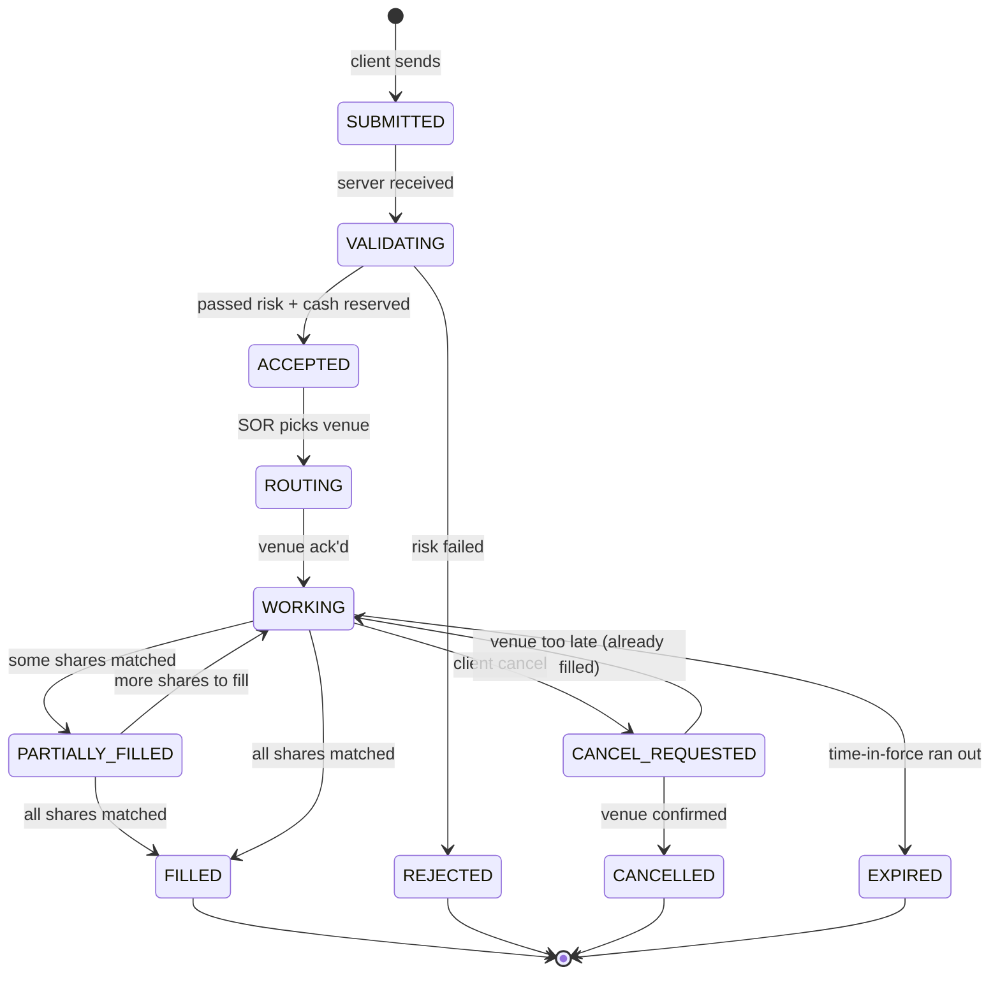
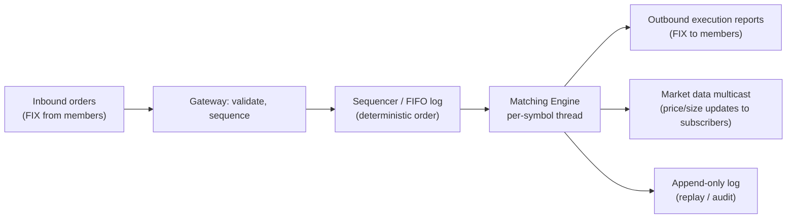
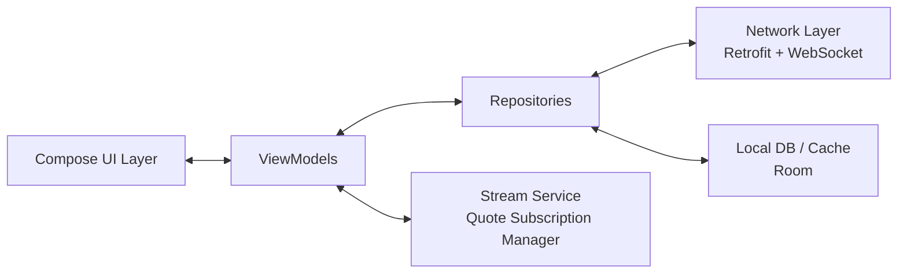

# Stock Trading App System Design

> Interview-style deep dive on designing a mobile stock-trading app (Robinhood / Webull / Fidelity / E*Trade). Covers the full order lifecycle and state machine, order types (market, limit, stop, stop-limit, trailing), the matching engine, smart order routing and Payment for Order Flow (PFOF), real-time market data streaming via WebSocket / SSE / FIX, position and cash reconciliation, regulatory constraints (NBBO, Reg NMS, PDT rule, Pattern Day Trading), and the mobile-specific concerns around latency, double-spend prevention, and offline behavior.

---

## 1. Problem Statement

Design a mobile trading app where users can:

- View their portfolio (positions, P&L, cash).
- See real-time price charts for stocks (line chart, candlestick) updating tick-by-tick.
- Place orders of multiple types: **market**, **limit**, **stop**, **stop-limit**, **trailing stop**.
- View order status (pending, partially filled, filled, cancelled, rejected).
- Cancel or modify open orders.
- Receive push notifications when orders fill or stop triggers.
- Trade outside market hours (pre-market 4-9:30 AM ET, after-hours 4-8 PM ET).
- Avoid double-spends — buying more than account cash allows.
- Comply with **NBBO** (National Best Bid Offer), **Reg NMS** (US), **Pattern Day Trading** rule, **T+1 settlement**.

### Functional Requirements

- Account management (KYC, banking link, balances, settlement).
- Watchlists.
- Quote / Level 1 data (best bid / ask / last trade).
- Optional Level 2 (full order book depth).
- Order placement, modification, cancellation.
- Order status tracking and history.
- Portfolio + transaction history.
- Multi-device sync.

### Non-Functional Requirements

| Concern | Target | Why |
|---|---|---|
| Quote refresh latency | < 100ms | UI feel of "real-time" |
| Order acknowledgement | < 200ms (median); < 500ms (p99) | Trader expectation |
| Order placement to broker | < 50ms internal | Industry standard |
| Order placement to fill (market order) | < 500ms typical | Routes via market maker |
| Chart frame rate during ticking | 60fps; never block UI | Mobile UX |
| Cash double-spend probability | 0 — must be impossible | Regulatory + business |
| Trade-record durability | 11 nines, immutable, audited | Regulatory (FINRA, SEC) |
| System uptime | 99.99% during market hours | Trading halt is catastrophic |
| Background ticker delivery | < 5s for price alerts | Acceptable trade-off |

### Scale Assumptions

For a major retail broker (~50M accounts, ~5M DAU during market):

| Quantity | Estimate |
|---|---|
| Active concurrent WebSocket connections | 3M during open |
| Symbols in universe | ~10,000 (US listed) |
| Price ticks per second peak (full feed) | 2M+ (SIP consolidated; ~50M+ raw) |
| Orders per day | 100M |
| Orders per second peak | 5K |
| Cash transactions per day | 200M |
| Storage (trades + audit) | 50TB/year + immutable |

---

## 2. Glossary

| Term | Meaning |
|---|---|
| **NBBO** | National Best Bid Offer — best price across all US exchanges. Brokers must meet or beat NBBO. |
| **Reg NMS** | SEC regulation governing US equity market structure including NBBO obligations. |
| **PFOF** | Payment for Order Flow — market makers pay brokers to send retail orders to them. |
| **SOR** | Smart Order Router — decides which venue/market-maker gets each order. |
| **Level 1 / L1** | Top of book: best bid, ask, last trade, volume. |
| **Level 2 / L2** | Full order book depth (per-price-level quantities). |
| **Tick** | A single price update. |
| **FIX** | Financial Information eXchange — industry standard protocol for orders between broker / exchange. |
| **OMS** | Order Management System — tracks every order's lifecycle. |
| **PDT** | Pattern Day Trader rule — 4+ day-trades in 5 business days requires ≥ $25K equity in margin account. |
| **T+1** | Trade date + 1 business day settlement. |

---

## 3. High-Level Architecture



### Tier responsibilities

- **API Gateway:** authenticated REST/GraphQL for orders, account, portfolio.
- **Quote Gateway:** persistent WebSocket fanning out market data to subscribed clients.
- **OMS (Order Management System):** order lifecycle, persistence, state machine.
- **Pre-trade Risk Engine:** synchronous check on every order — sufficient cash? margin OK? not PDT-blocked? halted symbol?
- **Cash Ledger:** strongly consistent, ACID. Reserves cash on order placement.
- **Smart Order Router:** decides venue per order.
- **Matching Engine (if running own venue) or external exchange/market-maker link via FIX.**
- **Settlement / Clearing:** T+1 settlement with DTCC; bookkeeping.
- **Market Data Tier:** ingests SIP (Securities Information Processor) and per-exchange feeds, normalizes ticks, distributes.

---

## 4. The Order Lifecycle

### 4.1 State machine



Each transition is an event with audit data (timestamp, venue, fill price/qty, reason). Events are append-only and immutable.

### 4.2 Order types

| Type | Definition | Use case |
|---|---|---|
| **Market** | Buy/sell at current best price | Fast execution; pays the spread |
| **Limit** | Buy/sell at price or better | Want a specific price |
| **Stop** | Triggers market order when price crosses stop | Stop-loss; trailing exit |
| **Stop-Limit** | Triggers limit order when stop reached | Stop-loss with no slippage risk |
| **Trailing Stop** | Stop that trails the price by % or $ | Lock in gains while letting upside run |
| **GTC / Day / IOC / FOK** | Time-in-force modifier | How long order is alive |

Time-in-force:
- **DAY**: cancelled at end of trading day if unfilled.
- **GTC** (Good 'til Cancelled): persists across days (typically max 60-90 days).
- **IOC** (Immediate or Cancel): execute any portion immediately; cancel rest.
- **FOK** (Fill or Kill): all-or-nothing immediately or cancel.

---

## 5. Placing an Order — The Full Flow

### 5.1 Happy-path sequence (market buy)

```mermaid
sequenceDiagram
    participant App as Mobile App
    participant Local as Local Room DB
    participant GW as API Gateway
    participant OMS as OMS
    participant Risk as Risk Engine
    participant Cash as Cash Ledger
    participant SOR as Smart Router
    participant MM as Market Maker (FIX)
    participant Push as Push Service

    App->>App: user confirms order
    App->>Local: insert order (status=SUBMITTED, idem_key=uuid)
    App->>GW: POST /orders {idem_key, symbol, qty, type, side}
    GW->>OMS: create order
    OMS->>Risk: validate(order)
    Risk->>Cash: try-reserve $amount + buffer
    Cash->>Cash: SELECT FOR UPDATE; reserve
    Cash-->>Risk: ok
    Risk->>Risk: NBBO check, halt check, PDT check
    Risk-->>OMS: ACCEPTED
    OMS-->>GW: 200 OK {order_id, status=ACCEPTED}
    GW-->>App: response
    App->>Local: update status=ACCEPTED

    OMS->>SOR: route(order)
    SOR->>MM: FIX New Order Single
    MM-->>SOR: FIX Execution Report (FILL)
    SOR->>OMS: filled qty, avg_price
    OMS->>Cash: settle: release reserve, debit actual
    OMS->>Push: notify "order filled"
    Push->>App: FCM data push
    App->>Local: update status=FILLED, fill_price
    App->>App: UI updates, portfolio refreshes
```

### 5.2 Key engineering points

**Idempotency key.** Client generates a UUID per order tap. Server rejects duplicates of the same key with the previous result. Prevents double-orders from network retry, accidental re-tap, double-device.

**Cash reservation.** Before routing, the order's cash requirement (plus a small buffer for slippage on market orders) is reserved in the cash ledger via a row-level lock or compare-and-swap. This prevents the user from placing two simultaneous orders that together exceed their balance.

```kotlin
@Transactional(isolation = SERIALIZABLE)
fun reserve(userId: UserId, amount: Money): Result<ReservationId> {
    val account = cashDao.selectForUpdate(userId)
    if (account.available < amount) return Failure("insufficient")
    cashDao.updateAvailable(userId, account.available - amount)
    return Success(reservationDao.create(userId, amount))
}
```

Serializable isolation or row-level locks prevent the race "user has $100, taps Buy $80 on phone and $80 on tablet simultaneously."

**Pre-trade risk checks.** Synchronous before order leaves:
- Cash / margin sufficient (above).
- Symbol tradeable (not halted, not delisted, exchange open if not extended-hours session).
- Pattern Day Trading: would this be the user's 4th day-trade in 5 days with < $25K equity? If yes, reject.
- Concentration limits, position limits (in some accounts).
- Buying-power calculation includes unsettled cash, margin.

**Smart Order Router (SOR).** For PFOF brokers (Robinhood, etc.): a routing table mapping market maker → priority. Pick the market maker offering best execution per historical performance and NBBO. For full-service brokers (Fidelity, Schwab): probe multiple venues for best price, route to winner. SOR's choice affects fill quality, latency, and revenue (PFOF rebates).

**FIX protocol.** The wire protocol with exchanges and market makers. Tag-value messages:

```
8=FIX.4.4|9=176|35=D|49=BROKER|56=MARKETMAKER|34=42|52=20260615-14:30:00|
11=client-order-id-uuid|55=AAPL|54=1|38=100|40=1|59=0|...
```

(35=D is "New Order Single". 11 is client order id. 55 is symbol. 54=1 is buy. 38=100 is 100 shares. 40=1 is market order. 59=0 is DAY time-in-force.)

The OMS maintains a long-running FIX session with each venue: heartbeats, sequence numbers, gap-fill, resend.

### 5.3 Partial fills

A market order for 1,000 shares of an illiquid stock may not fill in one block:

```
Order placed: 1000 shares
Execution Report 1: 300 shares @ $45.10
Execution Report 2: 500 shares @ $45.12
Execution Report 3: 200 shares @ $45.15
Final: 1000 shares, average $45.124
```

Each execution report updates the order's filled qty + average price. UI shows progress: "300/1000 filled." VWAP shown for avg price.

For limit orders, the order may rest at the limit price for a long time, picking up partial fills over hours.

### 5.4 Cancel race

User taps Cancel; server forwards CancelRequest; market maker has just filled the order microseconds earlier.

Resolution: the venue's response wins. If "filled before cancel," the cancel rejection is delivered; UI reverts the cancel attempt to "filled."

---

## 6. The Matching Engine (Concept)

Even brokers that don't run their own venue benefit from understanding matching engines, because they integrate with venues that do.

### 6.1 Order book data structure

```
Per symbol:
    bids: sorted descending by price (highest first), then by arrival time
    asks: sorted ascending by price (lowest first), then by arrival time
```

In production: each side is two structures — a price-level tree (sorted) and per-price-level FIFO queues for orders at that price. Updates are O(log N) for new price levels, O(1) for adding to existing.

### 6.2 Matching algorithm (price-time priority)

```kotlin
data class Order(val id: OrderId, val side: Side, val price: Price, val qty: Quantity, val ts: Long)

class OrderBook(val symbol: Symbol) {
    private val bids = TreeMap<Price, ArrayDeque<Order>>(reverseOrder())
    private val asks = TreeMap<Price, ArrayDeque<Order>>()

    fun submit(order: Order): List<Trade> {
        val trades = mutableListOf<Trade>()
        var remaining = order.qty
        val oppositeBook = if (order.side == Side.BUY) asks else bids

        // Match against opposite side while crossing
        while (remaining > 0 && oppositeBook.isNotEmpty()) {
            val (bestPrice, queue) = oppositeBook.firstEntry()
            if (!crosses(order.side, order.price, bestPrice)) break
            val head = queue.firstOrNull() ?: break
            val tradeQty = minOf(remaining, head.qty)
            trades += Trade(buyer = if (order.side == BUY) order.id else head.id,
                            seller = if (order.side == SELL) order.id else head.id,
                            price = bestPrice, qty = tradeQty)
            remaining -= tradeQty
            if (head.qty == tradeQty) queue.removeFirst() else head.qty -= tradeQty
            if (queue.isEmpty()) oppositeBook.remove(bestPrice)
        }

        // Rest unfilled portion in the book (for limit orders)
        if (remaining > 0 && order.type == LIMIT) {
            val mySide = if (order.side == BUY) bids else asks
            mySide.getOrPut(order.price) { ArrayDeque() }.addLast(order.copy(qty = remaining))
        }

        return trades
    }

    private fun crosses(side: Side, myPrice: Price, opp: Price): Boolean =
        (side == BUY && myPrice >= opp) || (side == SELL && myPrice <= opp)
}
```

This is a simplified single-threaded matcher. Production engines (NYSE Pillar, Nasdaq INET) run on dedicated CPUs, use lock-free ring buffers, and process millions of orders per second per symbol.

### 6.3 Why single-threaded?

A single thread per symbol guarantees ordering (no two trades can "cross" each other). Locking would slow it down more than the missed parallelism gains. Modern matching engines run one thread per symbol or symbol-shard, each pinned to a CPU core.

### 6.4 Architecture



Deterministic replay from the log is critical: if a node crashes, a fresh node replays the log and arrives at the same book state.

---

## 7. Market Data Pipeline

### 7.1 Data sources

- **SIP (Securities Information Processor):** the consolidated public feed. Best bid/ask across all US exchanges. Free-ish but slower (~milliseconds behind).
- **Direct feeds:** per-exchange feeds (NYSE OpenBook, Nasdaq TotalView). Faster but ~$100K+/month each.
- **OPRA:** options consolidated tape.

Retail brokers usually use SIP for free quotes. Pros stream direct feeds.

### 7.2 Ingest and normalization

```mermaid
flowchart LR
    SIP[SIP / Direct feeds<br/>UDP multicast]
    Ingest[Feed Handlers<br/>parse + dedupe + sequence-check]
    Normalize[Normalizer<br/>unified schema across feeds]
    Bus[Kafka topics<br/>per symbol or partition]
    L1[L1 Quote Cache<br/>Redis: symbol → {bid, ask, last}]
    L2[L2 Order Book Service<br/>per-symbol in-memory]
    Distribution[Distribution Layer]
    QuoteGW[Quote Gateway<br/>WebSocket]
    Clients[Client subscribers]

    SIP --> Ingest --> Normalize --> Bus
    Bus --> L1
    Bus --> L2
    Bus --> Distribution
    Distribution --> QuoteGW --> Clients
```

### 7.3 Client subscription

```
// WebSocket subscription
{
  "action": "subscribe",
  "channel": "quotes",
  "symbols": ["AAPL", "TSLA", "MSFT"]
}
```

Server subscribes the connection to the relevant channels. Updates pushed when ticks arrive.

### 7.4 Throttling for mobile

A symbol can tick 100+ times/second during volatility. Sending every tick to mobile is wasteful (battery, render). Throttle:

```kotlin
class QuoteClient(scope: CoroutineScope) {
    private val rawTicks = Channel<Tick>(capacity = Channel.CONFLATED)

    val displayQuotes: Flow<Tick> = flow {
        // Emit at most 10/sec per symbol (conflated upstream gives latest)
        while (currentCoroutineContext().isActive) {
            val tick = rawTicks.receive()
            emit(tick)
            delay(100)
        }
    }
}
```

The `Channel.CONFLATED` drops intermediate ticks if the consumer is behind. UI sees a smooth tick stream at ≤10Hz; the underlying market data is uncorrupted.

### 7.5 Chart data

Two layers:
- **Live ticking** (last 5-15min, from streaming feed).
- **Historical aggregates** (1m / 5m / 1h / 1d candles, from REST endpoint, computed server-side and cached on CDN).

Chart on mobile:

```kotlin
data class Candle(val ts: Long, val open: Float, val high: Float, val low: Float, val close: Float, val volume: Long)

class ChartViewModel(private val api: MarketApi, private val stream: QuoteStream) : ViewModel() {
    private val _candles = MutableStateFlow<List<Candle>>(emptyList())
    val candles: StateFlow<List<Candle>> = _candles

    fun load(symbol: String, range: ChartRange) {
        viewModelScope.launch {
            _candles.value = api.candles(symbol, range)
            stream.subscribe(symbol).collect { tick ->
                _candles.update { current ->
                    val last = current.lastOrNull()
                    if (last == null || tick.ts - last.ts > range.bucketMs) {
                        current + Candle(tick.ts, tick.price, tick.price, tick.price, tick.price, tick.size)
                    } else {
                        current.dropLast(1) + last.copy(
                            high = maxOf(last.high, tick.price),
                            low = minOf(last.low, tick.price),
                            close = tick.price,
                            volume = last.volume + tick.size
                        )
                    }
                }
            }
        }
    }
}
```

---

## 8. Cash Ledger & Reconciliation

### 8.1 Ledger design

Double-entry bookkeeping. Every transaction is a pair (debit, credit) summing to zero. Per account:

```sql
CREATE TABLE ledger_entries (
    entry_id BIGSERIAL PRIMARY KEY,
    account_id BIGINT NOT NULL,
    leg TINYINT NOT NULL,            -- 0=debit, 1=credit
    amount NUMERIC(20,4) NOT NULL,
    currency CHAR(3) NOT NULL,
    transaction_id UUID NOT NULL,    -- groups paired entries
    reason VARCHAR(64) NOT NULL,
    created_at TIMESTAMPTZ NOT NULL DEFAULT NOW()
);
CREATE INDEX idx_account_time ON ledger_entries(account_id, created_at);
```

To compute available cash:

```sql
SELECT SUM(CASE WHEN leg=1 THEN amount ELSE -amount END)
FROM ledger_entries WHERE account_id = ?;
```

For performance, maintain a materialized `account_balances` table updated on each insert.

### 8.2 Reservations & holds

When an order is placed but not yet filled, the cash is held — not yet debited.

```
On ACCEPT:
    INSERT reservation { account_id, amount, order_id, status=ACTIVE }
    available_balance -= amount   (computed)

On FILL:
    DELETE reservation
    INSERT ledger debit / credit pair for actual fill

On CANCEL/REJECT:
    DELETE reservation
```

Reservations are durable but not "final." They are accounted in `available` but not in `settled`.

### 8.3 Settlement (T+1)

A trade today is "settled" the next business day. Until settlement, cash from sales is "unsettled" — can be used to buy new positions (in margin accounts) but not withdrawn (in cash accounts; "Good Faith Violation" if you violate).

The ledger tracks settled vs unsettled separately:

```
balance = settled_cash + unsettled_cash
buyable_balance = settled_cash + unsettled_cash (in margin account)
withdrawable_balance = settled_cash only
```

Each midnight, T-1 trades move from unsettled to settled.

### 8.4 Multi-device cash race

User has $100. Taps Buy $80 on phone (A) and Buy $80 on tablet (B) within 50ms.

Without protection: both orders pass the read "I have $100"; both reserve; user is now committed to $160. Disaster.

With row-level lock + serializable isolation:

1. A's transaction begins; SELECT FOR UPDATE locks the row; computes `100 - 80 = 20`; reserves; commits.
2. B's transaction waits for the lock; on acquire, re-reads balance ($20 available); tries to reserve $80; fails. Order B rejected with "insufficient funds."

Performance: cash-ledger throughput limited by row locks. Mitigations:
- Most users have moderate trading volume; locks are fast.
- For high-volume cases: per-account lock stripes; or per-user partition with single-threaded actor (Erlang-style).
- For institutional clients, batch reconciliation rather than per-trade pessimistic locking.

---

## 9. Order Persistence & Audit

Every order event is appended to an immutable log:

```cql
CREATE TABLE order_events (
    order_id UUID,
    seq INT,                    -- monotonic per order
    event_ts TIMESTAMP,
    event_type TEXT,            -- SUBMITTED, ACCEPTED, REJECTED, FILLED, ...
    payload BLOB,                -- raw FIX or normalized JSON
    PRIMARY KEY (order_id, seq)
);
```

Reconstructing an order's current state = replay events. State is a *derivation*; the log is the truth. For audit (FINRA, SEC), the log is the legal record.

Order summary view (denormalized):

```cql
CREATE TABLE orders (
    order_id UUID PRIMARY KEY,
    account_id BIGINT,
    symbol TEXT,
    side TINYINT,
    type TINYINT,
    qty INT,
    qty_filled INT,
    avg_price NUMERIC(20,4),
    status TEXT,
    created_at TIMESTAMP,
    completed_at TIMESTAMP
);
```

Updated from event stream by a consumer; eventually consistent with the log.

---

## 10. Mobile Client Architecture

### 10.1 Layered architecture



### 10.2 Local schema

```kotlin
@Entity(tableName = "positions")
data class Position(
    @PrimaryKey val symbol: String,
    val qty: Float,
    val avgCost: Float,
    val lastPrice: Float,
    val updatedAt: Long
)

@Entity(tableName = "orders",
    indices = [Index("status"), Index("createdAt")])
data class OrderRow(
    @PrimaryKey val orderId: String,
    val idemKey: String,
    val symbol: String,
    val side: Side,
    val type: OrderType,
    val qty: Int,
    val limitPrice: Float?,
    val status: OrderStatus,
    val qtyFilled: Int,
    val avgFillPrice: Float,
    val createdAt: Long,
    val updatedAt: Long
)
```

### 10.3 Optimistic UI for order placement

```kotlin
suspend fun placeOrder(req: OrderRequest): Result<Order> {
    val idem = UUID.randomUUID().toString()
    val local = OrderRow(
        orderId = "local-$idem", idemKey = idem,
        symbol = req.symbol, side = req.side, type = req.type, qty = req.qty,
        limitPrice = req.limitPrice, status = OrderStatus.SUBMITTING,
        qtyFilled = 0, avgFillPrice = 0f,
        createdAt = clock.now(), updatedAt = clock.now()
    )
    orderDao.insert(local)

    return try {
        val resp = api.placeOrder(req.copy(idempotencyKey = idem))
        orderDao.update(local.copy(
            orderId = resp.orderId,
            status = resp.status,
            updatedAt = clock.now()
        ))
        Result.Success(resp)
    } catch (e: IOException) {
        // queue for retry; idempotency_key protects against duplicate
        workManager.enqueue(OneTimeWorkRequestBuilder<OrderRetryWorker>()
            .setInputData(workDataOf("idem" to idem))
            .setBackoffCriteria(BackoffPolicy.EXPONENTIAL, 5.seconds.inWholeMilliseconds, TimeUnit.MILLISECONDS)
            .build())
        Result.Failure(e)
    }
}
```

The UI immediately shows the order as SUBMITTING; status flips to ACCEPTED, FILLED, etc. as events arrive.

### 10.4 Stream subscription management

```kotlin
class QuoteStreamManager(
    private val socket: TradingSocket,
    private val scope: CoroutineScope
) {
    private val subscriptions = mutableMapOf<String, Job>()

    fun subscribe(symbol: String): Flow<Quote> = callbackFlow {
        socket.send(SubscribeMessage(symbol))
        val listener = socket.on<QuoteEvent>(symbol) { quote -> trySend(quote) }
        awaitClose {
            socket.send(UnsubscribeMessage(symbol))
            listener.cancel()
        }
    }.conflate()

    fun subscribeMany(symbols: List<String>) {
        // batch into one wire message
        socket.send(BulkSubscribe(symbols))
    }
}
```

When the user navigates to a stock detail screen, subscribe to that symbol. When they leave, unsubscribe. The watchlist subscribes to its full set; the home screen perhaps top-10. Server tracks per-connection subscription list.

### 10.5 Background & Doze

During market hours, app may be backgrounded. Strategy:

- Disconnect WebSocket after ~30s in background.
- Server uses FCM data push to deliver order-status updates (fill, partial fill, cancel ack).
- For price alerts (user-configured), server pushes high-priority FCM.

Out of market hours: usually no streaming needed. Alerts (futures, crypto) handled via push.

---

## 11. Regulatory & Compliance

### 11.1 NBBO obligation

A broker must execute customer market orders at or better than NBBO. SOR's pick of venue and routing decisions must be auditable. SEC Rule 605 reports quarterly stats on execution quality.

### 11.2 Pattern Day Trading (PDT)

In a margin account: 4+ day-trades in 5 business days → flagged as PDT → must maintain ≥ $25,000 equity. Below that, account is restricted for 90 days.

Implementation in risk engine:

```kotlin
fun isPdtBlocked(account: Account, newOrder: OrderRequest): Boolean {
    if (account.type != MARGIN) return false
    if (account.equity >= 25_000.toMoney("USD")) return false
    val rollingDayTrades = orderDao.countDayTrades(account.id, since = clock.now() - 5.businessDays)
    return rollingDayTrades >= 3 && wouldBeDayTrade(newOrder, account)
}
```

### 11.3 Good Faith Violation (cash account)

Buying with unsettled cash, then selling before settlement, then buying again — a GFV. 3 GFVs in 12 months = account restricted. Risk engine tracks.

### 11.4 Locked / halted symbols

When NYSE halts trading on a symbol (news pending, volatility), risk engine rejects orders for that symbol with "halted" status.

### 11.5 Best execution & PFOF disclosure

US: brokers must disclose PFOF arrangements. Quarterly Rule 606 reports list venues and payment terms. UI shows "execution venue" on order details for transparency.

### 11.6 Audit trail

CAT (Consolidated Audit Trail) reporting: every order's lifecycle must be reported to FINRA. The OMS's append-only event log makes this straightforward — it's already the legal record.

---

## 12. Failure Modes

**Disconnect during pending order.** App loses WebSocket; missing fill notification. Fix: on reconnect, sync open orders via REST `/orders?status=open`.

**Stale quote.** Market data feed lags 5s; user sees a price that's outdated. Fix: client tracks `quote_ts`; if older than 2s, show "stale" badge; consider auto-refresh.

**Race: cash double-spend.** Covered in §8.4.

**Race: cancel vs fill.** Covered in §5.4.

**Market data backpressure.** Subscriber too slow; messages queue. Fix: `Channel.CONFLATED` (drop intermediate), or close the connection if dropped > threshold.

**Order acknowledge timeout.** Server returns 200 but the OMS internal queue lost the message. Fix: client-side timeout (3s); on timeout, query `/orders?idem_key=` to discover state.

**Power outage at exchange.** Order placed but no acknowledgement. Fix: orders are persisted before being routed; on exchange restart, sequence-number resync, replay; missing orders are re-sent.

**Money disappeared from ledger.** Concurrency bug in cash ledger. Catastrophic. Mitigation: defense in depth (read-after-write checks, daily reconciliation against bank, alerting on negative balance, deny-by-default for ambiguous reads).

**SOR routes to slow venue.** Order languishes. Fix: monitor latency per venue; auto-disable slow venues; alert.

**FIX session out of sync.** Sequence number gap. Resync via FIX ResendRequest; if not recoverable, kill session and reconnect.

**Settlement break.** DTCC reports a trade discrepancy. Fix: trade reconciliation team; manual investigation; sometimes requires reaching out to counterparty.

---

## 13. Mobile-Specific Concerns

| Concern | Strategy |
|---|---|
| Cold start | Show cached portfolio first; refresh live |
| Quote latency | WebSocket streaming; throttle to 10Hz UI |
| Background ticker | Disconnect WS; FCM for important events |
| Order confirmation modal | Two-step UX: review screen, biometric confirm |
| Biometric for trades | Recommended; required for ≥ threshold orders |
| Tax-lot display | Per-account FIFO/LIFO/SpecID; user-configurable |
| Notifications | Order status (fill, partial, cancel ack), price alerts, account events |
| Anti-phishing | Verify the "user typed this symbol" matches the order being submitted |
| Network resilience | Optimistic UI; idempotency keys; WorkManager retry; offline order queueing only for limit orders during weekends |
| Battery | WebSocket only when foreground; coalesce updates |

---

## 14. Tradeoffs

**PFOF vs commission**

| | PFOF (Robinhood) | Commission (older Schwab) |
|---|---|---|
| User pays | $0 | $5/trade |
| Broker revenue | from market maker | from user |
| Execution quality | "meets NBBO" | sometimes better |
| Speed | very fast (single MM) | varies |
| Regulatory scrutiny | high | low |

**Run own matching engine vs route to exchange**

| | Own engine | Route to exchange |
|---|---|---|
| Latency | lowest | exchange-dependent |
| Liquidity | only own users | full market |
| Regulatory | full exchange status | broker-dealer |
| Cost | high (compliance) | rebate-based |
| Use case | crypto exchange, dark pool | retail equity broker |

**Pessimistic vs optimistic concurrency on cash**

| | Pessimistic (locks) | Optimistic (CAS) |
|---|---|---|
| Correctness | strong | strong if reseachecked |
| Throughput | limited by lock contention | higher |
| Complexity | simple | retry logic |
| Use | most brokers | high-frequency systems |

**Real-time L1 vs L2**

L1 (best bid/ask) covers 95% of retail use cases. L2 (full depth) is enthusiast / power-trader. L2 is expensive bandwidth and cognitive load.

---

## 15. Probing Questions

1. Walk through the order state machine from SUBMITTED to FILLED. What persisted events fire at each transition?
2. How does the system prevent a user with $100 from placing two simultaneous $80 buy orders on phone and tablet?
3. Explain Payment for Order Flow. What's the smart order router actually deciding, and how is best execution measured?
4. The matching engine is single-threaded per symbol. What problem does this solve, and what does it cost?
5. A market order for 1,000 shares fills as 300 + 500 + 200 at different prices. Walk through the average price computation and the order events.
6. How does the FIX protocol's sequence number prevent out-of-order or duplicate messages?
7. Pattern Day Trading rule: walk through the risk-engine check the moment a user places their 4th day-trade in 5 days.
8. WebSocket disconnects during volatile market. The next reconnect should restore subscriptions; what messages are exchanged?
9. Throttling tick updates to 10Hz at the client. What's the trade-off, and what does the user actually see?
10. A halted symbol: NYSE halts AAPL. What happens to pending limit orders for AAPL? What does the broker show the user?
11. Cash settlement (T+1). User sells $1000 of stock at 10am Monday. Can they buy $1000 of another stock at noon? Withdraw to bank?
12. SOR routes orders to market makers based on historical performance. What metric defines "performance," and what's the regulatory disclosure obligation?
13. Optimistic UI for orders: walk through what happens when the server's response is delayed beyond 3s and the user sees "submitting…".
14. Two-tower or matching engine: where does the broker actually route AAPL market buys for a retail user? Walk through the latency from tap to fill.
15. Idempotency key on order placement: what attack/bug does it prevent, and what's the server-side dedup logic?
16. The user has 5 watchlist symbols. How is the WebSocket subscription managed, and what happens when they scroll to a 6th symbol?
17. A limit order for AAPL at $150 sits for 3 days. Where is it stored, what happens at exchange close each day, and when does it become alive again at open?
18. Chart with 1-minute candles. Walk through how the client constructs a real-time candle from streaming ticks while displaying historical candles.
19. Trade reconciliation: at end of day, broker's records and DTCC's records show different totals. Walk through investigation.
20. Pre-market trading (4 AM ET) vs regular hours. What changes in routing, liquidity, and order types?

---

## 16. Further Reading

In this repository:

- [`payment-flow.md`](payment-flow.md) — payment integration patterns and idempotency.
- [`push-notifications.md`](push-notifications.md) — FCM for order status alerts.
- [`offline-sync.md`](offline-sync.md) — local-first patterns.
- [`../backend-for-mobile/push-vs-poll-vs-sse-vs-websockets.md`](../backend-for-mobile/push-vs-poll-vs-sse-vs-websockets.md) — transport for streaming quotes.
- [`../distributed-systems/idempotency.md`](../distributed-systems/idempotency.md) — preventing duplicate orders.
- [`../distributed-systems/consistency-models.md`](../distributed-systems/consistency-models.md) — strong consistency for cash ledger.
- [`../engineering-fundamentals/state-machines.md`](../engineering-fundamentals/state-machines.md) — order lifecycle as a formal state machine.
- [`../engineering-fundamentals/backpressure.md`](../engineering-fundamentals/backpressure.md) — handling tick burst.

External:

- [How Stock Exchange Works](https://newsletter.systemdesign.one/p/stock-exchange-system-design) — system design article on exchange architecture.
- [Designing Low Latency High Performance Order Matching Engine](https://medium.com/@amitava.webwork/designing-low-latency-high-performance-order-matching-engine-a07bd58594f4) — single-threaded matcher design.
- [Robinhood's Order Routing](https://robinhood.com/us/en/support/articles/stock-order-routing/) — official explanation of PFOF and routing.
- [Smart Order Routing — B2BITS](https://www.b2bits.com/trading_solutions/smart_order_router) — SOR architecture and best execution.
- [The Complete Guide to Real-Time Market Data Feeds](https://bookmap.com/blog/the-complete-guide-to-real-time-market-data-feeds-what-traders-need-to-know-in-2025) — market data architecture.
- *Trading and Exchanges* by Larry Harris — the canonical text on market microstructure.
- *Flash Boys* by Michael Lewis — accessible introduction to HFT, dark pools, and order routing.
- FIX Protocol Specification (fixtrading.org) — the wire protocol details.
- SEC Rule 605 / 606 reports — quarterly execution-quality and routing disclosures.
- [FINRA CAT FAQ](https://www.catnmsplan.com/) — Consolidated Audit Trail reporting requirements.
- *Inside the Black Box* by Rishi Narang — algorithmic trading systems for engineers.
