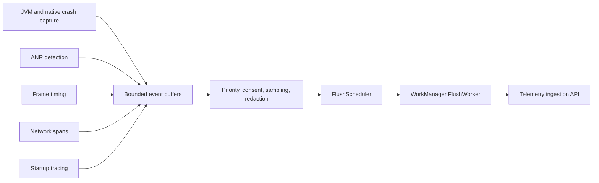
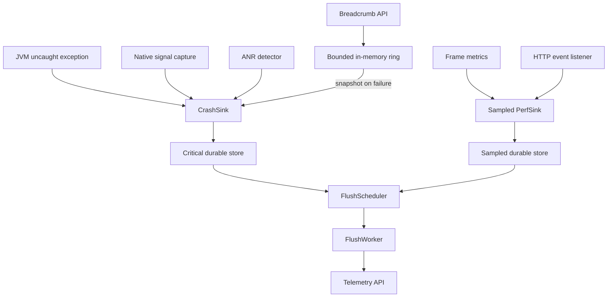

# Telemetry SDK (Crash + Performance)

> A 45-60 minute mobile system-design walkthrough for a crash + performance telemetry SDK on Android: uncaught exception capture, ANR detection, frame metrics, network timing, durable upload. Product analytics is the next file (`analytics-sdk.md`).

---

## 1. Gathering Requirements (~5 min)

> **Interviewer:** "Design a telemetry SDK like Firebase Crashlytics + perf monitoring."
> **Candidate:** "Two beasts in one box: crashes (one-shot, low volume, high value, can't fail) and perf metrics (high volume, statistical, OK to sample). I'll deep-dive crash capture + delivery because that's the highest-stakes path."

### Functional Requirements
- **Capture uncaught JVM exceptions** (Kotlin throws, Java errors).
- **Capture native crashes** (signal handler → minidump).
- **Detect ANR** (main thread blocked > 5s).
- **Frame metrics** (jank frames per session).
- **Startup time** (cold / warm / hot, time to first frame).
- **Network timing** (per request, via OkHttp event listener).

### Non-Functional Requirements
- **Crash report MUST persist** before the process exits.
- **Low overhead** — perf monitoring shouldn't cause jank itself.
- **Battery-conscious** — perf events bundle and flush like analytics.
- **Privacy-aware** — no PII; symbolicate stack traces server-side.
- **Compatible with proguard / R8** mapping files.

### Out of Scope
- Product events (see `analytics-sdk.md`)
- Real-time monitoring dashboard
- Symbol server / dSYM management
- Heap dumps on OOM (separate, heavy)
- Distributed tracing across server boundaries (see OpenTelemetry separately)

---

## 2. Clarifying Questions (~3 min)

| Question | Why it matters |
|---|---|
| In-house or wrap Crashlytics/Sentry? | Architecture vs SDK adapter |
| Native crashes in scope? | Need NDK signal handler |
| Sampling acceptable for perf? | Network volume, storage |
| Privacy / GDPR for crash payloads? | What to redact |
| Multi-tenant (in-house multiple apps)? | Endpoint routing |
| Android API floor? | FrameMetrics API availability, ANR APIs |
| Symbolication strategy? | Send mapping at upload-time vs server-resolved |

> **Candidate:** "In-house; JVM + native crashes; perf with 10% sampling; PII-scrubbed bodies; single app; Android 9+; server-side symbolication."

---

## 3. High-Level Diagram (~10 min)



Every signal enters through a bounded path and passes privacy and sampling policy before upload; critical crash evidence and high-volume performance samples must not compete under identical retention rules.

**Components:**
- **`CrashCapture`** — `Thread.setDefaultUncaughtExceptionHandler` + NDK.
- **`AnrWatchdog`** — separate thread monitoring main responsiveness.
- **`PerformanceMonitor`** — `FrameMetrics`, startup, network.
- **`TelemetryQueue`** — Room-backed; crashes are first persisted *synchronously* to a file and imported into Room on the next launch.
- **`FlushWorker`** — same shape as analytics, dedicated channel.

---

## 4. API Contract

### Crash payload

```json
{
  "type": "crash",
  "exception": "java.lang.NullPointerException",
  "message": "...",
  "thread": "main",
  "stackTrace": ["com.app.Foo.bar(Foo.kt:42)", "..."],
  "threads": { /* other thread states */ },
  "context": {
    "appVer": "4.12.1", "os": "Android 14", "device": "Pixel 7",
    "memoryMb": 4096, "diskFreeMb": 12000, "batteryPct": 47, "locale": "en-IN"
  },
  "breadcrumbs": [
    {"ts": 1750000000, "category": "nav", "msg": "screen=home"},
    {"ts": 1750000010, "category": "network", "msg": "GET /v1/feed 200 132ms"}
  ],
  "installId": "i_7f3", "sessionId": "s_111",   // pseudonymous; attach a user id only with consent
  "buildId": "f3a2c9", "ts": 1750000020, "crashId": "c_uuid"
}
```

### Perf payload

```json
{
  "type": "perf",
  "metric": "frame_jank",
  "value": { "jankFrames": 14, "totalFrames": 1024, "p90Ms": 18.4 },
  "screen": "feed", "sessionId": "s_111", "ts": ...
}
```

### Network event (via OkHttp listener)

```json
{
  "type": "net",
  "url": "/v1/feed",            // scrubbed (no PII)
  "method": "GET", "code": 200,
  "tNetMs": 92, "tTotalMs": 132,
  "ts": ...
}
```

---

## 5. Mobile App Architecture

### Module structure

```
:lib:telemetry
    telemetry-api          ← Telemetry, Breadcrumbs
    telemetry-crash        ← CrashCapture, ANR watchdog
    telemetry-perf         ← FrameMetrics, network listener, startup
    telemetry-core         ← queue, scheduler, worker
```

### Layered diagram



Crash capture uses the shortest safe persistence path and snapshots bounded breadcrumbs, while performance and network data can tolerate asynchronous sampling before both streams share an upload scheduler.

### Key class signatures

```kotlin
object Telemetry {
    fun init(context: Context, config: TelemetryConfig)
    fun leaveBreadcrumb(category: String, message: String, data: Map<String, Any> = emptyMap())
    fun captureMessage(message: String, level: Level = Level.WARN)
    fun captureException(t: Throwable, level: Level = Level.ERROR)
    fun startTrace(name: String): Trace
    fun setUser(userId: String?)
}

interface Trace {
    fun stop()
    fun addAttribute(key: String, value: String)
}
```

---

## 6. Local Storage

```kotlin
@Entity(tableName = "telemetry_events", indices = [Index("priority", "ts")])
data class TelemetryEntity(
    @PrimaryKey(autoGenerate = true) val id: Long = 0,
    val type: String,            // crash, anr, perf, net
    val priority: Int,           // 0 = critical (crash), 1 = high (anr), 2 = normal
    val payloadJson: String,
    val ts: Long
)
```

Crashes are written **synchronously to an append-only file** in the uncaught handler — we have milliseconds before process death, and most crashes happen on the main thread, where Room does not allow database access. On the next launch the SDK imports those files into this table.

---

## 7. Deep Dive: Crash Capture + Delivery (~15 min)

> *I'd pick this as the deep dive because crash capture is binary: it works or it doesn't. Sampling doesn't apply; lost crashes hide bugs in production.*

### JVM crash capture

```kotlin
class CrashCapture(private val context: Context, private val sink: CrashSink) {
    private val defaultHandler = Thread.getDefaultUncaughtExceptionHandler()

    fun install() {
        Thread.setDefaultUncaughtExceptionHandler { thread, throwable ->
            try {
                sink.capture(
                    CrashEvent(
                        throwable = throwable,
                        thread = thread.name,
                        breadcrumbs = BreadcrumbBuffer.snapshot(),
                        context = currentContext()
                    )
                )
            } catch (e: Throwable) {
                // never throw inside the handler
            } finally {
                defaultHandler?.uncaughtException(thread, throwable)
            }
        }
    }
}
```

`CrashSink.capture` appends synchronously to a flat file. Room is not used in the handler: [Room doesn't support database access on the main thread](https://developer.android.com/training/data-storage/room/async-queries), and the handler often runs there.

### CrashSink (sync write)

```kotlin
class CrashSink @Inject constructor(
    private val fileSink: FileCrashSink,
) {
    fun capture(event: CrashEvent) {
        val json = serializer.encodeToString(event.toWire())
        // Synchronous append + fsync; we may have milliseconds left. Never touch Room here.
        runCatching { fileSink.appendAndSync(json) }   // one JSON line in filesDir/crashes/
    }
}
```

> The flat file is the crash path. On next app start, the SDK scans `filesDir/crashes/`, imports entries into Room, and deletes the files.

### Breadcrumbs (in-memory ring buffer)

```kotlin
object BreadcrumbBuffer {
    private const val CAPACITY = 100
    private val ring = ArrayDeque<Breadcrumb>(CAPACITY)
    private val lock = ReentrantLock()

    fun add(b: Breadcrumb) = lock.withLock {
        if (ring.size == CAPACITY) ring.removeFirst()
        ring.addLast(b)
    }
    fun snapshot(): List<Breadcrumb> = lock.withLock { ring.toList() }
}
```

Auto-breadcrumbs: nav, network (via OkHttp listener), screen lifecycle. App code adds custom ones with `Telemetry.leaveBreadcrumb`.

### ANR watchdog

```kotlin
class AnrWatchdog(private val threshold: Long = 5_000) : Thread() {
    private val handler = Handler(Looper.getMainLooper())
    override fun run() {
        while (!interrupted()) {
            val ack = AtomicBoolean(false)
            handler.post { ack.set(true) }
            sleep(threshold)
            if (!ack.get()) {
                val mainStack = Looper.getMainLooper().thread.stackTrace
                Telemetry.captureException(AnrException("Main blocked ${threshold}ms", mainStack))
            }
        }
    }
}
```

> Android 11+ exposes `ApplicationExitInfo` with `REASON_ANR`. Read on next launch as confirmation; the watchdog catches in-process; `ApplicationExitInfo` catches the system's view.

### Native crash capture (NDK)

Out of detailed scope here, but pattern: install a SIGSEGV/SIGBUS handler in JNI, write a minidump to `filesDir/native_crashes/`. JVM SDK reads these on launch. Tools: `breakpad`, `crashpad`, or Sentry's NDK.

### Delivery on next launch

```kotlin
class TelemetryDeliveryBootstrapper @Inject constructor(
    private val migrator: FileToRoomMigrator,
    private val workManager: WorkManager,
) {
    fun onAppStart() {
        migrator.migratePending()         // flat files → Room
        workManager.enqueueUniqueWork(
            "telemetry-flush", ExistingWorkPolicy.KEEP,
            OneTimeWorkRequestBuilder<FlushWorker>()
                .setConstraints(Constraints.Builder().setRequiredNetworkType(NetworkType.CONNECTED).build())
                .setBackoffCriteria(BackoffPolicy.EXPONENTIAL, 30, TimeUnit.SECONDS)
                .build()
        )
    }
}
```

### Flush worker (prioritizes crashes)

```kotlin
@HiltWorker
class FlushWorker @AssistedInject constructor(...) : CoroutineWorker(ctx, params) {
    override suspend fun doWork(): Result {
        // 1. Critical first (priority=0)
        flushBatch(dao.takeByPriority(0, limit = 50))?.let { if (!it.isSuccess) return it }
        // 2. High (ANR)
        flushBatch(dao.takeByPriority(1, limit = 50))?.let { if (!it.isSuccess) return it }
        // 3. Normal (perf, net)
        flushBatch(dao.takeByPriority(2, limit = 200))?.let { if (!it.isSuccess) return it }
        return Result.success()
    }
}
```

### Performance traces

```kotlin
class FrameMetricsCapture(private val activity: Activity) {
    // JankStats applies a per-refresh-rate jank heuristic (16.7 ms at 60 Hz, 8.3 ms at 120 Hz).
    private val jankStats = JankStats.createAndTrack(activity.window) { frame ->
        if (frame.isJank) PerfBuffer.addJank(frame.frameDurationUiNanos)
    }

    fun stop() { jankStats.isTrackingEnabled = false }   // call from onDestroy
}
```

Sample at 10% of sessions; aggregate per-screen at session end; flush.

### Network timing (OkHttp event listener)

```kotlin
// One listener per call via EventListener.Factory, so no shared map is needed.
class NetTelemetryListener : EventListener() {
    private var start = 0L
    private var code = -1
    override fun callStart(call: Call) { start = clock.now() }
    override fun responseHeadersEnd(call: Call, response: Response) { code = response.code }
    override fun callEnd(call: Call) = report(call)
    override fun callFailed(call: Call, ioe: IOException) = report(call)
    private fun report(call: Call) {
        val url = call.request().url.newBuilder().query(null).build()   // strip query (PII)
        Telemetry.recordNet(url, clock.now() - start, code = code)
    }
}

// OkHttpClient.Builder().eventListenerFactory { NetTelemetryListener() }
```

### Failure modes

| What breaks | Behavior |
|---|---|
| Process dies before the crash is written | Lost; the file write is the shortest safe path |
| Room is corrupted | Crash files stay on disk until the next successful import |
| Network unavailable on next launch | Worker retries indefinitely with backoff |
| Server returns 400 | Drop offender (bad schema); continue |
| Disk full | Trim oldest perf; never trim crashes |
| Mapping file mismatch | Server symbolicates with whatever buildId is sent; may show obfuscated names |

---

## 8. Trade-offs

### In-house vs vendor (Crashlytics, Sentry)

| Option | Pros | Cons | Verdict |
|---|---|---|---|
| **In-house** | Privacy, custom routing, control | Build + maintain | Pick if scale + privacy demand it |
| **Crashlytics** | Free, integrated with Firebase | Vendor lock, limited custom fields | Default for small teams |
| **Sentry** | Best-in-class, OSS option | Cost at scale | Pick for mid-size teams |

### Storage for crashes

| Option | Verdict |
|---|---|
| **File in the handler, imported into Room on next launch** | Pick — safest |
| Files only | Loses transactional semantics for the rest of the queue |
| Room in the handler | Fails for main-thread crashes; risky if the DB is locked |

### Symbolication

| Option | Verdict |
|---|---|
| **Server-side with uploaded mapping** | Pick — keeps client small |
| Client-side symbolication | Wastes battery, requires mapping on device (security risk) |
| No symbolication | Useless |

### Perf sampling

| Option | Verdict |
|---|---|
| **10% session sampling** | Pick — bounded volume |
| Per-event sampling | Less statistical signal |
| 100% perf events | Overkill, expensive |

### Frame metrics

| Source | Verdict |
|---|---|
| `FrameMetrics` API | Accurate, but you own the per-refresh-rate threshold |
| `Choreographer` callback | DIY; reinvents wheel |
| **`JankStats` (AndroidX)** | Pick — wraps the above with a refresh-rate-aware heuristic |

---

## 9. Major Concerns

- **Crash atomicity.** Must persist before exit. A synchronous file append is the crash path; Room import happens on the next launch.
- **Reentrancy.** Uncaught handler must never throw — guard with `runCatching`.
- **Privacy.** Strip query parameters from URLs; redact known PII keys in breadcrumbs.
- **Mapping.** Upload R8 / ProGuard mapping per release. Server stores by `buildId`.
- **NDK crashes.** Need a signal handler installed; not in this code but architecturally a peer to JVM capture.
- **ANR vs slow operation.** 5s is a hard ANR threshold; we want to capture before the system dialog.
- **Battery.** Perf monitoring should be opt-in or sampled. Don't always-on.
- **Stack trace integrity.** Server must store mapping for at least N versions back (last 12 months typical).
- **Compliance.** "Right to be forgotten" — delete by `userId` server-side.

---

## 10. Follow-up Questions

> **Q: How are crashes deduped?**
> Server fingerprint = SHA-256(class + top frame + message). Crashes with the same fingerprint group into an "issue". Counts + affected users update per issue.

> **Q: What about OOM that kill the process suddenly?**
> JVM `OutOfMemoryError` is an exception → caught. Native OOM (Low Memory Killer) is silent; we detect on next launch via `ApplicationExitInfo` (Android 11+).

> **Q: How do you avoid losing a crash if the app crashes again during write?**
> File sink is append-only — partial writes are recoverable by skipping malformed JSON lines.

> **Q: What's the perceived impact on app size?**
> Measure it: compare release builds with APK Analyzer. An in-house JVM-only SDK can be small; a native signal handler adds per-ABI native code; vendor SDK sizes vary by version.

> **Q: How do you test crash capture?**
> `throw RuntimeException("test")` from a debug button. Verify the crash file is written and a Room row appears post-restart. CI: instrumented test that triggers a crash and checks the persisted artifact.

> **Q: Can the telemetry SDK report on itself?**
> Yes — internal "self-monitoring" events (worker failures, queue overflow) emit as `type=telemetry_internal`. Watch them carefully; they predict outages.

---

## 11. Out of Scope (defended)

- **Product events** — `analytics-sdk.md`.
- **Heap dumps** — heavy, requires symbolication of memory addresses.
- **Distributed tracing** — server domain.
- **Real-time dashboards** — telemetry consumer side.
- **Vendor SDK adapter** — pattern: thin wrapper, route events to chosen vendor.

---

## 12. Further Reading

- [Android Developers — JankStats library](https://developer.android.com/topic/performance/jankstats) — official frame-metrics wrapper.
- [Android Developers — ApplicationExitInfo](https://developer.android.com/reference/android/app/ApplicationExitInfo) — system-level exit reasons (API 30+).
- [Crashlytics Android docs](https://firebase.google.com/docs/crashlytics) — reference implementation.
- [Sentry Android SDK](https://docs.sentry.io/platforms/android/) — open-source alternative.
- [OpenTelemetry Android](https://github.com/open-telemetry/opentelemetry-android) — open-source instrumentation for comparison.

---

> **Closing in the interview:** "I anchored on crash capture because zero data loss is the SDK's job-one promise. Happy to dig into NDK signal handlers, perf-sampling strategies, or the symbolication pipeline next."
