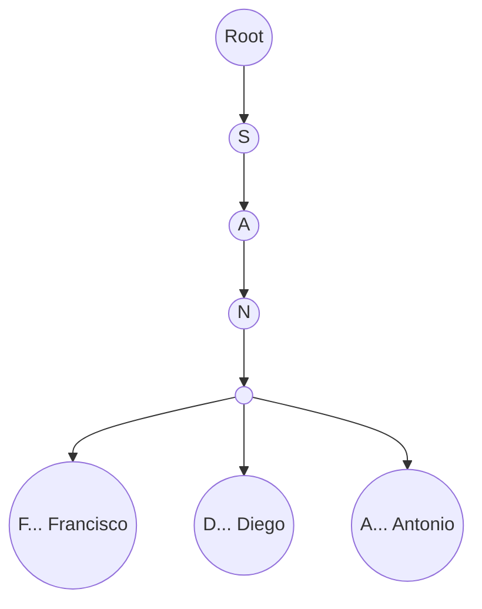

# System Design: Offline Typeahead & Autocomplete

## The Prompt

*"Design an ultra-fast Typeahead/Autocomplete system for a mobile app. The user is searching through a list of 50,000 known entities (e.g., all Cities in the US, or all of their Contacts). The search must work completely offline and provide suggestions instantly (<16ms) as the user types each character."*

*(Note: For network-based API throttling and debouncing, see [Global Search](search.md). This document focuses on offline, in-memory algorithmic search).*

## 1. Requirements & Clarification (RADIO Framework)

### Functional Requirements
- As the user types 'San', the app instantly suggests 'San Francisco', 'San Diego', 'San Antonio'.
- Works 100% offline.

### Non-Functional Requirements (NFRs)
- **Latency (Priority 0):** Must return results in < 16ms to maintain 60 FPS while the user is rapidly typing.
- **Memory:** We cannot load a 50MB database into active RAM arrays just to search it.
- **Accuracy:** Must support prefix matching (typing 'York' should ideally find 'New York', though strict prefix finds 'Yorktown').

## 2. High-Level Architecture (The Trie)

A Junior engineer loads 50,000 strings into a `List<String>`, and every time the user types a key, they run `list.filter { it.startsWith(query) }`.
This is an `O(N * M)` operation (where N is 50,000 strings, and M is the length of the string). It will freeze the UI thread on older phones.

A Staff engineer uses a **Trie (Prefix Tree)**.



## 3. Data Model: Building the Trie

A Trie is a tree data structure where each node represents a single character.

### The Node Structure
```kotlin
class TrieNode {
    val children = HashMap<Char, TrieNode>()
    var isWord: Boolean = false
    
    // Optimization: Cache the top 5 results passing through this node
    // so we don't have to traverse the entire subtree to find suggestions.
    val topSuggestions = mutableListOf<String>()
}
```

### The Search Algorithm: O(K) Time Complexity
When the user types 'San' (length K = 3):
1. Start at Root.
2. Go to 'S'. (O(1) Hashmap lookup)
3. Go to 'a'. (O(1) Hashmap lookup)
4. Go to 'n'. (O(1) Hashmap lookup)
5. Return the `topSuggestions` stored at node 'n'.

The time complexity is exactly `O(K)`. It takes 3 operations to find the results, regardless of whether the database has 50,000 cities or 5 Billion cities. It is infinitely scalable in terms of speed.

## 4. The Core Flows (Deep Dive)

### Flow 1: Memory Optimization (The Graph vs The String)
*Interviewer:* "Storing 50,000 strings in a Kotlin `List` takes 5MB of RAM. If you convert them into a Trie with HashMaps for every character, your memory overhead explodes due to Java Object allocation. The Trie takes 50MB of RAM. How do you fix this?"

**Staff Answer:**
"The standard Object-based Trie is too heavy for mobile RAM. We must use an **Array-Backed Trie** (or a flat memory buffer).
Instead of creating a `TrieNode` object, we represent the tree in a massive 1D integer array, where the index implies the character and the value points to the next child array. 
Alternatively, we abandon the in-memory Trie and use **SQLite FTS (Full-Text Search)**. We insert the 50,000 cities into a Room database with an FTS4/FTS5 virtual table. SQLite uses an optimized, highly-compressed on-disk index (a B-Tree or specialized Trie) that requires near-zero RAM, and executes `SELECT * FROM cities WHERE name MATCH 'San*'` in milliseconds."

### Flow 2: The Typo Problem (Fuzzy Matching)
*Interviewer:* "The user meant to type 'San Francisco', but they made a typo and typed 'Sam Francisco'. Your Trie goes Root -> 'S' -> 'a' -> 'm'. There are no children. It returns 0 results. How do you handle typos?"

**Staff Answer:**
"A standard Trie cannot handle typos. We must implement **Levenshtein Distance** (Edit Distance) algorithms, or use SQLite FTS with spellfix.
However, calculating Levenshtein Distance across a whole Trie is incredibly slow.
A common Staff-level optimization is **Double Metaphone** or Soundex encoding.
1. When inserting 'San Francisco' into the database, we also calculate its phonetic Soundex hash (e.g., `S516`).
2. When the user types 'Sam Francisco', we calculate the hash of their input (`S516`).
3. The hashes match! We suggest 'San Francisco'. 
This allows us to find results that *sound* the same, fixing typos instantly without expensive graph traversals."

### Flow 3: Ranking and Sorting (The "Top Suggestions" Cache)
*Interviewer:* "The user types 'A'. There are 4,000 cities that start with 'A'. The screen can only show 5. How do you decide which 5 to show without sorting 4,000 strings on every keystroke?"

**Staff Answer:**
"We pre-calculate the ranking.
When building the Trie (or when inserting into the SQLite DB), every city has a `weight` (e.g., Population).
New York has a weight of 8,000,000.
As we insert 'New York' into the Trie, we update the `topSuggestions` list of every node we pass through (Root, 'N', 'e', 'w'...). We sort that list of 5 items *once* during insertion.
When the user types 'N', we jump to the 'N' node and instantly return its pre-sorted list of 5 cities. The sort time at read-time is literally 0ms."

## 5. Failure Modes & Bottlenecks

### Bottleneck: Database Ingestion (The UI Freeze)
*Interviewer:* "You download a JSON file with 50,000 contacts. You build the Trie on the phone. It takes 4 seconds. The user is staring at a loading screen."

**Staff Answer:**
"Trie construction is CPU intensive.
**The Fix:** Never build massive Tries on the mobile device. The Backend should pre-build the Trie and serialize it into a binary file format, or pre-populate an SQLite file. The mobile app simply downloads the `.db` or binary file, saves it to disk, and immediately begins reading from it. We offload the compute cost to the cloud."

### Bottleneck: Prefix vs Infix (The 'York' problem)
*Interviewer:* "The user types 'York'. A standard Trie starts at the Root, goes to 'Y'. It will never find 'New York' because 'New York' starts with 'N'."

**Staff Answer:**
"A standard Trie only supports Prefix matching. To support Infix matching ('York' -> 'New York'), we must build a **Suffix Tree** or use SQLite FTS.
With SQLite FTS, the engine automatically tokenizes the string into ['New', 'York']. A query for `MATCH 'York*'` will instantly find the row, because the inverted index tracks every word independently, not just the first letter of the string."

## 6. Staff Engineer Thinking: Stop Inventing Data Structures

A Junior engineer loves writing Tries because it feels like a LeetCode problem.
A Staff Engineer knows that maintaining a custom in-memory Trie in Kotlin is a liability. It will leak memory, it won't persist across app restarts, and it requires writing custom synchronization code.

**The Staff Decision:** Unless there is a hyper-specific reason to hold a Trie in RAM (like a real-time gaming engine), a Staff Engineer will rely entirely on **Room + SQLite FTS4/FTS5**. SQLite has spent 20 years perfecting Full Text Search. It handles tokenization, memory mapping, and persistence perfectly. Let SQLite do the work.

## 7. Probing Questions (For Practice)

1.  Explain the mathematical Time Complexity difference between filtering a `List<String>` and traversing a `Trie` when searching for a 5-letter word in a dataset of 1 million words.
2.  Describe the memory overhead explosion that occurs when building a Trie using standard Java/Kotlin Objects (`class TrieNode`) compared to a flat array.
3.  How does caching the `topSuggestions` directly inside the Trie Nodes convert a slow sorting operation into an `O(1)` read?
4.  Explain the "Typo Problem" in a standard Trie, and how phonetic hashing (like Soundex) can provide instant fuzzy-matching.
5.  Why is a standard Trie incapable of finding "New York" if the user types "York"? 
6.  Describe how SQLite FTS (Full Text Search) tokenizes strings and builds an inverted index to solve the "Infix" matching problem.
7.  Why should an Android application avoid parsing a massive JSON array and building a Trie in-memory during application startup?
8.  Walk through the architectural alternative of having the Backend pre-compute the Trie/SQLite database and shipping the raw binary file to the Android client.
9.  If a user types 10 characters a second, explain why an in-memory Trie might still require a Kotlin Flow `debounce` operator to prevent UI stuttering during the `RecyclerView` rendering phase.
10. Justify the Staff Engineer decision to use Room + SQLite FTS5 instead of building a custom Trie in Kotlin for a standard E-Commerce app.

## Further Reading

- [`search.md`](search.md) — The network-layer design for Global Search (Debounce, flatMapLatest).
- [`trees.md`](../computer-science/trees.md) — The fundamental computer science behind Tries and B-Trees.
- [`caching-library.md`](caching-library.md) — Why loading 50MB of data into RAM is dangerous.
