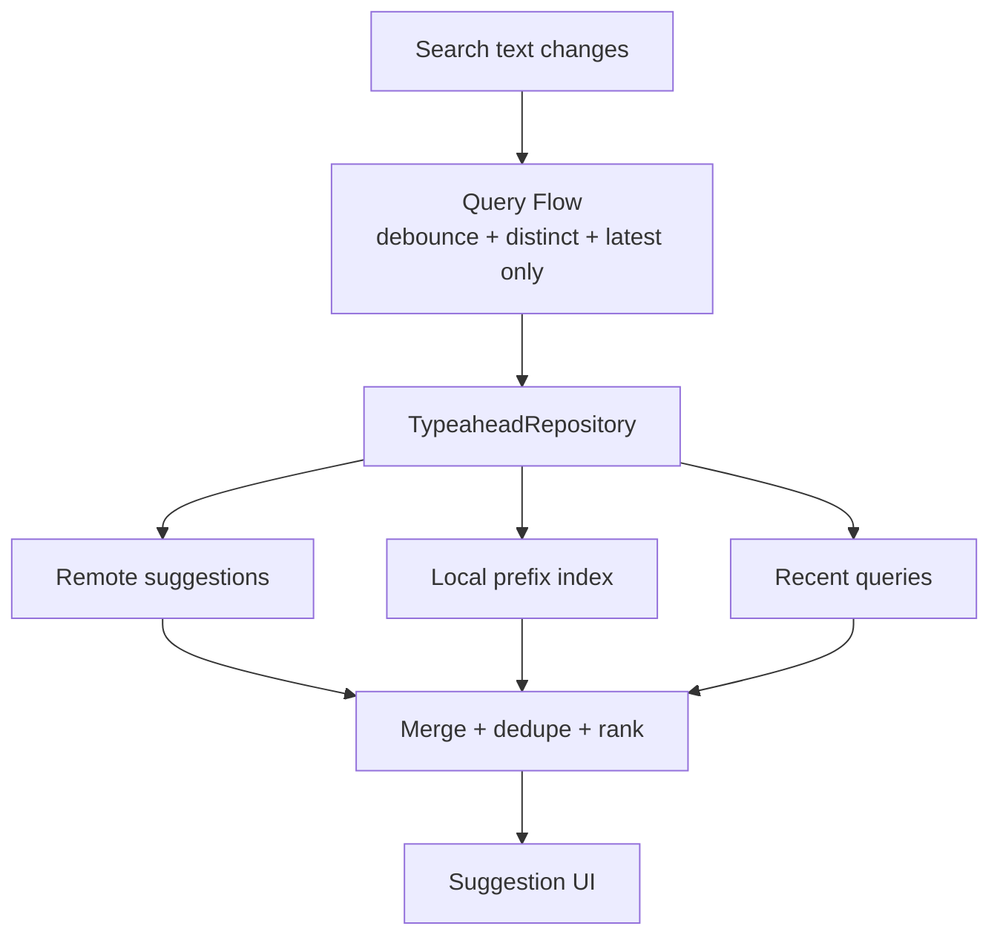
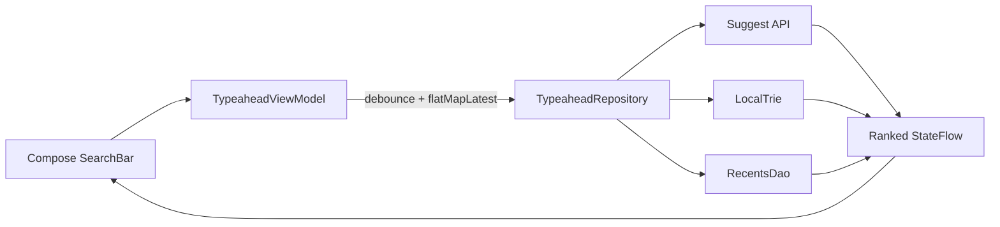

# Typeahead / Autocomplete

> A 45-60 minute mobile system-design walkthrough for the typeahead component (search-as-you-type). The main results experience is the separate `search.md` file.

---

## 1. Gathering Requirements (~5 min)

> **Interviewer:** "Design search-as-you-type / typeahead."
> **Candidate:** "Typeahead is its own problem: high request rate, low payload, perceived snappiness, sometimes offline. I'll deep-dive the suggestion request pipeline (debounce, cancellation, local trie fallback)."

### Functional Requirements
- **Suggest as you type** — < 100 ms perceived latency.
- **Highlight matched portion** of each suggestion.
- **Tap to fill the search bar** and submit.
- **Show recent queries** when input is empty.
- **Offline** fallback to a local index of recents + popular.

### Non-Functional Requirements
- **Cancel in-flight on each keystroke** beyond debounce.
- **Bound network rate** — don't hammer the server.
- **Cellular-aware** — same UX, smaller payloads.
- **Battery-aware** — no background work.
- **Privacy** — local recents not synced unless user opts in.

### Out of Scope
- Main results screen (`search.md`)
- Spelling correction model (server-side)
- Voice / OCR input
- Cross-device recent sync
- Predictive ML model training

---

## 2. Clarifying Questions (~3 min)

| Question | Why it matters |
|---|---|
| Suggestion sources (popular, history, ML-personalized)? | API surface |
| How many suggestions to show? | UI density, payload size |
| Server latency target? | Debounce sizing |
| Offline support needed? | Local index decision |
| Show highlights on the matched substring? | UI rendering |
| Domain-specific (product names, city names)? | Local trie viability |
| Multilingual? | Tokenization + transliteration |

> **Candidate:** "5-7 suggestions, mix of recent + popular + matched items, server p95 < 80 ms, offline shows recents only, highlight substring, single language, Android 9+."

---

## 3. High-Level Diagram (~10 min)



Latest-query cancellation prevents stale responses from replacing newer text, while local and recent results keep latency low before remote ranking returns.

**Components:**
- **`TypeaheadRepository`** — orchestrates remote + local; ranks.
- **`LocalTrie`** — for fast prefix lookups on popular/recents.
- **`RemoteSuggestApi`** — `/v1/suggest?q=...`.
- **`RecentsStore`** — Room DAO of historical queries.

---

## 4. API Contract

```http
GET /v1/suggest?q=run&limit=7
{
  "suggestions": [
    { "type": "query", "text": "running shoes", "highlightStart": 0, "highlightLen": 3 },
    { "type": "entity", "text": "Roger Federer", "entityId": "u_555", "imageUrl": "...",
      "highlightStart": 0, "highlightLen": 1 },
    { "type": "recent", "text": "rugby balls", "highlightStart": 0, "highlightLen": 3 }
  ]
}
```

Each suggestion has a type so the UI can render with appropriate icon / styling.

### Click feedback

```json
POST /v1/suggest/click
{ "q": "run", "selected": "running shoes", "position": 0, "ts": ... }
```

---

## 5. Mobile App Architecture

### Module structure

```
:feature:search           ← SearchBar + TypeaheadSheet share module
:domain:typeahead
:data:typeahead           ← repo, RecentsDao, LocalTrie
:core:network
```

### Layered diagram



The ViewModel owns query timing and cancellation; the repository owns source fusion and ranking, keeping composables free of request and cache policy.

### Key class signatures

```kotlin
sealed class Suggestion {
    data class Query(val text: String, val highlight: IntRange) : Suggestion()
    data class Entity(val text: String, val id: String, val imageUrl: String?, val highlight: IntRange) : Suggestion()
    data class Recent(val text: String, val highlight: IntRange) : Suggestion()
}

interface TypeaheadRepository {
    fun suggest(prefix: String): Flow<List<Suggestion>>
    suspend fun rememberSelection(prefix: String, selected: Suggestion, position: Int)
}
```

---

## 6. Local Storage

```kotlin
@Entity(tableName = "typeahead_recents")
data class RecentRow(
    @PrimaryKey val text: String,
    val lastUsedAt: Long, val useCount: Int
)

@Entity(tableName = "typeahead_popular")
data class PopularRow(
    @PrimaryKey val text: String,
    val rank: Int, val fetchedAt: Long
)
```

`popular` is periodically refreshed from `/v1/popular-queries` (cached for 7 days). `recents` is purely on-device.

> **Probing Q:** "Why a separate trie?" Because Room `LIKE 'prefix%'` is fine for a small set; for larger local data (e.g., 50K product names cached for offline) a trie is O(prefix length) vs O(n).

---

## 7. Deep Dive: Suggestion Pipeline (~15 min)

> *I'd pick this as the deep dive because it covers keystroke handling, debounce, cancellation, request rate limiting, the local fallback merge, and result ranking — the entire snappiness story.*

### ViewModel

```kotlin
@HiltViewModel
class TypeaheadViewModel @Inject constructor(
    private val repo: TypeaheadRepository,
    savedState: SavedStateHandle,
) : ViewModel() {

    val text = savedState.getStateFlow("text", "")

    val suggestions: StateFlow<List<Suggestion>> = text
        .debounce(120.milliseconds)
        .distinctUntilChanged()
        .flatMapLatest { prefix ->
            if (prefix.isBlank()) flowOf(emptyList())
            else repo.suggest(prefix)
        }
        .stateIn(viewModelScope, SharingStarted.WhileSubscribed(5_000), emptyList())

    fun onSelect(s: Suggestion, position: Int) {
        viewModelScope.launch {
            repo.rememberSelection(text.value, s, position)
            text.value = s.text
            submit()    // dispatches main search
        }
    }
}
```

### Repository: orchestrate remote + local

```kotlin
class DefaultTypeaheadRepository @Inject constructor(
    private val api: SuggestApi,
    private val recentsDao: RecentsDao,
    private val popularDao: PopularDao,
    private val trie: LocalTrie,
    private val connectivity: Connectivity,
) : TypeaheadRepository {

    override fun suggest(prefix: String): Flow<List<Suggestion>> = flow {
        // 1. Local first — instant
        emit(localSuggestions(prefix))

        // 2. If online, fetch remote and merge
        if (connectivity.isOnline()) {
            runCatching { api.suggest(prefix, limit = 7) }
                .onSuccess { resp ->
                    emit(mergeAndRank(resp.suggestions.toDomain(), localSuggestions(prefix), prefix))
                }
                .onFailure { /* keep local; log */ }
        }
    }
        .flowOn(Dispatchers.IO)

    private suspend fun localSuggestions(prefix: String): List<Suggestion> {
        val recents = recentsDao.byPrefix(prefix, limit = 3).map { Suggestion.Recent(it.text, prefix.range()) }
        val popular = trie.prefixSearch(prefix, limit = 5).map { Suggestion.Query(it, prefix.range()) }
        return (recents + popular).distinctBy { it.text }.take(7)
    }

    private fun mergeAndRank(remote: List<Suggestion>, local: List<Suggestion>, prefix: String): List<Suggestion> {
        // Server suggestions take precedence; pad with locals not already present.
        val seen = mutableSetOf<String>()
        return (remote + local).filter { seen.add(it.text.lowercase()) }.take(7)
    }
}
```

### Cancellation guarantee

`flatMapLatest` cancels the previous `suggest(prefix)` flow when a new `prefix` arrives. The OkHttp call in flight is cancelled (cooperative cancellation; OkHttp interceptor responds to coroutine cancel).

### Debounce sizing

| Sizing | Pro | Con |
|---|---|---|
| 80-120 ms | Snappy | More requests, higher cancellation rate |
| 200-300 ms | Fewer requests | User sees lag |
| 0 (no debounce) | Fastest | Server hammered |

For typeahead, 120 ms is a sweet spot: fast typists trigger only at pauses; slow typists feel real-time.

### Rate limiting

Even with debounce, a fast typist generates 5-10 req/sec. Limit at the OkHttp level with a token bucket interceptor:

```kotlin
class RateLimitInterceptor(private val limiter: RateLimiter) : Interceptor {
    override fun intercept(chain: Chain): Response {
        if (!limiter.tryAcquire()) {
            return Response.Builder()
                .request(chain.request()).protocol(Protocol.HTTP_1_1)
                .code(429).message("Local rate limit").body("".toResponseBody()).build()
        }
        return chain.proceed(chain.request())
    }
}
```

### UI with highlight

```kotlin
@Composable
fun SuggestionRow(s: Suggestion, onTap: () -> Unit) {
    val annotated = buildAnnotatedString {
        append(s.text)
        addStyle(SpanStyle(fontWeight = FontWeight.Bold), s.highlight.first, s.highlight.last + 1)
    }
    Row(Modifier.fillMaxWidth().clickable(onClick = onTap).padding(16.dp)) {
        SuggestionIcon(s.type)
        Text(annotated, modifier = Modifier.padding(start = 12.dp))
    }
}
```

### Recents persistence

```kotlin
override suspend fun rememberSelection(prefix: String, selected: Suggestion, position: Int) {
    recentsDao.bump(selected.text, clock.now())
    analytics.log(TypeaheadClickEvent(prefix, selected.text, position))
    runCatching { api.click(prefix, selected.text, position) }   // fire-and-forget
}
```

### Local trie

For offline catalogs (e.g., a list of all city names), the local trie is built once and serialized:

```kotlin
class LocalTrie {
    private val root = TrieNode()

    fun insert(word: String) { /* O(L) */ }
    fun prefixSearch(prefix: String, limit: Int): List<String> { /* DFS from prefix node */ }
}
```

Persist as a compact byte format on first launch (e.g., DAWG); reload into memory on app start. For small sets (< 5K entries), Room `LIKE 'prefix%'` is fine.

### Failure modes

| What breaks | Behavior |
|---|---|
| Server slow / 500 | Local suggestions still rendered; no error UI |
| Rate limiter trips | Skip the request; rely on local |
| User offline | Local-only; "Showing offline suggestions" subtle badge |
| Process death mid-type | Text in SavedStateHandle; suggestions re-fetch on resume |
| Stale popular list | Background refresh; old list still works |
| User selects a suggestion that's been deleted | Main search handles "no results" |

---

## 8. Trade-offs

### Debounce strategy

| Option | Pros | Cons | Verdict |
|---|---|---|---|
| **Fixed 120 ms debounce** | Predictable | Doesn't adapt to typing speed | Pick this |
| Adaptive (faster → longer debounce) | Smarter | Complex; small payoff | Skip |
| No debounce, server-side dedupe | Simplest client | Wastes network + battery | Skip |

### Local fallback

| Option | When |
|---|---|
| **Recents + Popular DAO** | All apps |
| **Trie for large catalog** | Offline-heavy or finite-domain (cities, products) |
| No local fallback | OK if always-online (rare) |

### Suggestion sources

| Option | Verdict |
|---|---|
| **Server-side personalized + popular** | Pick — best ranking |
| Local-only | Privacy win; weaker ranking |
| Both, merged | Default |

### Highlight rendering

| Option | Verdict |
|---|---|
| **AnnotatedString in Compose** | Pick — Compose-native |
| `Spannable` in View | Legacy |
| HTML | Don't |

### Rate limiting

| Option | Verdict |
|---|---|
| **Token-bucket interceptor** | Pick — bounded request rate |
| Just `debounce` | Sometimes still hammers |
| Backoff after 429 | Server-side rate-limit response |

---

## 9. Major Concerns

- **Snappiness.** Local first, remote second. Never block local on remote.
- **Cancellation.** `flatMapLatest` is the foundation. Don't manually manage `Job`s.
- **Privacy.** Recents are local-only by default. Cross-device sync requires opt-in (consent banner).
- **Cellular cost.** Payloads are small (a few KB), but request count can spike. Rate limiter caps it.
- **Battery.** No background work. Typeahead lives only while the user is typing.
- **Personalization.** If server personalizes, include user id in headers; cache per-user.
- **Accessibility.** Suggestions list is a `LazyColumn` with proper semantics; TalkBack reads each row including type.
- **Process death.** Text in `SavedStateHandle`. Local fallback always works on restart.
- **Localization.** Tokenize by Unicode word boundary; honour locale.

---

## 10. Follow-up Questions

> **Q: How is the local trie kept up to date?**
> Server endpoint `/v1/popular-queries?limit=5000` cached weekly. App downloads on first launch + once a week. For domains like city names, ship the trie as an asset and version it.

> **Q: Why not always go remote for the freshest suggestions?**
> Latency. Local-first ensures < 50 ms perceived latency even on cold network. Remote refines in the background; the merge updates the list.

> **Q: How do you avoid jank when the list shrinks?**
> `LazyColumn` with stable keys + `AnimatedVisibility` per row. Or `crossfade` between snapshots. Don't `clear()` then `addAll()`.

> **Q: How is the highlight computed if the server highlights at byte indices and Compose needs char indices?**
> Server returns char indices for the substring match. If multiple matches, pick the earliest. Localization matters: Unicode-aware indexing in Kotlin (`String` is UTF-16; works for BMP characters).

> **Q: Spelling correction?**
> Out of scope here. Typically server-side: returns a `correction` suggestion with `type: correction`. Client renders it inline; if user taps, replace the query and submit.

> **Q: How do you avoid showing recent queries to other users on a shared device?**
> Multi-user apps: namespace recents by account id. Opt-out: incognito mode that bypasses both reads and writes.

---

## 11. Out of Scope (defended)

- **Main results screen** — `search.md`.
- **Voice / OCR** — different input modalities.
- **Server-side ranker** — black box.
- **Cross-device recent sync** — privacy review; opt-in only.
- **Spelling-correction model internals** — server's domain.

---

## 12. Further Reading

- [Kotlin Flow operators — debounce, flatMapLatest](https://kotlinlang.org/api/kotlinx.coroutines/kotlinx-coroutines-core/kotlinx.coroutines.flow/) — official.
- [Android Developers — Compose AnnotatedString](https://developer.android.com/jetpack/compose/text) — highlighting.
- [Android Developers — Room queries](https://developer.android.com/training/data-storage/room/accessing-data) — `LIKE 'prefix%'` patterns.
- [Trie data structure](https://en.wikipedia.org/wiki/Trie) — for local prefix search at scale.
- [Material Design — Search](https://m3.material.io/components/search/overview) — design patterns.

---

> **Closing in the interview:** "I anchored on the suggestion pipeline because debounce + cancellation + local fallback is where snappiness lives or dies. Happy to dig into the trie persistence format, rate-limit tuning, or click-feedback loop next."
