# Versioning & Backward Compatibility (Mobile)

> A 45-60 minute mobile system-design walkthrough for versioning + backward-compatibility in a mobile app: API versioning, Room schema migrations, deprecation, force-update flows, feature flags as protection. Horizontal concern referenced across other files.

---

## 1. Gathering Requirements (~5 min)

> **Interviewer:** "How do you handle versioning and backward compatibility for a mobile app?"
> **Candidate:** "Mobile has unique constraints: users on old versions for years, can't be force-updated easily, server must stay compatible. Three axes: API versioning, local schema migrations, and lifecycle (deprecate, force-update). I'll deep-dive API + schema."

### Functional Requirements
- **N-3 version support**: the server supports the current release plus the previous three release-train versions (about six weeks at a bi-weekly cadence).
- **Schema migrations** at every Room version bump.
- **Force-update path** for critical security / legal needs.
- **Soft-deprecation banner** when running an old version.
- **Feature flags** kill new features that misbehave on old versions.

### Non-Functional Requirements
- **No crash on upgrade** — migrations are exhaustive.
- **Server changes don't break old clients** — wire format additive.
- **Clear deprecation timeline** — published.
- **Telemetry per version** — know who's on what.
- **Recovery plan** if a release ships a bug.

### Out of Scope
- Server-side schema evolution (separate, backend)
- A/B test rollback (`a-b-testing-infrastructure.md`)
- App Store / Play Store update mechanics
- OS-level upgrades (Android version skew)

---

## 2. Clarifying Questions (~3 min)

| Question | Why it matters |
|---|---|
| Release cadence (weekly, monthly)? | Deprecation timeline length |
| Force-update tolerance (regulated industry)? | Use of `force_update` flag |
| Server controls feature flags? | Kill switches for misbehaving versions |
| % users on >6-month-old versions? | Long-tail support burden |
| Wire format (JSON, gRPC, Proto)? | Additive vs strict |
| Multi-platform parity needed? | Schema as shared artifact |
| Migration test coverage? | Risk of crash on upgrade |

> **Candidate:** "Bi-weekly releases, support N-3 for ~6 weeks, force-update for security only, server-driven flags, ~5% on > 6-month versions, JSON, single-platform schema, Migration Test Helper covers each migration."

---

## 3. The Versioning Stack

```mermaid
flowchart TD
    App["Installed app version<br/>capabilities + support policy"]
    Wire["Wire contract version<br/>old and new clients overlap"]
    Local["Local schema version<br/>ordered, tested migrations"]
    Config["Compatibility controls<br/>capabilities + flags + minimum version"]
    User["Safe user experience<br/>degrade, migrate, warn, or block"]

    App --> Config
    Wire --> Config
    Local --> Config
    Config --> User
    App <--> Wire
    App --> Local
```



App, wire, and local-schema versions evolve independently. Compatibility policy must coordinate all three because installed clients cannot be assumed to upgrade when the server or schema changes.

---

## 4. API Versioning

### URL versioning (most common for mobile)

```
GET /v1/feed       # legacy
GET /v2/feed       # current
```

Client passes its app version header:

```http
GET /v2/feed
X-App-Version: 4.12.1
X-Platform: android
```

Server uses this for:
- Telemetry (which clients hit which endpoints)
- Kill switches (`if version < X, return cached response`)
- Format negotiation (`if old client, omit new fields`)

### Wire format discipline

**Additive only.** Never remove or rename fields without a version bump.

| Change | Safe? |
|---|---|
| Add optional field to response | Yes |
| Add field client must handle | Yes (with default) |
| Rename field | No (add new, keep old, deprecate) |
| Remove field | No (mark deprecated, retire later) |
| Change field type | No (add new field of new type) |
| Change semantics of existing field | No (add new field) |

### Deprecation in the response

```http
GET /v1/feed
Deprecation: @1782863999
Sunset: Thu, 31 Dec 2026 23:59:59 GMT
Link: </v2/feed>; rel="successor-version", <https://example.com/deprecations/feed-v1>; rel="deprecation"
```

`Deprecation` is a structured-field date (`@` + Unix seconds; here 30 June 2026) per [RFC 9745](https://www.rfc-editor.org/rfc/rfc9745.html), and the `Sunset` time ([RFC 8594](https://www.rfc-editor.org/rfc/rfc8594.html)) must not be earlier than it.

Client logs these headers as analytics events. Eng team monitors the dashboard.

### Compatibility matrix

For every mobile-facing API family, maintain a compatibility matrix. This belongs next to the API spec, not in a forgotten spreadsheet.

| Client cohort | Endpoint | Wire contract | Server behavior | Test fixture |
|---|---|---|---|---|
| Current | `/v2/feed` | `FeedV2` with badges and reactions | Full feature set | `feed_v2_current.json` |
| N-1 | `/v2/feed` | `FeedV2` without experimental fields | Gate by capability | `feed_v2_n_minus_1.json` |
| N-2 | `/v1/feed` or `/v2/feed` fallback | `FeedV1Compatible` | Omit unknown enum values and new required fields | `feed_v1_legacy.json` |
| Deprecated | `/v1/feed` | Frozen legacy contract | Return deprecation headers and soft banner policy | `feed_v1_deprecated.json` |
| Unsupported | Any retired contract | No business traffic | Force-update policy only | `force_update.json` |

The matrix is the bridge between engineering and operations. It tells backend engineers what they can remove, mobile engineers what they must parse, QA what to test, and release managers when a forced upgrade is safe.

### Sunset runbook

Do not retire a mobile contract because a new app version shipped. Retire it when the old contract is no longer materially used.

1. Add the replacement endpoint/field and ship a client that reads it.
2. Mark the old contract deprecated in the schema or response headers.
3. Add dashboards for active installs, request volume, crashes, and business events by app version and endpoint.
4. Run old-client contract tests in CI against today's backend payloads.
5. Wait until the old cohort is below the agreed threshold, for example `< 1%` monthly active users and `< 0.1%` revenue-impacting sessions.
6. Soft-deprecate with banners, support messaging, and release notes.
7. Force-update only if the remaining risk is security, legal, or a server contract that cannot be kept alive.
8. Remove the old contract after a rollback window, and keep synthetic monitors for the retirement path.

The hardest part is step 5. Calendar time is a weak signal; active install distribution is the real gate.

---

## 5. Room Schema Migrations

### Define a migration on every version bump

```kotlin
@Database(
    entities = [User::class, Message::class],
    version = 7,
    exportSchema = true
)
abstract class AppDatabase : RoomDatabase() {
    abstract fun messageDao(): MessageDao
}

val MIGRATION_6_7 = object : Migration(6, 7) {
    override fun migrate(db: SupportSQLiteDatabase) {
        db.execSQL("ALTER TABLE messages ADD COLUMN reactions TEXT DEFAULT '[]' NOT NULL")
        db.execSQL("CREATE INDEX idx_messages_conv_sent ON messages(convId, sentAt)")
    }
}

Room.databaseBuilder(context, AppDatabase::class.java, "app.db")
    .addMigrations(MIGRATION_1_2, MIGRATION_2_3, ..., MIGRATION_6_7)
    .build()
```

### Never use `fallbackToDestructiveMigration` in production

```kotlin
// Acceptable in tests
.fallbackToDestructiveMigration()        // DROPS ALL DATA!

// Production: never
```

### Test each migration

```kotlin
@RunWith(AndroidJUnit4::class)
class MigrationTest {
    @get:Rule
    val helper = MigrationTestHelper(
        InstrumentationRegistry.getInstrumentation(),
        AppDatabase::class.java
    )

    @Test
    fun migration6to7_addsReactionsColumn() {
        helper.createDatabase(TEST_DB, 6).use { db ->
            db.execSQL("INSERT INTO messages (id, convId, text, sentAt) VALUES (1, 'c1', 'hi', 1)")
        }
        helper.runMigrationsAndValidate(TEST_DB, 7, true, MIGRATION_6_7).use { db ->
            val cursor = db.query("SELECT reactions FROM messages WHERE id = 1")
            assertTrue(cursor.moveToNext())
            assertEquals("[]", cursor.getString(0))
        }
    }
}
```

CI runs migration tests on every PR.

### Exported schemas

With the Room Gradle plugin's `schemaDirectory("$projectDir/schemas")` (or the `room.schemaLocation` option), `exportSchema = true` writes `schemas/com.example.AppDatabase/7.json`, using the database class's fully qualified name. Commit these. Reviewers can see schema diffs in PRs.

`runMigrationsAndValidate` compares the migrated table with the entity: an index the migration creates must match the entity's `@Index` name and columns, and a column default must match `@ColumnInfo(defaultValue = …)` when the entity declares one.

---

## 6. Deep Dive: Force-Update + Soft-Deprecation Flow (~15 min)

> *Force-update is a last resort but must work flawlessly. Soft-deprecation pre-empts the force.*

### Server returns version policy

```http
GET /v1/me
X-App-Version: 4.10.0
{
  "user": { ... },
  "appPolicy": {
    "bannerBelow": "4.10",
    "forceUpdateBelow": "4.8",
    "messageDeprecation": "An update is available. Please update soon.",
    "messageForce": "This version is no longer supported. Please update to continue."
  }
}
```

Or a dedicated endpoint at app start:

```http
GET /v1/app/policy
{ "bannerBelow": "4.10", "forceUpdateBelow": "4.8" }
```

### Client interpretation

```kotlin
class AppPolicyGate @Inject constructor(
    private val versionInfo: () -> AppVersion,
    private val policy: () -> AppPolicy,
) {
    fun status(): AppStatus = when {
        versionInfo().lessThan(policy().forceUpdateBelow) -> AppStatus.FORCE_UPDATE
        versionInfo().lessThan(policy().bannerBelow) -> AppStatus.DEPRECATED
        else -> AppStatus.OK
    }
}
```

### Force-update screen

```kotlin
@Composable
fun ForceUpdateGate(content: @Composable () -> Unit) {
    val status by appPolicyGate.statusFlow().collectAsStateWithLifecycle()
    when (status) {
        AppStatus.FORCE_UPDATE -> ForceUpdateScreen(
            message = policy.messageForce,
            onUpdate = { openPlayStore() }
        )
        AppStatus.DEPRECATED -> {
            DeprecationBanner(policy.messageDeprecation)
            content()
        }
        AppStatus.OK -> content()
    }
}
```

### When to force-update

| Reason | Force? |
|---|---|
| Security vulnerability | Yes |
| Breaking server contract retirement | Yes (with prior warning) |
| New feature | No |
| Performance improvement | No |
| Old API floor below current Android | Soft only |

### Soft-deprecation cadence

```
Day 0:   New min-supported announced.
Day 14:  Soft banner appears on N-3.
Day 28:  Server returns deprecation header on responses.
Day 45:  Hard kill switch — N-3 sees force update.
```

Communicate in release notes, email, in-app banner — multiple channels.

### Telemetry

```
events:
  - app_version_distribution    (% users on each version)
  - deprecation_banner_shown    (CTR on the update CTA)
  - force_update_shown          (helps measure churn impact)
```

Watch: if force-update rate is high, you have unhappy users.

### Failure modes

| What breaks | Behavior |
|---|---|
| Policy endpoint down | Last cached policy used; default to N-3 supported |
| Play Store unreachable | Show CTA; user must reach Play themselves |
| Force-update on a device with no Play (e.g., Huawei post-2020) | Direct to vendor store; document fallback |
| Old client sees new field they can't parse | Server omits fields if `X-App-Version < threshold` |
| Migration fails on upgrade | Rare; ship hotfix; fall back to fresh install (with restore from cloud) |

---

## 7. Feature Flags as Compatibility Insurance

Every risky feature has a kill switch (see `feature-flags-and-remote-config.md`). If the new feature breaks on a subset of devices (e.g., specific OEMs), flip the flag to disable it server-side — no app update needed.

```kotlin
if (Flags.newCheckout()) {
    NewCheckoutFlow()
} else {
    LegacyCheckoutFlow()
}
```

Keep legacy paths for one or two release cycles before removal.

---

## 8. SDK / Library Versioning

When you ship a library used by other apps (in-house or open-source):

- **Semver strictly.** Major = breaking, minor = additive, patch = fix.
- **Deprecation annotations** (`@Deprecated(message = "...", replaceWith = ReplaceWith("..."))`) on every removed/renamed API.
- **Bridging adapters** for transitional periods.
- **CHANGELOG.md** human-readable.
- **Binary compatibility** — JetBrains' [Kotlin binary-compatibility-validator](https://github.com/Kotlin/binary-compatibility-validator) (now in maintenance mode) or the ABI validation built into the Kotlin Gradle plugin; Metalava for Android libraries.

---

## 9. Common Misses

| Miss | Fix |
|---|---|
| Schema bump without migration | Ship migration; test it |
| `fallbackToDestructiveMigration` left enabled | Remove; rely on real migrations |
| Force-update with no soft warning | Communicate well in advance |
| Server breaks old clients | Wire changes are additive only |
| No app-version header | Add `X-App-Version` to every request |
| No version distribution dashboard | Telemetry on `app_version` |
| Removed field still expected | Mark deprecated server-side; sunset header |
| Stale feature flag defaults | Update defaults when sunsetting an experiment |
| Old version's pins don't match rotated keys | Backup pins, overlapping rotation, and pinning only when justified |
| Old client downloads new manifest with new opcodes | Server omits / falls back |

---

## 10. Follow-up Questions

> **Q: A user is on version 3.5 and the schema is now version 12. How do migrations work?**
> Room runs them in sequence: 3→4, 4→5, ..., 11→12. Each migration must be present. If Room can't find a migration path, it throws `IllegalStateException` when it opens the database. Hence the discipline: every version bump ships a migration.

> **Q: How do you decide what's a "breaking" API change?**
> Anything that an old client wouldn't tolerate: removed field it relied on, renamed enum value, changed required-vs-optional. Adding optional fields is safe. Use schema linters in CI.

> **Q: How do you handle a buggy release that breaks the database?**
> Hotfix release first. If the bug corrupts the database, a later release can detect (Room version + sentinel column) and restore from server-side backup if available. Otherwise, fresh install with cloud restore.

> **Q: How long do you keep V1 endpoints around after launching V2?**
> Depends on user-base distribution. Rule of thumb: keep until < 1% of monthly active users are on the old client. Could be 6-12 months.

> **Q: How do you avoid force-updating people whose devices can't update (old hardware)?**
> Detect API level; offer a "limited mode" tier where the app degrades to read-only or core features. Document gracefully.

> **Q: What's the worst-case if the policy endpoint is down at app launch?**
> Last cached policy. If first launch ever: fall back to "OK" status (don't lock out users due to network problems). Plan for "we can never reach the policy endpoint" as a class of bug.

---

## 11. Out of Scope (defended)

- **Server-side schema evolution** — backend's domain.
- **A/B test rollback** — `a-b-testing-infrastructure.md`.
- **Play Store / App Store mechanics** — vendor.
- **Android version skew (API 23 vs 34)** — gated via `Build.VERSION.SDK_INT` checks per feature.

---

## 12. Further Reading

- [Android Developers — Room migrations](https://developer.android.com/training/data-storage/room/migrating-db-versions) — official.
- [Android Developers — Schema export](https://developer.android.com/training/data-storage/room/migrating-db-versions#export-schema) — exporting + diffing.
- [Semver 2.0](https://semver.org/) — versioning rules.
- [Stripe API versioning](https://stripe.com/blog/api-versioning) — backwards-compat philosophy.
- [In-app updates (Play Core)](https://developer.android.com/guide/playcore/in-app-updates) — flexible vs immediate update flows.

---

> **In short:** version everything (API, wire, schema, app). Migrate exhaustively. Communicate deprecation in stages. Force-update only when necessary. Build feature flags as the insurance policy. Test migrations in CI. Watch the version distribution dashboard like a hawk.
