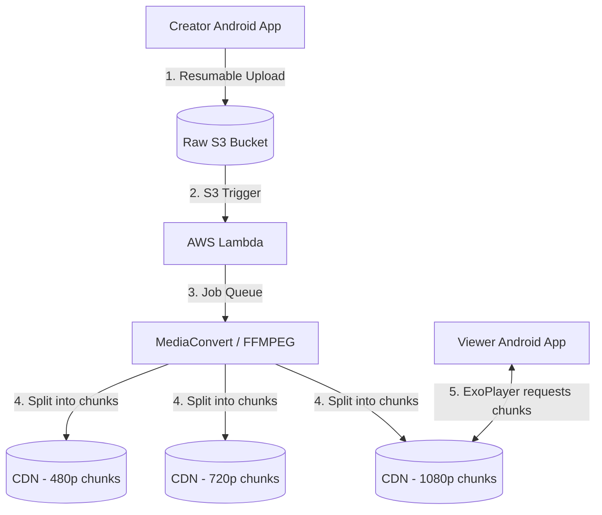

# System Design: Video Streaming (YouTube / Netflix)

## The Prompt

*"Design a mobile video streaming application like YouTube. Users must be able to upload large video files from their phone. Other users must be able to stream those videos instantly, with the video quality dynamically adapting to their cellular network speed to prevent buffering."*

## 1. Requirements & Clarification (RADIO Framework)

### Functional Requirements
- **Upload:** Users can upload raw video files (MP4, MOV) from their camera roll.
- **Playback:** Users can stream videos smoothly.
- **Adaptive Bitrate:** The video must drop to 480p on 3G, and jump to 4K on Wi-Fi automatically.

### Non-Functional Requirements (NFRs)
- **Bandwidth Efficiency (Priority 0):** You cannot force a user on a 3G network to download a 4K video. It will buffer infinitely.
- **Upload Reliability:** If an upload drops at 99%, the user must not have to restart the 2GB upload.
- **Storage:** The backend cannot store raw uncompressed 4K files indefinitely.

## 2. High-Level Architecture (The Transcoding Pipeline)

A Junior engineer uploads an MP4 to an S3 bucket and sends the S3 URL to the mobile app for playback. This is catastrophically wrong.
A Staff engineer designs an asynchronous **Transcoding Pipeline**. The raw file is never sent to the viewer.



## 3. The Core Flows (Deep Dive)

### Flow 1: Resumable Video Uploads
*Interviewer:* "The user is uploading a 2GB 4K video from their phone. At 99%, they drive into a tunnel. The network drops. When they exit the tunnel, how do you prevent restarting?"

**Staff Answer:**
"I must implement **Chunked Resumable Uploads**.
1. The Android app does *not* send a single 2GB HTTP POST.
2. The app reads the file from the local `MediaStore` using an `InputStream`.
3. It slices the bytes into 5MB chunks.
4. It uploads Chunk 1, Chunk 2, Chunk 3 sequentially using HTTP `PUT` requests (or AWS S3 Multipart Upload APIs).
5. If the network drops at Chunk 400 (out of 400), the app simply retries Chunk 400 when the network returns. The backend re-assembles the 400 chunks into the final MP4."

### Flow 2: Adaptive Bitrate Streaming (HLS / DASH)
*Interviewer:* "How exactly does the video 'magically' switch from 480p to 1080p mid-stream without interrupting the playback?"

**Staff Answer:**
"This relies on **HLS (HTTP Live Streaming)** or **MPEG-DASH**. 
The backend Transcoder does two things:
1. It creates 3 different resolutions of the video (1080p, 720p, 480p).
2. It slices *every* resolution into 3-second `.ts` (Transport Stream) chunks.

The backend generates a `.m3u8` Manifest File:
```text
#EXTM3U
#EXT-X-STREAM-INF:BANDWIDTH=5000000,RESOLUTION=1920x1080
http://cdn.com/1080p.m3u8
#EXT-X-STREAM-INF:BANDWIDTH=2500000,RESOLUTION=1280x720
http://cdn.com/720p.m3u8
#EXT-X-STREAM-INF:BANDWIDTH=800000,RESOLUTION=854x480
http://cdn.com/480p.m3u8
```

**The Android Client (ExoPlayer):**
1. `ExoPlayer` downloads the Manifest file.
2. `ExoPlayer` measures the current TCP connection bandwidth. (e.g., Oh, we have 6 Megabits/sec).
3. It selects the 1080p stream. It requests `1080p_chunk_1.ts`.
4. Mid-playback, the user goes into an elevator. Bandwidth drops to 1 Megabit/sec.
5. `ExoPlayer` detects the drop. For the *next* chunk, it seamlessly switches to requesting `480p_chunk_2.ts`. 
The video quality blurs, but it never buffers."

### Flow 3: Preventing UI Thread Freezes (SurfaceView)
*Interviewer:* "When the video plays, your app's UI becomes incredibly sluggish. Scrolling the comment section below the video drops to 15 frames per second."

**Staff Answer:**
"If the video is being drawn onto a standard `TextureView`, every frame of the video has to pass through the Android View Hierarchy's rendering pipeline. A 60fps video will absolutely choke the Main Thread.
**The Fix:** I must explicitly configure `ExoPlayer` to use a `SurfaceView`. A `SurfaceView` punches a literal hole through the Android UI window, allowing the hardware video decoder chip to render pixels directly to the screen's memory buffer, completely bypassing the UI thread. The comment section will now scroll at a perfect 60fps."

## 4. Failure Modes & Bottlenecks

### Bottleneck: Battery Drain
*Interviewer:* "Users report their phone gets incredibly hot and the battery dies in 1 hour when watching videos."

**Staff Answer:**
"This happens when the device falls back to **Software Decoding**.
If the backend encodes the video in a cutting-edge codec (like AV1) that the 4-year-old Android hardware doesn't natively support, the CPU is forced to decode the video mathematically. This melts the battery.
**The Fix:** The Manifest file must offer standard, globally hardware-accelerated codecs (like H.264 / AVC). `ExoPlayer` must query `MediaCodecList` to ensure a hardware decoder exists for the stream before playing it."

### Bottleneck: Cold Start Buffering
*Interviewer:* "When the user taps the video, they stare at a black loading screen for 3 seconds while it starts. How do we make it start instantly?"

**Staff Answer:**
"We must implement **Pre-fetching** and prioritize the lowest bitrate.
1. When the user is scrolling the feed, and the video thumbnail comes into view, the app silently downloads the `.m3u8` Manifest and exactly *one* chunk of the 480p stream into the local disk cache.
2. When the user taps the video, `ExoPlayer` plays that local 480p chunk instantly (0ms latency).
3. While the 480p chunk is playing, `ExoPlayer` establishes the network connection and ramps up to 1080p for the second chunk."

## 5. Staff Engineer Thinking: CDN Economics

A Staff Engineer knows that Video Streaming is primarily an economics problem, not just a technical one.

Serving 1 Petabyte of video from AWS S3 costs ~$90,000. Serving it from a CDN (Cloudflare/Fastly) costs ~$5,000. 
The mobile app *must never* request video chunks directly from the core backend or S3. The URLs provided in the manifest must point to Edge CDN nodes. The app relies on the CDN to cache the chunks physically close to the user (e.g., caching the video in a data center in Mumbai for an Indian user, instead of streaming it from Virginia).

## 6. Probing Questions (For Practice)

1.  Explain why serving a raw, uncompressed MP4 directly from an AWS S3 bucket to a mobile app is an architectural failure for a global user base.
2.  Describe the fundamental difference between downloading a video file and Adaptive Bitrate Streaming (HLS/DASH).
3.  Walk through the structure of an HLS `.m3u8` manifest file. How does it allow `ExoPlayer` to seamlessly switch resolutions?
4.  Explain how Chunked Multipart Uploads protect a 2GB video upload from being completely lost if the user's network connection drops at 99%.
5.  Why does rendering a video onto a `TextureView` cause massive UI stuttering when scrolling a layout, and how does a `SurfaceView` fix it?
6.  Describe the difference between Hardware Decoding and Software Decoding. Why does playing an unsupported codec (like AV1 on an old phone) destroy battery life?
7.  How does pre-fetching the Manifest and the first 3-second chunk of a 480p stream solve the "Cold Start Buffering" problem?
8.  Explain the economic necessity of using a Content Delivery Network (CDN) for video streaming compared to streaming directly from core cloud storage.
9.  If `ExoPlayer` is playing a 1080p stream and the user enters an elevator, lowering bandwidth, describe exactly what `ExoPlayer` does to prevent the video from pausing to buffer.
10. Why must the Android client read the raw video file via an `InputStream` from the `MediaStore` rather than loading the entire `ByteArray` into memory before initiating an upload?

## Further Reading

- [`file-downloader.md`](file-downloader.md) — The mechanics of chunked network transfers.
- [`jank.md`](../android/performance/jank.md) — The difference between `SurfaceView` and `TextureView` regarding the Main Thread.
- [`caching.md`](../engineering-fundamentals/caching.md) — The mechanics of Edge CDNs.
