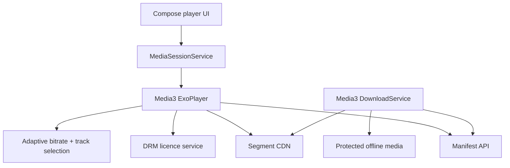
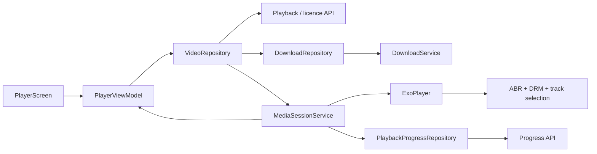

# Video Streaming (YouTube / Netflix-style)

> A 45-60 minute mobile system-design walkthrough for a video-streaming client (YouTube, Netflix, Prime Video) on Android. CDN, ABR ladder, DRM internals are server problems — bulk is on-device: player lifecycle, ABR client behaviour, offline downloads, picture-in-picture.

---

## 1. Gathering Requirements (~5 min)

> **Interviewer:** "Design a video-streaming app like YouTube."
> **Candidate:** "The interesting mobile problems are player lifecycle, adaptive bitrate selection, offline downloads, and battery/data discipline. I'll deep-dive the player + ABR client."

### Functional Requirements
- **Play HLS / DASH video** with multiple quality tiers.
- **Offline downloads** for paid / subscription content.
- **Picture-in-picture** when user backgrounds.
- **Background audio** when user locks screen.
- **Cast** to TV / Chromecast.
- **Cross-device handoff** to seamlessly resume playback across mobile, web, and TV using synced playback state.

### Non-Functional Requirements
- **Time-to-first-frame** (TTFF) < 1.5s on a good network.
- **No buffer underruns** under network variance (ABR).
- **Battery** — efficient codec selection.
- **Cellular-aware** — default to lower bitrate; warn before HD on cellular.
- **DRM** — Widevine L1 keeps protected playback in a hardware-backed trusted path; L3 is a software-only, reduced-security fallback and does not provide a TEE guarantee.

### Out of Scope
- Encoding / packaging pipeline (server)
- CDN / edge selection (server)
- Recommendation algorithm (server, returns video list)
- Live streaming ingestion (separate stack)
- AR / VR video

---

## 2. Clarifying Questions (~3 min)

| Question | Why it matters |
|---|---|
| Protocol (HLS, DASH)? | Player + CDN setup |
| DRM (Widevine L1/L3)? | Hardware requirements; the content provider's licence sets the quality per level |
| Offline / save-for-later? | Downloader + storage |
| Live in scope? | Different latency profile |
| Cast / external playback? | Media3 Cast extension |
| Cellular auto-quality? | ABR default |
| Audio-only background? | MediaSessionService |

> **Candidate:** "Both HLS + DASH, Widevine L1 where available, offline yes, live out of scope, Cast supported, cellular auto-LD, audio background supported."

---

## 3. High-Level Diagram (~10 min)



The service owns playback beyond the screen lifecycle; manifests, segment delivery, DRM, and downloads remain distinct so buffering, entitlement, and offline failures can be diagnosed independently.

**Components:**
- **`ExoPlayer`** (Media3) — playback engine.
- **`MediaSessionService`** — owns the player; survives backgrounding.
- **`DownloadService`** — for offline.
- **`DrmSessionManager`** — Widevine key exchange.
- **`CastSession`** — Media3 Cast extension.

---

## 4. API Contract

### Manifest URL (per video)

```http
GET /v1/videos/{id}/playback
Authorization: Bearer ...
{
  "videoId": "v_42",
  "manifests": {
    "dash": "https://cdn.../v_42.mpd",
    "hls":  "https://cdn.../v_42.m3u8"
  },
  "licenseUrl": "https://drm.../widevine",
  "drmType": "WIDEVINE",
  "thumbnails": "https://cdn.../v_42-thumbs.vtt",
  "captions": [
    { "lang": "en", "url": "https://cdn.../v_42-en.vtt", "kind": "subtitles" }
  ],
  "expiresAt": 1750003600
}
```

### Offline download authorization

```http
POST /v1/videos/{id}/license/offline
{
  "deviceId": "d_abc",
  "profileId": "p_1"
}
{ "licenseUrl": "https://drm.../widevine?offline=1", "licenseToken": "...", "expiresAt": 1752592000 }
```

This response only authorizes a licence request; it carries no key. The device's `MediaDrm` generates the DRM request, the licence server answers it, and `provideKeyResponse` returns a **local key-set ID** that only means something on this device. `OfflineLicenseHelper` wraps that exchange.

### Cross-device playback progress

```http
GET /v1/me/videos/{id}/progress
200 OK
ETag: "17"

{ "positionMs": 83421, "playbackSessionId": "playback-session-123", "sequence": 41, "eventType": "PAUSE", "version": 17, "updatedAt": "2026-08-01T14:00:00Z" }

# First write after GET returned 404 Not Found
PUT /v1/me/videos/{id}/progress
If-None-Match: *
Idempotency-Key: playback-session-123:1

{ "positionMs": 12000, "playbackSessionId": "playback-session-123", "sequence": 1, "eventType": "PERIODIC" }
201 Created
ETag: "1"

{ "positionMs": 12000, "playbackSessionId": "playback-session-123", "sequence": 1, "eventType": "PERIODIC", "version": 1, "updatedAt": "2026-08-01T13:55:00Z" }

# Subsequent write after reading ETag "17"
PUT /v1/me/videos/{id}/progress
If-Match: "17"
Idempotency-Key: playback-session-123:42

{ "positionMs": 98210, "playbackSessionId": "playback-session-123", "sequence": 42, "eventType": "PERIODIC" }
200 OK
ETag: "18"

{ "positionMs": 98210, "playbackSessionId": "playback-session-123", "sequence": 42, "eventType": "PERIODIC", "version": 18, "updatedAt": "2026-08-01T14:00:15Z" }
```

`eventType` is one of `PERIODIC`, `PAUSE`, `REWIND`, or `COMPLETE`, so the server can distinguish an intentional lower position and terminal completion from stale ordinary progress. `playbackSessionId` is a globally unique random ID and wire-level `sequence` increases monotonically within it; the server records the last accepted session sequence and treats an equal or lower same-session sequence as already superseded. The idempotency store is scoped by authenticated profile as well as `Idempotency-Key`.

`GET` returns `404 Not Found` when no progress representation exists. The first writer uses `If-None-Match: *`; it receives `201 Created` and the first ETag, while a concurrent writer that lost the create race receives `412 Precondition Failed` and must fetch before reconciling. Subsequent writers use the quoted ETag in `If-Match`.

Each client reads progress before playback and records it every 15–30 seconds and on pause, background, Cast handoff, and completion. Before attempting the network call, `PlaybackProgressRepository` transactionally upserts the latest position and its nullable last-seen server ETag in Room and appends a durable outbox item. Both rows carry the stable, opaque `profileId` from the authenticated session; progress is keyed by `(profileId, videoId)`, and an outbox operation is never reassigned to whichever account happens to be active later. In addition to the per-session `sessionSequence` sent as wire-level `sequence`, the repository atomically allocates a monotonically increasing `timelineSequence` across every local session for that profile/video. This preserves the causal order when session A ends and session B starts while both are offline. A `null` base ETag means conditional creation with `If-None-Match: *`; it is never replaced with a synthetic version such as zero. Treat ETags as opaque strings even when examples happen to contain digits. A unique, connectivity-constrained WorkManager job per profile flushes that profile's outbox after reconnect, so progress from downloaded/offline playback is not lost. Ordinary periodic updates may coalesce only within one session and retain the newest `timelineSequence`; session boundaries, completion, and explicit rewind events remain ordered.

The worker receives `profileId` as immutable input, selects only rows owned by that profile, and asks the token provider for credentials explicitly bound to that profile before every `/v1/me` request. The network layer refuses to attach a token owned by a different profile, so an account-switch race cannot borrow the next user's credentials. On sign-out or account switch, `SignOutOrchestrator` also cancels that profile's unique work before changing credentials. Cancellation is lifecycle hygiene rather than the security boundary. Product policy may then purge its progress/outbox rows immediately or retain them encrypted for the same profile to resume after re-authentication, but another profile can neither query nor flush them; account deletion always purges them.

The server assigns `updatedAt`, advances `version`, and returns an opaque quoted ETag. The worker serializes writes for a `(profileId, videoId)` and processes all sessions in ascending `timelineSequence`. After every accepted `201`/`200`, it transactionally stores the returned ETag plus the acknowledged session/timeline markers, deletes the acknowledged item, and rebases every remaining item with a greater `timelineSequence` for that profile/video onto the new ETag before sending the next item—even when the next item belongs to a later local session. While newer items remain, the local `PlaybackProgressEntity` keeps the highest-timeline optimistic projection rather than being overwritten by an older acknowledgement; once the queue is empty, it stores the accepted server representation and becomes `SYNCED`. This ensures an ordered `COMPLETE`, `REWIND`, or later offline session is not left on the stale pre-offline validator.

A stale precondition gets `412 Precondition Failed`, after which the worker fetches the latest representation and ETag rather than blindly overwriting it. The representation's `(playbackSessionId, sequence)` is first matched against a queued local event or the persisted last-acknowledged marker. If it identifies a known local causal predecessor, the worker transactionally removes all rows through that event's `timelineSequence`, rebases every known-later row—including later sessions—onto the fetched ETag, and retries in timeline order. Only server state that cannot be placed in this local causal chain is genuinely concurrent: that moves the queue to `NEEDS_RECONCILIATION` and surfaces a resume choice instead of guessing from skewed device clocks. The worker deletes an outbox item only after acceptance, recognition that its causal position was already superseded, or an explicit user reconciliation; it uses bounded retries if the ETag changes again and never lets an old near-end update resurrect a completed video.

---

## 5. Mobile App Architecture

### Module structure

```
:app
:feature:player        ← PlayerScreen, controls
:feature:downloads     ← downloads list, manage
:feature:cast          ← Cast UI
:core:network
:core:database         ← downloads metadata
:core:media            ← Media3 wrapper
:data:videos
:data:playback-progress ← cross-device progress read/write + conflict handling
```

### Layered diagram



The screen issues intent and observes session state, while playback and downloads live in services whose lifetimes are not tied to a composable.

### Key class signatures

```kotlin
interface VideoRepository {
    suspend fun getPlaybackInfo(videoId: String): PlaybackInfo
    suspend fun downloadForOffline(videoId: String)
    fun observeDownloads(): Flow<List<Download>>
}

class PlayerFactory @Inject constructor(@ApplicationContext private val ctx: Context, private val constraints: TrackConstraints, ...) {
    // The service owns what this returns, and releases it in onDestroy.
    fun create(): ExoPlayer = ExoPlayer.Builder(ctx)
        .setMediaSourceFactory(buildMediaSourceFactory())
        .setTrackSelector(constraints.trackSelector)
        .setLoadControl(buildLoadControl())
        .setWakeMode(C.WAKE_MODE_LOCAL)                  // screen-off playback under a foreground service
        .setAudioAttributes(movieAudioAttributes, /* handleAudioFocus = */ true)
        .setHandleAudioBecomingNoisy(true)               // pause when headphones unplug
        .build()
}
```

---

## 6. Local Storage

```kotlin
@Entity(tableName = "downloads", primaryKeys = ["profileId", "videoId"])
data class DownloadEntity(
    val profileId: String,          // paid or age-restricted downloads belong to one profile
    val videoId: String,
    val title: String, val durationMs: Long, val sizeBytes: Long,
    val state: DownloadState,       // QUEUED, DOWNLOADING, COMPLETED, FAILED, EXPIRED
    val offlineKeySetId: ByteArray?,  // local MediaDrm ID, never a raw key
    val downloadedAt: Long?, val licenseExpiresAt: Long?
)

@Entity(
    tableName = "playback_progress",
    primaryKeys = ["profileId", "videoId"],
)
data class PlaybackProgressEntity(
    val profileId: String,
    val videoId: String,
    val positionMs: Long,
    val baseServerEtag: String?,    // null until conditional creation succeeds
    val playbackSessionId: String,
    val lastEventType: ProgressEventType,
    val localSessionSequence: Long,
    val localTimelineSequence: Long,
    val lastAckedPlaybackSessionId: String?,
    val lastAckedSessionSequence: Long?,
    val lastAckedTimelineSequence: Long?,
    val syncState: SyncState,       // PENDING, SYNCED, NEEDS_RECONCILIATION
)

@Entity(
    tableName = "playback_progress_outbox",
    indices = [
        Index(value = ["profileId", "videoId", "playbackSessionId", "sessionSequence"], unique = true),
        Index(value = ["profileId", "videoId", "timelineSequence"], unique = true),
    ],
)
data class PlaybackProgressOutboxEntity(
    @PrimaryKey val operationId: String,
    val profileId: String,
    val videoId: String,
    val playbackSessionId: String,
    val sessionSequence: Long,      // serialized as wire-level sequence
    val timelineSequence: Long,     // local causal order across sessions
    val positionMs: Long,
    val eventType: ProgressEventType, // PERIODIC, PAUSE, REWIND, COMPLETE
    val baseServerEtag: String?,    // null selects If-None-Match: *
)
```

Actual video bytes are managed by Media3's `DownloadIndex` + a `Cache` on disk — not directly in Room. Room tracks download metadata plus durable playback progress/outbox state used for reconnect synchronization.

---

## 7. Deep Dive: Player + ABR Client (~15 min)

> *I'd pick this as the deep dive because player lifecycle + ABR is where most subtle bugs and bad UX live — pre-buffering, quality switches, network changes, app backgrounding.*

### MediaSessionService

```kotlin
class VideoPlaybackService : MediaSessionService() {

    @Inject lateinit var playerFactory: PlayerFactory
    private var session: MediaSession? = null

    override fun onCreate() {
        super.onCreate()
        session = MediaSession.Builder(this, playerFactory.create()).build()
    }

    override fun onGetSession(controllerInfo: MediaSession.ControllerInfo): MediaSession? = session

    override fun onTaskRemoved(rootIntent: Intent?) {
        // Video stops with the app. Audio mode uses the default: keep ongoing playback, stop otherwise.
        if (audioMode) super.onTaskRemoved(rootIntent) else pauseAllPlayersAndStopSelf()
    }

    override fun onDestroy() {
        session?.run { player.release(); release() }
        session = null
        super.onDestroy()
    }
}
```

The service creates the player and releases it, so nothing can reuse a released instance. The UI talks to it through a `MediaController`. Declare `FOREGROUND_SERVICE`, `FOREGROUND_SERVICE_MEDIA_PLAYBACK` and `foregroundServiceType="mediaPlayback"`.

The MediaSessionService gets a foreground notification automatically when playback starts. System surfaces the player on lock screen, Bluetooth, Android Auto, Wear.

### ABR (adaptive bitrate)

```kotlin
class TrackConstraints @Inject constructor(@ApplicationContext context: Context, private val plan: Plan) {
    val trackSelector = DefaultTrackSelector(context)

    init {
        clearMeteredLimits()
    }

    fun applyMeteredLimits() = trackSelector.setParameters(trackSelector.buildUponParameters()
        .setMaxVideoSize(854, 480)
        .setMaxVideoBitrate(1_500_000)
        .build())

    // The cap follows the ABR ladder in section 8; the selector also skips tracks the device can't play.
    fun clearMeteredLimits() = trackSelector.setParameters(trackSelector.buildUponParameters()
        .clearVideoSizeConstraints()
        .setMaxVideoBitrate(if (plan.isPremium) 15_000_000 else 4_000_000)
        .build())
}
```

ExoPlayer's built-in `AdaptiveTrackSelection` picks bitrate within constraints based on bandwidth estimate; it switches up after stable throughput, down on stalls.

### Custom `LoadControl`

```kotlin
private fun buildLoadControl(): LoadControl {
    return DefaultLoadControl.Builder()
        .setBufferDurationsMs(
            /* minBufferMs = */ 15_000,
            /* maxBufferMs = */ 50_000,
            /* bufferForPlaybackMs = */ 1_000,           // start playing quickly
            /* bufferForPlaybackAfterRebufferMs = */ 2_000
        )
        .setPrioritizeTimeOverSizeThresholds(true)
        .build()
}
```

The last two values match Media3's current defaults (1 s and 2 s), so only the first is a real change: the default minimum is 50 s, and starting downloads again at 15 s spends less data on video the user may abandon. These values are durations of buffered media, not waiting time. The 50s max buffer cap balances memory + responsive seeks.

### Picture-in-picture

```kotlin
class PlayerActivity : ComponentActivity() {

    // Call setPictureInPictureParams(pipParams()) when playback starts or pauses, or the video size changes.
    private fun pipParams(): PictureInPictureParams {
        val size = controller.videoSize
        val ratio = if (size.width > 0 && size.height > 0) {
            Rational(size.width, size.height).coerceIn(Rational(100, 239), Rational(239, 100))
        } else {
            Rational(16, 9)
        }
        return PictureInPictureParams.Builder().setAspectRatio(ratio).apply {
            if (Build.VERSION.SDK_INT >= Build.VERSION_CODES.S) setAutoEnterEnabled(controller.isPlaying)
        }.build()
    }

    override fun onUserLeaveHint() {
        super.onUserLeaveHint()
        // Android 12+ enters by itself through setAutoEnterEnabled.
        if (Build.VERSION.SDK_INT < Build.VERSION_CODES.S && controller.isPlaying && supportsPip()) {
            enterPictureInPictureMode(pipParams())
        }
    }
}
```

PiP keeps playback going in a floating window. The ratio must be between 2.39:1 and 1:2.39, and scope films can be wider, so clamp it; a zero size means the player doesn't know yet.

### Background audio

When the user locks the screen during a music-style video, the foreground MediaSessionService keeps the process alive, and `WAKE_MODE_LOCAL` keeps the CPU awake, which the service alone doesn't do. The `MediaSession` projects controls to lock screen / Bluetooth.

### DRM (Widevine)

```kotlin
fun buildMediaItem(info: PlaybackInfo): MediaItem {
    val drmConfig = MediaItem.DrmConfiguration.Builder(C.WIDEVINE_UUID)
        .setLicenseUri(info.licenseUrl)
        .setMultiSession(false)
        .build()
    return MediaItem.Builder()
        .setUri(info.manifests.dash)
        .setMimeType(MimeTypes.APPLICATION_MPD)
        .setDrmConfiguration(drmConfig)
        .build()
}
```

ExoPlayer handles the Widevine key exchange. On L1 devices, decrypted frames stay in TEE; we never see plaintext. On L3 (no Trusted Execution), client-side software decryption is used. The maximum resolution per level is the content provider's licence policy, not a Widevine rule; many studio licences cap L3 at SD.

### Network change handling

```kotlin
class NetworkChangeListener(...) : ConnectivityManager.NetworkCallback() {
    override fun onCapabilitiesChanged(network: Network, caps: NetworkCapabilities) {
        // Metered status, not transport: a Wi-Fi hotspot can be metered, and some cellular plans aren't.
        if (caps.hasCapability(NetworkCapabilities.NET_CAPABILITY_NOT_METERED)) {
            constraints.clearMeteredLimits()
        } else {
            constraints.applyMeteredLimits()
        }
    }
}
```

Register it with `registerDefaultNetworkCallback`, so it follows the network the app is using. When user switches from Wi-Fi to a metered network mid-playback, we tighten quality immediately — avoid a surprise data spike.

### Offline downloads (Media3)

```kotlin
class VideoDownloadService : DownloadService(
    /* notificationId = */ 1001,
    /* foregroundNotificationUpdateInterval = */ 1_000L,
    /* channelId = */ "downloads",
    /* channelNameResourceId = */ R.string.download_channel,
    /* channelDescriptionResourceId = */ 0,
) {
    override fun getDownloadManager(): DownloadManager = appDownloadManager
    override fun getForegroundNotification(downloads: List<Download>, notMetRequirements: Int): Notification = ...
    override fun getScheduler(): Scheduler = PlatformScheduler(this, JOB_ID)
}
```

Media3's `DownloadService` manages segment download, retry, persistence. Declare `FOREGROUND_SERVICE_DATA_SYNC` and `foregroundServiceType="dataSync"`. For apps targeting Android 15+, that type gets 6 hours in any 24, shared across the app's `dataSync` services. Then the system calls `onTimeout`, and new starts fail until the user brings the app forward. So test that a large queue on slow Wi-Fi resumes correctly after the limit; Media3's guide doesn't say how `DownloadService` handles it.

For DRM content, the licence is a separate lifecycle:

1. Get authorization from `POST /v1/videos/{id}/license/offline`.
2. Call `OfflineLicenseHelper.downloadLicense(format)`, which returns the local `offlineKeySetId`.
3. Persist it in `DownloadEntity`, and pass it to `DownloadRequest.Builder.setKeySetId`.
4. Load it for playback with `MediaItem.DrmConfiguration.Builder.setKeySetId`.
5. Before expiry, call `renewLicense` if the user is still entitled, and store the returned ID.
6. On delete, sign-out or lost entitlement, call `releaseLicense`, then remove the bytes.

Only one offline key set can be used per playback, so multi-key content needs a licence server that returns all its keys in one response.

### Failure modes

| What breaks | Behavior |
|---|---|
| Network drops mid-playback | ExoPlayer rebuffers; ABR may step down; resume on reconnect |
| Manifest URL expires | `expiresAt` triggers re-fetch before next segment |
| DRM license expires | Online: fetch new license; retry segment. Offline: block playback and ask the user to reconnect |
| Foreground service killed by OEM | Playback stops. Position is already saved, so the user resumes from the app or, if we implement `onPlaybackResumption` and its `MediaButtonReceiver`, a media button. No automatic restart is promised |
| Download hits the `dataSync` limit | Service stops on `onTimeout`; remaining downloads wait until the app is next opened |
| Different profile opens a download | Only rows for that `profileId` are listed and playable |
| Disk full during download | Download fails; surface error; partial cleanup |
| Codec unsupported | Track selector picks alternate; if none, show error |
| Cast disconnects | Resume on phone; preserve position |

---

## 8. Trade-offs

### Protocol

| Option | Pros | Cons | Verdict |
|---|---|---|---|
| **DASH (MPD)** | Widely supported; good ABR | Slightly more complex setup | Pick for new |
| **HLS (m3u8)** | Apple-native; ubiquitous | Less granular ABR | Always also expose for iOS / Safari parity |
| Smooth Streaming | Legacy Microsoft | Niche | Skip |

### Player

| Option | Verdict |
|---|---|
| **ExoPlayer (Media3)** | Pick — official, ABR + DRM + Cast |
| `MediaPlayer` | Skip — limited; no ABR |
| Custom (libavformat) | Don't — vast scope |

### DRM tier

| Tier | When |
|---|---|
| **L1 (hardware TEE)** | Usually what studio licences require for HD on protected content |
| **L3 (software)** | Older / cheaper devices; quality limited by the provider's licence, often SD |
| No DRM | UGC; free content |

### Background playback model

| Option | Verdict |
|---|---|
| **MediaSessionService** | Pick — official, integrates with system |
| Plain foreground service | More work; reinvents MediaSession |
| Audio-only library (e.g., AVPlayer-style) | Doesn't cover video PiP |

### ABR sizing

| Quality | Bitrate | When |
|---|---|---|
| 240p | 200 kbps | Slow cellular |
| 480p | 700 kbps | Cellular auto |
| 720p | 1.5 Mbps | Wi-Fi default |
| 1080p | 4 Mbps | Wi-Fi + supported device |
| 4K | 15 Mbps | Premium tier, Wi-Fi only |

### Cellular default

| Option | Verdict |
|---|---|
| **Auto-lower on cellular** | Pick — saves data without surprise |
| Same quality | Risks bill shock |
| Pause / require user opt-in | Annoying UX |

---

## 9. Major Concerns

- **TTFF.** `bufferForPlaybackMs` low; prefetch via small initial segments.
- **Cellular spend.** Auto-cap on metered networks. Warn before HD.
- **Battery.** Hardware decode (codec2/MediaCodec) is far more efficient than software fallback.
- **Memory.** Cap buffer to 50s. Leaving the screen detaches the surface and controller; the service-owned player is released only in the service's `onDestroy`.
- **DRM.** The provider's licence decides quality per security level; surface "best quality on this device" honestly.
- **Lifecycle.** `MediaSessionService` for background; PiP for "leave the app but keep playing"; surface release on dispose. Automatic restart after a kill isn't guaranteed, so saved position is what protects the user.
- **Cast.** Media3 Cast extension; preserve position when handing off.
- **Captions / accessibility.** Always offer captions; honour system caption settings.
- **Privacy.** Don't log full URLs (signed CDN URLs may include user tokens). Redact.

---

## 10. Follow-up Questions

> **Q: User starts a video on Wi-Fi, walks outside losing Wi-Fi mid-playback — what happens?**
> `ConnectivityManager` callback fires. We re-apply cellular constraints (`MaxVideoBitrate=1.5Mbps`). ExoPlayer's `BandwidthMeter` reads the new throughput; ABR steps down. If buffer underruns, brief rebuffer; otherwise seamless.

> **Q: User scrubs to 50% on a long video — what's the latency target?**
> Set a measured seek-to-frame target, because the real time depends on network, cache, codec and keyframe spacing. We seek to a keyframe near the target and fetch the segment containing it. A seek uses `bufferForPlaybackMs` (1 s of buffered media here), because `bufferForPlaybackAfterRebufferMs` applies only after the buffer ran out on its own. Neither is a wait time. UI shows scrubbing thumbnail (from thumbnails VTT) during the seek.

> **Q: How do you support background audio for a music video?**
> MediaSessionService + `WAKE_MODE_LOCAL`, with the media notification Media3 provides. The user can lock the screen and audio continues. Lock-screen controls follow the session's `Player` automatically, so there's no playback state to set by hand; that was the legacy `MediaSessionCompat` model.

> **Q: How are downloads expired?**
> `OfflineLicenseHelper.getLicenseDurationRemainingSec` reports what's left on a key set. A periodic `WorkManager` job checks expiries and either renews the licence (if user is still entitled, storing the returned key-set ID) or marks the download EXPIRED, releases the licence and deletes bytes after a grace period.

> **Q: Cast handoff — what happens to local player?**
> When `CastSession` connects, the local player is paused. We pass the current position to Cast (`CastPlayer.setMediaItem(item, currentPosition)`). When the user disconnects, we read position back and resume locally.

> **Q: How is this tested?**
> Media3 sample apps + Cast emulator. Unit tests for ABR constraints. Integration tests on real devices for DRM (sandbox license server). Manual smoke for network-change scenarios.

---

## 11. Out of Scope (defended)

- **Encoding / packaging** — server pipeline.
- **CDN / edge selection** — backend.
- **Recommendation algorithm** — black box; returns video list.
- **Live streaming** — different latency profile; separate stack.
- **AR / VR video** — separate.

---

## 12. Further Reading

- [Android Developers — Media3 overview](https://developer.android.com/media/media3) — official docs.
- [ExoPlayer DRM guide](https://developer.android.com/media/media3/exoplayer/drm) — Widevine integration.
- [Cast SDK for Android](https://developers.google.com/cast/docs/android_sender) — sender app integration.
- [HLS spec (RFC 8216)](https://datatracker.ietf.org/doc/html/rfc8216) — for HLS internals.

---

> **Closing in the interview:** "I anchored on player + ABR because that's where all the lifecycle, DRM, and network-change concerns intersect. Happy to dig into offline-license renewal, the Cast handoff, or PiP transitions next."
