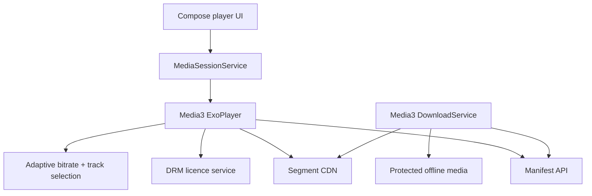
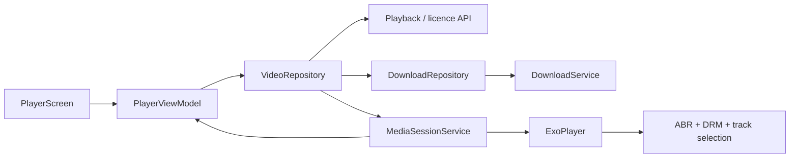

# Video Streaming (YouTube / Netflix-style)

> A 45-60 minute mobile system-design walkthrough for a video-streaming client (YouTube, Netflix, Prime Video) on Android. CDN, ABR ladder, DRM internals are server problems — bulk is on-device: player lifecycle, ABR client behaviour, offline downloads, picture-in-picture.

---

## 1. Gathering Requirements (~5 min)

> **Interviewer:** "Design a video-streaming app like YouTube."
> **Candidate:** "The interesting mobile problems are player lifecycle, adaptive bitrate selection, offline downloads, and battery/data discipline. I'll deep-dive the player + ABR client."

### Functional Requirements
- **Play HLS / DASH video** with multiple quality tiers.
- **Offline downloads** for paid / subscription content.
- **Picture-in-picture** when user backgrounds.
- **Background audio** when user locks screen.
- **Cast** to TV / Chromecast.

### Non-Functional Requirements
- **Time-to-first-frame** (TTFF) < 1.5s on a good network.
- **No buffer underruns** under network variance (ABR).
- **Battery** — efficient codec selection.
- **Cellular-aware** — default to lower bitrate; warn before HD on cellular.
- **DRM** — Widevine for protected content.

### Out of Scope
- Encoding / packaging pipeline (server)
- CDN / edge selection (server)
- Recommendation algorithm (server, returns video list)
- Live streaming ingestion (separate stack)
- AR / VR video

---

## 2. Clarifying Questions (~3 min)

| Question | Why it matters |
|---|---|
| Protocol (HLS, DASH)? | Player + CDN setup |
| DRM (Widevine L1/L3)? | Hardware requirements |
| Offline / save-for-later? | Downloader + storage |
| Live in scope? | Different latency profile |
| Cast / external playback? | Media3 Cast extension |
| Cellular auto-quality? | ABR default |
| Audio-only background? | MediaSessionService |

> **Candidate:** "Both HLS + DASH, Widevine L1 where available, offline yes, live out of scope, Cast supported, cellular auto-LD, audio background supported."

---

## 3. High-Level Diagram (~10 min)



The service owns playback beyond the screen lifecycle; manifests, segment delivery, DRM, and downloads remain distinct so buffering, entitlement, and offline failures can be diagnosed independently.

**Components:**
- **`ExoPlayer`** (Media3) — playback engine.
- **`MediaSessionService`** — owns the player; survives backgrounding.
- **`DownloadService`** — for offline.
- **`DrmSessionManager`** — Widevine key exchange.
- **`CastSession`** — Media3 Cast extension.

---

## 4. API Contract

### Manifest URL (per video)

```http
GET /v1/videos/{id}/playback
Authorization: Bearer ...
{
  "videoId": "v_42",
  "manifests": {
    "dash": "https://cdn.../v_42.mpd",
    "hls":  "https://cdn.../v_42.m3u8"
  },
  "licenseUrl": "https://drm.../widevine",
  "drmType": "WIDEVINE",
  "thumbnails": "https://cdn.../v_42-thumbs.vtt",
  "captions": [
    { "lang": "en", "url": "https://cdn.../v_42-en.vtt", "kind": "subtitles" }
  ],
  "expiresAt": 1750003600
}
```

### Offline download request

```http
POST /v1/videos/{id}/license/offline
{
  "deviceId": "d_abc",
  "expectedDurationDays": 30
}
{ "offlineLicenseKey": "...bytes-base64..." }
```

---

## 5. Mobile App Architecture

### Module structure

```
:app
:feature:player        ← PlayerScreen, controls
:feature:downloads     ← downloads list, manage
:feature:cast          ← Cast UI
:core:network
:core:database         ← downloads metadata
:core:media            ← Media3 wrapper
:data:videos
```

### Layered diagram



The screen issues intent and observes session state, while playback and downloads live in services whose lifetimes are not tied to a composable.

### Key class signatures

```kotlin
interface VideoRepository {
    suspend fun getPlaybackInfo(videoId: String): PlaybackInfo
    suspend fun downloadForOffline(videoId: String)
    fun observeDownloads(): Flow<List<Download>>
}

class PlayerHolder @Inject constructor(@ApplicationContext ctx: Context, ...) {
    val player: ExoPlayer = ExoPlayer.Builder(ctx)
        .setMediaSourceFactory(buildMediaSourceFactory())
        .setTrackSelector(buildTrackSelector())
        .setLoadControl(buildLoadControl())
        .build()
}
```

---

## 6. Local Storage

```kotlin
@Entity(tableName = "downloads")
data class DownloadEntity(
    @PrimaryKey val videoId: String,
    val title: String, val durationMs: Long, val sizeBytes: Long,
    val state: DownloadState,       // QUEUED, DOWNLOADING, COMPLETED, FAILED, EXPIRED
    val downloadedAt: Long?, val licenseExpiresAt: Long?
)
```

Actual video bytes are managed by Media3's `DownloadIndex` + a `Cache` on disk — not directly in Room. Room only tracks metadata for UI.

---

## 7. Deep Dive: Player + ABR Client (~15 min)

> *I'd pick this as the deep dive because player lifecycle + ABR is where most subtle bugs and bad UX live — pre-buffering, quality switches, network changes, app backgrounding.*

### MediaSessionService

```kotlin
class VideoPlaybackService : MediaSessionService() {

    @Inject lateinit var playerHolder: PlayerHolder
    private var session: MediaSession? = null

    override fun onCreate() {
        super.onCreate()
        session = MediaSession.Builder(this, playerHolder.player).build()
    }

    override fun onGetSession(controllerInfo: MediaSession.ControllerInfo): MediaSession? = session

    override fun onTaskRemoved(rootIntent: Intent?) {
        // User swiped the app — stop playback (or continue if audio mode)
        if (!playerHolder.player.playWhenReady) stopSelf()
    }

    override fun onDestroy() {
        session?.run { player.release(); release() }
        super.onDestroy()
    }
}
```

The MediaSessionService gets a foreground notification automatically when playback starts. System surfaces the player on lock screen, Bluetooth, Android Auto, Wear.

### ABR (adaptive bitrate)

```kotlin
private fun buildTrackSelector(): DefaultTrackSelector {
    val parameters = DefaultTrackSelector.Parameters.Builder(context)
        .setMaxVideoSize(width = 1920, height = 1080)
        .setMaxVideoBitrate(8_000_000)
        .setForceLowestBitrate(false)
        .build()
    return DefaultTrackSelector(context).apply { setParameters(parameters) }
}
```

Constrain on cellular:

```kotlin
fun applyCellularConstraints() {
    if (connectivity.isActiveNetworkMetered) {
        trackSelector.setParameters(trackSelector.buildUponParameters()
            .setMaxVideoSize(854, 480)
            .setMaxVideoBitrate(1_500_000)
            .build())
    }
}
```

ExoPlayer's built-in `AdaptiveTrackSelection` picks bitrate within constraints based on bandwidth estimate; it switches up after stable throughput, down on stalls.

### Custom `LoadControl`

```kotlin
private fun buildLoadControl(): LoadControl {
    return DefaultLoadControl.Builder()
        .setBufferDurationsMs(
            /* minBufferMs = */ 15_000,
            /* maxBufferMs = */ 50_000,
            /* bufferForPlaybackMs = */ 1_000,           // start playing quickly
            /* bufferForPlaybackAfterRebufferMs = */ 2_000
        )
        .setPrioritizeTimeOverSizeThresholds(true)
        .build()
}
```

Aggressive `bufferForPlaybackMs` favors TTFF; user expects video to start fast. The 50s max buffer cap balances memory + responsive seeks.

### Picture-in-picture

```kotlin
class PlayerActivity : ComponentActivity() {

    override fun onUserLeaveHint() {
        super.onUserLeaveHint()
        if (player.isPlaying && supportsPip()) {
            val ratio = Rational(player.videoSize.width, player.videoSize.height)
            enterPictureInPictureMode(PictureInPictureParams.Builder()
                .setAspectRatio(ratio).build())
        }
    }
}
```

`onUserLeaveHint` fires when the user presses Home. PiP keeps playback going in a floating window.

### Background audio

When the user locks the screen during a music-style video, MediaSessionService keeps playback alive. The `MediaSession` projects controls to lock screen / Bluetooth.

### DRM (Widevine)

```kotlin
fun buildMediaItem(info: PlaybackInfo): MediaItem {
    val drmConfig = MediaItem.DrmConfiguration.Builder(C.WIDEVINE_UUID)
        .setLicenseUri(info.licenseUrl)
        .setMultiSession(false)
        .build()
    return MediaItem.Builder()
        .setUri(info.manifests.dash)
        .setMimeType(MimeTypes.APPLICATION_MPD)
        .setDrmConfiguration(drmConfig)
        .build()
}
```

ExoPlayer handles the Widevine key exchange. On L1 devices, decrypted frames stay in TEE; we never see plaintext. On L3 (no Trusted Execution), client-side software decryption is used; only SD content typically.

### Network change handling

```kotlin
class NetworkChangeListener(...) : ConnectivityManager.NetworkCallback() {
    override fun onCapabilitiesChanged(network: Network, caps: NetworkCapabilities) {
        if (caps.hasTransport(NetworkCapabilities.TRANSPORT_CELLULAR)) {
            playerHolder.applyCellularConstraints()
        } else {
            playerHolder.clearConstraints()
        }
    }
}
```

When user switches from Wi-Fi to cellular mid-playback, we tighten quality immediately — avoid a surprise data spike.

### Offline downloads (Media3)

```kotlin
class VideoDownloadService : DownloadService(
    /* notificationId = */ 1001,
    /* foregroundNotificationUpdateInterval = */ 1_000L,
    /* channelId = */ "downloads",
    /* channelNameResourceId = */ R.string.download_channel,
    /* channelDescriptionResourceId = */ 0,
) {
    override fun getDownloadManager(): DownloadManager = appDownloadManager
    override fun getForegroundNotification(downloads: List<Download>, notMetRequirements: Int): Notification = ...
    override fun getScheduler(): Scheduler = PlatformScheduler(this, JOB_ID)
}
```

Media3's `DownloadService` manages segment download, retry, persistence. For DRM content, we also call `OfflineLicenseHelper` to download a long-lived license.

### Failure modes

| What breaks | Behavior |
|---|---|
| Network drops mid-playback | ExoPlayer rebuffers; ABR may step down; resume on reconnect |
| Manifest URL expires | `expiresAt` triggers re-fetch before next segment |
| DRM license expires | Fetch new license; retry segment |
| Foreground service killed by OEM | MediaSessionService restarts via WorkManager fallback |
| Disk full during download | Download fails; surface error; partial cleanup |
| Codec unsupported | Track selector picks alternate; if none, show error |
| Cast disconnects | Resume on phone; preserve position |

---

## 8. Trade-offs

### Protocol

| Option | Pros | Cons | Verdict |
|---|---|---|---|
| **DASH (MPD)** | Widely supported; good ABR | Slightly more complex setup | Pick for new |
| **HLS (m3u8)** | Apple-native; ubiquitous | Less granular ABR | Always also expose for iOS / Safari parity |
| Smooth Streaming | Legacy Microsoft | Niche | Skip |

### Player

| Option | Verdict |
|---|---|
| **ExoPlayer (Media3)** | Pick — official, ABR + DRM + Cast |
| `MediaPlayer` | Skip — limited; no ABR |
| Custom (libavformat) | Don't — vast scope |

### DRM tier

| Tier | When |
|---|---|
| **L1 (hardware TEE)** | Required for HD on protected content |
| **L3 (software)** | SD only; older / cheaper devices |
| No DRM | UGC; free content |

### Background playback model

| Option | Verdict |
|---|---|
| **MediaSessionService** | Pick — official, integrates with system |
| Plain foreground service | More work; reinvents MediaSession |
| Audio-only library (e.g., AVPlayer-style) | Doesn't cover video PiP |

### ABR sizing

| Quality | Bitrate | When |
|---|---|---|
| 240p | 200 kbps | Slow cellular |
| 480p | 700 kbps | Cellular auto |
| 720p | 1.5 Mbps | Wi-Fi default |
| 1080p | 4 Mbps | Wi-Fi + supported device |
| 4K | 15 Mbps | Premium tier, Wi-Fi only |

### Cellular default

| Option | Verdict |
|---|---|
| **Auto-lower on cellular** | Pick — saves data without surprise |
| Same quality | Risks bill shock |
| Pause / require user opt-in | Annoying UX |

---

## 9. Major Concerns

- **TTFF.** `bufferForPlaybackMs` low; prefetch via small initial segments.
- **Cellular spend.** Auto-cap on metered networks. Warn before HD.
- **Battery.** Hardware decode (codec2/MediaCodec) is far more efficient than software fallback.
- **Memory.** Cap buffer to 50s; release player aggressively on dispose.
- **DRM.** L1 required for HD on protected content; surface "best quality on this device" honestly.
- **Lifecycle.** `MediaSessionService` for background; PiP for "leave the app but keep playing"; surface release on dispose.
- **Cast.** Media3 Cast extension; preserve position when handing off.
- **Captions / accessibility.** Always offer captions; honour system caption settings.
- **Privacy.** Don't log full URLs (signed CDN URLs may include user tokens). Redact.

---

## 10. Follow-up Questions

> **Q: User starts a video on Wi-Fi, walks outside losing Wi-Fi mid-playback — what happens?**
> `ConnectivityManager` callback fires. We re-apply cellular constraints (`MaxVideoBitrate=1.5Mbps`). ExoPlayer's `BandwidthMeter` reads the new throughput; ABR steps down. If buffer underruns, brief rebuffer; otherwise seamless.

> **Q: User scrubs to 50% on a long video — what's the latency target?**
> Seek to keyframe near target. With segmented streaming (DASH), we fetch the segment containing that position (~few seconds). `bufferForPlaybackAfterRebufferMs = 2000` means ~2s before playback resumes. UI shows scrubbing thumbnail (from thumbnails VTT) during the seek.

> **Q: How do you support background audio for a music video?**
> MediaSessionService + a foreground notification with `MediaStyle`. The user can lock the screen and audio continues. We mark the session as `MediaSession.Builder.setPlaybackState(PLAYING)` so lock-screen controls work.

> **Q: How are downloads expired?**
> Each offline license has `expiresAt`. A periodic `WorkManager` job checks expiries and either re-requests a new license (if user is still entitled) or marks the download EXPIRED and deletes bytes after a grace period.

> **Q: Cast handoff — what happens to local player?**
> When `CastSession` connects, the local player is paused. We pass the current position to Cast (`CastPlayer.setMediaItem(item, currentPosition)`). When the user disconnects, we read position back and resume locally.

> **Q: How is this tested?**
> Media3 sample apps + Cast emulator. Unit tests for ABR constraints. Integration tests on real devices for DRM (sandbox license server). Manual smoke for network-change scenarios.

---

## 11. Out of Scope (defended)

- **Encoding / packaging** — server pipeline.
- **CDN / edge selection** — backend.
- **Recommendation algorithm** — black box; returns video list.
- **Live streaming** — different latency profile; separate stack.
- **AR / VR video** — separate.

---

## 12. Further Reading

- [Android Developers — Media3 overview](https://developer.android.com/media/media3) — official docs.
- [ExoPlayer DRM guide](https://developer.android.com/media/media3/exoplayer/drm) — Widevine integration.
- [Cast SDK for Android](https://developers.google.com/cast/docs/android_sender) — sender app integration.
- [HLS spec (RFC 8216)](https://datatracker.ietf.org/doc/html/rfc8216) — for HLS internals.

---

> **Closing in the interview:** "I anchored on player + ABR because that's where all the lifecycle, DRM, and network-change concerns intersect. Happy to dig into offline-license renewal, the Cast handoff, or PiP transitions next."
