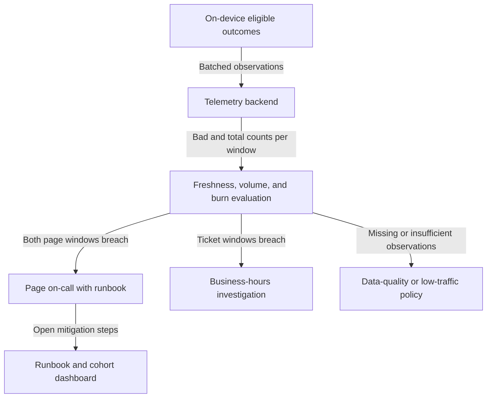
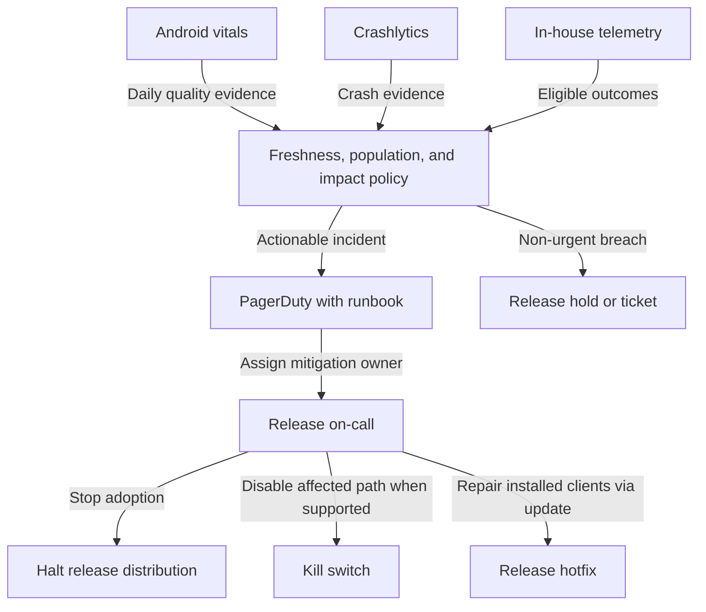

# Alerting

## Overview

Alerting is the mechanism that translates the silent data of your Observability spine (Logs, Metrics, SLIs) into active human intervention. It is the system that decides when a computer should interrupt a human's life (via Slack, email, or a 3:00 AM PagerDuty phone call) because the software is failing.

## Why It Matters

A dashboard with 50 beautiful charts showing a catastrophic system failure is completely useless if no one is looking at it. Human attention is the most expensive resource in engineering. You cannot pay engineers to stare at dashboards 24/7. Alerting automates the surveillance. 

However, poor alerting destroys engineering teams. "Alert Fatigue"—where engineers are bombarded with hundreds of useless, non-actionable emails every day—causes them to start ignoring alerts. When a real, catastrophic alert finally fires, it is ignored alongside the garbage, and the business suffers massive downtime.

## Historical Context

In the 2010s, alerting was often "Cause-Based" (e.g., "Alert if CPU > 90%"). This generated massive amounts of noise because a server can run at 95% CPU perfectly fine without affecting the user. Modern SRE practices mandate "Symptom-Based" alerting (e.g., "Alert if Checkout Success Rate drops below 95%"). For paging, prefer user-impact symptoms and use internal causes to investigate. Also route actionable operational risks, such as an approaching certificate/pin expiry or a paused release, to their owner before they become outages.

## First Principles

1.  **Actionable:** Every single alert must require a human to take a specific action. If an alert fires and the engineer just says "Oh, that's normal," the alert must be deleted.
2.  **Impact and prevention:** Page on actionable user harm; route non-SLO operational deadlines and preventive guardrails by urgency and ownership.
3.  **Severity Routing:** Not all alerts are equal. A minor dip in performance should be a Slack message during business hours. A complete outage should be a PagerDuty call at 3:00 AM.

## Mental Model

Think of a home security system.
- **Cause-Based (Bad Alerting):** An alert goes off every time the wind blows hard, a car drives by, or a squirrel walks on the roof. You start ignoring the alarm. When a burglar breaks in, you assume it's just a squirrel and go back to sleep.
- **Symptom-Based (Good Alerting):** The alarm only goes off if a window shatters or a door is kicked in. It is silent for years. But when it finally rings, you immediately jump out of bed and take action because you know it is real.

## Internal Mechanics

Building a robust alerting system requires math, specifically "Burn Rate" math tied to [Error Budgets](error-budgets.md).

### The anti-pattern: a percentage without context

A rule such as "page if crash rate exceeds 2% in five minutes" lacks a population, minimum sample, freshness rule, and mitigation. Ten failures during a tiny rollout may still justify an urgent release hold; the absolute count alone cannot decide whether to page. Static thresholds can be useful when those conditions are explicit. Burn-rate rules also need traffic handling.

### Multi-window burn-rate alerting

For an event-based success SLO, `burn = observed_bad_fraction / (1 - target)`, using eligible bad/total events from the same window. For a 99.9% SLO and 10% current failure, burn is 100×. At a constant rate and comparable traffic, this consumes a full 30-day budget in 7.2 hours; forecasting remaining budget needs its current balance too.

Maximum burn is bounded by `1 / (1 - target)`: 1000× at 99.9%, but only 200× at 99.5%. A universal 1000× paging threshold could therefore never fire. Do not treat a count of unique users across overlapping windows as an additive request count.

[Google's SRE workbook](https://sre.google/workbook/alerting-on-slos/) offers these starting points for a 30-day SLO:

| Route | Long window | Short window | Burn must exceed threshold in both |
|---|---|---|---|
| Page | 1 hour | 5 minutes | 14.4× |
| Page | 6 hours | 30 minutes | 6× |
| Ticket | 3 days | 6 hours | 1× |

The page conditions are alternatives (OR); each pair of windows is an AND. The short window checks that the problem is still active. Adapt the values to the SLO period, user harm, delivery delay, and available mitigation.

For low traffic, define minimum eligible-event counts and how to detect complete outages or missing telemetry. Synthetic probes, an absolute critical-failure condition, or a release hold can complement the rate rule. A zero denominator or stale series is unknown, not healthy.

## Architecture



The evaluator uses paired windows and an explicit unknown-data route; a single universal multiplier does not decide urgency.

## Production Example

**The Alert Runbook**

An alert without a Runbook is just noise. A Runbook is a step-by-step instruction manual attached to the alert that tells the panicked, sleep-deprived engineer exactly what to do.

**Alert Notification via PagerDuty:**
```text
[CRITICAL] Checkout technical-completion SLO burning rapidly
Triggered: 03:14 AM
SLO: 99.9% correct terminal outcomes within 15 seconds
Burn: 20x over 1 hour AND 18x over 5 minutes
Freshness and minimum-volume checks: passed
Runbook: https://wiki.company.com/runbooks/checkout_latency
```

**Inside `checkout_latency.md` (The Runbook):**
1. **Description:** Eligible checkout attempts are failing or missing the 15-second deadline. Check transport, client, and backend signals before attributing this to the payment gateway.
2. **Impact:** Users cannot buy things. Revenue is dropping.
3. **Dashboards to check:** [Link to Datadog Network Dashboard]
4. **Immediate Actions:**
   - Check the Payment Gateway Status page.
   - If the Gateway is down, trigger the `RemoteConfig` kill-switch `disable_checkout_flow = true` to stop users from hanging indefinitely and show a friendly maintenance message.
   - Page the Backend Billing team.
5. **Escalation:** If unresolved in 15 minutes, call the VP of Engineering.

## Tradeoffs

**Advantages**
- **Mental Health:** Good alerting protects engineers from burnout by ensuring they only get interrupted when it actually matters.
- **MTTR (Mean Time To Resolution):** Symptom-based alerts with clear Runbooks drastically reduce the time it takes to fix a production outage.

**Disadvantages**
- **Tuning is Exhausting:** Setting up Burn Rate alerts requires a deep understanding of statistics and constant tuning. If the alert fires falsely twice, engineers lose trust. Tuning out the "false positives" while catching the "true positives" takes weeks of iteration.
- **The Mobile Rollout Lag:** Halting a release stops its further distribution, not execution on devices already updated. Use an available kill switch or backend mitigation and ship a hotfix. Group and acknowledge the incident to avoid duplicate pages while continuing to measure affected users; do not silence new harm indefinitely.

## Failure Modes

- **Email Alerting:** Sending alerts to an email inbox. Nobody reads automated emails. They set up a Gmail filter to send them to an "Alerts" folder and never look at them. Alerts must go to synchronous channels (Slack, PagerDuty).
- **No Escalation Policy:** Paging an engineer, but the engineer sleeps through their phone ringing. The alert sits unacknowledged for 4 hours. *(Fix: All critical alerts must escalate. If Dev A doesn't answer in 5 minutes, page Dev B. If Dev B doesn't answer, page the Engineering Manager).*
- **"Ghost" Alerts:** An alert that fires, wakes someone up, and resolves itself 2 minutes later before the engineer can even open their laptop. This destroys morale. *(Fix: Ensure the evaluation window is wide enough to smooth out momentary network blips, e.g., require the paired long and short windows to breach, with sufficient observations and a recovery condition).*

## Staff Engineer Thinking

When auditing an on-call rotation, a Staff engineer focuses on the human cost:

1.  **Is this a "Wake Me Up" problem?** If I review the PagerDuty history and see someone was woken up at 4:00 AM because "Image upload is slow," I will downgrade that alert to a Slack message immediately. Image uploads being slow doesn't threaten the survival of the business. Let them sleep.
2.  **Every Alert Needs a Runbook.** I reject any PR that creates a new Datadog Monitor if it doesn't include a URL to a Runbook.
3.  **Are we playing Whack-a-Mole?** If the same alert fires every Tuesday at 10:00 AM, engineers will start ignoring it. I will assign a sprint task to either fix the underlying architectural bug causing the spike, or adjust the alert thresholds so it stops firing.

## Common Misconceptions

- **"We need to alert on everything that breaks."** Alert on actionable SLO harm and operational risks with a deadline or owner, including pin expiry and Play distribution pauses. A recovered background retry need not page anyone, but approaching a user-visible freshness deadline or exhausting retries may require action.
- **"The On-Call engineer's job is to fix the bug."** Rarely true. At 3:00 AM, the On-Call engineer's job is to *mitigate the impact* (e.g., flip a feature flag, halt a rollout, route traffic to a fallback server). The actual root-cause code fix happens the next day during normal business hours.

## Probing Questions

1.  Explain the concept of "Alert Fatigue" and how it endangers the reliability of a software system.
2.  What is the difference between "Cause-Based" alerting and "Symptom-Based" alerting? Give an Android example of each.
3.  Why is setting a static percentage threshold (e.g., "Alert if error rate > 5%") often inferior to "Burn Rate" alerting?
4.  Describe the purpose of an Alert Runbook. What are the key components it must contain?
5.  Why should automated alerts never be routed to an email inbox?
6.  Explain the concept of an "Escalation Policy" in a tool like PagerDuty.
7.  How does the slow rollout and update cycle of Mobile applications complicate the resolution and silencing of production alerts?
8.  Why is it crucial to distinguish between an alert that requires a Slack message vs an alert that requires a 3:00 AM phone call? What criteria do you use to decide?
9.  If an alert fires, wakes an engineer up, and resolves itself 2 minutes later, what architectural changes should you make to the alert definition?
10. If an engineer is paged at 2:00 AM because a feature is crashing, what is usually their primary goal: fixing the code bug, or mitigating the user impact (e.g., via Remote Config)?

## Mobile Implementation (Android)

Mobile alerts have a different shape than server alerts because the mitigation toolbox is different. You can't restart a server; you can flip a flag, halt a rollout, or hotfix-and-wait.



Evidence reaches an evaluator before paging; stopping distribution and repairing installed clients are separate mitigations.

Halting does not downgrade already-updated devices. Validate release-track eligibility in [Play's halt documentation](https://support.google.com/googleplay/android-developer/answer/16285429?hl=en).

Illustrative operational thresholds below are internal policy, not vendor floors. Declare the measurement window, source population, freshness, minimum sample, and route before deploying each rule; do not average per-cohort percentages to obtain a fleet rate.

| Alert | Source | Threshold | First action |
|---|---|---|---|
| Crash rate spike | Vitals or Crashlytics (separate source-specific rules) | > baseline + 0.5pp | Halt rollout |
| User-perceived ANR spike | Vitals | > 0.30% of daily active users (example internal gate) | Halt + investigate stack traces |
| Critical-flow drop | Custom (checkout success) | > 2pp drop vs prev version | Flip flag if isolable feature |
| Network 5xx spike (BFF) | RUM | > 3% over 5 min | Coordinate with BFF on-call |
| Cohort-specific crash | Cohort-filtered Vitals | Selected phone-model cohort: user-perceived crashes > 5% of DAU | Cohort kill switch |
| Slow start regression | Vitals | p95 > 1.5x baseline | Hold rollout; not page-worthy |
| Pin expiration ≤ 30 days | Build-time check | (calendar) | Schedule release |
| Play distribution paused | Play API | Status changed | Investigate Console |

For the 99.9% checkout SLO above, compute the bad-event ratio from counts of all accepted attempts and correctly completed attempts within the deadline. Count each operation once. The following is evaluation pseudocode, not a vendor-ready monitor:

```text
fresh_and_sufficient = each window has fresh observations and its declared minimum count
page_fast = burn_1h > 14.4 AND burn_5m > 14.4
page_slow = burn_6h > 6 AND burn_30m > 6
page = fresh_and_sufficient AND (page_fast OR page_slow)
```

Configure thresholds, no-data policy, escalation, deduplication, runbook, and recovery in the selected alert system. Do not take an unweighted average of device- or cohort-level crash-free percentages.

Mobile-distinct:

1. **No instant rollback.** Halting a Play rollout stops *new* installs of the bad version; existing affected users stay broken until the hotfix ships. Always pair "halt" with "kill switch" — server-side disable of the offending feature.
2. **Alert latency tolerance.** Play documents daily Vitals updates, not a guaranteed 6–24-hour delivery SLA. In-house telemetry can be faster but also delayed or incomplete; compare coverage and freshness and investigate with both.
3. **Cohort alerts.** A 95% crash-free rate globally hides a 70% on Samsung A series. Define cohort-specific alerts for the top 5 OEM-API combinations.
4. **Don't alert on cold-start regressions like crashes.** Slow start is "hold," not "page." Page only on user-perceived outage.
5. **Auto-resolve.** Resolve only after the defined recovery windows are healthy with sufficient fresh observations. Halting adoption or losing telemetry can reduce counts without repairing affected installs.

## Answer Key

1. **Explain the concept of "Alert Fatigue" and how it endangers the reliability of a software system.**
   It occurs when engineers receive too many noisy, unactionable alerts, causing them to ignore all alerts, including critical ones during real outages.
2. **What is the difference between "Cause-Based" alerting and "Symptom-Based" alerting? Give an Android example of each.**
   Cause-based alerts on internal state (e.g., CPU > 90%), while symptom-based alerts on user pain (e.g., checkout success drops below 95%).
3. **Why is setting a static percentage threshold (e.g., "Alert if error rate > 5%") often inferior to "Burn Rate" alerting?**
   A percentage alone omits window, population, and actionability. Burn rate relates errors to the SLO allowance but still needs paired windows, minimum traffic, and missing-data handling; static gates remain valid for explicit release policies.
4. **Describe the purpose of an Alert Runbook. What are the key components it must contain?**
   A runbook provides immediate, actionable steps to mitigate an issue; it should contain the description, impact, relevant dashboards, immediate mitigation actions, and escalation steps.
5. **Why should automated alerts never be routed to an email inbox?**
   Emails are asynchronous, often ignored or filtered, and fail to immediately grab an on-call engineer's attention like PagerDuty or Slack.
6. **Explain the concept of an "Escalation Policy" in a tool like PagerDuty.**
   It automatically routes an unacknowledged alert to the next engineer or manager in the chain if the primary on-call doesn't respond within a set timeframe.
7. **How does the slow rollout and update cycle of Mobile applications complicate the resolution and silencing of production alerts?**
   An affected installed version remains until updated or mitigated. Halt further distribution, use kill switches where available, ship a hotfix, and group repeated notifications without hiding new impact.
8. **Why is it crucial to distinguish between an alert that requires a Slack message vs an alert that requires a 3:00 AM phone call? What criteria do you use to decide?**
   It prevents burnout; only issues directly impacting critical user journeys or significant revenue under the declared multi-window policy warrant waking an engineer up.
9. **If an alert fires, wakes an engineer up, and resolves itself 2 minutes later, what architectural changes should you make to the alert definition?**
   Review paired long/short windows, minimum observations, delivery delay, deduplication, and recovery conditions. Do not add a long fixed delay that masks a fast, actionable outage.
10. **If an engineer is paged at 2:00 AM because a feature is crashing, what is usually their primary goal: fixing the code bug, or mitigating the user impact (e.g., via Remote Config)?**
    The primary goal is immediate mitigation (e.g., halting rollout, flipping a kill switch), leaving the root-cause code fix for normal business hours.

## Further Reading

- [`error-budgets.md`](error-budgets.md) — The math that determines when an alert should fire (Burn Rates).
- [`dashboards.md`](dashboards.md) — Where the engineer goes after reading the Runbook to visualize the outage.
- [Google SRE: Alerting on SLOs](https://sre.google/workbook/alerting-on-slos/) — multi-window burn rate alerts.
- [`release-engineering/crash-rate-gating.md`](../release-engineering/crash-rate-gating.md) — automated halt on regression.
- [`release-engineering/kill-switches.md`](../release-engineering/kill-switches.md) — server-side mitigation.
- [Play Vitals definitions and update cadence](https://support.google.com/googleplay/android-developer/answer/9844486?hl=en)
- [Halting a fully rolled-out release](https://support.google.com/googleplay/android-developer/answer/16285429?hl=en)
