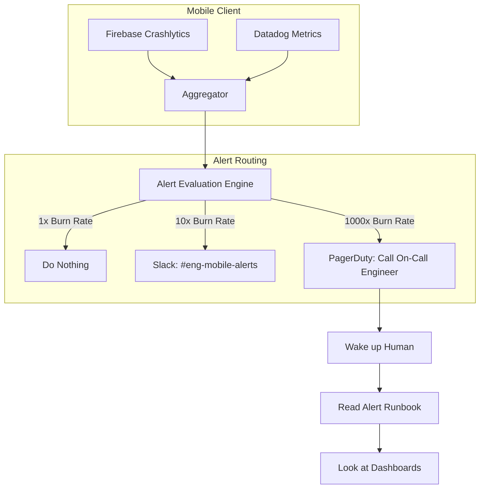
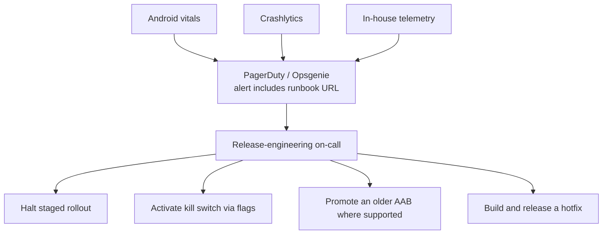

# Alerting

## Overview

Alerting is the mechanism that translates the silent data of your Observability spine (Logs, Metrics, SLIs) into active human intervention. It is the system that decides when a computer should interrupt a human's life (via Slack, email, or a 3:00 AM PagerDuty phone call) because the software is failing.

## Why It Matters

A dashboard with 50 beautiful charts showing a catastrophic system failure is completely useless if no one is looking at it. Human attention is the most expensive resource in engineering. You cannot pay engineers to stare at dashboards 24/7. Alerting automates the surveillance. 

However, poor alerting destroys engineering teams. "Alert Fatigue"—where engineers are bombarded with hundreds of useless, non-actionable emails every day—causes them to start ignoring alerts. When a real, catastrophic alert finally fires, it is ignored alongside the garbage, and the business suffers massive downtime.

## Historical Context

In the 2010s, alerting was often "Cause-Based" (e.g., "Alert if CPU > 90%"). This generated massive amounts of noise because a server can run at 95% CPU perfectly fine without affecting the user. Modern SRE practices mandate "Symptom-Based" alerting (e.g., "Alert if Checkout Success Rate drops below 95%"). You only alert on the *symptoms* the user feels, and you use the *causes* (CPU, Logs) to debug the issue once you are awake.

## First Principles

1.  **Actionable:** Every single alert must require a human to take a specific action. If an alert fires and the engineer just says "Oh, that's normal," the alert must be deleted.
2.  **Symptom-Based:** Alert on the user's pain (SLIs/SLOs), not on internal system states.
3.  **Severity Routing:** Not all alerts are equal. A minor dip in performance should be a Slack message during business hours. A complete outage should be a PagerDuty call at 3:00 AM.

## Mental Model

Think of a home security system.
- **Cause-Based (Bad Alerting):** An alert goes off every time the wind blows hard, a car drives by, or a squirrel walks on the roof. You start ignoring the alarm. When a burglar breaks in, you assume it's just a squirrel and go back to sleep.
- **Symptom-Based (Good Alerting):** The alarm only goes off if a window shatters or a door is kicked in. It is silent for years. But when it finally rings, you immediately jump out of bed and take action because you know it is real.

## Internal Mechanics

Building a robust alerting system requires math, specifically "Burn Rate" math tied to [Error Budgets](error-budgets.md).

### The Anti-Pattern: Static Thresholds

```sql
// BAD: Alert if Crash Rate > 2% in the last 5 minutes
SELECT crash_rate FROM metrics WHERE window = '5m' > 0.02
```
*Why this fails:* If you launch an app update to 1% of your users at 2:00 AM, and 10 of those users crash immediately, the rate for that 5-minute window might spike to 50%. The on-call engineer is woken up, but only 10 users were affected. The absolute volume doesn't justify a page.

### The Standard: Burn Rate Alerting

Instead of looking at static thresholds, you look at how fast you are burning your monthly Error Budget.

- **1x Burn Rate:** You will consume exactly 100% of your budget over the 30-day window. (Everything is fine).
- **10x Burn Rate:** You will consume the entire 30-day budget in 3 days. (This is a problem, but not a "wake me up" problem. Send a Slack message/Jira ticket for the morning).
- **1000x Burn Rate:** You will consume the entire 30-day budget in 45 minutes. (This is a catastrophe. Wake the engineer up NOW).

**The Calculation:**
If your SLO is 99.9%, your allowed error rate is 0.1%.
If your *current* error rate over the last hour is 10%, your burn rate is:
$10\% / 0.1\% = 100\text{x Burn Rate}$.

## Architecture



## Production Example

**The Alert Runbook**

An alert without a Runbook is just noise. A Runbook is a step-by-step instruction manual attached to the alert that tells the panicked, sleep-deprived engineer exactly what to do.

**Alert Notification via PagerDuty:**
```text
[CRITICAL] Checkout Flow 1000x Burn Rate
Triggered: 03:14 AM
Metric: P95 Checkout Latency > 15 seconds
Runbook: https://wiki.company.com/runbooks/checkout_latency
```

**Inside `checkout_latency.md` (The Runbook):**
1. **Description:** The mobile app is taking longer than 15 seconds to process a checkout. This usually indicates the Payment Gateway is down.
2. **Impact:** Users cannot buy things. Revenue is dropping.
3. **Dashboards to check:** [Link to Datadog Network Dashboard]
4. **Immediate Actions:**
   - Check the Payment Gateway Status page.
   - If the Gateway is down, trigger the `RemoteConfig` kill-switch `disable_checkout_flow = true` to stop users from hanging indefinitely and show a friendly maintenance message.
   - Page the Backend Billing team.
5. **Escalation:** If unresolved in 15 minutes, call the VP of Engineering.

## Tradeoffs

**Advantages**
- **Mental Health:** Good alerting protects engineers from burnout by ensuring they only get interrupted when it actually matters.
- **MTTR (Mean Time To Resolution):** Symptom-based alerts with clear Runbooks drastically reduce the time it takes to fix a production outage.

**Disadvantages**
- **Tuning is Exhausting:** Setting up Burn Rate alerts requires a deep understanding of statistics and constant tuning. If the alert fires falsely twice, engineers lose trust. Tuning out the "false positives" while catching the "true negatives" takes weeks of iteration.
- **The Mobile Rollout Lag:** If an alert fires because of a bug in a new Android release, the only "fix" is to roll back the release in the Play Store. But it will take users days to download the fix. The alert will stay red, and the alarm will keep ringing, for days. (You must build "silencing" mechanisms into your alerting logic).

## Failure Modes

- **Email Alerting:** Sending alerts to an email inbox. Nobody reads automated emails. They set up a Gmail filter to send them to an "Alerts" folder and never look at them. Alerts must go to synchronous channels (Slack, PagerDuty).
- **No Escalation Policy:** Paging an engineer, but the engineer sleeps through their phone ringing. The alert sits unacknowledged for 4 hours. *(Fix: All critical alerts must escalate. If Dev A doesn't answer in 5 minutes, page Dev B. If Dev B doesn't answer, page the Engineering Manager).*
- **"Ghost" Alerts:** An alert that fires, wakes someone up, and resolves itself 2 minutes later before the engineer can even open their laptop. This destroys morale. *(Fix: Ensure the evaluation window is wide enough to smooth out momentary network blips, e.g., require the 1000x burn rate to sustain for 5 minutes before paging).*

## Staff Engineer Thinking

When auditing an on-call rotation, a Staff engineer focuses on the human cost:

1.  **Is this a "Wake Me Up" problem?** If I review the PagerDuty history and see someone was woken up at 4:00 AM because "Image upload is slow," I will downgrade that alert to a Slack message immediately. Image uploads being slow doesn't threaten the survival of the business. Let them sleep.
2.  **Every Alert Needs a Runbook.** I reject any PR that creates a new Datadog Monitor if it doesn't include a URL to a Runbook.
3.  **Are we playing Whack-a-Mole?** If the same alert fires every Tuesday at 10:00 AM, engineers will start ignoring it. I will assign a sprint task to either fix the underlying architectural bug causing the spike, or adjust the alert thresholds so it stops firing.

## Common Misconceptions

- **"We need to alert on everything that breaks."** No. You only alert on things that break your *SLOs*. If a background sync job fails, but it has a built-in retry mechanism that eventually succeeds 3 hours later without the user ever noticing, you absolutely should not alert on it.
- **"The On-Call engineer's job is to fix the bug."** Rarely true. At 3:00 AM, the On-Call engineer's job is to *mitigate the impact* (e.g., flip a feature flag, roll back a release, route traffic to a fallback server). The actual root-cause code fix happens the next day during normal business hours.

## Probing Questions

1.  Explain the concept of "Alert Fatigue" and how it endangers the reliability of a software system.
2.  What is the difference between "Cause-Based" alerting and "Symptom-Based" alerting? Give an Android example of each.
3.  Why is setting a static percentage threshold (e.g., "Alert if error rate > 5%") often inferior to "Burn Rate" alerting?
4.  Describe the purpose of an Alert Runbook. What are the key components it must contain?
5.  Why should automated alerts never be routed to an email inbox?
6.  Explain the concept of an "Escalation Policy" in a tool like PagerDuty.
7.  How does the slow rollout and update cycle of Mobile applications complicate the resolution and silencing of production alerts?
8.  Why is it crucial to distinguish between an alert that requires a Slack message vs an alert that requires a 3:00 AM phone call? What criteria do you use to decide?
9.  If an alert fires, wakes an engineer up, and resolves itself 2 minutes later, what architectural changes should you make to the alert definition?
10. If an engineer is paged at 2:00 AM because a feature is crashing, what is usually their primary goal: fixing the code bug, or mitigating the user impact (e.g., via Remote Config)?

## Mobile Implementation (Android)

Mobile alerts have a different shape than server alerts because the mitigation toolbox is different. You can't restart a server; you can flip a flag, halt a rollout, or hotfix-and-wait.



Concrete alert configs that matter:

| Alert | Source | Threshold | First action |
|---|---|---|---|
| Crash rate spike | Vitals/Crashlytics | > baseline + 0.5pp | Halt rollout |
| ANR rate spike | Vitals | > 0.30% sessions | Halt + investigate stack traces |
| Critical-flow drop | Custom (checkout success) | > 2pp drop vs prev version | Flip flag if isolable feature |
| Network 5xx spike (BFF) | RUM | > 3% over 5 min | Coordinate with BFF on-call |
| Cohort-specific crash | Cohort-filtered Vitals | Samsung A series > 5% crash | Cohort kill switch |
| Slow start regression | Vitals | p95 > 1.5x baseline | Hold rollout; not page-worthy |
| Pin expiration ≤ 30 days | Build-time check | (calendar) | Schedule release |
| Play distribution paused | Play API | Status changed | Investigate Console |

```yaml
# Datadog monitor (or Grafana alert) for crash regression
name: "Android crash rate regression — v2.0.0 production"
type: metric alert
query: |
  avg(last_30m):
    avg:android.crash_free_users.rate{version:2.0.0, env:production}
  < 0.99
message: |
  Crash-free users below 99% for v2.0.0 production rollout.

  Runbook: https://wiki/runbooks/android-crash-regression
  Halt: https://github.com/example/app/actions/workflows/halt.yml
  Slack: #android-release
  PagerDuty: android-releng-oncall

  @pagerduty-android-releng-oncall
tags:
  - team:android-platform
  - severity:high
options:
  thresholds:
    critical: 0.99
    warning: 0.995
  evaluation_delay: 60
```

Mobile-distinct:

1. **No instant rollback.** Halting a Play rollout stops *new* installs of the bad version; existing affected users stay broken until the hotfix ships. Always pair "halt" with "kill switch" — server-side disable of the offending feature.
2. **Alert latency tolerance.** Vitals data lags by 6-24h. Your in-house telemetry is faster but smaller sample size. Alert on the union; investigate with both.
3. **Cohort alerts.** A 95% crash-free rate globally hides a 70% on Samsung A series. Define cohort-specific alerts for the top 5 OEM-API combinations.
4. **Don't alert on cold-start regressions like crashes.** Slow start is "hold," not "page." Page only on user-perceived outage.
5. **Auto-resolve.** When the rollout halts and the next refresh shows healthy, auto-resolve the alert. Don't make on-call hunt for the silence button.

## Answer Key

1. **Explain the concept of "Alert Fatigue" and how it endangers the reliability of a software system.**
   It occurs when engineers receive too many noisy, unactionable alerts, causing them to ignore all alerts, including critical ones during real outages.
2. **What is the difference between "Cause-Based" alerting and "Symptom-Based" alerting? Give an Android example of each.**
   Cause-based alerts on internal state (e.g., CPU > 90%), while symptom-based alerts on user pain (e.g., checkout success drops below 95%).
3. **Why is setting a static percentage threshold (e.g., "Alert if error rate > 5%") often inferior to "Burn Rate" alerting?**
   Static thresholds trigger false positives on small sample sizes (e.g., during off-hours), whereas Burn Rate looks at the speed of consuming the error budget over time.
4. **Describe the purpose of an Alert Runbook. What are the key components it must contain?**
   A runbook provides immediate, actionable steps to mitigate an issue; it should contain the description, impact, relevant dashboards, immediate mitigation actions, and escalation steps.
5. **Why should automated alerts never be routed to an email inbox?**
   Emails are asynchronous, often ignored or filtered, and fail to immediately grab an on-call engineer's attention like PagerDuty or Slack.
6. **Explain the concept of an "Escalation Policy" in a tool like PagerDuty.**
   It automatically routes an unacknowledged alert to the next engineer or manager in the chain if the primary on-call doesn't respond within a set timeframe.
7. **How does the slow rollout and update cycle of Mobile applications complicate the resolution and silencing of production alerts?**
   Because a bug remains on user devices until they download a hotfix, an alert will fire for days unless you build custom silencing or kill-switch mechanisms.
8. **Why is it crucial to distinguish between an alert that requires a Slack message vs an alert that requires a 3:00 AM phone call? What criteria do you use to decide?**
   It prevents burnout; only issues directly impacting critical user journeys or significant revenue (e.g., 1000x burn rate) warrant waking an engineer up.
9. **If an alert fires, wakes an engineer up, and resolves itself 2 minutes later, what architectural changes should you make to the alert definition?**
   Widen the evaluation window to require the failure to sustain for a longer period (e.g., 5 minutes) to filter out transient network blips.
10. **If an engineer is paged at 2:00 AM because a feature is crashing, what is usually their primary goal: fixing the code bug, or mitigating the user impact (e.g., via Remote Config)?**
    The primary goal is immediate mitigation (e.g., halting rollout, flipping a kill switch), leaving the root-cause code fix for normal business hours.

## Further Reading

- [`error-budgets.md`](error-budgets.md) — The math that determines when an alert should fire (Burn Rates).
- [`dashboards.md`](dashboards.md) — Where the engineer goes after reading the Runbook to visualize the outage.
- [Google SRE: Alerting on SLOs](https://sre.google/workbook/alerting-on-slos/) — multi-window burn rate alerts.
- [`release-engineering/crash-rate-gating.md`](../release-engineering/crash-rate-gating.md) — automated halt on regression.
- [`release-engineering/kill-switches.md`](../release-engineering/kill-switches.md) — server-side mitigation.
