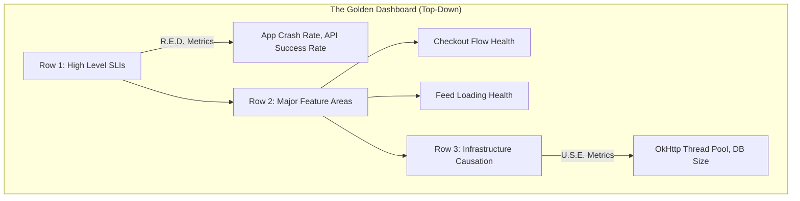

# Dashboards

## Overview

Dashboards are the visual interface of your observability system. They aggregate raw [Metrics](metrics.md) and [Logs](logging.md) into graphs, heatmaps, and tables. 

If Alerting tells you *that* you have a problem, the Dashboard is the very first tool you use to figure out the *blast radius* (who is affected) and the *vector* (what changed).

## Why It Matters

During a severe production incident at 3:00 AM, cognitive function drops significantly. You cannot expect a panicked engineer to write complex SQL queries from scratch to find a bug. Dashboards pre-compute and visually organize the most critical questions a human needs answered during an outage. A well-designed dashboard reduces Mean Time To Resolution (MTTR) by immediately drawing the eye to the anomaly.

## Historical Context

Early operations centers used literal physical monitors displaying static graphs (NOCs - Network Operations Centers). As systems became dynamic and cloud-native, tools like Grafana, Datadog, and New Relic allowed software engineers to define dashboards as code (Infrastructure as Code) and build highly interactive, dimensional visualizations that can be filtered on the fly (e.g., "Show me this graph, but only for Android 14 users on AT&T").

## First Principles

1.  **Glanceability:** You should be able to look at a dashboard and know within 5 seconds if the system is healthy or burning to the ground.
2.  **Top-Down Hierarchy:** The top of the dashboard shows the macroscopic user experience ([SLIs](slis.md)). As you scroll down, the graphs should become more granular, showing internal system causes (CPU, Cache Misses).
3.  **Correlation over Isolation:** A graph showing "Network Errors" is useful. A dashboard that overlays "Network Errors" directly on top of "App Releases" is a superpower.

## Mental Model

Think of a car's dashboard.
- **The Warning Light (The Alert):** The "Check Engine" light turns on.
- **The Top-Level SLI (The Speedometer & Gas Gauge):** You look at the big dials. Am I moving? Do I have fuel? This tells you if the car is currently fulfilling its primary purpose (driving).
- **The Deep Dive (The OBD-II Scanner):** The mechanic plugs in a tool to look at granular metrics (oxygen sensor voltage, spark plug timing) to find out *why* the check engine light is on.

## Internal Mechanics

Building a good dashboard requires curating the right types of visualizations.

### The USE Method (For Resources)
Used for tracking internal systems (like SQLite databases or thread pools).
- **U**tilization: What percentage of the resource is busy? (e.g., Thread pool is 80% full).
- **S**aturation: How much work is queued up waiting? (e.g., 50 coroutines waiting for a thread).
- **E**rrors: How many operations failed?

### The RED Method (For Services)
Used for tracking the User's experience (APIs, UI rendering).
- **R**ate: How many requests per second? (e.g., 500 Checkouts / sec).
- **E**rrors: How many are failing? (e.g., 5 Checkouts failing / sec).
- **D**uration: How long are they taking? (e.g., P95 Checkout is 2.5s).

## Architecture



## Production Example

**The Mobile Release Dashboard**

Because mobile releases roll out slowly (unlike backend web deployments), you need a specific dashboard to compare versions.

A standard Mobile Release Dashboard in Datadog/Grafana has a global variable at the top: `$app_version`. 

When an alert fires, the engineer goes to the dashboard. They see the "Crash Rate" graph spiking. They filter the dashboard to `$app_version = 2.4.1`. The graph is a flat red line (100% crashing). They filter to `$app_version = 2.4.0`. The graph is perfectly healthy. 

*Conclusion:* The new release is broken. Halt the rollout in the Play Store immediately. This took 15 seconds to determine.

## Tradeoffs

**Advantages**
- **Democratization of Data:** Dashboards allow Product Managers and Customer Support to see the health of the app without needing to know how to write PromQL or Elasticsearch queries.
- **Pattern Recognition:** Human brains are incredible at spotting visual anomalies in line graphs (e.g., a sudden drop in traffic exactly at midnight).

**Disadvantages**
- **Dashboard Rot:** A team creates 50 dashboards. Over a year, APIs change and metrics are renamed. 40 of those dashboards are now showing blank graphs or lying. When an incident occurs, nobody knows which dashboard is the "source of truth."
- **Confirmation Bias:** If you suspect the network is the problem, and you only look at the Network Dashboard, you will find something that looks weird. You might completely miss that the real issue is an OutOfMemory error because that graph is on a different page.

## Failure Modes

- **The "Wall of Dials" Anti-pattern:** A dashboard with 100 tiny graphs packed onto one screen. It is completely unreadable. It induces cognitive overload. *(Fix: Group graphs into collapsible rows. Use the Top-Down Hierarchy).*
- **Averaging Percentiles (Again):** A graph labeled "Average Latency." As covered in [Metrics](metrics.md), averages hide the pain of your slowest users. Dashboards should visualize the P50 (Median), P90, and P99 lines on the same graph to show the distribution spread.
- **Missing Annotations:** A massive spike in traffic appears on a Thursday. Was it a marketing push? A DDoS attack? A feature rollout? *(Fix: Observability tools allow you to automatically draw vertical lines on graphs when CI/CD completes a deployment. Correlation is instantaneous).*

## Staff Engineer Thinking

When reviewing observability posture, a Staff engineer focuses on curation and lifecycle:

1.  **Which one is the "Golden" dashboard?** If a new hire joins the team, what is the single URL they should bookmark to know if the mobile app is healthy? There must be *one* officially maintained Golden Dashboard. All others are scratchpads.
2.  **Dashboard as Code.** I forbid creating critical dashboards by clicking around in the Datadog UI. Dashboards must be defined in Terraform or JSON, reviewed in a Pull Request, and checked into Git. If the vendor deletes our account, we must be able to recreate the dashboards instantly.
3.  **The "Kill it with Fire" policy.** If a dashboard hasn't been viewed by a human in 90 days, I set up an automated script to delete it. Dashboard rot is a massive liability during an incident.

## Common Misconceptions

- **"I need a dashboard to catch bugs."** Dashboards do not catch bugs; Alerting catches bugs. Dashboards are for *investigating* the bug after the alert wakes you up. Staring at dashboards waiting for lines to wiggle is an anti-pattern.
- **"More data on the screen is better."** False. White space and grouping are critical. If a graph is green 99.9% of the time and never helps during an incident, remove it from the Golden Dashboard. Move it to a secondary "Deep Dive" dashboard.

## Probing Questions

1.  Explain the principle of "Glanceability" and why it is critical for a dashboard used during a 3:00 AM outage.
2.  Describe the "Top-Down Hierarchy" of a well-designed observability dashboard.
3.  What is the RED Method, and what are the three metrics it tracks for a given service?
4.  Why is a dedicated "Release Dashboard" (filtered by app version) particularly important for mobile applications compared to backend web applications?
5.  Explain the danger of "Dashboard Rot" and how "Dashboard as Code" (Infrastructure as Code) helps mitigate it.
6.  Why is an "Average Latency" graph considered an anti-pattern? What should you visualize instead?
7.  How do deployment annotations (vertical lines indicating when code was shipped) aid in root-cause analysis?
8.  What is the difference between the primary function of an Alert and the primary function of a Dashboard?
9.  Why should a Staff Engineer aggressively delete dashboards that haven't been viewed recently?
10. Describe the visual layout differences between a dashboard designed for an Executive (Product/Business) vs a dashboard designed for an On-Call Engineer.

## Mobile Implementation (Android)

The dashboards a mobile release manager actually lives in:

| Dashboard | Source | What it answers |
|---|---|---|
| **Play Console — Android Vitals** | Play | Crash rate, ANR rate, slow start, slow render — per version |
| **Play Console — Statistics** | Play | Installs/uninstalls, country, device, retention — per version |
| **Firebase Crashlytics** | Crashlytics | Crash detail, affected devices, stack traces |
| **Firebase Performance** | Performance Monitoring | Trace breakdown, network latency, screen rendering |
| **Custom Grafana via BigQuery export** | Crashlytics + Analytics BQ | Cohort-sliced views (country, OEM, device tier, version) |
| **In-house telemetry RUM** | Your SDK | Domain SLIs (checkout success, sync latency, custom flows) |
| **PagerDuty / OpsGenie** | Wired alerts | Active incidents + current rollout posture |

Each one answers a specific question:

```
"Are we shipping safely right now?"        → Vitals (crash, ANR per version)
"What broke in v2.0.1?"                    → Crashlytics issue list, filtered to version
"Which devices are crashing the most?"     → BQ + Grafana, OEM cohort breakdown
"Did our checkout flow regress?"           → Custom dashboard for `sli.checkout.*`
"Why is the feed slow today?"              → Firebase Performance, network trace breakdown
"Is the rollout fraction climbing?"        → Play Console Statistics
```

Mobile-distinct dashboarding principles:

1. **Per-version, always.** Aggregating across versions hides regressions in new releases. Default every panel to "by versionCode."
2. **Cohort by what you can't control.** Country, OEM, API level, device tier, network class. These are the dimensions Vitals can't (or won't) slice for you.
3. **One dashboard per role.** Release manager wants rollout + crash gates; on-call wants alerts + service health; feature owner wants their flow's metrics. Don't make everyone hunt.
4. **No averages.** P50/P95/P99 only. The mean of (1ms, 1ms, 60s) is comforting and wrong.
5. **Day-of-week and time-of-day.** Mobile traffic is cyclical. A baseline that doesn't show 7d-over-7d comparison misleads.
6. **Link to runbooks.** Every alert chart links to the runbook for "what to do at 3 AM when this fires."

## Further Reading

- [`alerting.md`](alerting.md) — The system that drives humans to look at the dashboard.
- [`metrics.md`](metrics.md) — The raw numerical data that powers the graphs.
- [The RED Method (Weaveworks)](https://www.weave.works/blog/the-red-method-key-metrics-for-microservices-architecture/)
